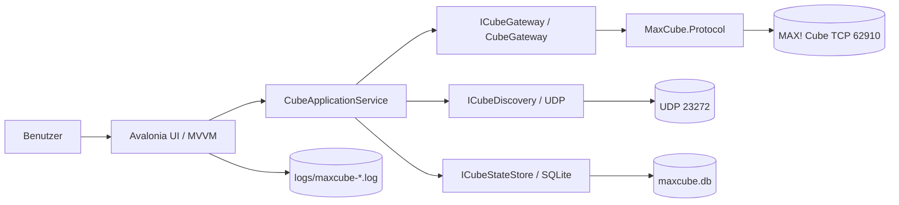

# xplat-maxcube

> Cross-platform MAX! Cube desktop application for Windows and Linux.

[](https://github.com/Ebenhoeh80/xplat-maxcube/actions/workflows/ci.yml)
[](https://github.com/Ebenhoeh80/xplat-maxcube/actions/workflows/release.yml)
[](LICENSE)
[](https://github.com/sponsors/Ebenhoeh80)

[English](README.md) | [Deutsch](README.de.md)

---

Lokale C#/.NET-10-Desktopanwendung für den eQ-3 MAX! Cube. Sie ersetzt die lokale Steuerung der ehemaligen MAX! Local Application – **ohne Java, Browser, Jetty, Cloud, HTTPS-Update-Check oder Administratorrechte**. Der Cube bleibt Source of Truth; SQLite ist nur Cache, Einstellungsspeicher und Audit-Log (`src/MaxCube.Infrastructure/Persistence/SqliteStateStore.cs:8-13`).

Version **0.6.0** (`Directory.Build.props:3`), Stand **25.11.2026**. Siehe [CHANGELOG.md](CHANGELOG.md).

> **FAKT (Nutzerhinweis 25.11.2026, nicht extern verifiziert):** eQ-3 hat die MAX!-Cloud-Steuerung abgeschaltet und die Cloud-App aus den App-Stores entfernt. Fernzugriff, Produktkonto, Proxy und App-Update bleiben daher bewusst ausgeschlossen (`docs/features.md:34-36`).

## Inhalt

- [Installation](#installation)
- [Verwendung](#verwendung)
- [Screenshots](#screenshots)
- [Entwicklung](#entwicklung)
- [Architektur](#architektur)
- [Grenzen und bewusste Ausschlüsse](#grenzen-und-bewusste-ausschüsse)
- [Verifikationsstand](#verifikationsstand)
- [Dokumentation](#dokumentation)
- [Projekt unterstützen](#projekt-unterstützen)
- [Mitmachen und Lizenz](#mitmachen-und-lizenz)

## Installation

### Fertige Pakete (empfohlen)

Unter [Releases](https://github.com/Ebenhoeh80/xplat-maxcube/releases) liegen selbstständige Pakete für `win-x64` und `linux-x64` (self-contained, kein .NET-SDK nötig). Die Archive werden bei jedem `v*`-[Tag](https://github.com/Ebenhoeh80/xplat-maxcube/tags) automatisch von GitHub Actions gebaut, mit dem fensterlosen Selbsttest geprüft und an das Release angehängt.

- **Windows:** ZIP entpacken, `MaxCube.UI.Desktop.exe` starten.
- **Linux:** ZIP entpacken, `chmod +x MaxCube.UI.Desktop`, danach `./MaxCube.UI.Desktop`. Für die Oberfläche sind X11 oder Wayland nötig.

### Aus Quellen bauen

Voraussetzung: **.NET 10 SDK**.

```powershell
git clone https://github.com/Ebenhoeh80/xplat-maxcube.git
cd xplat-maxcube
.\start.cmd
```

```bash
git clone https://github.com/Ebenhoeh80/xplat-maxcube.git
cd xplat-maxcube
bash start.sh
```

`start.cmd` und `start.sh` suchen ein .NET-10-SDK, bauen inkrementell und starten die Desktop-App (`start.cmd:8-43`, `start.sh:8-35`). `start.sh` setzt bei fehlendem `libicuuc` automatisch `DOTNET_SYSTEM_GLOBALIZATION_INVARIANT=1`.

### Fensterloser Selbsttest

```powershell
dotnet test MaxCube.slnx
dotnet src/MaxCube.UI.Desktop/bin/Debug/net10.0/MaxCube.UI.Desktop.dll --selfcheck
```

Der Selbsttest baut Pfade, SQLite, Gateway, Service, ViewModel und Lokalisierung, prüft Instanzschutz und die sechs Sprachen. Er kontaktiert **keinen** Cube und sendet **keinen** Broadcast (`src/MaxCube.UI.Desktop/Program.cs:26-92`).

Der Datenordner ist `%LOCALAPPDATA%\MaxCube` unter Windows bzw. `$XDG_DATA_HOME/MaxCube` (Standard `~/.local/share/MaxCube`) unter Linux. `MAXCUBE_DATA_DIR` verschiebt ihn für portablen Betrieb (`AppPaths.cs:3-10`).

## Verwendung

1. **Cube verbinden:** Entweder den gespeicherten Endpoint verwenden oder **Cube suchen**. Der UDP-Broadcast wird ausschließlich auf diese Benutzeraktion hin gesendet, niemals beim App-Start (`UdpDiscoveryTransport.cs`). Der lokale UDP-Port ist `23272`; die eigentliche Steuerungsverbindung läuft über TCP `host:62910`.
2. **Räume und Geräte:** Räume, Ist-/Solltemperaturen und Gerätestatus werden aus dem Cube gelesen. Modi Auto/Permanent/Temporary sowie ECO/COMFORT und Haussteuerung sind verfügbar.
3. **Wochenprofile:** Bis zu 13 Schaltpunkte pro Tag, grafische Tagesleiste, Schnellbearbeitung im 0,5-°C-/5-Minuten-Raster und Kopieren auf andere Räume.
4. **Administration:** Raumkonfiguration, Boost/Entkalkung/Ventil, Wandthermostat-Anzeige, Tasterkonfiguration, Anlernen, Gerätezuordnung, Strukturpflege, Uhrzeit/Zeitzone/NTP und UDP-Netzwerkkonfiguration.
5. **Diagnose:** Funkauslastung aus dem `S:`-Sendestatus, lokaler Fehlerbericht und Fehlercode-Katalog `MAX0001`–`MAX1051`. Es wird nichts nach außen gesendet.
6. **Datenherkunft:** Jeder Bereich zeigt „nicht vom Cube gelesen“, „Cache vom …“, „Live …“ oder „veraltet“ mit Uhrzeit. Der Cube-Reiter liest beim Aktivieren automatisch, wenn eine Verbindung besteht. Ungelesene Platzhalter (z. B. im Wochenprofil) sind nicht sendbar.
7. **Statusleiste:** Verbindung, Host/Port, Datenherkunft, letzte Aktion mit Uhrzeit und Protokollstatus bleiben dauerhaft sichtbar – mit Symbol **und** Text.
8. **Diagnoseprotokoll:** In den Einstellungen oder der Statusleiste opt-in einschalten (Standard aus). Der Viewer im Reiter „Status“ zeigt die letzten Einträge; der ZIP-Export entsteht nur auf Klick und bleibt im Datenordner. Er kann IP-Adressen, Seriennummern und Raumwerte enthalten – vor der Weitergabe prüfen.
9. **Über:** Autor, MIT-Lizenz und GitHub-Link; ausdrücklich inoffiziell und nicht von eQ-3. Der Link öffnet erst nach Benutzerklick.

Alle Cube-Schreibzugriffe erfordern eine ausdrückliche Bestätigung in der Oberfläche **und** eine tatsächlich gelesene Ausgangsbasis; `Stale` und Offline sperren das Senden. Cache-Werte sind nur offline schreibbar: Bei bestehender Verbindung werden sie nie auf den Cube zurückgeschrieben (`src/MaxCube.UI/ViewModels/MainWindowViewModel.cs:280`). Der Normalbetrieb ist lesend; die SQLite-Datenbank ist ausschließlich Cache und Audit-Log.

## Screenshots

Noch keine Screenshots veröffentlicht. Die Oberfläche ist eine native Avalonia-Desktopanwendung mit Hauptfenster (Räume/Geräte), Wochenprofil-Editor und Admin-Dialogen; die geplante Gestaltung ist in [`docs/gui-specification.md`](docs/gui-specification.md) beschrieben. Screenshots eines echten Cubes werden in einem Folge-Release ergänzt.

## Entwicklung

```powershell
dotnet restore MaxCube.slnx
dotnet build MaxCube.slnx --nologo
dotnet test MaxCube.slnx --nologo
```

```bash
dotnet restore MaxCube.slnx
dotnet build MaxCube.slnx --nologo
dotnet test MaxCube.slnx --nologo
```

Die Solution enthält die Projekte `Domain`, `Application`, `Protocol`, `Infrastructure`, `UI`, `UI.Desktop` und die zugehörigen Testprojekte. Der CI-Workflow [`.github/workflows/ci.yml`](.github/workflows/ci.yml) baut und testet auf `ubuntu-latest` und `windows-latest` und fährt zusätzlich den fensterlosen Selbsttest.

**Wichtige Konventionen:**

- Aussagen über das Protokoll werden als `FAKT`, `BEOBACHTUNG`, `INFERENZ` oder `UNBEKANNT` mit Beleg `Datei:Zeile` markiert. Hardwarebelege stehen in [`docs/HARDWARE-VERIFY.md`](docs/HARDWARE-VERIFY.md).
- Der Cube ist Source of Truth. Neue Schreibformate nie ohne kontrollierte Rücksetzung testen; echte Hardwaretests nur mit freigegebener Gegenstelle.
- Die Reverse-Engineering-Eingaben (`decompiled/`, `extracted/`, `evidence/`) sind **nicht** Teil dieses Repos. Nur unsere eigenen Auswertungen unter `docs/` sind quelloffen. Details: [`docs/INDEX.md`](docs/INDEX.md).
- Keine Cloud-, HTTP- oder Update-Abhängigkeiten ergänzen.

Weitere Hinweise: [`docs/DEVELOPMENT.md`](docs/DEVELOPMENT.md) und [CONTRIBUTING.md](CONTRIBUTING.md).

## Architektur



Details: [Architektur](docs/ARCHITECTURE.md), [API](docs/API.md), [Datenbank](docs/DATABASE.md), [Module](docs/modules.md).

## Grenzen und bewusste Ausschlüsse

| Thema | Status |
|---|---|
| Cloud, Fernzugriff, Produktkonto, Proxy, App-Update | bewusst verworfen (Cloud abgeschaltet) |
| Firmware schreiben | bewusst deaktiviert; nur read-only Versionsprüfung |
| Browser-/Jetty-/AGPL-Abhängigkeit | keine |
| WebSocket-/HTTP-API | keine; `docs/API.md` beschreibt C#-Schnittstellen und das Cube-Wire-Protokoll |
| Golden-Capture der Schreibformate `m:`, `w:`, `v:`, `z:` | `FAKT` (Wire-Format und `A:`-Quittung am Original-Cube), fachliche Gerätewirkung teils `UNBEKANNT` |
| `S:`-Sendestatus | `FAKT`: `S:<dutyHex>,<discarded>,<freeHex>`; Airtime und freie Slots, keine Fehlercodes |
| UDP-Adressreihenfolge | `FAKT`: IP, Gateway, Maske, DNS 1, DNS 2; durch Java-Code und echte `c`-Antwort belegt |
| Drag-and-drop im Wochenprogramm | nicht umgesetzt; Tagesleiste und Schnellbearbeitung vorhanden |
| Linux-Oberfläche auf echtem Desktop, Tray-Verhalten | `UNBEKANNT` (CI prüft fensterlosen Selbsttest) |

## Verifikationsstand

Build **0 Warnungen / 0 Fehler**, **468/468** hardwarefreie Tests grün unter Windows und Debian 13 (WSL2), `--selfcheck` unter beiden Systemen `OK`, self-contained Linux-Paket mit `LANG=de_DE.UTF-8` und `LANG=C` `OK` (`docs/gremium.md:134`, `docs/roadmap.md:460-487`). Diese Ergebnisse sind `BEOBACHTUNG`.

**FAKT (25.11.2026, freigegebene Hardwareprüfung):** Discovery, `0x11` Komfort/Eco, `0x12`, `0x20`–`0x23`, `m:`, `w:`, `v:` und `z:` wurden am Original-Cube `192.168.10.60` gesendet und quittiert; der Cube-Zustand wurde auf die Ursprungswerte 21,5 °C / 16,5 °C zurückgesetzt und nur-lesend bestätigt (`docs/HARDWARE-VERIFY.md`). Die fachliche Annahme durch Thermostate ist nur teilweise per Read-back belegt.

## Dokumentation

| Ziel | Dokument |
|---|---|
| Systemverständnis, Entscheidungen, Risiken | [docs/ARCHITECTURE.md](docs/ARCHITECTURE.md) |
| Setup, Build, Tests, Konventionen | [docs/DEVELOPMENT.md](docs/DEVELOPMENT.md) |
| C#-Schnittstellen und Cube-Wire-Protokoll | [docs/API.md](docs/API.md) |
| SQLite-Schema, Migration, Datenflüsse | [docs/DATABASE.md](docs/DATABASE.md) |
| Netzwerk, CI, Pakete | [docs/OPERATIONS.md](docs/OPERATIONS.md) |
| Auth, Secrets, Datenschutz | [docs/SECURITY.md](docs/SECURITY.md) |
| Fehlerbilder und Diagnose | [docs/TROUBLESHOOTING.md](docs/TROUBLESHOOTING.md) |
| Start/Stopp/Update/Wartung | [docs/RUNBOOK.md](docs/RUNBOOK.md) |
| Wiki-Auszug, FAQ, Lessons Learned, ADRs | [docs/SECOND_BRAIN.md](docs/SECOND_BRAIN.md) |
| Hardwareprüfung am Original-Cube | [docs/HARDWARE-VERIFY.md](docs/HARDWARE-VERIFY.md) |
| Reverse-Engineering-Quellen und Gremium | [docs/INDEX.md](docs/INDEX.md), [docs/features.md](docs/features.md), [docs/gremium.md](docs/gremium.md) |

## ❤️ Support this project

<div align="center">

**Ich entwickle und pflege dieses Projekt in meiner Freizeit und trage die laufenden Kosten selbst – meine Zeit, Strom, Werkzeuge und IT-Ausstattung.**

Sponsoring ist freiwillig und begründet keinen Anspruch auf Support, Funktionen oder Antwortzeiten. Jeder Beitrag, egal wie klein, hilft. Vielen Dank! 🙏

<a href="https://github.com/sponsors/Ebenhoeh80">
  
</a>
<a href="https://www.paypal.com/pool/9p84qTHCFr?sr=wccr">
  
</a>
<a href="https://buymeacoffee.com/daneben">
  
</a>

</div>

## Mitmachen und Lizenz

Beiträge sind willkommen – siehe [CONTRIBUTING.md](CONTRIBUTING.md). Bitte keine Cloud-Funktionen, kein Firmware-Schreiben und keine unbestätigten Cube-Schreibzugriffe ergänzen.

Veröffentlicht unter der [MIT-Lizenz](LICENSE). Die dekompilierten und extrahierten Artefakte der eQ-3 MAX! Local Application sind ausdrücklich **nicht** Bestandteil dieses Repos und unterliegen weiterhin ihren ursprünglichen Lizenzbedingungen.
