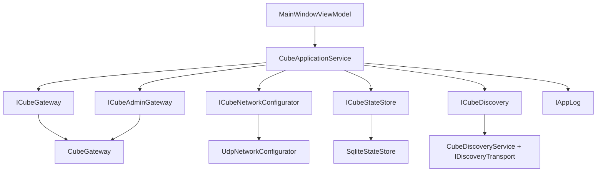
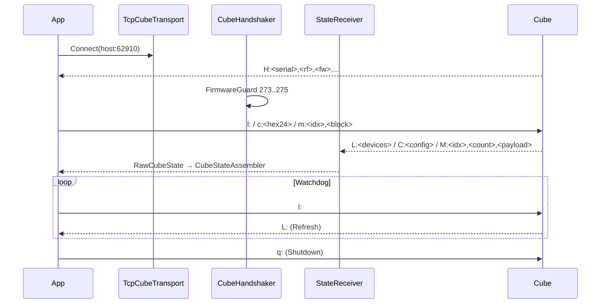

# API – MAX! Cube Local App

> Stand 25.11.2026. Diese App hat **keine HTTP-API**. Die „API“ besteht aus (1) lokalen C#-Schnittstellen für die Desktopanwendung und (2) dem Cube-Wire-Protokoll über TCP/UDP. Belege als `Datei:Zeile`; Kennzeichnung wie in [INDEX.md](INDEX.md).

## 0. Wichtige Feststellung: keine REST-Endpunkte

**FAKT:** Es gibt keinen HTTP-Server, keine REST-/DWR-/Jetty-/Browser-Schnittstelle und keinen Update-Endpunkt in der C#-App.

| Prüfung | Ergebnis | Beleg |
|---|---|---|
| Projekt-Typ | `Microsoft.NET.Sdk`, `OutputType=WinExe`; kein `Microsoft.NET.Sdk.Web` | `src/MaxCube.UI.Desktop/MaxCube.UI.Desktop.csproj:1-13` |
| Einstieg | `BuildAvaloniaApp().StartWithClassicDesktopLifetime(args)` oder `--selfcheck` | `Program.cs:13-24` |
| Composition Root | nur Clock, Version, Log, Gateway, Store, Discovery, Service, Localizer, ViewModel, Window | `Composition.cs:18-47` |
| Volltextsuche `src/` | keine Treffer für `WebApplication`, `MapGet`, `MapPost`, `IActionResult`, `ApiController`, `ControllerBase`, `HttpListener`, `TcpListener`, `Kestrel` | `BEOBACHTUNG`, Inventur 25.11.2026 |
| Einzige Netzwerkprimitive | `UdpClient` in Discovery/Netzwerk, `TcpClient` im Transport | `UdpDiscoveryTransport.cs:23`, `UdpNetworkConfigurator.cs:52`, `TcpCubeTransport.cs:35` |
| Original-HTTP-Fläche | `/dwr/*`, `/controller/*`, `*.html`, Port 63121 – **nicht übernommen** | `docs/architecture-rea.md:145-179`, `docs/INDEX.md:99-103` |

Wer einen HTTP-Endpunkt sucht, sucht am falschen Ort. Für Automatisierung steht nur die lokale GUI bzw. der Cube selbst zur Verfügung; ein Fernzugriff ist bewusst verworfen (`docs/features.md:34-36`).

## 1. C#-Anwendungs-API

### 1.1 Überblick



`CubeGateway` implementiert **zugleich** `ICubeGateway` und `ICubeAdminGateway`; die DI gibt beiden Interfaces dasselbe Singleton, damit nur ein Socket, eine Queue und ein Worker existieren (`Composition.cs:27-30`, `CubeGateway.cs:21`).

### 1.2 `ICubeGateway` – Kernzugriff

Datei: `src/MaxCube.Application/Abstractions/ICubeGateway.cs`.

| Element | Signatur / Wert | Zweck und Nebenwirkung | Beleg |
|---|---|---|---|
| Status-Enum | `Disconnected`, `Connecting`, `Connected`, `Faulted` | Verbindungszustand des physischen Cubes | `:9-15` |
| Endpoint | `record CubeEndpoint(string Host, int Port)` | Port **62910** physisch, `54321` nur virtuell | `:17-18` |
| Property | `CubeConnectionState State` | vom Gateway gepflegt | `:26` |
| Event | `StateChanged` | Zustandswechsel | `:28` |
| Event | `CubeRefreshed` | neue Gerätewerte aus `l:`-Refresh, kein Metadatenwechsel | `:30-31` |
| Event | `SessionUnreachable` | Sitzung nach wiederholten Fehlern nicht erreichbar | `:33-34` |
| Methode | `Task<Cube> ConnectAsync(CubeEndpoint, CancellationToken = default)` | TCP, `H:`-Handshake, Firmware-Guard, `L:/C:/M:`, frisches Aggregat; startet Queue und Watchdog | `:36-37`, `CubeGateway.cs:72-116` |
| Methode | `Task SetRoomTemperatureAsync(int roomId, RadioAddress master, Temperature, CancellationToken)` | sendet `0x40` Permanent-Mode | `:39-40`, `CubeGateway.cs:118-120` |
| Methode | `Task SetRoomControlModeAsync(int roomId, RadioAddress master, RoomControlMode, Temperature? setPoint, DateTimeOffset? until, CancellationToken)` | Auto/Permanent/Temporary; Parameter je Modus erforderlich | `:42-48`, `CubeGateway.cs:130-144` |
| Methode | `Task SetWeekDayProfileAsync(int roomId, RadioAddress master, DayProfile, CancellationToken)` | ein oder zwei `0x10`-Telegramme | `:50-52`, `CubeGateway.cs:149-171` |
| Methode | `Task DisconnectAsync(CancellationToken)` | sendet `q:` (zeitbegrenzt), räumt Queue/Watchdog auf | `:54`, `CubeGateway.cs:173-236` |

### 1.3 `ICubeAdminGateway` – Konfiguration, Anlernen, Struktur, Zeit

Datei: `src/MaxCube.Application/Abstractions/ICubeAdminGateway.cs`.

| Methode / Typ | Zweck | Beleg |
|---|---|---|
| `record FoundDevice(DeviceType, int NumericType, RadioAddress, string SerialNumber)` | Gerät aus `N:`-Antwort | `:8-13` |
| `record AirtimeStatus(int DutyCycle, int FreeMemorySlots)` | Funkauslastung aus `S:` | `:15-16` |
| `record RoomConfigurationValues(Comfort, Eco, Maximum, Minimum, double Offset, WindowOpen, int WindowOpenMinutes)` | Frame `0x11` | `:18-26` |
| `record ValveFunctionValues(BoostMinutes, BoostValveAngle, DecalcificationDay, DecalcificationHour, MaxValveRaw, ValveOffsetRaw)` | Frame `0x12` (`INFERENZ`) | `:28-35` |
| Event `AirtimeChanged` | nach jedem erfolgreich gesendeten Radiogramm | `:45-46` |
| `SetRoomConfigurationAsync(...)` | schreibt `0x11` | `:48-49` |
| `SetValveFunctionsAsync(...)` | schreibt `0x12` | `:51-52` |
| `SetDisplayModeAsync(RadioAddress, bool showActualTemperature, ...)` | `0x82`, nur Wandthermostate | `:54-55` |
| `Task<FoundDevice?> SearchNewDeviceAsync(TimeSpan window, ...)` | ein Anlernfenster; `null` = kein Gerät | `:57-58` |
| `EndInclusionAsync(...)` | `x:` beendet Anlernmodus | `:60` |
| `SetGroupAddressAsync(...)` / `RemoveGroupAddressAsync(...)` | `0x22` / `0x23` (`INFERENZ`) | `:62-64` |
| `SetLinkPartnerAsync(..., bool add, ...)` | `0x20` add / `0x21` remove (`INFERENZ`) | `:66-68` |
| `DeleteDevicesAsync(IReadOnlyList<RadioAddress>, bool factoryReset, ...)` | `t:`, 1..255 Adressen | `:70-71` |
| `WriteMetadataAsync(Cube, ...)` | `m:`-Blöcke; nur nach byte-genauer Rundreise des unveränderten Zustands | `:73-77`, `CubeGateway.Admin.cs:99-103` |
| `Task<PushButtonConfiguration> ReadPushButtonAsync(RadioAddress, ...)` | `c:` + Codec | `:79-80` |
| `SetPushButtonAsync(RadioAddress, PushButtonConfiguration, ...)` | `w:`, genau 66 Byte | `:82-83` |
| `Task<TimeZoneConfiguration> ReadTimeZoneAsync(RadioAddress, ...)` | `c:` + Codec | `:85-86` |
| `SetTimeZoneAsync(RadioAddress, TimeZoneConfiguration, DateTimeOffset? setTimeUtc, ...)` | `v:`; mit Zeit zusätzlich Cube-Zeit (`INFERENZ`: Unix-Sekunden) | `:88-93`, `CubeApplicationService.Admin.cs:734-747` |
| `Task<string> QueryNtpServersAsync(...)` | `f:` → rohe `F:`-Antwort; Format `UNBEKANNT` | `:95`, `MainWindowViewModel.Cube.cs:122` |
| `SetNtpServersAsync(IReadOnlyList<string>, ...)` | ein oder zwei Server, `f:` → `F:` | `:97` |

**Hinweis:** `SetTimeZoneAsync` schreibt die Zeitzone; `CubeApplicationService.SetCubeTimeAsync` liest sie und sendet sie mit `_clock.Now.ToUniversalTime()` erneut (`CubeApplicationService.Admin.cs:734-747`). Der Datums-/Zeitanteil ist `INFERENZ`.

### 1.4 `ICubeNetworkConfigurator` – UDP-Konfiguration

Datei: `ICubeAdminGateway.cs:100-108`.

| Methode | Verhalten | Beleg |
|---|---|---|
| `Task<CubeNetworkConfiguration> ReadAsync(string serialNumber, string ipAddress, ...)` | UDP-Unicast Port 23272, Opcode `c`,Antwort `C`, 2 s × max. 5 Versuche, Antwort muss von gleicher IP kommen | `:103-104`, `UdpNetworkConfigurator.cs:13-18,43-82` |
| `Task WriteAsync(string serialNumber, string ipAddress, CubeNetworkConfiguration, ...)` | liest zuerst, übernimmt Bytes hinter dem DHCP-Flag, schreibt `C`; **keine** Firmware-Operation | `:106-108`, `UdpNetworkConfigurator.cs:31-41`, `CubeUdpCodec.cs:12` |

Das Schreiben ist nur nach Bestätigung erlaubt (`CubeApplicationService.Admin.cs:776-790`, `MainWindowViewModel.Cube.cs:160-165`).

### 1.5 `ICubeStateStore`, `IClock`, `IAppLog`, `IAppVersionProvider`

Dateien: `src/MaxCube.Application/Abstractions/ICubeStateStore.cs`, `IAppLog.cs`, `IAppVersionProvider.cs`.

| Element | Signatur / Zweck | Beleg |
|---|---|---|
| `IClock.Now` | `DateTimeOffset.Now` = Ortszeit mit Offset (Temporary-Endzeiten!) | `ICubeStateStore.cs:5-19` |
| `Task<CubeSnapshot?> LoadAsync(string serialNumber, ...)` | Cache lesen; `null`, wenn nie verbunden | `:25-27` |
| `Task SaveAsync(CubeSnapshot, ...)` | Cache vollständig ersetzen; Cube bleibt Source of Truth | `:21-29` |
| `Task<string?> GetSettingAsync(string key, ...)` / `Task SetSettingAsync(...)` | Einstellungen; Keys werden nicht validiert | `:31-33` |
| `Task AppendAuditAsync(string message, ...)` / `Task<IReadOnlyList<string>> ReadAuditAsync(...)` | Audit; Store liefert 500, UI zeigt 100 | `:35-38`, `SqliteStateStore.cs:183-191` |
| `IAppLog.Write(level, message)` / `Cleanup(retentionDays)` | lokale Tagesdatei, kein Versand | `IAppLog.cs:3-12`, `FileAppLog.cs:25-75` |
| `IAppVersionProvider.Version` | Version aus genau einer Quelle | `IAppVersionProvider.cs:3-9`, `AppVersionProvider.cs:13-24` |

### 1.6 `CubeApplicationService` – fachliche Use Cases

Datei: `src/MaxCube.Application/Services/CubeApplicationService.cs`; Admin-Teil: `CubeApplicationService.Admin.cs`.

| Methode | Verhalten / Vorbedingung | Beleg |
|---|---|---|
| `ConnectAsync(CubeEndpoint, ...)` | speichert `cube.serial`/`cube.endpoint`, persistiert Snapshot, Audit, setzt `_current`/`_offline`; bei Cachefehler Disconnect und Rethrow | `:187-240` |
| `GetLastEndpointAsync(...)` | parst `host:port` streng, Port 1..65535 | `:242-263` |
| `LoadCachedAsync(...)` | offline lesbar; wirft bei `Connecting`/`Connected` | `:265-303` |
| `SetRoomTemperatureAsync(int, Temperature, ...)` | `RequireOnline`, 0,5-°-Raster, Permanent + Cache/Audit | `:305-332,521-526` |
| `SetRoomControlModeAsync(...)` | Validierung: Permanent braucht Sollwert, Temporary braucht Sollwert+Endzeit > jetzt, Auto übernimmt keinen Sollwert | `:334-387` |
| `GetWeekDayProfile` / `HasWeekProfile` | Sendesperre, wenn Tag nicht vom Cube gelesen | `:389-403` |
| `ApplyEcoAsync` / `ApplyComfortAsync` | sendet die **belegten** ECO-/Komfort-Sollwerte | `:405-411` |
| `SetWeekDayProfileAsync(...)` | 1–2 Telegramme; Audit bei Erfolg und bei Fehler mit Teilsendungshinweis; `S:` nur Sendestatus | `:413-468` |
| `DisconnectAsync(...)` | stoppt Reconnect, Gate 250 ms, `q:` mit 1 s Obergrenze, Audit | `:470-519` |
| Admin-Mutationen | `RunReadAsync`/`RunWriteAsync` erzwingen Online, Cube, Gate und Audit; destruktive Aktionen brauchen `confirmed` | `Admin.cs:349-951` |
| `BuildDiagnosticReportAsync(appVersion, ...)` | lokaler Textbericht, **kein Versand** | `Admin.cs:840-876` |
| `ReloadAsync(...)` | Disconnect + Connect zum letzten Endpoint | `Admin.cs:878-887` |

**FAKT:** Der Offline-Cache ist schreibgeschützt; alle Mutationen rufen `RequireOnline()` (`:528-534`). Schreibfehler im lokalen Cache nach erfolgreichem Cube-Befehl erzeugen eine Warnung, machen den Cube-Erfolg aber nicht rückgängig (`:544-564`).

### 1.7 Discovery-API

| Element | Signatur / Zweck | Beleg |
|---|---|---|
| `ICubeDiscovery.DiscoverAsync(TimeSpan, CancellationToken)` | liefert `IReadOnlyList<DiscoveredCube>` | `ICubeDiscovery.cs:3-7` |
| `IDiscoveryTransport.ProbeAsync(byte[] request, TimeSpan, CancellationToken)` | rohe Datagramme; Tests liefern Beispielbytes | `ICubeDiscovery.cs:10-17` |
| `CubeDiscoveryProtocol.UdpPort` | 23272 – **lokaler Bindungsport zwingend**, sonst ist die UDP-Antwort nicht erreichbar (`FAKT`, Hardware 25.11.2026) | `CubeDiscoveryService.cs:15`, `UdpDiscoveryTransport.cs:23`, `docs/HARDWARE-VERIFY.md` §3 |
| `MulticastTtl` / `ResendCount` / `ResendInterval` | 5 / 3 / 50 ms | `:16-18` |
| `MulticastGroup` / `BroadcastAddress` | `224.0.0.1` / `255.255.255.255` | `:19-20` |
| `BuildRequest()` | 19 Byte `eQ3Max*\0**********I` | `:22,27-28` |
| `TryParse(DiscoveryDatagram)` | Signaturen `eQ3MaxAp`/`eQ3MaxBl`; Seriennummer Bytes 8..17, Firmware 24..25; Bootloader verliert gegen reguläre Antwort | `:30-65,68-105` |

Discovery ist **immer benutzerinitiiert**; beim Start wird kein Broadcast gesendet (`docs/features.md:41`, `Program.cs:26-29`).

### 1.8 `OperationGate` – Synchronisation

Datei: `src/MaxCube.Application/Abstractions/OperationGate.cs`.

```csharp
await using var lease = await gate.EnterAsync(callerToken);
await service.DoSomethingAsync(lease.Token);
// using/dispose gibt Semaphore und CTS frei
```

- `AcquireTimeout` 2 s, `ShutdownAcquireTimeout` 250 ms (`:13-16`).
- `CancelActive()` bricht die laufende Operation ab (`:44-58`).
- Zwei getrennte Instanzen in App und Gateway (`:6-8`, `CubeApplicationService.cs:22`, `CubeGateway.cs:31`).

## 2. Cube-Wire-Protokoll (TCP 62910)

### 2.1 Rahmenbedingungen

| Parameter | Wert | Beleg |
|---|---|---|
| Port | 62910 physisch; 54321 nur virtueller Cube | `CubeConnectionOptions.cs:10-13` |
| Connect / Hello / Socket / State | 30 s / 30 s / 70 s / 70 s | `:15-44` |
| Firmware | 273–275 | `:31-35`, `FirmwareGuard.cs:12-20` |
| Maximale Zeilenlänge | 65536 | `:37-38` |
| Command-Timeout / Queue | 30 s / 100 | `:49-56` |
| Watchdog / Idle / KeepAlive / Unreachable | 5 s / 30 s / 900 s / 6 h | `:58-72` |
| Framing | CRLF; `LineReader` akzeptiert auch LF, schreibt immer CRLF | `LineReader.cs:46-58,113-125` |
| Hex | lowercase, feste Breite; 24 Bit = 6 Stellen | `CubeCommands.cs:7-19` |
| Base64 | Radiogramme und Konfigurationsblöcke | `:15,225,309,338` |

**FAKT:** Nach `Fault` muss ein **neuer** Transport erzeugt werden; `TcpCubeTransport.ConnectAsync` lehnt Wiederverwendung ab (`TcpCubeTransport.cs:25-28,184-189`).

### 2.2 Verbindungs- und Zustandsfluss



`StateReceiver` verlangt `H:` bereits konsumiert, akzeptiert `C:`/`M:` vor `L:`, ignoriert unbekannte Prefixe wie der Hersteller und bricht bei EOF/Timeout vor `L:` ab (`StateReceiver.cs:23-71`). `C:` braucht genau 2 Argumente und eine 24-Bit-Hex-Adresse (`:73-88`); `M:` genau 3 Argumente, Index/Count hex, Count 1..16, Payload ≤ 8192 Byte (`:90-129`).

### 2.3 Antwortregeln

`ResponseCommand<T>` (`CubeCommands.cs:21-64`):

| Antwort | Verhalten |
|---|---|
| `null` (Verbindung zuvor geschlossen) | `CubeCommunicationFailedException` |
| `r:…` | `CubeCommandRejectedException` |
| anderes als erwartetes Prefix | `UnknownCubeOpcodeException` |
| erwartetes Prefix | `ParseBody(line[prefix.Length..])` |

`AcknowledgedCommand` erwartet `A:` und liefert `true` (`:67-73`). Parse-Fehler eines einzelnen Kommandos faulten die Queue **nicht**; Timeout/EOF/Transportfehler schon (`CubeCommandQueue.cs:259-289`).

### 2.4 Vollständiges Kommando-Inventar (`CubeCommands.cs`)

| Klasse | Wire-Zeile | Antwort | Zweck / Besonderheit | Beleg |
|---|---|---|---|---|
| `ListDevicesCommand` | `l:` | `L:` | Gerätezustände (Live-Refresh) | `:75-80` |
| `GetConfigurationCommand` | `c:<hex24>` | `C:` | Cube-Konfiguration lesen | `:82-88` |
| `SendMetadataBlockCommand` | `m:<idx:D2>,<UTF-8>` | `A:` | ein Block; 1900 Byte; Index 0..99; kein CR/LF im Block | `:90-127` |
| `StartInclusionCommand` | `n:<hex4 Sekunden>` | `N:` | Anlernmodus; `Enter`; Timeout `max(70 s, s+10 s)`; leeres `N:` = `Exit` | `:129-167` |
| `CancelInclusionCommand` | `x:` | `N:` (mehrere) | `AllowedDuringInclusion`, `UntilEmptyBody`, max. 64 | `:169-187` |
| `DisconnectCommand` | `q:` | keine | `ExpectsResponse=false`; Gateway timeout 700 ms | `:189-205`, `CubeGateway.cs:23-24` |
| `SetUrlCommand` | `u:<url>` | `A:` | URL setzen; **nicht lokal verdrahtet** | `:207-210` |
| `SetIntervalCommand` | `i:<hex8>,00000000` | `A:` | Intervall ms | `:212-216` |
| `SendRadiogramCommand` | `s:<Base64>` | `S:` | Radiogramm; `discarded=='1'` = Fehler | `:218-228,238-258` |
| `ResetDeviceCommand` | `r:01,<Base64 3 Byte>` | `S:` | Gerät zurücksetzen | `:230-236` |
| `EncryptCommand` | `e:<plaintext>` | `E:` | AES; **nicht lokal verdrahtet** | `:260-266` |
| `DecryptCommand` | `d:<base64Cipher>` | `D:` | AES; **nicht lokal verdrahtet** | `:268-274` |
| `ResetGatewayCommand` | `a:` | keine | Gateway-Reset; kein ACK erwartet | `:276-284` |
| `DeleteDevicesCommand` | `t:<hex2 Anzahl>,<0\|1>,<Base64 Adressen>` | `A:` | 1..255 Adressen | `:286-304` |
| `SetPushButtonConfigurationCommand` | `w:<Base64>` | `A:` | genau 66 Byte | `:306-321` |
| `SetTimezoneConfigurationCommand` | `v:<Base64 24 Byte>[,<hex Sekunden>]` | `A:` | Zeitzone; optional Cube-Zeit (`INFERENZ`) | `:323-341` |
| `SetNtpServerCommand` | `f:<server>[,<server2>]` | `F:` | 1–2 nicht leere Server | `:343-362` |
| `QueryNtpServerCommand` | `f:` | `F:` | Antwortformat `UNBEKANNT`, roh angezeigt | `:364-369` |
| `WakeupCommand` | `z:<hex2 Minuten>,A\|D\|G[,Ziel]` | `A:` | A=alle, D=Device+hex24, G=Group+hex2 | `:371-408` |

Beispiel-Wire-Zeilen aus Tests: `n:003c`, `r:01,HSo8`, `i:000003e8,00000000`, `z:1e,G,05` (`CubeCommandsTests.cs:10-33`).

### 2.5 Radiogramme (`RoomCommands.cs`, alle `s:<Base64>` → `S:`)

| Klasse | Frame | Inhalt / Belegstatus | Beleg |
|---|---|---|---|
| `SetRoomAutoModeCommand` | `0x40` | Modus 0, Byte 10 Bit 6 = 0 | `:9-16` |
| `SetRoomPermanentModeCommand` | `0x40` | Modus 1 + Sollwert Byte 10, 0,5-° | `:18-26` |
| `SetRoomTemporaryModeCommand` | `0x40` | Modus 2 + Temperatur + Ende; Bitpositionen absichtlich Java-getreu; 30-min-Raster | `:28-46` |
| `SetRoomConfigurationCommand` | `0x11` | Comfort, Eco, Max, Min, Offset, FensterTemp, FensterDauer; Komfort/Eco **FAKT** an Hardware 25.11.2026 (mit Funkverzögerung), die übrigen Felder weiterhin nur Byte-Tests | `:48-73`, `docs/HARDWARE-VERIFY.md` §4 |
| `SetRoomValveFunctionsCommand` | `0x12` | Boost, Winkel/5, Entkalkung, MaxValveRaw, ValveOffsetRaw; **INFERENZ** | `:75-139` |
| `SetDisplayModeCommand` | `0x82` | 11 Byte; Byte 10 `0x04`=Ist, `0x00`=Soll; **live bestätigt** | `:141-153` |
| `SetGroupAddressCommand` | `0x22` | Byte 10 = Gruppen-ID; **INFERENZ** | `:155-165` |
| `RemoveGroupAddressCommand` | `0x23` | 10 Byte; **INFERENZ** | `:167-172` |
| `LinkPartnerCommand` | `0x20`/`0x21` | Partneradresse 3 Byte big-endian + numerischer Typ; **INFERENZ** | `:174-193` |
| `SetRoomWeekTemperatureProfileCommand` | `0x10` | 7 oder 6 Schaltpunkte; bei 8..13 zwei Telegramme | `:195-215` |

`S:`-Antwort: `S:<dutyHex>,<discarded>,<freeHex>`; drei Argumente, `discarded='1'` wirft `CubeCommunicationFailedException` (`CubeCommands.cs:238-257`). Die **fachliche** Annahme eines Radiogramms durch den Cube ist `UNBEKANNT`; `S:` ist nur ein Sendestatus (`CubeApplicationService.cs:439`). **BEOBACHTUNG (Hardware 25.11.2026):** Nach `0x11` zeigte der Cube den neuen Komfort/Eco-Wert erst nach der nächsten Sendung; die fachliche Bedeutung der `S:`-Werte bleibt `UNBEKANNT` (`docs/HARDWARE-VERIFY.md` §4).

### 2.6 Anlernmodus und Queue

- `CubeCommandQueue`: Bounded Channel Kapazität 100, `SingleReader`, `FullMode=Wait`, ein Worker (`CubeCommandQueue.cs:26-37,49-66`).
- Während Inclusion sind nur `x:`/`q:` erlaubt; Guard gilt bei Annahme **und** Ausführung (`:188-198`, `:68-123`).
- `x:` liest bis zu 64 `N:`-Zeilen; fehlt die leere `N:`, gibt es einen Desync-Fehler (`:204-237`, Tests `:241-253`).
- Parse-Fehler faulten nur das Kommando; Zeitablauf faultet die Queue (`Fault` vor `Fail`, `:259-289`).

### 2.7 Konfigurations- und Zustandscodecs

| Codec | Aufgabe | Beleg |
|---|---|---|
| `CubeConfigurationCodec` | `C:`-Body → `CubeNetworkConfiguration`/Zeitzone/Taster | `src/MaxCube.Protocol/State/CubeConfigurationCodec.cs` |
| `CubeUdpCodec` | UDP `c`/`C`; Opcodes `B/U/W/R` bewusst nicht enthalten | `CubeUdpCodec.cs:9-18,47-61,82-116` |
| `NewDeviceDecoder` | `N:`-Gerät → `FoundDevice` | `NewDeviceDecoder.cs` |
| `MetadataDecoder` / `MetadataEncoder` | `M:`-Blöcke; Version 1 ohne Magic/Master/DST, Version 2 mit Magic 86 | `SecondBrain/wiki/projekte/app-maxcube.md:30` |
| `WeekProfileDecoder` / `WeekProfileSerializer` | 13 Punkte/Tag, 7+6 Telegramme | `docs/INDEX.md:37`, `WeekProfileSerializer.cs` |
| `CubeStateAssembler` | `H:/L:/C:/M:` → Aggregat | `CubeStateAssembler.cs` |

## 3. UDP-Discovery (Port 23272)

```mermaid
sequenceDiagram
  actor U as Benutzer
  participant VM as ViewModel
  participant S as CubeDiscoveryService
  participant T as UdpDiscoveryTransport
  participant C as Cube
  U->>VM: „Cube suchen“
  VM->>S: DiscoverAsync(1800 ms)
  S->>T: 3× 19-Byte-Request, 50 ms Abstand
  T->>C: Broadcast 255.255.255.255 + Multicast 224.0.0.1, TTL 5, Port 23272
  C-->>T: Datagramm (Signatur, Seriennummer, IP, Firmware)
  T-->>S: DiscoveryDatagram
  S-->>VM: Trefferliste; „Übernehmen“ → Host + Port 62910
```

- Request: `eQ3Max*\0**********I` (19 Byte) (`CubeDiscoveryService.cs:22,27-28`).
- Signaturen: `eQ3MaxAp` (regulär) und `eQ3MaxBl` (Bootloader); Bootloader verliert gegen reguläre Antwort gleicher Seriennummer (`:34-65,68-105`).
- Multicast-Join kann in Containern scheitern; Broadcast bleibt nutzbar (`UdpDiscoveryTransport.cs:26-36`).
- Discovery-Firmware ist **dezimal**, TCP-Header **hexadezimal**; die Discovery-Werte werden deshalb nicht in den Firmware-Guard eingespeist (`CubeDiscoveryService.cs:8-12,10-11`).
- **FAKT (Hardware 25.11.2026, `192.168.10.60`):** Antwort 26 Byte, `eQ3MaxAp` + 10 Byte Seriennummer + `>I` + 2 Byte Firmware (dezimal) + 2 Byte unbekannt + `0x01 0x13`; der Parser ergab `192.168.10.60`, `JEQ0355273`, Firmware `275`. Mitschnitt in [HARDWARE-VERIFY.md](HARDWARE-VERIFY.md) §3.3. Bootloader-Antwort weiterhin `UNBEKANNT`.

## 4. Fehlervertrag

- Fehlerkatalog: `MAX0001`, `MAX1001`–`MAX1051` plus belegter Ausreißer `MAX10038` (`:54`); Regex `MAX\d{4,5}` (`:97`).
- `DomainValidationException` formt die Nachricht als `"{Code}: {message}"` (`DomainValidationException.cs:3-16`).
- UI: `ErrorMessage = $"{errorPrefix}: {exception.Message}"`, `ErrorHint = ErrorCatalog.Describe(...)`; eigene `OperationCanceledException` → „Cancelled“ (`MainWindowViewModel.cs:1208-1229`, `MainWindowViewModel.Admin.cs:149-169`).
- Protokollausnahmen tragen **keine** MAX-Codes (`CubeProtocolExceptions.cs:3-69`); `Describe` greift nur, wenn ein Code im Text vorkommt.
- Die Erklärungen im Katalog sind Deutung der Symbolnamen, **keine** Herstellermeldungen (`ErrorCatalog.cs:5-9`).

## 5. Nicht implementierte / verworfene Flächen

| Fläche | Status | Grund |
|---|---|---|
| HTTP/REST, Jetty, DWR, Browser-UI | verworfen | kein Server im C#-Projekt; Original-Webschicht nicht portiert |
| Cloud, Fernzugriff, Produktkonto, Proxy | verworfen | Cloud abgeschaltet; Nutzerhinweis 25.11.2026 (nicht extern verifiziert) |
| App-Update/Getdown/HTTP-Check | verworfen | keine Update-Abhängigkeit |
| Cube-Firmware schreiben | deaktiviert | kein Golden-Capture, Gerätedefekt-Risiko |
| Opcodes `u:`, `e:`, `d:`, `a:` im App-Pfad | Klassen vorhanden, nicht verdrahtet | cloud-/updatebezogen; keine lokale Aktion |
| UDP-Firmware-Opcodes `B/U/W/R` | nicht enthalten | bewusst ausgeschlossen (`CubeUdpCodec.cs:12`) |

## 6. Offene Fragen

- Fachliche Bedeutung von `S:`-Werten > 0 und der toten Konstante `g:` / `OUTGOING_MORE_DATA`: `UNBEKANNT`.
- Format der `F:`-NTP-Antwort: `UNBEKANNT`; wird roh angezeigt.
- Echtes Hardwareverhalten von `0x12`, `0x20`–`0x23`, `m:`, `w:`, `v:`, UDP-Netzwerk: `INFERENZ`; echte UDP-Antwort und `0x11` Komfort/Eco `FAKT` (25.11.2026, `docs/HARDWARE-VERIFY.md`), fachlich ausgewertete `S:`-Quittung weiterhin `UNBEKANNT`.
- Regex/Muster der Seriennummer: `UNBEKANNT` (`SerialNumber.cs:9-10`, Code `MAX1041` nur reserviert).
