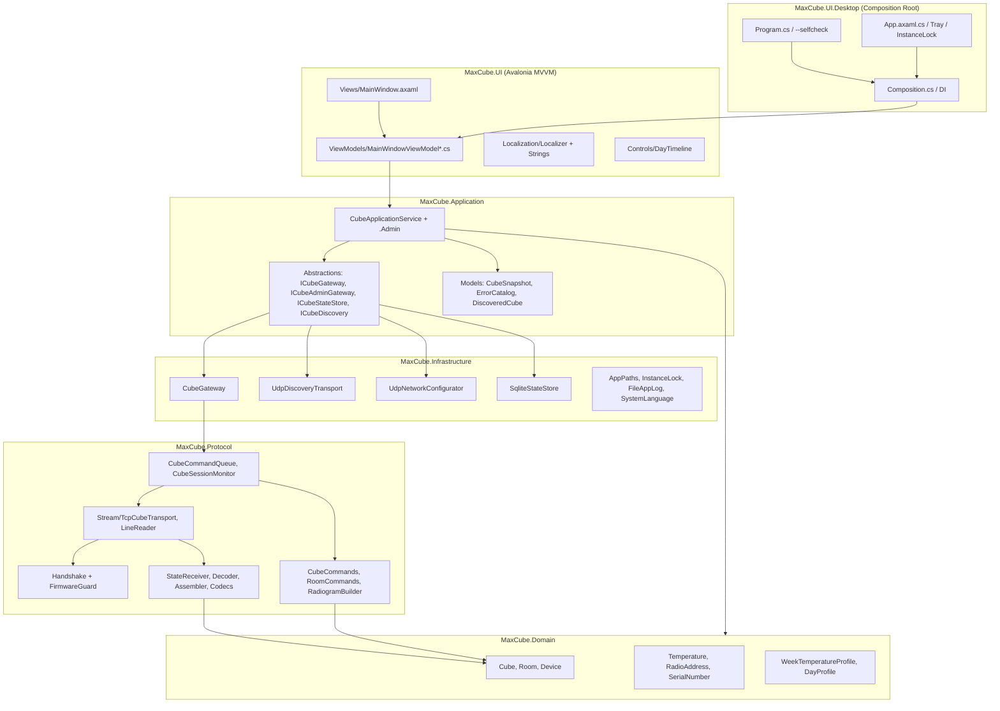
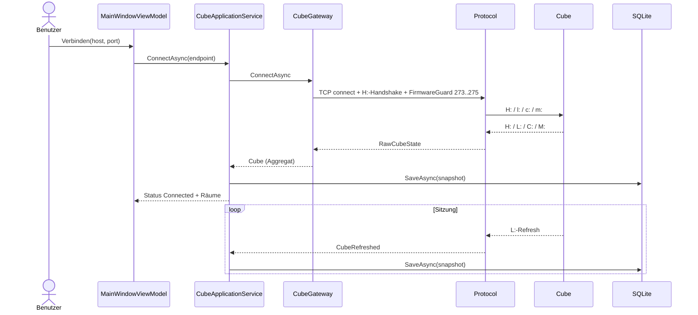
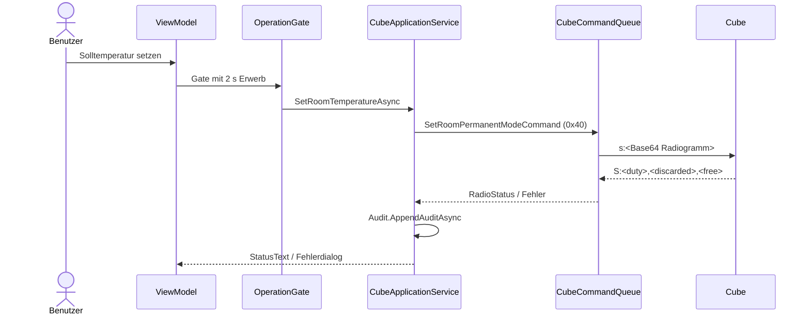

# Architektur – MAX! Cube Local App

> Rolle: Senior Solution Architect. Stand: 25.11.2026. Version: 0.3.0.
> Kennzeichnung: `FAKT` = direkt im Artefakt belegt, `BEOBACHTUNG` = im Testlauf gesehen, `INFERENZ` = aus Code/Doku abgeleitet, `UNBEKANNT` = nicht belegbar. Belege als `Datei:Zeile`.

## 1. Executive Summary

### 1.1 Zweck

Die App stellt die lokal nutzbaren Funktionen der ehemaligen eQ-3 MAX! Local Application für den MAX! Cube unter Windows und Linux bereit. Sie ist eine Neuimplementierung, kein Fork und keine 1:1-Portierung des Java-Originals (`docs/INDEX.md:3-4`).

### 1.2 Geschäftlicher Nutzen

Die MAX!-Hardware bleibt ohne Herstellercloud und ohne Browser/Java-Shell bedienbar. Wärmekomfort, Heizperioden und Gerätestruktur können lokal konfiguriert werden; der Betrieb ist ohne Internet, ohne Produktkonto und ohne App-Update-Server möglich. Der Nutzerhinweis vom 25.11.2026 bestätigt, dass die Cloud-App aus Android-/iOS-Stores entfernt wurde; damit ist der lokale Weg der einzig verbleibende (`docs/features.md:34-36`).

### 1.3 Hauptfunktionen

Verbindung und Discovery, Raum-/Geräteansicht, Solltemperatur und Modi, Haussteuerung, Wochenprofile, Raum- und Gerätekonfiguration, Anlernen und Strukturpflege, Cube-Zeit/Zeitzone/NTP/Netzwerk, Diagnose, Audit, sechs Sprachen (`README.md:26-36` vor der hier erfolgten Neufassung; `docs/features.md:40-99`).

### 1.4 Zielgruppe

- **Betreiber:** Haushalt/Kleininstallation mit einem physischen MAX! Cube, Windows oder Linux.
- **Entwickler:** .NET-Entwickler ohne Java-Kenntnisse, der das Protokoll über die C#-Schicht erweitert.
- **Administrator:** lokale Wartung, Backup des Datenordners, Log-/Audit-Auswertung.

### 1.5 Technologiestack

| Ebene | Technologie | Beleg |
|---|---|---|
| Laufzeit | .NET 10, `net10.0`, `LangVersion latest`, `Nullable enable`, `InvariantGlobalization true` | `Directory.Build.props:3-13` |
| UI | Avalonia 11.3.23, Fluent Theme, CommunityToolkit.Mvvm 8.4.2 | `src/MaxCube.UI/MaxCube.UI.csproj:3-8`, `src/MaxCube.UI.Desktop/MaxCube.UI.Desktop.csproj:6-8` |
| Persistenz | Microsoft.Data.Sqlite 10.0.0 + SQLitePCLRaw.lib.e_sqlite3 2.1.14 | `src/MaxCube.Infrastructure/MaxCube.Infrastructure.csproj:7-8` |
| Tests | xUnit 2.9.3, FluentAssertions 7.2.0, Microsoft.NET.Test.Sdk 17.14.1 | `tests/*/*.csproj:7-10` |
| CI | GitHub Actions, `ubuntu-latest` + `windows-latest`, self-contained Publish | `.github/workflows/ci.yml:13-17,39-65` |
| Protokoll | Eigene C#-Schicht, keine externe MAX!-NuGet-Abhängigkeit | `docs/INDEX.md:28`, `src/MaxCube.Protocol/*.csproj:3` |

## 2. Systemkontext

```mermaid
C4Context
  title Systemkontext – MAX! Cube Local App
  Person(Betreiber, "Betreiber", "Steuert Heizung lokal am PC")
  System(App, "MAX! Cube Local App 0.3.0", "Avalonia-Desktop-App, Windows/Linux")
  System(Cube, "eQ-3 MAX! Cube", "Firmware 273–275, TCP 62910, UDP 23272")
  SystemDb(Cache, "maxcube.db", "SQLite-Cache, Einstellungen, Audit")
  SystemExt(Cloud, "MAX! Cloud", "seit 01.07.2023 abgeschaltet; App laut Nutzerhinweis aus Stores entfernt")
  Rel(Betreiber, App, "Bedient Räume, Profile, Struktur")
  Rel(App, Cube, "TCP-Kommandos, L/C/M/S-Telegramme; UDP nur benutzerinitiiert")
  Rel(App, Cache, "Offline-Anzeige, Einstellungen, Audit")
  Rel(Cloud, App, "keine Verbindung – bewusst verworfen")
```

**FAKT:** Es gibt keinen HTTP-Endpunkt, keinen Jetty-Server, keinen Browser-Autostart und keinen Update-Check (`docs/features.md:83-87`, `docs/maxcube-protocol.md` Abschnitt 6.1). Die „API“ der App sind C#-Schnittstellen und das Cube-Wire-Protokoll; siehe [API.md](API.md).

## 3. Gesamtarchitektur



### 3.1 Abhängigkeitsregel

`Domain` ist abhängigkeitsfrei. `Protocol` hängt nur von `Domain`. `Application` hängt nur von `Domain` und definiert Ports. `Infrastructure` implementiert diese Ports und hängt zusätzlich von `Protocol`. `UI` hängt von `Application`/`Domain`. `UI.Desktop` verdrahtet alles (`Composition.cs:18-47`; csproj-Referenzen in `src/*/*.csproj`).

**FAKT:** Diese Richtung verhindert, dass TCP/SQLite in die Fachlogik oder UI eindringen. DieAusnahme ist bewusst: `CubeApplicationService` orchestriert Schreibzugriffe und ist damit die einzige fachliche Schreibstelle (`README.md` alt:21; `src/MaxCube.Application/Services/CubeApplicationService.cs`).

## 4. Komponentenübersicht

| Modul | Verantwortlichkeit | Wichtige Typen | Beleg |
|---|---|---|---|
| `MaxCube.Domain` | Fachregeln, Value Objects, Aggregate, Wochenprofile, Limits | `Cube`, `Room`, `Device`, `Temperature`, `WeekTemperatureProfile`, `DomainLimits` | `src/MaxCube.Domain/Aggregates/DomainLimits.cs:4-13` |
| `MaxCube.Protocol` | Wire-Format, Transport, Handshake, Queue, Radiogramme, Decoder | `TcpCubeTransport`, `CubeHandshaker`, `CubeCommandQueue`, `CubeCommands`, `RoomCommands`, `CubeStateAssembler` | `src/MaxCube.Protocol/Commands/*.cs`, `src/MaxCube.Protocol/State/*.cs` |
| `MaxCube.Application` | Use Cases, Ports, Snapshots, Fehlerkatalog, Discovery-Regeln | `CubeApplicationService`, `ICubeGateway`, `ICubeAdminGateway`, `ICubeStateStore`, `ErrorCatalog` | `src/MaxCube.Application/Abstractions/*.cs` |
| `MaxCube.Infrastructure` | Adapter: TCP, UDP, SQLite, Plattform | `CubeGateway`, `UdpDiscoveryTransport`, `UdpNetworkConfigurator`, `SqliteStateStore`, `AppPaths`, `FileAppLog` | `src/MaxCube.Infrastructure/**/*.cs` |
| `MaxCube.UI` | MVVM-Ansicht, Lokalisierung, Tagesleiste | `MainWindowViewModel*`, `DayProfileViewModel`, `Localizer`, `DayTimeline` | `src/MaxCube.UI/**/*.cs` |
| `MaxCube.UI.Desktop` | Prozess, DI, Tray, Instanzschutz, Selbsttest | `Program`, `App`, `Composition`, `InstanceLock` | `src/MaxCube.UI.Desktop/*.cs` |

### 4.1 Wichtige Klassen und Funktionen (Auswahl)

- `CubeApplicationService.ConnectAsync(endpoint)` – verbindet, aktualisiert Cache/Audit und abonniert Sitzungsereignisse (`CubeApplicationService.cs:191`).
- `CubeApplicationService.SetRoomTemperatureAsync(...)` – fachlicher Schreibpfad für Solltemperatur (`:305`).
- `CubeApplicationService.Admin.cs` – Raumkonfiguration, Boost, Wanddisplay, Inclusion, Zuordnung, Struktur, Netzwerk, Diagnose (`:78-844`).
- `CubeGateway` – hält genau einen Transport, Writer und eine Queue; sendet beim Shutdown `q:` (`CubeGateway.cs:17-26`).
- `ResponseCommand<T>.ParseResponse` – lehnt `r:` als `CubeCommandRejectedException` und fremde Prefixe als `UnknownCubeOpcodeException` ab (`CubeCommands.cs:21-64`).
- `SqliteStateStore.SaveAsync` – ersetzt Räume/Geräte eines Serials transaktional; `LoadAsync` liefert Offline-Snapshot (`SqliteStateStore.cs:207-379`).
- `Composition.Build` – singleton-Verdrahtung für GUI und Selbsttest (`Composition.cs:18-47`).
- `Program.SelfCheck` – fensterlose Abnahme ohne Cube-Kontakt (`Program.cs:26-92`).

## 5. Datenflüsse

### 5.1 Verbinden und Zustand aufbauen



### 5.2 Schreibkommando



### 5.3 Discovery (immer benutzerinitiiert)

```mermaid
sequenceDiagram
  actor U as Benutzer
  participant VM as ViewModel
  participant S as CubeDiscoveryService
  participant T as UdpDiscoveryTransport
  participant C as Cube
  U->>VM: „Cube suchen“
  VM->>S: DiscoverAsync(duration)
  S->>T: 3× Request eQ3Max*…I, 50 ms Abstand
  T->>C: Broadcast 255.255.255.255 + Multicast 224.0.0.1, TTL 5, UDP 23272
  C-->>T: Datagramm mit Seriennummer/IP/Firmware
  T-->>S: DiscoveryDatagram
  S-->>VM: Trefferliste; „Übernehmen“ setzt Host + Port 62910
```

**FAKT:** Beim App-Start wird kein Broadcast gesendet (`docs/features.md:41`, `CubeDiscoveryProtocol.cs:15-20`, `UdpDiscoveryTransport.cs:9-19`).

**FAKT (Hardware 25.11.2026):** Der UDP-Client muss an Port 23272 gebunden sein; mit ephemeralem Port kam keine Antwort an. Nach der Korrektur lieferte `192.168.10.60` eine 26-Byte-Antwort mit Seriennummer und Firmware 275 (`UdpDiscoveryTransport.cs:23`, `docs/HARDWARE-VERIFY.md` §3). Die frühere Einstufung als `UNBEKANNT` ist damit für dieses Format aufgehoben.

### 5.4 Cache und Source of Truth

Der Cache wird bei jedem Connect vollständig überschrieben (`SqliteStateStore.cs:236-255`). Ein geladener Offline-Zustand ist schreibgeschützt; Schreibbefehle setzen eine Verbindung voraus (`CubeApplicationService.cs:305-334`). Damit kann SQLite nie den Cube-Status überschreiben.

## 6. Abhängigkeiten

### 6.1 Externe Pakete

| Paket | Version | Zweck |
|---|---|---|
| Avalonia / Avalonia.Desktop / Themes.Fluent | 11.3.23 | plattformnative UI (Win32/X11) |
| CommunityToolkit.Mvvm | 8.4.2 | `ObservableObject`, `RelayCommand` |
| Microsoft.Extensions.DependencyInjection | 10.0.0 | Composition Root |
| Microsoft.Data.Sqlite | 10.0.0 | SQLite-Zugriff |
| SQLitePCLRaw.lib.e_sqlite3 | 2.1.14 | native SQLite-Bibliothek |
| xUnit / FluentAssertions / Test SDK | 2.9.3 / 7.2.0 / 17.14.1 | hardwarefreie Tests |
| Microsoft.Extensions.TimeProvider.Testing | 10.0.0 | deterministische Zeit in Protokolltests |

**FAKT:** Es gibt keine Cloud-, Jetty-, Browser-, Getdown-, AGPL- oder HTTP-Update-Abhängigkeit (`docs/INDEX.md:28`, `docs/features.md:83-87`).

### 6.2 Laufzeitabhängigkeiten

- TCP-Port 62910 muss erreichbar und nicht durch eine andere Instanz blockiert sein.
- UDP-Port 23272 nur für „Cube suchen“; kein Listener im Dauerbetrieb.
- Kein DNS, kein Zertifikat, kein Secret-Store, kein Proxy erforderlich.
- Linux: X11/Wayland und `libSkiaSharp.so`/`libHarfBuzzSharp.so` aus dem Paket; `libe_sqlite3.so` aus SQLitePCLRaw.

## 7. Architekturentscheidungen

| Nr. | Entscheidung | Begründung | Status/Beleg |
|---|---|---|---|
| ADR-01 | Eigene C#-Protokollschicht statt NuGet-Bibliothek | Kein passendes C#-Paket; `MAXSharp` AGPL und eingefroren | `docs/INDEX.md:28` |
| ADR-02 | Clean Architecture mit Ports/Adapter | Protokoll und SQLite dürfen die Fachlogik/UI nicht verunreinigen | `Composition.cs:18-47` |
| ADR-03 | Cube Source of Truth, SQLite nur Cache | Original hat keine DB; veraltete Cache-Daten dürfen nicht zurückfließen | `SqliteStateStore.cs:8-13`, `docs/INDEX.md:113` |
| ADR-04 | Kein Cloud/Fernzugriff/Produktkonto/Proxy/Update | Cloud abgeschaltet; Store-Hinweis 25.11.2026; keine Zugangsdaten in der App | `docs/features.md:34-36` |
| ADR-05 | Firmware-Schreiben deaktiviert | Kein Golden-Capture, Gerätedefekt-Risiko, keine Firmwaredatei | `README.md` alt:76, `docs/gremium.md:11` |
| ADR-06 | UDP nur benutzerinitiiert | Kein Broadcast beim Start; Netzwerkkonfiguration nur mit Bestätigung | `docs/features.md:41`, `UdpNetworkConfigurator.cs:10-13` |
| ADR-07 | InvariantGlobalization + eigene Spracherkennung | Start auf schlanken Linux-Systemen ohne libicu | `Directory.Build.props:12`, `SystemLanguage.cs:6-14` |
| ADR-08 | Ein Gateway-Objekt für Kern+Admin | Ein Socket, eine Queue, ein Worker – verhindert konkurrierende Sitzungen | `Composition.cs:27-30` |
| ADR-09 | Zwei getrennte OperationGates | Ein hängendes Gateway-Gate darf die UI nicht blockieren | `OperationGate.cs:3-16` |
| ADR-10 | Fensterloser Selbsttest in CI | Verdrahtung, SQLite, Pfade, Sprachen und Instanzschutz ohne Desktop prüfbar | `Program.cs:26-92`, `ci.yml:29-30` |
| ADR-11 | Metadaten nur nach byte-genauer Rundreise | `m:`-Semantik ist `INFERENZ`; Schutz vor Strukturverlust | `README.md` alt:34,77 |
| ADR-12 | App-Version zentral + Cache-Version | Anzeige und Diagnose ohne verteilte Konstanten | `Directory.Build.props:3-5`, `SqliteStateStore.cs:108-115` |

## 8. Risiken und technische Schulden

| ID | Risiko/Schuld | Klasse | Auswirkung | Beleg |
|---|---|---|---|---|
| R-01 | Schreibformate `0x12`, `0x20`–`0x23`, `m:`, `w:`, `v:`, UDP-Netzwerk nur `INFERENZ` | **kritisch** | Falsche Kodierung könnte Meterwerte/Struktur verändern; vor Produktivgebrauch Testraum nötig | `README.md` alt:77 |
| R-02 | Kein Golden-Capture, keine fachlich ausgewertete `S:`-Antwort | **kritisch** | Quittungen >0 und `A:`-Annahme nicht belegt; UDP-Antwort und `0x11` Komfort/Eco sind hardwarebelegt (`docs/HARDWARE-VERIFY.md`) | `README.md` alt:80,83 |
| R-03 | Linux-Oberfläche/Tray nie auf echtem Desktop gesehen | hoch | Layout-/Tray-Probleme möglich | `README.md` alt:8,66 |
| R-04 | Verbundene Temperaturen (3 s) können gegenüber Einzelbefehlen verzögern | mittel | Akzeptanzfrage, kein Datenverlust | `docs/features.md:93`, `MainWindowViewModel.Settings.cs:23` |
| R-05 | `ReadAuditAsync` lädt 500, UI zeigt 100 Einträge; Audit wächst unbegrenzt | mittel | Langzeitbetrieb: DB-Wachstum, keine Rotation | `SqliteStateStore.cs:183-191`, `README.md` alt:38 |
| R-06 | `Temperature` exakter Vergleich statt Java-Toleranz <0,1 °C | niedrig | Andere Grenzwerte bei Gleitkomma-Runden | `README.md` alt:73 |
| R-07 | `DomainLimits` werden im Aggregat erzwungen, Java-AL prüft nicht | niedrig | Strengere Validierung als Original (bewusst) | `DomainLimits.cs:4-8` |
| R-08 | Keine Hardwarevalidierung der 7+6-Wochenprofile | hoch | Zweites `0x10`-Telegramm bleibt `UNBEKANNT` | `docs/roadmap.md:318-321` |
| R-09 | Runde 5 ohne Modellstimmen (Free-Limit) | organisatorisch | Keine externe Gegencheck-Stimme für letzten Umfang | `docs/gremium.md:90-97` |
| R-10 | `MAX10038` weicht vom Muster `MAX\d{4}` ab | niedrig | Regex `MAX\d{4,5}` berücksichtigt es; Konsumenten mit fester Länge könnten es übersehen | `ErrorCatalog.cs:54,97` |

## 9. Verbesserungsvorschläge (separat, nicht umgesetzt)

1. Hardwaretest mit Paketmitschnitt für alle `INFERENZ`-Formate; anschließend Belegstatus in `docs/features.md` heben oder Kodierung korrigieren.
2. Golden-Capture eines echten Cubes inklusive `S:`-Quittung und UDP-Antwort; Testfixtures daraus ableiten.
3. Linux-Desktop-Sichtprüfung auf X11 **und** Wayland, inklusive Tray und „Schließen versteckt Fenster“.
4. Audit-Rotation oder konfigurierbare Aufbewahrung analog zu `FileAppLog`.
5. Drag-and-drop im Wochenprogramm-Editor als Ergänzung zur Tagesleiste.
6. Fehlercatalog-Einträge mit Herstellersprachen statt Deutungen ergänzen, sobald belegbar.
7. Self-contained Pakete mit Hash/Signatur ausliefern; aktuell nur CI-Artefakte ohne Signatur (`ci.yml:66-69`).

## 10. Offene Fragen

- Welche fachliche Bedeutung haben `S:`-Codes > 0 und die tote Konstante `g:` / `OUTGOING_MORE_DATA`? (`UNBEKANNT`)
- Wie interpretiert der Cube Temporary-Endzeiten bei Sommer-/Winterzeit? Die App folgt Java (Ortszeit), Beleg fehlt.
- Ist der echte UDP-Firmware-Frame reproduzierbar? Die reguläre Discovery-Antwort ist belegt (`docs/HARDWARE-VERIFY.md`); Firmware-Schreiben bleibt trotzdem aus.
- Welches `SerialNumber`-Pattern gilt? (`UNBEKANNT`)
- Werden die sechs Sprachen auf allen Linux-Desktops korrekt erkannt, wenn `LANG=C` gesetzt ist? (`UNBEKANNT`; der Selbsttest prüft nur Textschlüssel.)
