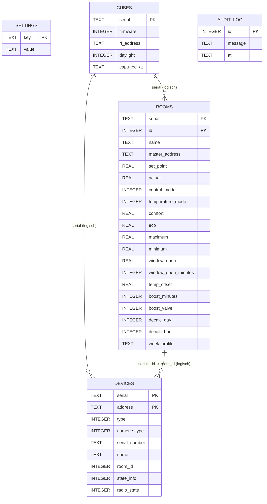
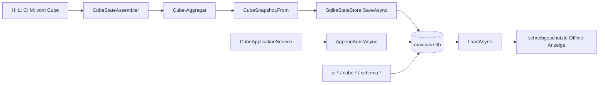

# Datenbank – SQLite-Cache der MAX! Cube Local App

> Stand 25.11.2026. Alle Aussagen sind aus `src/MaxCube.Infrastructure/Persistence/SqliteStateStore.cs` und den Aufrufstellen abgeleitet. Im Original gab es **keine Datenbank**; dieser Store ist ein Neubau (`SqliteStateStore.cs:8-13`, `docs/INDEX.md:113`).

## 1. Zweck und Grundsatz

| Aspekt | Feststellung | Beleg |
|---|---|---|
| Rolle | Offline-Anzeige, Einstellungen, Audit – **nicht** Source of Truth | `SqliteStateStore.cs:8-13` |
| Source of Truth | physischer Cube | `SqliteStateStore.cs:10-11` |
| Schreibsperre | geladener Offline-Zustand ist schreibgeschützt; Schreibbefehle brauchen Verbindung | `CubeApplicationService.cs:305-334` |
| Über schreiben | Bei jedem Connect werden Räume/Geräte eines Serials vollständig ersetzt | `SqliteStateStore.cs:236-255` |
| Datei | `<Datenordner>/maxcube.db`, änderbar mit `MAXCUBE_DATA_DIR` | `AppPaths.cs:10,20-26` |
| Schema-Version | `PRAGMA user_version = 1`; zusätzlich `settings.schema.version` und `settings.app.version` | `SqliteStateStore.cs:15-16,108-115` |

**FAKT:** Es gibt keine FOREIGN-KEY-Constraints, keine expliziten `CREATE INDEX`-Statements und keine Fremdschlüssel-Prüfung. Beziehungen werden logisch über `serial` bzw. `rooms.id` hergestellt (`SqliteStateStore.cs:43-94`).

## 2. ER-Diagramm

## 3. Tabellenbeschreibung

### 3.1 `settings`

| Spalte | Typ | Constraint | Zweck |
|---|---|---|---|
| `key` | TEXT | PRIMARY KEY | stabiler Settings-Schlüssel |
| `value` | TEXT | NOT NULL | Wert als Text; Zahlen/Bools werden von der Anwendung geparst |

**Upsert:** `INSERT ... ON CONFLICT(key) DO UPDATE SET value = excluded.value` (`SqliteStateStore.cs:118-127,146-163`).

### 3.2 `cubes`

| Spalte | Typ | Constraint | Zweck |
|---|---|---|---|
| `serial` | TEXT | PRIMARY KEY | Seriennummer des Cubes |
| `firmware` | INTEGER | NOT NULL | Firmware-Version aus `H:` |
| `rf_address` | TEXT | NOT NULL | 24-Bit-Adresse hexadezimal |
| `daylight` | INTEGER | NOT NULL | Sommerzeit-Flag 0/1 |
| `captured_at` | TEXT | NOT NULL | Zeitpunkt des Snapshots, ISO-8601 (`"O"`) |

### 3.3 `rooms`

| Spalte | Typ | Constraint | Zweck |
|---|---|---|---|
| `serial` | TEXT | PK (mit `id`) | Cube-Zuordnung |
| `id` | INTEGER | PK (mit `serial`) | Raum-ID |
| `name` | TEXT | NOT NULL | Anzeigename |
| `master_address` | TEXT | NOT NULL | Master-Thermostat des Raums |
| `set_point`, `actual` | REAL | NOT NULL | Soll-/Isttemperatur |
| `control_mode`, `temperature_mode` | INTEGER | NOT NULL | enum-codiert |
| `comfort`, `eco`, `maximum`, `minimum` | REAL | NOT NULL | Raumtemperaturgrenzen |
| `window_open`, `window_open_minutes` | REAL / INTEGER | NOT NULL | Fenster-offen-Konfiguration |
| `temp_offset` | REAL | NOT NULL | Temperatur-Offset |
| `boost_minutes`, `boost_valve` | INTEGER | NOT NULL | Boost-Konfiguration |
| `decalc_day`, `decalc_hour` | INTEGER | NOT NULL | Entkalkung |
| `week_profile` | TEXT | NULL | JSON des Wochenprofils oder `NULL`; **additive Migration** |

### 3.4 `devices`

| Spalte | Typ | Constraint | Zweck |
|---|---|---|---|
| `serial` | TEXT | PK (mit `address`) | Cube-Zuordnung |
| `address` | TEXT | PK (mit `serial`) | Funkadresse hexadezimal |
| `type`, `numeric_type` | INTEGER | NOT NULL | Gerätetyp (enum / Rohcode) |
| `serial_number`, `name` | TEXT | NOT NULL | Geräteidentität/Anzeige |
| `room_id` | INTEGER | NOT NULL | logische Raumzuordnung |
| `state_info`, `radio_state` | INTEGER | NOT NULL | enum-codierte Statuswerte |

### 3.5 `audit_log`

| Spalte | Typ | Constraint | Zweck |
|---|---|---|---|
| `id` | INTEGER | PRIMARY KEY AUTOINCREMENT | sortierbare Reihenfolge |
| `message` | TEXT | NOT NULL | lesbare Ereignismeldung |
| `at` | TEXT | NOT NULL | Zeitpunkt, ISO-8601 (`_clock.Now.ToString("O")`) |

## 4. Beziehungen, Indizes, Constraints

- **Beziehungen:** `cubes.serial` ↔ `rooms.serial`, `cubes.serial` ↔ `devices.serial`, `rooms.id` ↔ `devices.room_id`. Alle sind **logisch**, nicht per `FOREIGN KEY` erzwungen (`SqliteStateStore.cs:43-94`).
- **Indizes:** Nur die impliziten Indizes der PRIMARY KEYs. Es gibt kein explizites `CREATE INDEX` (`SqliteStateStore.cs:43-94`). Bei kleinen Datenmengen (max. 20 Räume / 140 Geräte nach `DomainLimits.cs:11-13`) ist das ausreichend.
- **Constraints:** `NOT NULL` auf allen Spalten außer `rooms.week_profile`. `room_id` hat **keinen** Check against `rooms.id`; ein verwaistes Gerät würde beim Laden trotzdem in den Snapshot übernommen (Assembler verwarft verwaiste Geräte bereits vor dem Speichern).
- **Sortierung:** `LoadAsync` liefert Räume `ORDER BY id`, Geräte `ORDER BY address` (`SqliteStateStore.cs:316,349`). Audit `ORDER BY id DESC LIMIT 500`, dann wieder aufsteigend (`:191`).

## 5. Datenflüsse

### 5.1 `SaveAsync` (transaktional)

1. `SemaphoreSlim _gate` serialisiert alle Store-Zugriffe (`SqliteStateStore.cs:21,210`).
2. `BEGIN TRANSACTION`.
3. Cube-Zeile upserten (`:219-233`).
4. `DELETE FROM rooms WHERE serial = $serial` und alle Räume neu einfügen (`:236-253`).
5. `DELETE FROM devices WHERE serial = $serial` und alle Geräte neu einfügen (`:255-276`).
6. `COMMIT` (`:278`).

**Konsequenz:** Ein teilweiser Schreibfehler lässt den alten Stand erhalten; ein Connect überschreibt den Cache vollständig.

### 5.2 `LoadAsync`

1. Cube-Zeile lesen; bei Fehlschlag `null` (`:295-311`).
2. Räume und Geräte zum Serial laden (`:313-364`).
3. `week_profile` aus JSON zurück in `DayProfile`/`WeekTemperatureProfile` überführen; `NULL` wird `null` (`:340-342`; `CubeSnapshot.cs`).
4. `CubeSnapshot` mit `DateTimeOffset.Parse(captured)` (`:366-373`).

## 6. Gespeicherte Settings-Keys

| Key | gesetzt von | gelesen von | Wert/Bedeutung |
|---|---|---|---|
| `schema.version` | `SqliteStateStore.InitializeSchema` (`:114`) | Diagnose/Anzeige | `"1"` = `CurrentSchemaVersion` |
| `app.version` | `SqliteStateStore.InitializeSchema` (`:115`) | Diagnose/Anzeige | Version aus `IAppVersionProvider`, z. B. `0.6.9`; `"unbekannt"` als Fallback (`:32-34`) |
| `cube.serial` | `CubeApplicationService.ConnectAsync` (`:208`) | `LoadCachedAsync` (`:282`) | Seriennummer des zuletzt verbundenen Cubes |
| `cube.endpoint` | `CubeApplicationService.ConnectAsync` (`:209`) | `GetLastEndpointAsync` (`:248`) | `host:port`, z. B. `192.168.10.60:62910` |
| `ui.language` | `MainWindowViewModel.Settings.cs:21` | Localizer/ViewModel | `de`, `en`, `fr`, `it`, `nl`, `pl` |
| `log.retentionDays` | `MainWindowViewModel.Settings.cs:22` | `FileAppLog` / Einstellungen | Aufbewahrung in Tagen, Default 30 (`:25`) |
| `ui.bundleTemperatures` | `MainWindowViewModel.Settings.cs:23` | `CubeApplicationService.QueueRoomTemperature` | gebündeltes Senden 3 s, optional |
| `ui.closeToTray` | `MainWindowViewModel.Settings.cs:24` | `App.axaml.cs:55` | Fenster schließen nur verstecken |

Beliebige weitere Keys können über `CubeApplicationService.ReadSettingAsync`/`WriteSettingAsync` (`CubeApplicationService.Admin.cs:830-834`) geschrieben werden; der Store validating Keys nicht (`GetSettingAsync`/`SetSettingAsync` akzeptieren jeden String). **INFERENZ:** dadurch können Tippfehler unbemerkt neue Keys erzeugen.

## 7. Migrationen

| Version | Änderung | Idempotenz | Beleg |
|---|---|---|---|
| 0 → 1 | Tabellen `settings`, `cubes`, `rooms`, `devices`, `audit_log` | `CREATE TABLE IF NOT EXISTS` | `SqliteStateStore.cs:43-95` |
| 1 (additiv) | `ALTER TABLE rooms ADD COLUMN week_profile TEXT NULL`, nur wenn `pragma_table_info` die Spalte nicht kennt | ja, Spaltenprüfung vor `ALTER` | `SqliteStateStore.cs:97-106` |
| 1 (metadaten) | `PRAGMA user_version = 1`, `schema.version`, `app.version` | ja, Upsert | `SqliteStateStore.cs:108-115` |

**FAKT:** Es gibt kein migratorisches Downgrade und keine Prüfung, ob `user_version` höher als `CurrentSchemaVersion` ist. Eine fremde, neuere DB würde unverändert geöffnet; unbekannte Spalten werden vom SELECT ignoriert (`INFERENZ` aus `LoadAsync`).

## 8. Backup, Wiederherstellung, Wartung

- **Backup:** Datenordner kopieren, mindestens `maxcube.db`; besser `maxcube.db`, `logs/`, `reports/` gemeinsam (konsistente Evidence). Die DB ist klein; ein Copy im laufenden Betrieb ist mit SQLite meist möglich, aber **empfohlen:** App vorher beenden, damit der Lock und offene Transaktionen nicht stören (`AppPaths.cs:20-28`, `InstanceLock.cs:5-10`).
- **Recovery:** App beenden → gesicherte `maxcube.db` zurückkopieren → Start. Der nächste Connect überschreibt Räume/Geräte ohnehin vom Cube; Einstellungen und Audit bleiben aus der Sicherung.
- **Wartung:** `audit_log` wächst unbegrenzt; bei Bedarf alte Zeilen löschen oder Rotation ergänzen (Verbesserungsvorschlag in [ARCHITECTURE.md](ARCHITECTURE.md) R-05). Logrotation erfolgt getrennt über `FileAppLog` (`FileAppLog.cs:6-9`).

## 9. Offene Fragen

- Soll `room_id` als echter `FOREIGN KEY` mit `ON DELETE CASCADE` modelliert werden? Aktuell nur logisch.
- Wie soll ein Backup bei laufender App konsistent migratorisch geprüft werden? Aktuell kein `PRAGMA integrity_check` in der App.
- Soll `audit_log` eine Aufbewahrungsgrenze erhalten? Derzeit `UNBEKANNT`/unbegrenzt.
- Werden `week_profile`-JSONs bei Schemaänderungen versioniert? Derzeit nur als Text gespeichert.
