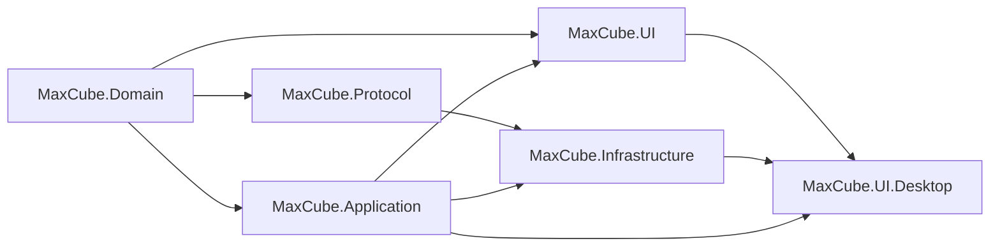
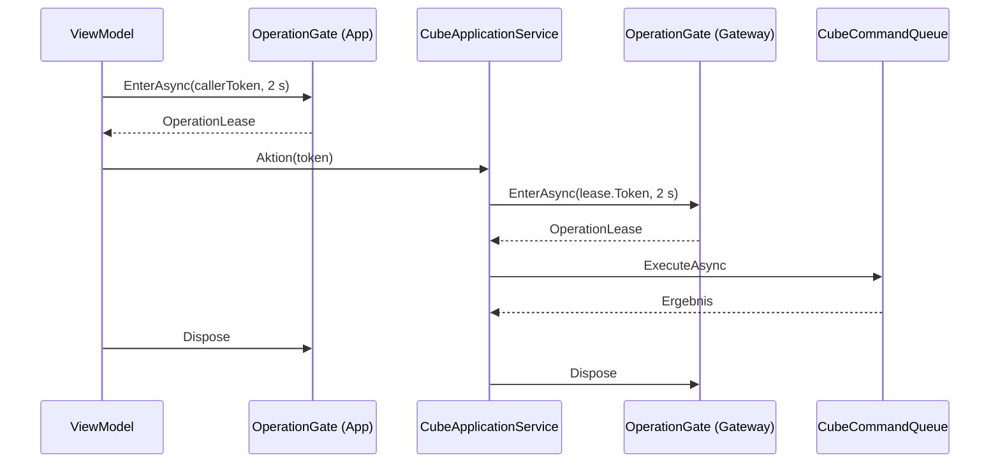

# Entwicklung – MAX! Cube Local App

> Stand 27.11.2026. Version 0.8.0. Diese Datei beschreibt den **Ist-Zustand des Repositories**, nicht eine Wunscharchitektur. Aussagen mit `INFERENZ`/`UNBEKANNT` sind ausdrücklich gekennzeichnet; Belege stehen als `Datei:Zeile`.

## 1. Schnellstart für Entwickler

### 1.1 Voraussetzungen

| Voraussetzung | Windows | Linux | Beleg |
|---|---|---|---|
| SDK | .NET 10 (`net10.0`) | .NET 10 | `Directory.Build.props:6`, `ci.yml:20-22` |
| Editor | beliebiger C#-Editor/IDE | beliebig | `INFERENZ` – keine Editor-Konfiguration im Repo belegt |
| Desktop | Win32 | X11 oder Wayland | `start.sh:3-4`, `Program.cs:23-24` |
| Cube für Hardwaretests | optional | optional | Alle Tests laufen hardwarefrei (`LoopbackFakeCube.cs:10-12`) |

`start.cmd` und `start.sh` suchen ein SDK, bauen inkrementell und starten die Debug-DLL mit übergebenen Argumenten (`start.cmd:8-43`, `start.sh:8-35`). Für reine Codearbeit genügen:

```powershell
dotnet restore MaxCube.slnx
dotnet build MaxCube.slnx --nologo
dotnet test MaxCube.slnx --nologo
dotnet src/MaxCube.UI.Desktop/bin/Debug/net10.0/MaxCube.UI.Desktop.dll --selfcheck
```

```bash
dotnet restore MaxCube.slnx
dotnet build MaxCube.slnx --nologo
dotnet test MaxCube.slnx --nologo
dotnet src/MaxCube.UI.Desktop/bin/Debug/net10.0/MaxCube.UI.Desktop.dll --selfcheck
```

Der Selbsttest ist fensterlos, baut Pfade/SQLite/Gateway/Service/ViewModel/Lokalisierung und sendet **keinen** Broadcast (`Program.cs:26-92`). Exitcodes: `0` OK, `1` Ausnahme, `2` Instanzschutz, `3` fehlender Text, `4` DB nicht erzeugt (`Program.cs:41-42,58-59,83-85,92`).

### 1.2 Solution und Projekte



`MaxCube.slnx` enthält sechs Source- und fünf Testprojekte (`MaxCube.slnx:2-16`).

| Projekt | Rolle | Wichtige Abhängigkeiten |
|---|---|---|
| `MaxCube.Domain` | Aggregate, Value Objects, Wochenprofile, Fehlercodes; **abhängigkeitsfrei** | – (`src/MaxCube.Domain/*.csproj`) |
| `MaxCube.Protocol` | Wire-Format, Framing, Handshake, Queue, Radiogramme, Codecs | nur Domain |
| `MaxCube.Application` | Use Cases, Ports, Snapshots, Discovery, ErrorCatalog | Domain |
| `MaxCube.Infrastructure` | TCP/UDP/SQLite/Plattform-Adapter | Application + Protocol |
| `MaxCube.UI` | Avalonia-MVVM, Lokalisierung, Tagesleiste | Avalonia 11.3.23, CommunityToolkit.Mvvm 8.4.2 |
| `MaxCube.UI.Desktop` | Prozess, DI, Tray, Instanzschutz, Selbsttest | Avalonia.Desktop/Themes 11.3.23, DI 10.0.0 |

Zentrale Build-Properties: Version `0.8.0`, `LangVersion latest`, `Nullable enable`, `ImplicitUsings enable`, `InvariantGlobalization true`, `Deterministic true` (`Directory.Build.props:3-13`). C#-Quellen nutzen LF-Zeilenenden (`.gitattributes`, `.editorconfig`), damit `dotnet format --verify-no-changes` auf Windows und Debian identisch ist.

## 2. Kodierkonventionen

### 2.1 Sprach- und Fehlerregeln

- Kommentare/Begründungen sind deutsch; Bezeichner sind englisch (`BEOBACHTUNG`, z. B. `CubeGateway.cs`, `Localizer.cs`).
- Alle fachlichen Validierungsfehler tragen einen MAX-Code über `DomainValidationException` (`DomainValidationException.cs:3-16`). Der Katalog ist `MAX0001`, `MAX1001`–`MAX1051`, ergänzt um den belegten Ausreißer `MAX10038` (`ErrorCatalog.cs:14-68,97`). **Nicht korrigieren**, solange das Artefakt ihn so enthält.
- Protokoll-/Transportausnahmen tragen **keine** MAX-Codes (`CubeProtocolExceptions.cs:3-69`, `CubeCommandExceptions.cs:1-31`). Die UI zeigt `ErrorMessage` und einen aus `ErrorCatalog.Describe` abgeleiteten Hinweis (`MainWindowViewModel.cs:1208-1229`, `MainWindowViewModel.Admin.cs:149-169`).
- `INFERENZ` darf implementiert werden, aber nur mit Kennzeichnung in Code/Doku; `UNBEKANNT` darf nicht als gültiger Zustand durchgereicht werden (`docs/INDEX.md:54-58`, `docs/roadmap.md:61`).

### 2.2 Async, Cancellation, Gates



- `OperationGate.EnterAsync` nutzt standardmäßig 2 s, der Shutdown-Pfad 250 ms (`OperationGate.cs:13-16,26-42`).
- `CancelActive()` bricht die aktive Operation ab, ohne selbst auf das Gate zu warten (`OperationGate.cs:44-58`).
- App und Gateway haben **getrennte** Gates, damit ein hängendes Gateway die UI nicht blockiert (`OperationGate.cs:6-8`, `CubeApplicationService.cs:22`, `CubeGateway.cs:31`).
- Leases immer mit `using` freigeben; `OperationLease.Dispose` ist idempotent (`OperationGate.cs:75-99`).
- Asynchrone Pfade durchgehend `ConfigureAwait(false)`, außer dort, wo die UI-Dispatcher-Instanz den UI-Thread bedient (`IUiDispatcher.cs`, `AvaloniaUiDispatcher.cs`).

### 2.3 Zeit und Uhren

`IClock.Now` liefert `DateTimeOffset.Now`, also **Ortszeit mit Offset**, nicht UTC; Grund sind die vom Cube ohne Zeitzone kodierten Temporary-Endzeiten (`ICubeStateStore.cs:5-19`). Tests injizieren `TimeProvider`/`FakeClock`; Golden-Capture und Hardwarezeit sind derzeit nicht im Testpfad.

### 2.4 Lokalisierung und Hilfe

- Sechs Sprachen: `de`, `en`, `fr`, `it`, `nl`, `pl` (`Localizer.cs:15-23`).
- XAML bindet über den Indexer `{Binding Loc[Schlüssel]}`; `PropertyChanged("Item[]")` aktualisiert alle Texte ohne Neustart (`Localizer.cs:9-11,51-54`).
- Unbekannte Schlüssel erscheinen als `!Schlüssel!` – der Selbsttest prüft genau dieses Muster (`Localizer.cs:56-61`, `Program.cs:79-86`).
- Reihenfolge der Sprachwahl: gespeichertes `ui.language`, dann Systemsprache, dann Deutsch (`Localizer.cs:70-84`, `MainWindowViewModel.Settings.cs:118-119`).
- Hilfe-Themen: `Connect`, `Rooms`, `Week`, `Config`, `Devices`, `Cube` (`MainWindowViewModel.Settings.cs:27`), Texte in `Strings.cs:265-276`.
- Systemsprache: `LC_ALL` → `LC_MESSAGES` → `LANGUAGE` → `LANG` → Windows API; `C`/`POSIX` = `null` (`SystemLanguage.cs:17-35,40-55,71-72`).

### 2.5 UI-Aufbau

`MainWindowViewModel` ist ein `partial class` **ohne Avalonia-Typen**; alle Aktionen laufen über `CubeApplicationService` (`MainWindowViewModel.cs:29-33`). Partials: `.cs`, `.Admin.cs`, `.Structure.cs`, `.Cube.cs`, `.Settings.cs`.

**Neun Reiter** in dieser Reihenfolge: `Rooms`, `Week`, `House`, `Configuration`, `Devices`, `Cube`, `Status`, `Help`, `Settings` (`MainWindowViewModel.Admin.cs:23-35`, XAML `MainWindow.axaml:49,112,168,193,305,370,441,451,464`). `SelectedIndex` ist two-way gebunden (`MainWindow.axaml:46`).

Es gibt **62 `[RelayCommand]`-Attribute** (statische Inventur 27.11.2026), u. a. Verbindung/Discovery/Temperatur/Woche/Haus in `MainWindowViewModel.cs`, Admin in `MainWindowViewModel.Admin.cs:77-408`, Struktur in `MainWindowViewModel.Structure.cs:86-249`, Cube/Zeit/Netzwerk in `MainWindowViewModel.Cube.cs:74-172`, Hilfe in `MainWindowViewModel.Settings.cs:164`, Tagesleiste in `DayProfileViewModel.cs:32-41`. MVVM-Konvention: `[ObservableProperty]` auf privaten Feldern, `[RelayCommand]` auf privaten Methoden; `partial void On…Changed` übernimmt Persistenz und `CanExecute`-Invalidierung (`MainWindowViewModel.cs:4-5`, `DayProfileViewModel.cs:25-41`, `Settings.cs:55-91`, `Cube.cs:68`).

Kontext-Hilfe: sechs Themen `Connect/Rooms/Week/Config/Devices/Cube`, Sprung auf Reiter 7 (`Settings.cs:27,151-169`, `Strings.cs:265-276`, `MainWindow.axaml:40,198,310,375,451-457`).

Tray: laufzeitgeneriertes Icon ohne Binärasset (`TrayIconFactory.cs:9-17`), `TrayShow`/`TrayExit` und Sprachwechsel (`App.axaml.cs:51,80-115`). Fehlt Desktop-Tray-Unterstützung, startet die App trotzdem (`App.axaml.cs:116-121`). „Schließen versteckt Fenster“ ist Standard **aus** (`Settings.cs:48-53`, `App.axaml.cs:53-60`). Instanzschutz per exklusiver Lockdatei (`InstanceLock.cs:5-10,19-49`, `App.axaml.cs:31-41`, `AlreadyRunningWindow.cs:7-30`).

## 3. Tests

| Projekt | Fokus | Belege |
|---|---|---|
| `MaxCube.Domain.Tests` | Value Objects, Aggregate, Struktur, Enums | `tests/MaxCube.Domain.Tests/*Tests.cs` |
| `MaxCube.Application.Tests` | Service, Snapshots, Discovery, Admin | `tests/MaxCube.Application.Tests/*Tests.cs` |
| `MaxCube.Protocol.Tests` | Framing, Handshake, Queue, Commands, State, Radiogramme | `tests/MaxCube.Protocol.Tests/*Tests.cs` |
| `MaxCube.Infrastructure.Tests` | SQLite, Gateway, UDP, Plattform, Sprache | `tests/MaxCube.Infrastructure.Tests/*Tests.cs` |
| `MaxCube.UI.Tests` | ViewModel, Admin-ViewModel | `tests/MaxCube.UI.Tests/*Tests.cs` |

**BEOBACHTUNG (27.11.2026):** 553/553 Tests grün unter Windows 10 und Debian 13 (WSL2). **FAKT (Testlauf 27.11.2026):** Domain 64, Application 90, Protocol 200, Infrastructure 69, UI 130; die einzige `[MemberData]`-Quelle liefert 21 Zeilen (`CubeCommandsTests.cs:12-33`). Die älteren Stände 442/442, 514/515 und 519/519 sind historisch und in `CHANGELOG.md` dokumentiert. Belege: `tests/*/*.cs`, `CHANGELOG.md`. Hardwarefrei: Der End-to-End-Test nutzt `LoopbackFakeCube`/`FakeGateway`/`FakeStore`, **keinen** Golden-Capture (`LoopbackFakeCube.cs:10-12`). Für Wake-up gibt es bewusst keinen automatischen Hardware-Schreibtest; die Aktion ist nur nach Bestätigung erreichbar.

### 3.1 Testregeln

1. Kein Test darf echten Cube, Cloud oder Broadcast benötigen. Discovery-Tests nutzen `IDiscoveryTransport` mit Beispiel-Datagrammen (`ICubeDiscovery.cs:10-17`, `CubeDiscoveryServiceTests.cs`).
2. Zeitabhängige Tests nutzen injizierte Uhr/`TimeProvider`, nicht `Task.Delay` mit Wandzeit.
3. Für jedes neue Wire-Format: Codec-Test **und** Byte-Erwartung; Herkunft als `FAKT`/`INFERENZ` im Testkommentar.
4. Für jede neue fachliche Aktion: Audit-Eintrag und `Warning`-Pfad bei Cache-Fehler prüfen (`CubeApplicationService.cs:648`, `:84`).
5. Für jede neue UI-Aktion: `CanExecuteChanged`/Button-Zustand und Sprachwechsel prüfen (historische Funde H-A/N9 in `SecondBrain/wiki/projekte/app-maxcube.md:36,40`).
6. Definition of Done: Build `0 Warnungen/0 Fehler`, alle Tests grün, `--selfcheck` OK, Doku und Kennzeichnung nachgezogen.

## 4. Erweiterungsrezepte

### 4.1 Neues Cube-Kommando

1. Klasse in `src/MaxCube.Protocol/Commands/` von `CubeCommand<T>` ableiten; `WireLine`, `ResponsePrefix`, ggf. `Timeout` setzen (`CubeCommand.cs:8-33,56-87`).
2. Antwort mit `ResponseCommand<T>` parsen: `r:` → `CubeCommandRejectedException`, fremdes Prefix → `UnknownCubeOpcodeException`, `null` → `CubeCommunicationFailedException` (`CubeCommands.cs:21-64`).
3. Byte-Test in `tests/MaxCube.Protocol.Tests/` ergänzen; bei abgeleiteten Formaten `INFERENZ` kennzeichnen.
4. Port in `ICubeAdminGateway` ergänzen, Implementierung in `CubeGateway.Admin.cs`, fachliche Aktion in `CubeApplicationService.Admin.cs`. Alle Admin-Aktionen laufen über `RunReadAsync`/`RunWriteAsync` mit Gate und Audit (`CubeApplicationService.Admin.cs:893-951`).
5. UI-Aktion mit Bestätigung, wenn sie Struktur, Netzwerk oder Geräte verändert (`RequireConfirmed`, `:945-951`).

**Warnung:** Firmware-Opcodes `B/U/W/R` im UDP-Codec und Firmware-Schreiben bleiben ausgeschlossen (`CubeUdpCodec.cs:12`, `docs/gremium.md:11`).

### 4.2 Neue Einstellung

1. Konstante in `MainWindowViewModel.Settings.cs` ergänzen; Default und Validierung festlegen (Vorbild `log.retentionDays`: `:22,25,120-123`).
2. `InitializeAsync` lädt den Wert über `ReadSettingAsync`; `PersistAsync` schreibt ihn über `WriteSettingAsync` (`:97-149`).
3. Store akzeptiert beliebige Keys – Tippfehler erzeugen neue Keys (`SqliteStateStore.cs:130-164`). Deshalb in `docs/DATABASE.md` §6 nachtragen.
4. Wenn die Einstellung die Verbindung oder Schreibreihenfolge beeinflusst: Selbsttest und ViewModel-Tests anpassen.

### 4.3 Neue Sprache

1. Code in `Localizer.Languages` ergänzen (`Localizer.cs:15-23`).
2. Für **jeden** Key in `Strings.Table` eine Übersetzung ergänzen; leere Texte fallen auf Deutsch zurück (`Localizer.cs:56-65`). Ein Vollständigkeitstest liegt in `tests/MaxCube.UI.Tests/AdminViewModelTests.cs:34` (`Every_key_has_six_non_empty_texts_with_identical_placeholders`).
3. `SystemLanguage.Detect` braucht keinen neuen Fall, solange der Zwei-Buchstaben-Code übereinstimmt (`SystemLanguage.cs:17-35`).
4. `--selfcheck` mit neuem Code ausführen; er meldet `SELFCHECK FEHLER: Text fehlt in <code>`, wenn ein Key fehlt (`Program.cs:79-86`).

### 4.4 Neuer UI-Bereich

Neue Reiter folgen dem Muster `MainWindowViewModel.<Bereich>.cs` + `Strings`-Keys + kontextbezogenes Hilfe-Thema in `HelpKeys` (`MainWindowViewModel.Settings.cs:27`). ViewModel-Aktionen laufen über `RunAsync` mit `OperationCanceledException`-Sonderfall und Fehlerprotokoll (`MainWindowViewModel.cs:1134`). Kein direkter Socket-/SQLite-Zugriff aus der UI; ausschließlich `CubeApplicationService`.

## 5. Versionierung und Releases

Version kommt **nur** aus `Directory.Build.props:3-5`; `AppVersionProvider` liest das Assembly-Attribut (`AppVersionProvider.cs:13-24`). Fenstertitel und Status zeigen die Version; der Cache speichert `app.version` und `schema.version` zusätzlich (`SqliteStateStore.cs:31-37,108-115`).

Bei Änderungen: Version nach Nutzerregel im SecondBrain automatisch/autark erhöhen (`SecondBrain/wiki/quellen/sitzung-2026-11-23-autobuild-bei-aenderungen`, `wiki/index.md:53`). Aktuell `0.8.0`; `schema.version` bleibt `1`, solange das Schema kompatibel bleibt.

CI: Push/PR auf `main`/`master`/`develop` oder manuell; Matrix `ubuntu-latest` + `windows-latest`; Restore/Build/Test/Selbsttest, danach Publish `linux-x64`/`win-x64` mit Selbsttest und Artefakt-Upload (`ci.yml:3-69`). Der Release-Workflow erzeugt zusätzlich `SHA256SUMS.txt` für die beiden ZIPs (`release.yml:91-105,134`). Die Artefakte sind weiterhin **unsigniert**; eine Signatur bleibt Verbesserungsvorschlag (`ARCHITECTURE.md` §9).

## 6. Umgang mit Quellmaterial

- `extracted/`, `decompiled/`, `evidence/` und `docs/*` (Reverse Engineering) sind **Analysequellen**; kein Code darf daraus kopiert werden (`docs/INDEX.md:128`).
- `raw/` im SecondBrain ist unveränderlich; `wiki/` wird gepflegt, aber nicht veröffentlicht (`SecondBrain/CLAUDE.md:15-16,115`).
- Keine Cloud-/Jetty-/Browser-/AGPL-Abhängigkeit; kein HTTP-Update-Check (`docs/INDEX.md:28`, `docs/features.md:83-87`).
- Keine Commits/Pushes in diesem Arbeitsauftrag; bei Bedarf zuerst den Nutzer fragen.

## 7. Häufige Entwicklerfehler

| Symptom | Ursache | Lösung |
|---|---|---|
| „SELFCHECK FEHLER: Text fehlt in xx“ | Neuer Key ohne Übersetzung | `Strings.Table` vervollständigen (`Localizer.cs:56-65`) |
| Buttons nach Connect deaktiviert | `CanExecuteChanged` fehlt | `RelayCommand.NotifyCanExecuteChanged()` nach Zustandswechsel (historisch H-A) |
| `q:` beim Beenden fehlt | Gateway-Gate mit 250 ms nicht erreichbar | Cleanup-Pfad nutzt `CancellationToken.None` + 700 ms/2 s Obergrenzen (`CubeGateway.cs:209-235,441-459`) |
| Offline-Wert wird gesendet | `RequireOnline()` umgangen | Alle Mutationen über `CubeApplicationService` (`:528-534`) |
| `MAX10038` als Tippfehler „korrigiert“ | Artefakt weicht vom Muster ab | Bewusst so lassen; Regex akzeptiert 4–5 Stellen (`ErrorCatalog.cs:54,97`) |
| Schreibformatnummer stimmt nicht | Temp/Byte-Raster | 0,5 °C quantisieren (`CubeApplicationService.cs:310-312,521-526`), Temporary 30-min-Raster (`RoomCommands.cs:28-46`) |

## 8. Offene Fragen

- Soll `ErrorCatalog` künftig echte Herstellermeldungen statt Symbol-Deutungen enthalten? (`UNBEKANNT`)
- Wie werden Hardwaremitschnitte als Testfixtures versioniert? Derzeit kein Golden-Capture im Repo.
- Werden sechs Sprachen auf Wayland mit `LANG=C` korrekt erkannt? Der Selbsttest prüft nur Textschlüssel.
- Soll ein `HttpListener`/REST-Test hingefügt werden? **Nein** – es gibt bewusst keine HTTP-API (`API.md`).
