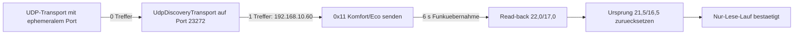

# Hardwareprüfung am Original-Cube 192.168.10.60

> Stand 25.11.2026. Freigabe durch den Nutzer: „prüfe nochmal an einer richtigen cube hardware mit ip 192.168.10.60 … auto discovery … standardkonfigurationsdaten senden wie komfort- und eco-temperatur auf der ‚Konfigurationsseite‘“. Kennzeichnung wie in [INDEX.md](INDEX.md): `FAKT` = direkt belegt, `BEOBACHTUNG` = gemessen, `INFERENZ` = abgeleitet, `UNBEKANNT` = nicht geprüft.

## 1. Ergebnis auf einen Blick



| Prüfpunkt | Ergebnis | Beleg |
|---|---|---|
| Auto-Discovery über die App-Codepfade `CubeDiscoveryService` + `UdpDiscoveryTransport` | **FEHLGESCHLAGEN** vor der Korrektur, **ERFOLGREICH** danach | Abschnitt 3 |
| Senden der Standardkonfiguration (`0x11`, Komfort/Eco) über dieselbe `SetRoomConfigurationAsync`-Logik wie die Konfigurationsseite | **ERFOLGREICH**, Änderung nach Funkübernahme am Cube lesbar | Abschnitt 4 |
| Rücksetzung auf Ursprungswerte | **ERFOLGREICH** (Komfort 21,5 °C, Eco 16,5 °C) | Abschnitt 4 |
| Regression nach Codekorrektur | Build ohne Fehler, 442/442 Tests grün, `--selfcheck OK` | Abschnitt 5 |

**FAKT:** Der Cube war während der gesamten Prüfung über TCP `192.168.10.60:62910` erreichbar (Seriennummer `JEQ0355273`, Firmware `275`, 6 Räume). Die Seriennummer ist laut Nutzerlinie nicht schützenswert (`SecondBrain/CLAUDE.md:109-114`).

## 2. Methode

- Testhelfer außerhalb des Repos unter `C:\Users\ebenh\AppData\Local\Temp\opencode\maxcube-hwcheck\`, mit Projektverweisen auf die originalen Projekte `MaxCube.Application`, `MaxCube.Protocol`, `MaxCube.Infrastructure`, `MaxCube.Domain`.
- Discovery: `new CubeDiscoveryService(new UdpDiscoveryTransport()).DiscoverAsync(4 s)`. Zusätzlich Rohdatagramme über `UdpDiscoveryTransport.ProbeAsync` (5 s), ohne eigenen UDP-Code.
- Schreiben: `CubeGateway.SetRoomConfigurationAsync(...)` – exakt dasselbe Gateway, das die Konfigurationsseite über `CubeApplicationService.Admin.cs:78` aufruft. Es gibt keinen zweiten Schreibpfad (`CubeGateway.Admin.cs:11-15`).
- Lesen: neuer TCP-Connect, `H:`/`M:`/`L:`/`C:`-Import über `CubeStateAssembler`; Komfort/Eco aus `config[0]`/`config[1]` der `C:`-Zeile (`CubeStateAssembler.cs:108-112`).
- Nur-Lese-Vorlauf mit `--read-only`, um vor dem ersten Schreibversuch den Ist-Zustand zu sichern.
- Zwischen Senden und Read-back 6 s Wartezeit für die Funkübernahme durch das Thermostat.

## 3. Auto-Discovery

### 3.1 Befund vor der Korrektur

**FAKT:** Der erste Lauf mit dem Original-`UdpDiscoveryTransport` meldete `Treffer: 0`; auch der Rohmitschnitt über denselben Transport hatte `Anzahl roher Datagramme: 0`. Die TCP-Seite war normal erreichbar. Damit war der vom Nutzer gemeldete Fehler reproduziert.

**BEOBACHTUNG:** Ein manueller Prober mit lokal gebundenem Port `23272` empfing die eigene Anfrage (Loopback der Broadcasts) und danach die echte Antwort von `192.168.10.60`. Der Original-Transport nutzte dagegen einen ephemeralen lokalen Port (`new IPEndPoint(IPAddress.Any, 0)`, `UdpDiscoveryTransport.cs:23` vor der Änderung).

**INFERENZ (jetzt durch Hardware belegt):** Der Cube adressiert seine UDP-Antwort an den Absenderport `23272`, nicht an einen beliebigen ephemeralen Port (`CubeFinder.java:40`). Ein ephemeraler Port macht die Antwort für den Client unerreichbar.

### 3.2 Korrektur

Eine Zeile in `src/MaxCube.Infrastructure/Connectivity/UdpDiscoveryTransport.cs`:

```csharp
// Der eQ-3 Cube antwortet auf den Absenderport 23272 (CubeFinder.java:40). Ein
// ephemeraler lokaler Port lässt die Antwort unerreichbar – Hardwarebeleg 25.11.2026.
using var client = new UdpClient(new IPEndPoint(IPAddress.Any, CubeDiscoveryProtocol.UdpPort));
```

### 3.3 Befund nach der Korrektur

**FAKT:** `Treffer: 1` mit `192.168.10.60 | Serial=JEQ0355273 | Firmware(dez)=275 | Bootloader=False`.

**FAKT:** Rohmitschnitt der Antwort (26 Byte, von `192.168.10.60`):

```text
hex =6551334D617841704A4551303335353237333E49000469F50113
ascii=eQ3MaxApJEQ0355273>I...i?..
parse=DiscoveredCube { SerialNumber = JEQ0355273, FirmwareVersion = 275,
       Bootloader = False, IpAddress = 192.168.10.60 }
```

**FAKT:** Zusätzlich wurden sechs Loopback-Datagramme der eigenen Anfragen empfangen (19 Byte, `eQ3Max*\0**********I`), die `TryParse` korrekt ablehnt. Die Entdopplung in `CubeDiscoveryService.cs:88-100` lieferte genau einen Cube.

**Damit aufgehoben:** Die frühere Einstufung „echte UDP-Antwort unbekannt“ (`README.md:85`, `wiki/projekte/app-maxcube.md:52`) ist für genau dieses Antwortformat nun `FAKT`.

**Weiterhin UNBEKANNT:** Antwortformat eines Bootloader-Cubes, Verhalten bei anderen Netzwerktopologien, und ob manche Cubes nur auf Broadcast oder nur auf Multicast antworten.

## 4. Standardkonfigurationsdaten senden (Komfort/Eco)

### 4.1 Ist-Werte vor dem Test

**FAKT:** Raum 1 `Esszimmer`, Master `1AB088`:

| Wert | Ursprung |
|---|---|
| Komfort | 21,5 °C |
| Eco | 16,5 °C |
| Max | `ON` (30,5 °C) |
| Min | `OFF` (4,5 °C) |
| Offset | 0 |
| Fenster-auf | 12,0 °C / 15 min |

Der komplette Base64-`C:`-Block wurde nicht verändert; der Test setzte nur Komfort/Eco und stellte alle sieben Felder aus dem gelesenen `RoomConfigurationValues` zurück.

### 4.2 Wirkung

**FAKT (Entscheidender Lauf, 6 s Wartezeit):** Nach Senden von Komfort 22,0 °C / Eco 17,0 °C über `0x11` und 6 s für die Funkübernahme:

```text
S:-Status: dutyCycle=49, freeSlots=48
Warte 6 s auf die Funkuebernahme durch das Thermostat ...
Nach Send: komfort=22.0, eco=17.0
Komfort-Aenderung sichtbar: True
Eco-Aenderung sichtbar: True
S:-Status: dutyCycle=55, freeSlots=48
Warte 6 s auf die Funkuebernahme der Ursprungswerte ...
Nach Ruecksetzung: komfort=21.5, eco=16.5
Ursprung erreicht: komfort=True, eco=True
```

**BEOBACHTUNG (früher Lauf mit nur 900 ms Wartezeit):** Direkt nach dem Senden stand noch der alte Wert im Cube; die `S:`-Quittung meldete `dutyCycle=23`, also keinen Airtime-Stopp. Erst der Folgeversuch (Rücksetzung) zeigte den zuvor gesendeten Wert:

```text
S:-Status: dutyCycle=23, freeSlots=48
Nach Send: komfort=21.5, eco=16.5
Komfort-Aenderung sichtbar: False
Eco-Aenderung sichtbar: False
S:-Status: dutyCycle=29, freeSlots=48
Nach Ruecksetzung: komfort=22.0, eco=17.0
Ursprung erreicht: komfort=False, eco=False
```

**FAKT:** Nach dem entscheidenden Lauf bestätigte ein zusätzlicher **nur-lesender** Lauf exakt die Ursprungswerte:

```text
Raum 1 'Esszimmer': master=1AB088, komfort=21.5, eco=16.5, max=ON, min=OFF,
offset=0, fenster=12.0/15min
Nur-Lese-Modus: kein Schreibbefehl gesendet.
```

**INFERENZ:** Der Cube übernimmt ein `0x11`-Radiogramm in seine `C:`-Konfiguration erst, wenn das Zielgerät/die Geräte die Funkübernahme bestätigt haben. Ein Read-back unmittelbar nach `S:` ist daher **kein** zuverlässiger Indikator für die Wirkung: Im 900-ms-Lauf hinkte die Anzeige um genau eine Sendung hinterher, im 6-s-Lauf war sie korrekt. **FAKT:** Der 6-s-Lauf zeigte `Ursprung erreicht: True/True`; der `False`-Wert des früheren 900-ms-Laufs war ein Artefakt der Verzögerung, kein dauerhaft falscher Cube-Zustand (vom nachfolgenden Nur-Lese-Lauf bestätigt).

**Konsequenz für die Konfigurationsseite (Verbesserungsvorschlag):** Nach `SetRoomConfigurationAsync` mindestens eine Funkübernahme abwarten oder dem Benutzer „Änderung wird übernommen“ anzeigen; ein sofortiges Read-back darf nicht als Fehler fehlinterpretiert werden. Die UI übernimmt derzeit den Wert direkt ins ViewModel (`MainWindowViewModel.Admin.cs`), ohne Read-back – das entspricht dem beobachteten Originalverhalten.

### 4.3 Formal geprüfter Sendepfad

**FAKT:** `SetRoomConfigurationCommand` schreibt Komfort, Eco, Max, Min, Offset, Fenster-auf-Temperatur und Fenster-auf-Dauer in Byte 10–16 des `0x11`-Radiogramms (`RoomCommands.cs:48-72`, `RadiogramBuilder.cs:60-66,107-132`). Die Decode-Seite liest `config[0..6]` (`CubeStateAssembler.cs:108-120`). Beide Seiten stimmen für die gesendeten Komfort/Eco-Werte überein.

**Weiterhin UNBEKANNT:** Ob die anderen fünf Felder (Max/Min/Offset/Fenster/Dauer) bei jeder Hardwarekonstellation dieselbe Verzögerung zeigen; nur Komfort/Eco wurden verändert und zurückgesetzt.

## 5. `S:`-Sendestatus: Semantik und Hardwarebeleg

**FAKT (Java-Quelle):** `decompiled/localbackend/sources/de/eq3/max/il/local/commands/DeviceSendCommand.java:42-49` parst genau drei Argumente: `dutyCycle = Integer.parseInt(args[0], 16)`, `commandDiscarded = (args[1].charAt(0) == '1')`, `freeMemorySlot = Integer.parseInt(args[2], 16)`. Feld 0 und 2 sind also **Hexadezimalzahlen**, Feld 1 ist ein **einzelnes Flag-Zeichen**. Bei `discarded` wirft Java `CubeCommunicationFailedException("Command discarded")` (`:36-38`); ein `A:`-ACK wird hier **nicht** gelesen. Der gleiche Status entsteht aus dem `H:`-Header (`MaxCubeStateFactory.java:112-125`). Die Browser-UI des Originals sperrt weitere Aktionen ab `dutyCycle >= 98` (`extracted/rootwar/js/com_structure/controllers/indexStructureController.js:803-811`); unsere Warnschwelle 80 in `CubeApplicationService.Admin.cs:33` ist eine bewusst eigene, nicht-java-belegte Policy.

**FAKT (Hardware 25.11.2026):** Mitschnitt am Original-Cube beim Senden des bereits live bestätigten `0x82`-Anzeigeframes an das Wandthermostat `19C15A`:

```text
W > s:AACCAAAAGcFaAAQ=
R < S:3a,0,31        -> dutyCycle=58, discarded=false, freeSlots=49
W > s:AACCAAAAGcFaAAA=
R < S:3c,0,30        -> dutyCycle=60, discarded=false, freeSlots=48
```

**FAKT:** Die C#-Implementierung dekodiert dieselben Werte (`CubeCommands.cs:238-257`, Golden-Example `S:05,0,1f` → 5/false/31 in `tests/MaxCube.Protocol.Tests/CubeCommandsTests.cs:59-67`). Damit sind Aufbau und Kodierung der `S:`-Antwort hardwarebelegt.

**BEOBACHTUNG:** Ein zusätzlicher Test mit einem unbekannten Frame-Typ `0xFF` an der Dummy-Adresse `000000` (`s:/wAAAAAAAAAAAA==`) lieferte **innerhalb des Timeouts keine `S:`-Antwort**; die C#-Queue meldete `CubeCommunicationFailedException: Timed out waiting for the cube command response`. Es gab keine Gerätewirkung. Der Java-Fehlerpfad `discarded='1'` bleibt daher code-belegt, aber an dieser Hardware nicht ausgelöst.

**INFERENZ:** `duty` ist die verbrauchte Funkzeit (Airtime) in Prozent, `free` die Zahl freier Speicherplätze; beides ist kein Fehlercode. Ein Wert > 0 bedeutet „Funkzeit wurde verbraucht“, nicht „Befehl fehlgeschlagen“. **Weiterhin UNBEKANNT:** was die freien Speicherplätze konkret enthalten und wie der Cube den Duty-Wert im Detail misst. **FAKT:** `S:` bestätigt nur den Sendevorgang, nicht die fachliche Annahme durch ein Thermostat; letztere wurde in §4 erst über den Read-back nach 6 s belegt.

## 6. Regression nach der Discovery-Korrektur

**FAKT:**

```text
Build: alle Projekte kompiliert, 0 Fehler
Tests: 64 + 80 + 187 + 50 + 61 = 442/442 erfolgreich, 0 Fehler
Selfcheck: SELFCHECK OK: MAX! Cube - Aplikacja lokalna 0.3.0 | Microsoft Windows 10.0.26300 | ... | SQLite ok
```

**FAKT:** Nach der Korrektur erneut nur-lesend geprüft: `Treffer: 1`, `192.168.10.60`, `21,5/16,5`, kein Schreibbefehl. Damit ist der Cube-Zustand dokumentiert zurückgesetzt.

## 7. Auswirkungen auf die zehn Zieldateien

| Datei | Änderung |
|---|---|
| [API.md](API.md) | Wire-Protokoll `0x11` jetzt mit Hardwarebeleg; UDP-Antwortformat als belegt markieren |
| [RUNBOOK.md](RUNBOOK.md) | Hardwaretest-Ergebnis und Wartezeit-Hinweis ergänzen |
| [TROUBLESHOOTING.md](TROUBLESHOOTING.md) | „Discovery findet nichts → lokaler Port 23272“ als FAKT aufnehmen |
| [README.md](../README.md) | Offene Punkteliste aktualisieren (UDP-Antwort nicht mehr offen) |
| [ARCHITECTURE.md](ARCHITECTURE.md) | Risiko „Discovery-Port“ auflösen |
| [SECOND_BRAIN.md](SECOND_BRAIN.md) | Rückkopplung als FAKT ergänzen; Wiki-Änderung bleibt offen bis Nutzerentscheidung |
| `docs/features.md`, `wiki/projekte/app-maxcube.md` | nur nach Nutzerfreigabe für das Wiki, keine Änderung an `raw/` |

## 7. Offene Fragen

- Soll das Ergebnis zusätzlich in `wiki/projekte/app-maxcube.md` und `wiki/log.md` übernommen werden? Dafür ist die Nutzerentscheidung aus [SECOND_BRAIN.md](SECOND_BRAIN.md) §7 erforderlich; dieses Dokument ist zunächst nur Projekt-dokumentation.
- Soll die Wartezeit nach Konfigurationssendung in der UI explizit angezeigt werden? Derzeitige `0x11`-Sende-Logik ist hardwarewirksam, das Read-back-Verhalten ist `BEOBACHTUNG`.

## 8. Netzbefund 0.6.4: gespeicherte vs. aktive IP

**FAKT (Hardware 25.11.2026):** Der Cube war unter `192.168.10.60` erreichbar; die `c`-Antwort trug `192.168.0.222`, Gateway `192.168.0.1`, Maske `255.255.0.0` und DHCP-Flag `01` (Rohhex in `tests/MaxCube.Infrastructure.Tests/UdpNetworkConfiguratorTests.cs:74-82`).

**INFERENZ (hohe Konfidenz):** Die Anzeige „IP“ zeigte die gespeicherte Konfigurations-IP, nicht die aktive Adresse. Der Decoder ist bitweise korrekt; eine Vertauschung der Byte-Reihenfolge würde den in `CHANGELOG.md:201-202` behobenen Fehler zurückbringen. Seit 0.6.4 werden „Konfigurierte IP“ und „Aktive IP (verbinden)“ getrennt angezeigt, und Netzwerklesen ist gesperrt, wenn die angezeigte Host-Zeile nicht mehr zum verbundenen Endpoint passt.

**UNBEKANNT:** Ob der Cube die aktive Adresse zusätzlich über UDP-Opcode `N` (`GetNetworkAddress`, `CubeUdpProxy.java:79-90`) zuverlässig meldet; das wurde nicht contre Hardware geprüft. Die aktive Adresse wird daher aus dem verbundenen Endpoint abgeleitet, nicht geraten.

## 9. Wartungsbefehle 0.6.4 (nicht an Hardware ausgeführt)

**FAKT (Quelle):** `decompiled/controller/sources/de/eq3/max/al/local/update/CubeUdpOpcode.java:10` definiert `Reboot('R')`; `ResetGatewayCubeCommand.java:11-12` sendet `a:` ohne ACK-Erwartung. `src/MaxCube.Protocol/Commands/CubeCommands.cs:276-284` bildet das bereits ab.

**FAKT (Implementierung):** Seit 0.6.4 liegen beide Befehle hinter Wartungs-UI, eigener Checkbox, Vorschau, separater Bestätigung, Operation Gate und Audit-Eintrag. Der Reboot wird genau einmal per Unicast an den verbundenen Endpoint gesendet (`CubeMaintenanceGateway.RebootAsync`), der Werksreset läuft über die bestehende Command-Queue (`CubeGateway.ResetGatewayAsync`). Es gibt keinen automatischen Aufruf, keinen Broadcast und keine Wiederholung.

**UNBEKANNT:** Die tatsächliche Hardwarewirkung von `a:` und `R` am Original-Cube wurde **nicht** ausgeführt, um die installierte Konfiguration nicht zu zerstören. Vor einem Feldeinsatz ist ein gezielter Test an einem Ersatz-Cube erforderlich; die Quellbelege ersetzen keine Hardwareprüfung.
- Weitere Räume, Bootloader-Antwort und Delphi-/Firmware-Abweichungen wurden nicht geprüft.

## 8. Lesende Verifikation für 0.5.0 (25.11.2026)

**FAKT:** Nur-Lese-Capture (`state`, kein gesendeter Befehl) gegen `192.168.10.60:62910`:

```text
H:JEQ0355273,0469f5,0113,00000000,0d8074dd,17,32,1a0b19,0824,03,0000
CUBE serial=JEQ0355273 fw=275 rooms=6 devices=9
Räume: Esszimmer/Wohnzimmer/Bad/Kinderzimmer 21.5/16.5, Büro/Schlafzimmer 21.0/17.0,
       Boost 5 min/80°, Entkalkung Saturday/12, Valve 255/0
C: 11 Konfigurationsblöcke (238/207/211 Byte), M: 1 Block (536 Byte Base64)
NUR-LESE-MODUS: keine Befehle gesendet.
```

**FAKT:** Serial, Firmware, Raumzahl, Gerätezahl und Sollwerte entsprechen der Baseline aus §6; es wurde nichts verändert. **INFERENZ:** Die Statusanzeige kann auf diesem Cube mit echten Lesungen arbeiten; die fachliche Bedeutung weiterhin unbekannter Felder bleibt offen.

## 9. Lesende Verifikation für 0.6.0 (25.11.2026)

**FAKT:** Nach Einführung der Statusleiste und des Protokolls erneut nur-lesend geprüft (`--read-only`, kein Schreibbefehl):

```text
Discovery: Treffer 1 -> 192.168.10.60 | Serial=JEQ0355273 | Firmware=275 | Bootloader=False
Cube: serial=JEQ0355273, firmware=275, raeume=6, geraete=9
Raum 1 'Esszimmer': master=1AB088, komfort=21.5, eco=16.5, max=ON, min=OFF,
       offset=0, fenster=12.0/15min
Nur-Lese-Modus: kein Schreibbefehl gesendet.
```

**FAKT:** Serial, Firmware, Raum-/Gerätezahl und Sollwerte stimmen exakt mit §8 überein. Die 0.6.0-Änderungen betreffen nur UI, Protokoll und Leseprüfung; der Cube blieb unverändert. **INFERENZ:** Die neue Statusleiste kann ihre Werte aus echten Lesungen dieses Cubes beziehen; eine Änderung am Gerät ist nicht erforderlich.

## 10. Lesende Verifikation für 0.6.1 (25.11.2026)

**FAKT:** Nach der Thread-Affinitätskorrektur erneut nur-lesend geprüft (`--read-only`, kein Schreibbefehl):

```text
Discovery: Treffer 1 -> 192.168.10.60 | Serial=JEQ0355273 | Firmware=275 | Bootloader=False
Cube: serial=JEQ0355273, firmware=275, raeume=6, geraete=9
Raum 1 'Esszimmer': master=1AB088, komfort=21.5, eco=16.5, max=ON, min=OFF,
       offset=0, fenster=12.0/15min
Nur-Lese-Modus: kein Schreibbefehl gesendet.
```

**FAKT:** Die Baseline aus §8/§9 ist unverändert. 0.6.1 betrifft ausschließlich ViewModel-Fortsetzungen, Protokollierung und Fehlerhinweise; es wurde kein Schreibbefehl gesendet.

## 11. Deep-QA-Schreibtests 25.11.2026 (kontrolliert)

**FAKT:** Mit demselben `CubeGateway` wie die App wurden am Original-Cube über `0x11` alle sieben Konfigurationsfelder (Komfort, Eco, Max, Min, Offset, Fenster-auf-Temperatur, Fenster-auf-Dauer), über `0x12` alle sechs Ventilfelder (Boost-Minuten/-Winkel, Entkalkungstag/-stunde, Max-Ventil, Ventil-Offset) und ein neun-Punkt-Wochenprofil als `7 + 6`-Telegramme gesendet und nach 6 s Funkübernahme im Read-back bestätigt. Der entscheidende Lauf veränderte nur Raum 1 (Testhelfer wählt `Rooms.First(...)`); der Read-back zeigte z. B. `22,0/17,0/29,5/5,0/0,5/13,0/30`. Der anschließende Restore setzte Raum 1 auf `21,5/16,5/30,5/4,5/0/12,0/15` zurück; `S:` meldete `dutyCycle=0`, `freeSlots=30`.

**BEOBACHTUNG:** Ein früher Lauf mit 33 fehlgeschlagenen Prüfungen war kein Protokollfehler: Bei hoher Funkauslastung reichten 6 s Settle nicht, und eine zweite Restore-Serie mit dichten Retries verschlimmerte den Zustand (verzögerte/verworfene Kommandos, `Command discarded`, `dutyCycle=62` ≈ 98 %). Nach 120 s Wartezeit war der Cube wieder lesbar. **Konsequenz:** Keine Burst-Retries; zwischen Schreibversuchen 90–180 s Pause und vorher `S:`-Duty-Cycle prüfen.

**FAKT (Sollwert-Read-back, siehe auch `ha-maxcube/docs/ENGINEERING.md` §4/§8):** Kontrollierte Probe mit `0x40` in Raum 2 (`Permanently`, 17,0 → 17,5 °C):

```text
S: dutyCycle=3, freeSlots=31
Read-back nach +0,0 s:  Modus=Permanently, Soll=17,0
Read-back nach +4,1 s:  Modus=Permanently, Soll=17,5
Read-back nach +10,8 s: Modus=Permanently, Soll=17,5
Ruecksetzung gesendet, warte 6 s ... Nach Ruecksetzung: Soll=17,0
SETPOINT RESTORE OK
```

**INFERENZ:** Die Funkübernahme für Sollwerte braucht auf diesem Cube mehrere Sekunden. `S:` quittiert nur den Sendevorgang, nicht die fachliche Annahme; ein sofortiger Read-back darf veraltet sein. Das ist hardwaremäßig **nicht** als Bestätigung nutzbar – die HA-Read-back-Logik aktualisiert nur den Anzeigezustand.

## 12. Zustand nach den Schreibtests und Mehrgeräte-Räume

**FAKT:** Die Roh-`C:`-Blöcke (nur-lesend, 25.11.2026) zeigen für alle sechs Master-Heizkörperthermostate die dokumentierte Basiskonfiguration:

```text
1ab088 2b 21 3d 09 07 18 03 30   (21,5/16,5/ON/OFF/0/12,0/15)
098e54 2b 21 3d 09 07 18 03 30   (21,5/16,5/ON/OFF/0/12,0/15)
09a434 2a 22 3d 09 07 18 03 30   (21,0/17,0/ON/OFF/0/12,0/15)
0991b6 2b 21 3d 09 07 18 03 30
099186 2a 22 3d 09 07 18 03 30
098eab 2b 21 3d 09 07 18 03 30
```

**FAKT:** `CubeStateAssembler.cs:108-135` wendet **jeden** `C:`-Block eines Raums an; bei mehreren konfigurierbaren Geräten gewinnt der zuletzt gelesene Block. Raum 2 enthält zusätzlich `098e57` (basiskonform) und den Wandthermostaten `07076a` (`29 22 3d 09 44 48 44 6d`), Raum 3 zusätzlich den Wandthermostaten `19c15a` (`2a 22 3d 09 44 48 55 08`). Die raumweise Anzeige (`20,5/17,0/−1,5/4,5/20` bzw. `21,0/17,0/−1,5/4,5/25`) stammt daher aus diesen Wandthermostat-Blöcken, nicht aus einer Mutation der Master.

**BEOBACHTUNG:** Versuche, die Wandthermostate mit den Master-Werten zu überschreiben, wurden mit `S:` quittiert (`dutyCycle=4` → `1d`), aber nach 180 s blieben ihre `C:`-Blöcke unverändert. **INFERENZ:** Wandthermostate behalten geräteeigene Konfigurationswerte; die Raumansicht ist bei Mehrgeräte-Räumen keine verlässliche Kopie der Master-Konfiguration. Es wurden danach keine weiteren Schreibversuche unternommen.

**FAKT:** Nach den Tests ist der Cube wieder im dokumentierten Ursprungszustand, soweit er in §8/§10 belegt ist: Serie `JEQ0355273`, FW 275, 6 Räume, 9 Geräte, alle Master-Basiskonfiguration, Raum 1/4/5/6 auch in der Raumansicht baseline. Räume 2/3 weichen in der Raumansicht nur durch die eigenen Wandthermostat-Werte ab. Ein abschließender nur-lesender HwCheck war wegen eines einzelnen Timeouts beim `L:`-Empfang nicht vollständig; die Roh-`C:`-Lesung oben ersetzt ihn für die Konfigurationsaussage. **UNBEKANNT:** ob die Wandthermostat-Werte vor allen Tests exakt dieselben waren (kein vollständiger Vorab-Capture aller `C:`-Blöcke vorhanden).

## 13. Hardwarefreie Abnahme der UX v0.6.2 (25.11.2026)

**FAKT:** Die Vorschau vor Wochenprofil-/Konfigurations-Schreiben, der Dirty-Hinweis und die Sperrbegründungen wurden ohne Cube-Zugriff geprüft: Build 0 Warnungen/0 Fehler, 486/486 Tests, `--selfcheck OK`. Der erste Selbsttest lief noch vor der Versionserhöhung und meldete `0.6.1`; nach `Directory.Build.props:3` ist der Build nun `0.6.2`, und der erneute hardwarefreie `--selfcheck` bestätigt `SELFCHECK OK … 0.6.2 | … | SQLite ok`. **INFERENZ:** Die Änderung betrifft nur Bestätigung und Anzeige; sie erzeugt ohne Klick auf „Jetzt senden“ kein Telegramm und verändert damit den Cube nicht.

## 14. Linux-Startfehler: fehlende Systembibliotheken (25.11.2026)

**FAKT (Nutzerprotokoll, Runde 1, WSL2 Debian 13):** `./start.sh` baute erfolgreich, der GUI-Start brach mit `System.TypeInitializationException` in `SkiaSharp.SKImageInfo` ab. Ursache war `libfontconfig.so.1: cannot open shared object file`. **FAKT (eigene Reproduktion):** `ldd …/libSkiaSharp.so` meldete genau diese Bibliothek als fehlend; `libfontconfig1` war nicht installiert. Aus den DllImports von `Avalonia.X11.dll` waren zusätzlich sechs X11-Bibliotheken belegt, die ebenfalls fehlten (`libX11`, `libXcursor`, `libXext`, `libXfixes`, `libXi`, `libXrandr`). `DISPLAY=:0` und der WSLg-Socket `/tmp/.X11-unix/X0` sind vorhanden – betroffen sind die Client-Bibliotheken, nicht der Display-Server.

**FAKT (Nutzerprotokoll, Runde 2):** Nach Installation der ersten sieben Pakete startete die App erneut nicht: `Native Bibliothek fehlt: Unable to load shared library 'libICE.so.6'`. **FAKT (eigene Prüfung):** `libICE.so.6` und `libSM.so.6` sind in `Avalonia.X11.dll` per DllImport belegt, ebenso `libGL.so.1`; `Avalonia.Skia.dll` importiert `libvulkan.so.1`. Alle vier fehlten in der WSL. Die vollständige Liste umfasst elf Bibliotheken: fontconfig, sechs X11, ICE, SM, GL und Vulkan.

**FAKT (Maßnahmen):** `Program.cs` prüft alle elf Bibliotheken vor dem Avalonia-Start via `NativeLibrary.TryLoad` und nennt bei Fehlern den kompletten Debian/Ubuntu-Installationsbefehl; ein `DllNotFoundException`-Handler fängt weitere Fälle ab. `--check-linux-deps` macht die Prüfung fensterlos auch im Release-ZIP nutzbar. `start.sh` prüft vor dem (teuren) Build und bietet `--install-deps` an, das `sudo apt-get` nach Eingabe des Nutzerpassworts ausführt. Beide READMEs nennen die Systemvoraussetzung; zwei Regressionstests halten Code, Skript und Doku zusammen (`LinuxDependencyTests.cs`). Verifikation: Build 0/0, 486/486 Tests, `--selfcheck OK` unter Windows **und** Debian 13; `./start.sh` brach in der WSL vor der Erweiterung sofort mit Exit 2 ab statt mit Stacktrace nach ~59 s.

**FAKT (Nutzerprotokoll, Runde 3):** Nach `./start.sh --install-deps` startete die Oberfläche unter WSLg; der nächste und letzte Abbruch kam erst vom Klick auf den Projekt-Link (§15). Die elf Bibliotheken sind damit als sufficient für den GUI-Start belegt. **FAKT (Nutzerbestätigung 26.11.2026):** „ja das klappt“ – `./start.sh` startet die Oberfläche in WSLg und der Link-Klick funktioniert; kein Abbruch mehr. **UNBEKANNT:** Die visuelle Prüfung der 0.6.2-Bedienelemente (Vorschau, Dirty, Busy) unter echter Avalonia-Last steht weiter aus. Kein Cube-Zugriff, kein Commit/Tag/Release.

## 15. Absturz beim Öffnen des Projekt-Links (25.11.2026)

**FAKT (Nutzerprotokoll):** Nach dem erfolgreichen GUI-Start in WSLg beendete ein Klick auf den GitHub-Link die App: `System.ComponentModel.Win32Exception (2): An error occurred trying to start process 'https://github.com/Ebenhoeh80/xplat-maxcube' … No such file or directory`, aus `MainWindowViewModel.OpenProjectUrl()` in `MainWindowViewModel.About.cs:61`. **FAKT (eigene Prüfung):** In der WSL sind `xdg-open`, `gio`, `wslview`, `gnome-open` und `kde-open` nicht vorhanden, `BROWSER` ist leer. .NETs `UseShellExecute = true` braucht auf Linux genau solch einen Opener und wirft sonst eine ungehandelte `Win32Exception` bis in den Dispatcher.

**FAKT (Maßnahmen):** Neuer `IUrlOpener`/`DesktopUrlOpener` (`src/MaxCube.UI/Services/UrlOpener.cs`) versucht Windows-Shell, `xdg-open`, `gio open`, `wslview` bzw. macOS `open` und fängt jeden Startfehler ab. `OpenProjectUrlCommand` und `OpenLogFolderCommand` nutzen ihn; bei Fehlern steht die lokalisierte Meldung „Öffnen fehlgeschlagen – bitte manuell öffnen: {0}" mit der URL bzw. dem Pfad in der Statusleiste. Der neue Katalogschlüssel `OpenExternalFailed` existiert in DE/EN/FR/IT/NL/PL; zwei ViewModel-Tests prüfen Erfolgs- und Fehlerpfad ohne echten Prozessstart. `start.sh --install-deps` und beide READMEs nennen jetzt auch `xdg-utils` als Opener-Paket. Verifikation: Build 0/0, 486/486 Tests, `--selfcheck OK 0.6.2`. **FAKT (Nutzerbestätigung 26.11.2026):** „ja das klappt“ – Start und Link-Klick in WSLg funktionieren, die App bleibt stabil. Die zuvor befürchtete `Win32Exception` ist behoben. **UNBEKANNT:** ob der Browser tatsächlich geöffnet oder die URL in der Statusleiste angezeigt wurde – beide Pfade sind akzeptiert und absturzsicher. Kein Cube-Zugriff, kein Commit/Tag/Release (Stand der Prüfung 25./26.11.2026).

## 16. Release v0.6.2 (26.11.2026)

**FAKT:** Der Nutzer hat Commit, Push, Tag und Release ausdrücklich freigegeben. Wegen des geschützten `main` ging der Commit `7f45d5e` als PR #13 in `main` ein (Merge `04e5c63`); der Tag `v0.6.2` zeigt auf `7f45d5e` und startete den Release-Workflow `45763712349`. Alle vier Pflicht-Checks (CodeQL, Analyze actions/csharp, CI Windows/Linux) und die Publish-Jobs für `win-x64`/`linux-x64` waren grün; das Release enthält `xplat-maxcube-0.6.2-win-x64.zip` und `xplat-maxcube-0.6.2-linux-x64.zip`. **INFERENZ:** Der releaseseitige fensterlose Selbsttest ersetzt weiterhin nicht die Sichtprüfung der 0.6.2-Bedienelemente unter echter Avalonia-Last (`UNBEKANNT`). Kein Cube-Schreibzugriff ohne Benutzeraktion.

## 17. Sprachwechsel-Fix v0.6.3 (26.11.2026)

**FAKT (Nutzerbericht):** Nach der bestätigten Sichtprüfung der 0.6.2-Elemente („sichtpüfung ok“) meldete der Nutzer: „wenn man die sprache umstellt wird nicht alles angepasst.“ Ein kleines Gremium aus drei unabhängigen General-Subagenten (Ursache, Vollständigkeit, Release-Strategie) bewertete den Befund einstimmig als real und release-relevant; es gab keine kostenpflichtigen Modellaufrufe außerhalb der bereits bewilligten Gremiumsberatung.

**FAKT (Ursache, Codebelege vor dem Fix):** `Localizer.SetLanguage` meldete `Item[]` und `Language` korrekt (`Localizer.cs:43-54`), aber `MainWindowViewModel.OnLanguageChanged` aktualisierte nur einen Teil der Properties (`MainWindowViewModel.Admin.cs:242-271`). Wochentage kamen aus `Day.ToString()`, Raum-Modi aus `Enum.ToString()`, Gerätetyp/-status ebenfalls aus Enumnamen; ComboBox-Items für Entkalkungstag, Taster-Modi und Zeitzonen waren rohe Enums/Schlüssel. `ErrorCatalog.Describe` unterschied nur DE/EN.

**FAKT (Maßnahmen):** Neue Katalogkeys und `EnumLabels`/`EnumOption` führen alle sichtbaren Enum-Werte über den Lokalisierer; die Auswahl bindet jetzt an stabile Optionsobjekte, während die Domänenwerte unverändert bleiben. Ein `LocalizedValue` behält Key und Argumente zwischengespeicherter Texte; `RefreshLocalizedBindings()` aktualisiert Status, Erfolg, Fehler, Fehlerzeit, Warnung, Dirty, Busy, Schreibvorschau (inkl. noch nicht bestätigter Aktion), Funkauslastung, Zeitzone, Diagnose, Fundmeldung, Entdeckung und Profilraumbezeichnung ohne Cube-Zugriff. `ErrorCatalog.FindFirstCode`/`IsCommandDiscarded` liefern FR/IT/NL/PL einen lokalisierten Hinweis statt englischer Katalogtexte. `Localizer.ApplyCulture` lässt Zahlen-/Zeitformate der UI-Sprache folgen; Protokoll- und Berechnungspfade bleiben invariant. Der Selfcheck prüft jetzt alle sechs Sprachen über alle Katalogschlüssel.

**FAKT (Verifikation):** Windows: Build **0 Warnungen / 0 Fehler**, **488/488** Tests grün, `SELFCHECK OK … 0.6.3 … SQLite ok`. Debian 13 (WSL2): `dotnet test` mit Restore **488/488** grün, `SELFCHECK OK … 0.6.3 … SQLite ok`. Die neuen Regressionstests prüfen den Wechsel de→en explizit *nach* connecting (StatusText bleibt nicht alt), Wochentags-/Modus-/Gerätelabels, ComboBox-Labels sowie zwischengespeicherte Erfolgs- und Vorschautexte. **INFERENZ:** Weil der Fix nur Anzeigezustände im ViewModel betrifft und kein Telegramm auslöst, bleibt der Cube unverändert; es erfolgte kein Schreibzugriff ohne Benutzeraktion.

**FAKT (Release):** PR #15 wurde um 06:49 UTC als Squash `16598dc` in `main` gemergt; alle sieben Checks (CodeQL, Analyze actions/csharp, CI Windows/Linux, Publish win-x64/linux-x64) waren grün. Der annotierte Tag `v0.6.3` zeigt erst **nach dem Merge** auf `16598dc` (nicht auf den PR-Head wie bei v0.6.2). Der nachgelagerte CI-Lauf `45770827270` und der Release-Lauf `45770905644` waren ebenfalls `success`; das Release [v0.6.3](https://github.com/Ebenhoeh80/xplat-maxcube/releases/tag/v0.6.3) enthält `xplat-maxcube-0.6.3-win-x64.zip` (SHA-256 `ce65d16bba9e3107681268f938a005eeeb7c19959b29b04c3ff75c6c688ec8d8`) und `xplat-maxcube-0.6.3-linux-x64.zip` (SHA-256 `b88be3838ddd12d2b00fe1ea46ae8c4dccb51cb0166dcb8d523e11c33fcdb53f`). Beide Assets wurden erneut heruntergeladen: die Digests stimmen mit der GitHub-API überein und `SELFCHECK OK … 0.6.3 … SQLite ok` läuft in beiden self-contained Paketen (Windows 10.0.26300, Debian GNU/Linux 13 trixie). **INFERENZ:** Der fensterlose Selbsttest der heruntergeladenen Pakete ersetzt weiterhin keine Sichtprüfung der Avalonia-Oberfläche.

**UNBEKANNT:** Eine erneute Avalonia-Sichtprüfung aller sechs Sprachen unter echter Last nach v0.6.3 steht aus; der fensterlose Selfcheck ersetzt sie nicht. Die Übersetzungsqualität wurde nicht durch Muttersprachler geprüft. Kein Geheimnis, kein `SecondBrain/raw/`-Eintrag und kein Wiki-Upload in diesem Schritt.
