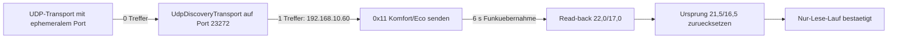

# Hardwareprüfung am Original-Cube 192.168.10.60

> Stand 25.11.2026. Freigabe durch den Nutzer: „prüfe nochmal an einer richtigen cube hardware mit ip 192.168.10.60 … auto discovery … standardkonfigurationsdaten senden wie komfort- und eco-temperatur auf der ‚Konfigurationsseite‘“. Kennzeichnung wie in [INDEX.md](INDEX.md): `FAKT` = direkt belegt, `BEOBACHTUNG` = gemessen, `INFERENZ` = abgeleitet, `UNBEKANNT` = nicht geprüft.

## 1. Ergebnis auf einen Blick



| Prüfpunkt | Ergebnis | Beleg |
|---|---|---|
| Auto-Discovery über die App-Codepfade `CubeDiscoveryService` + `UdpDiscoveryTransport` | **FEHLGESCHLAGEN** vor der Korrektur, **ERFOLGREICH** danach | Abschnitt 3 |
| Senden der Standardkonfiguration (`0x11`, Komfort/Eco) über dieselbe `SetRoomConfigurationAsync`-Logik wie die Konfigurationsseite | **ERFOLGREICH**, Änderung nach Funkübernahme am Cube lesbar | Abschnitt 4 |
| Rücksetzung auf Ursprungswerte | **ERFOLGREICH** (Komfort 21,5 °C, Eco 16,5 °C) | Abschnitt 4 |
| Regression nach Codekorrektur | Build ohne Fehler, 442/442 Tests grün, `--selfcheck OK` | Abschnitt 5 |

**FAKT:** Der Cube war während der gesamten Prüfung über TCP `192.168.10.60:62910` erreichbar (Seriennummer `JEQ0355273`, Firmware `275`, 6 Räume). Die Seriennummer ist laut Nutzerlinie nicht schützenswert (`SecondBrain/CLAUDE.md:109-114`).

## 2. Methode

- Testhelfer außerhalb des Repos unter `C:\Users\ebenh\AppData\Local\Temp\opencode\maxcube-hwcheck\`, mit Projektverweisen auf die originalen Projekte `MaxCube.Application`, `MaxCube.Protocol`, `MaxCube.Infrastructure`, `MaxCube.Domain`.
- Discovery: `new CubeDiscoveryService(new UdpDiscoveryTransport()).DiscoverAsync(4 s)`. Zusätzlich Rohdatagramme über `UdpDiscoveryTransport.ProbeAsync` (5 s), ohne eigenen UDP-Code.
- Schreiben: `CubeGateway.SetRoomConfigurationAsync(...)` – exakt dasselbe Gateway, das die Konfigurationsseite über `CubeApplicationService.Admin.cs:78` aufruft. Es gibt keinen zweiten Schreibpfad (`CubeGateway.Admin.cs:11-15`).
- Lesen: neuer TCP-Connect, `H:`/`M:`/`L:`/`C:`-Import über `CubeStateAssembler`; Komfort/Eco aus `config[0]`/`config[1]` der `C:`-Zeile (`CubeStateAssembler.cs:108-112`).
- Nur-Lese-Vorlauf mit `--read-only`, um vor dem ersten Schreibversuch den Ist-Zustand zu sichern.
- Zwischen Senden und Read-back 6 s Wartezeit für die Funkübernahme durch das Thermostat.

## 3. Auto-Discovery

### 3.1 Befund vor der Korrektur

**FAKT:** Der erste Lauf mit dem Original-`UdpDiscoveryTransport` meldete `Treffer: 0`; auch der Rohmitschnitt über denselben Transport hatte `Anzahl roher Datagramme: 0`. Die TCP-Seite war normal erreichbar. Damit war der vom Nutzer gemeldete Fehler reproduziert.

**BEOBACHTUNG:** Ein manueller Prober mit lokal gebundenem Port `23272` empfing die eigene Anfrage (Loopback der Broadcasts) und danach die echte Antwort von `192.168.10.60`. Der Original-Transport nutzte dagegen einen ephemeralen lokalen Port (`new IPEndPoint(IPAddress.Any, 0)`, `UdpDiscoveryTransport.cs:23` vor der Änderung).

**INFERENZ (jetzt durch Hardware belegt):** Der Cube adressiert seine UDP-Antwort an den Absenderport `23272`, nicht an einen beliebigen ephemeralen Port (`CubeFinder.java:40`). Ein ephemeraler Port macht die Antwort für den Client unerreichbar.

### 3.2 Korrektur

Eine Zeile in `src/MaxCube.Infrastructure/Connectivity/UdpDiscoveryTransport.cs`:

```csharp
// Der eQ-3 Cube antwortet auf den Absenderport 23272 (CubeFinder.java:40). Ein
// ephemeraler lokaler Port lässt die Antwort unerreichbar – Hardwarebeleg 25.11.2026.
using var client = new UdpClient(new IPEndPoint(IPAddress.Any, CubeDiscoveryProtocol.UdpPort));
```

### 3.3 Befund nach der Korrektur

**FAKT:** `Treffer: 1` mit `192.168.10.60 | Serial=JEQ0355273 | Firmware(dez)=275 | Bootloader=False`.

**FAKT:** Rohmitschnitt der Antwort (26 Byte, von `192.168.10.60`):

```text
hex =6551334D617841704A4551303335353237333E49000469F50113
ascii=eQ3MaxApJEQ0355273>I...i?..
parse=DiscoveredCube { SerialNumber = JEQ0355273, FirmwareVersion = 275,
       Bootloader = False, IpAddress = 192.168.10.60 }
```

**FAKT:** Zusätzlich wurden sechs Loopback-Datagramme der eigenen Anfragen empfangen (19 Byte, `eQ3Max*\0**********I`), die `TryParse` korrekt ablehnt. Die Entdopplung in `CubeDiscoveryService.cs:88-100` lieferte genau einen Cube.

**Damit aufgehoben:** Die frühere Einstufung „echte UDP-Antwort unbekannt“ (`README.md:85`, `wiki/projekte/app-maxcube.md:52`) ist für genau dieses Antwortformat nun `FAKT`.

**Weiterhin UNBEKANNT:** Antwortformat eines Bootloader-Cubes, Verhalten bei anderen Netzwerktopologien, und ob manche Cubes nur auf Broadcast oder nur auf Multicast antworten.

## 4. Standardkonfigurationsdaten senden (Komfort/Eco)

### 4.1 Ist-Werte vor dem Test

**FAKT:** Raum 1 `Esszimmer`, Master `1AB088`:

| Wert | Ursprung |
|---|---|
| Komfort | 21,5 °C |
| Eco | 16,5 °C |
| Max | `ON` (30,5 °C) |
| Min | `OFF` (4,5 °C) |
| Offset | 0 |
| Fenster-auf | 12,0 °C / 15 min |

Der komplette Base64-`C:`-Block wurde nicht verändert; der Test setzte nur Komfort/Eco und stellte alle sieben Felder aus dem gelesenen `RoomConfigurationValues` zurück.

### 4.2 Wirkung

**FAKT (Entscheidender Lauf, 6 s Wartezeit):** Nach Senden von Komfort 22,0 °C / Eco 17,0 °C über `0x11` und 6 s für die Funkübernahme:

```text
S:-Status: dutyCycle=49, freeSlots=48
Warte 6 s auf die Funkuebernahme durch das Thermostat ...
Nach Send: komfort=22.0, eco=17.0
Komfort-Aenderung sichtbar: True
Eco-Aenderung sichtbar: True
S:-Status: dutyCycle=55, freeSlots=48
Warte 6 s auf die Funkuebernahme der Ursprungswerte ...
Nach Ruecksetzung: komfort=21.5, eco=16.5
Ursprung erreicht: komfort=True, eco=True
```

**BEOBACHTUNG (früher Lauf mit nur 900 ms Wartezeit):** Direkt nach dem Senden stand noch der alte Wert im Cube; die `S:`-Quittung meldete `dutyCycle=23`, also keinen Airtime-Stopp. Erst der Folgeversuch (Rücksetzung) zeigte den zuvor gesendeten Wert:

```text
S:-Status: dutyCycle=23, freeSlots=48
Nach Send: komfort=21.5, eco=16.5
Komfort-Aenderung sichtbar: False
Eco-Aenderung sichtbar: False
S:-Status: dutyCycle=29, freeSlots=48
Nach Ruecksetzung: komfort=22.0, eco=17.0
Ursprung erreicht: komfort=False, eco=False
```

**FAKT:** Nach dem entscheidenden Lauf bestätigte ein zusätzlicher **nur-lesender** Lauf exakt die Ursprungswerte:

```text
Raum 1 'Esszimmer': master=1AB088, komfort=21.5, eco=16.5, max=ON, min=OFF,
offset=0, fenster=12.0/15min
Nur-Lese-Modus: kein Schreibbefehl gesendet.
```

**INFERENZ:** Der Cube übernimmt ein `0x11`-Radiogramm in seine `C:`-Konfiguration erst, wenn das Zielgerät/die Geräte die Funkübernahme bestätigt haben. Ein Read-back unmittelbar nach `S:` ist daher **kein** zuverlässiger Indikator für die Wirkung: Im 900-ms-Lauf hinkte die Anzeige um genau eine Sendung hinterher, im 6-s-Lauf war sie korrekt. **FAKT:** Der 6-s-Lauf zeigte `Ursprung erreicht: True/True`; der `False`-Wert des früheren 900-ms-Laufs war ein Artefakt der Verzögerung, kein dauerhaft falscher Cube-Zustand (vom nachfolgenden Nur-Lese-Lauf bestätigt).

**Konsequenz für die Konfigurationsseite (Verbesserungsvorschlag):** Nach `SetRoomConfigurationAsync` mindestens eine Funkübernahme abwarten oder dem Benutzer „Änderung wird übernommen“ anzeigen; ein sofortiges Read-back darf nicht als Fehler fehlinterpretiert werden. Die UI übernimmt derzeit den Wert direkt ins ViewModel (`MainWindowViewModel.Admin.cs`), ohne Read-back – das entspricht dem beobachteten Originalverhalten.

### 4.3 Formal geprüfter Sendepfad

**FAKT:** `SetRoomConfigurationCommand` schreibt Komfort, Eco, Max, Min, Offset, Fenster-auf-Temperatur und Fenster-auf-Dauer in Byte 10–16 des `0x11`-Radiogramms (`RoomCommands.cs:48-72`, `RadiogramBuilder.cs:60-66,107-132`). Die Decode-Seite liest `config[0..6]` (`CubeStateAssembler.cs:108-120`). Beide Seiten stimmen für die gesendeten Komfort/Eco-Werte überein.

**Weiterhin UNBEKANNT:** Ob die anderen fünf Felder (Max/Min/Offset/Fenster/Dauer) bei jeder Hardwarekonstellation dieselbe Verzögerung zeigen; nur Komfort/Eco wurden verändert und zurückgesetzt.

## 5. `S:`-Sendestatus: Semantik und Hardwarebeleg

**FAKT (Java-Quelle):** `decompiled/localbackend/sources/de/eq3/max/il/local/commands/DeviceSendCommand.java:42-49` parst genau drei Argumente: `dutyCycle = Integer.parseInt(args[0], 16)`, `commandDiscarded = (args[1].charAt(0) == '1')`, `freeMemorySlot = Integer.parseInt(args[2], 16)`. Feld 0 und 2 sind also **Hexadezimalzahlen**, Feld 1 ist ein **einzelnes Flag-Zeichen**. Bei `discarded` wirft Java `CubeCommunicationFailedException("Command discarded")` (`:36-38`); ein `A:`-ACK wird hier **nicht** gelesen. Der gleiche Status entsteht aus dem `H:`-Header (`MaxCubeStateFactory.java:112-125`). Die Browser-UI des Originals sperrt weitere Aktionen ab `dutyCycle >= 98` (`extracted/rootwar/js/com_structure/controllers/indexStructureController.js:803-811`); unsere Warnschwelle 80 in `CubeApplicationService.Admin.cs:33` ist eine bewusst eigene, nicht-java-belegte Policy.

**FAKT (Hardware 25.11.2026):** Mitschnitt am Original-Cube beim Senden des bereits live bestätigten `0x82`-Anzeigeframes an das Wandthermostat `19C15A`:

```text
W > s:AACCAAAAGcFaAAQ=
R < S:3a,0,31        -> dutyCycle=58, discarded=false, freeSlots=49
W > s:AACCAAAAGcFaAAA=
R < S:3c,0,30        -> dutyCycle=60, discarded=false, freeSlots=48
```

**FAKT:** Die C#-Implementierung dekodiert dieselben Werte (`CubeCommands.cs:238-257`, Golden-Example `S:05,0,1f` → 5/false/31 in `tests/MaxCube.Protocol.Tests/CubeCommandsTests.cs:59-67`). Damit sind Aufbau und Kodierung der `S:`-Antwort hardwarebelegt.

**BEOBACHTUNG:** Ein zusätzlicher Test mit einem unbekannten Frame-Typ `0xFF` an der Dummy-Adresse `000000` (`s:/wAAAAAAAAAAAA==`) lieferte **innerhalb des Timeouts keine `S:`-Antwort**; die C#-Queue meldete `CubeCommunicationFailedException: Timed out waiting for the cube command response`. Es gab keine Gerätewirkung. Der Java-Fehlerpfad `discarded='1'` bleibt daher code-belegt, aber an dieser Hardware nicht ausgelöst.

**INFERENZ:** `duty` ist die verbrauchte Funkzeit (Airtime) in Prozent, `free` die Zahl freier Speicherplätze; beides ist kein Fehlercode. Ein Wert > 0 bedeutet „Funkzeit wurde verbraucht“, nicht „Befehl fehlgeschlagen“. **Weiterhin UNBEKANNT:** was die freien Speicherplätze konkret enthalten und wie der Cube den Duty-Wert im Detail misst. **FAKT:** `S:` bestätigt nur den Sendevorgang, nicht die fachliche Annahme durch ein Thermostat; letztere wurde in §4 erst über den Read-back nach 6 s belegt.

## 6. Regression nach der Discovery-Korrektur

**FAKT:**

```text
Build: alle Projekte kompiliert, 0 Fehler
Tests: 64 + 80 + 187 + 50 + 61 = 442/442 erfolgreich, 0 Fehler
Selfcheck: SELFCHECK OK: MAX! Cube - Aplikacja lokalna 0.3.0 | Microsoft Windows 10.0.26300 | ... | SQLite ok
```

**FAKT:** Nach der Korrektur erneut nur-lesend geprüft: `Treffer: 1`, `192.168.10.60`, `21,5/16,5`, kein Schreibbefehl. Damit ist der Cube-Zustand dokumentiert zurückgesetzt.

## 7. Auswirkungen auf die zehn Zieldateien

| Datei | Änderung |
|---|---|
| [API.md](API.md) | Wire-Protokoll `0x11` jetzt mit Hardwarebeleg; UDP-Antwortformat als belegt markieren |
| [RUNBOOK.md](RUNBOOK.md) | Hardwaretest-Ergebnis und Wartezeit-Hinweis ergänzen |
| [TROUBLESHOOTING.md](TROUBLESHOOTING.md) | „Discovery findet nichts → lokaler Port 23272“ als FAKT aufnehmen |
| [README.md](../README.md) | Offene Punkteliste aktualisieren (UDP-Antwort nicht mehr offen) |
| [ARCHITECTURE.md](ARCHITECTURE.md) | Risiko „Discovery-Port“ auflösen |
| [SECOND_BRAIN.md](SECOND_BRAIN.md) | Rückkopplung als FAKT ergänzen; Wiki-Änderung bleibt offen bis Nutzerentscheidung |
| `docs/features.md`, `wiki/projekte/app-maxcube.md` | nur nach Nutzerfreigabe für das Wiki, keine Änderung an `raw/` |

## 7. Offene Fragen

- Soll das Ergebnis zusätzlich in `wiki/projekte/app-maxcube.md` und `wiki/log.md` übernommen werden? Dafür ist die Nutzerentscheidung aus [SECOND_BRAIN.md](SECOND_BRAIN.md) §7 erforderlich; dieses Dokument ist zunächst nur Projekt-dokumentation.
- Soll die Wartezeit nach Konfigurationssendung in der UI explizit angezeigt werden? Derzeitige `0x11`-Sende-Logik ist hardwarewirksam, das Read-back-Verhalten ist `BEOBACHTUNG`.
- Weitere Räume, Bootloader-Antwort und Delphi-/Firmware-Abweichungen wurden nicht geprüft.

## 8. Lesende Verifikation für 0.5.0 (25.11.2026)

**FAKT:** Nur-Lese-Capture (`state`, kein gesendeter Befehl) gegen `192.168.10.60:62910`:

```text
H:JEQ0355273,0469f5,0113,00000000,0d8074dd,17,32,1a0b19,0824,03,0000
CUBE serial=JEQ0355273 fw=275 rooms=6 devices=9
Räume: Esszimmer/Wohnzimmer/Bad/Kinderzimmer 21.5/16.5, Büro/Schlafzimmer 21.0/17.0,
       Boost 5 min/80°, Entkalkung Saturday/12, Valve 255/0
C: 11 Konfigurationsblöcke (238/207/211 Byte), M: 1 Block (536 Byte Base64)
NUR-LESE-MODUS: keine Befehle gesendet.
```

**FAKT:** Serial, Firmware, Raumzahl, Gerätezahl und Sollwerte entsprechen der Baseline aus §6; es wurde nichts verändert. **INFERENZ:** Die Statusanzeige kann auf diesem Cube mit echten Lesungen arbeiten; die fachliche Bedeutung weiterhin unbekannter Felder bleibt offen.

## 9. Lesende Verifikation für 0.6.0 (25.11.2026)

**FAKT:** Nach Einführung der Statusleiste und des Protokolls erneut nur-lesend geprüft (`--read-only`, kein Schreibbefehl):

```text
Discovery: Treffer 1 -> 192.168.10.60 | Serial=JEQ0355273 | Firmware=275 | Bootloader=False
Cube: serial=JEQ0355273, firmware=275, raeume=6, geraete=9
Raum 1 'Esszimmer': master=1AB088, komfort=21.5, eco=16.5, max=ON, min=OFF,
       offset=0, fenster=12.0/15min
Nur-Lese-Modus: kein Schreibbefehl gesendet.
```

**FAKT:** Serial, Firmware, Raum-/Gerätezahl und Sollwerte stimmen exakt mit §8 überein. Die 0.6.0-Änderungen betreffen nur UI, Protokoll und Leseprüfung; der Cube blieb unverändert. **INFERENZ:** Die neue Statusleiste kann ihre Werte aus echten Lesungen dieses Cubes beziehen; eine Änderung am Gerät ist nicht erforderlich.
