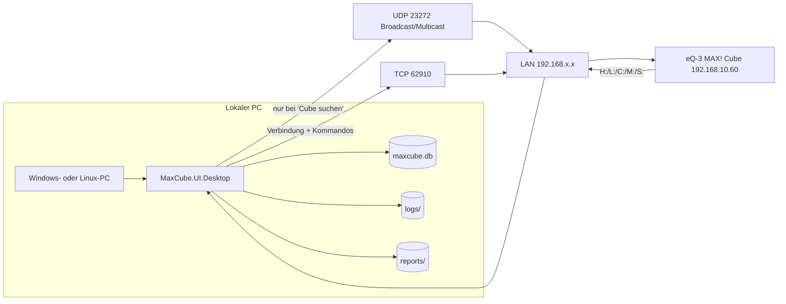

# Betrieb und Infrastruktur – MAX! Cube Local App

> Stand 25.11.2026. Die App ist eine **lokale Desktop-Anwendung**. Server-, Container- und Kubernetes-Konzepte sind nicht anwendbar; wo die Aufgabenstellung danach fragt, ist dies explizit ausgewiesen und durch das tatsächliche Äquivalent ersetzt.

## 1. Infrastruktur ist „nicht vorhanden“ – bewusst

| Kategorie | Status | Ersatz / Beleg |
|---|---|---|
| Server | **nicht vorhanden** (kein HTTP-Server, kein Jetty) | `docs/features.md:83-87`, `src/MaxCube.UI.Desktop/Program.cs:9` |
| Container / Docker | **nicht vorhanden** (kein Dockerfile in der Inventur gesehen) | `BEOBACHTUNG`; self-contained Paket direkt auf Host |
| Kubernetes / Helm | **nicht vorhanden** (keine Manifeste gesehen) | `BEOBACHTUNG`; kein Cluster nötig |
| DNS | **nicht erforderlich** | Cube wird per IP/host:port adressiert; `CubeConnectionOptions.cs:10-13` |
| Zertifikate / TLS | **nicht vorhanden** | keine HTTPS-Endpunkte; lokales TCP/UDP-Protokoll |
| Secrets-Management | **nicht vorhanden** | keine Zugangsdaten, keine Tokens, kein Produktkonto (`docs/features.md:78-82`) |
| Proxy | **verworfen** | nur für Cloud/Update nötig; Cloud abgeschaltet (`docs/features.md:83`) |
| Cloud / Fernzugriff | **verworfen** | Nutzerhinweis 25.11.2026, `FAKT`, nicht extern verifiziert (`docs/features.md:36`) |

**Offene Frage:** Ob außerhalb dieses Repositorys ein internes Verteilungs- oder MDM-System existiert, ist `UNBEKANNT`. Diese Doku beschreibt nur dieses Repository.

## 2. Netztopologie



**FAKT:** Beim Start gibt es keinen Broadcast und keine automatische Cloud-Verbindung (`docs/features.md:41`, `Program.cs:26-29`). UDP-Netzwerkkonfiguration (`c`/`C`) läuft als Unicast nur nach Bestätigung (`UdpNetworkConfigurator.cs:10-13`).

## 3. Deployment / Installation

### 3.1 Variante A – Quellcheckout + SDK (Entwicklung)

Windows:

```powershell
cd C:\Users\ebenh\OneDrive\Coding\app-maxcube
.\start.cmd
```

Linux:

```bash
cd /pfad/zu/app-maxcube
bash start.sh
```

Beide Skripte bauen die Solution inkrementell und starten `bin/Debug/net10.0/MaxCube.UI.Desktop.dll` (`start.cmd:34-43`, `start.sh:32-35`).

### 3.2 Variante B – veröffentlichtes Paket (Betrieb)

```bash
dotnet publish src/MaxCube.UI.Desktop/MaxCube.UI.Desktop.csproj -c Release -r linux-x64 --self-contained true -p:PublishSingleFile=false -o publish/linux-x64
chmod +x publish/linux-x64/MaxCube.UI.Desktop
publish/linux-x64/MaxCube.UI.Desktop --selfcheck
publish/linux-x64/MaxCube.UI.Desktop
```

Windows entsprechend `-r win-x64` und `MaxCube.UI.Desktop.exe`. Die CI erzeugt genau diese Artefakte für `linux-x64` und `win-x64` und prüft beide mit `--selfcheck` (`.github/workflows/ci.yml:39-65`).

**FAKT:** `PublishSingleFile=false`; das Paket ist ein Ordner mit DLLs und nativen Bibliotheken (`SkiaSharp`, `HarfBuzzSharp`, `libe_sqlite3`). Kein Installer, kein Service, keine Registry-Abhängigkeit.

### 3.3 Datenordner

| Plattform | Standardpfad |Override |
|---|---|---|
| Windows | `%LOCALAPPDATA%\MaxCube` | `MAXCUBE_DATA_DIR` |
| Linux | `$XDG_DATA_HOME/MaxCube` bzw. `~/.local/share/MaxCube` | `MAXCUBE_DATA_DIR` |

Enthalten: `maxcube.db`, `logs/`, `reports/`, `maxcube.lock` (`AppPaths.cs:3-28`). Der Ordner wird beim Start angelegt (`App.axaml.cs:31`, `Program.cs:36`).

## 4. Start, Stopp, Neustart

| Aktion | Windows | Linux |
|---|---|---|
| Start | `.\start.cmd` oder EXE aus `publish/win-x64` | `bash start.sh` oder Binary aus `publish/linux-x64` |
| Selbsttest | `dotnet ...\MaxCube.UI.Desktop.dll --selfcheck` | `.../MaxCube.UI.Desktop --selfcheck` |
| Stopp | Fenster schließen / Tray → Beenden | Fenster schließen / Tray → Beenden |
| Neustart | nach Stopp erneut Start; Lock wird freigegeben | identisch |
| Erzwungen | Prozess beenden; `InstanceLock` wird vom OS freigegeben | identisch |

Der Shutdown ist asynchron: Tray wird disposed, `ServiceProvider.DisposeAsync()` schließt SQLite und sendet über `CubeGateway` `q:`, danach wird das Lock freigegeben (`App.axaml.cs:124-143`, `CubeGateway.cs:23-26`). Ein blockierendes `GetResult` im UI-Thread wird bewusst vermieden (`App.axaml.cs:69-73`).

## 5. Rollback

Es gibt keinen Installer und keine Datenbankschema-Rückwärtsmigration. Rollback bedeutet:

1. App vollständig beenden (Lock/Verbindung freigeben).
2. Vorheriges Verzeichnis `publish/<rid>` oder vorherige DLLs zurückkopieren.
3. Optional vorherige `maxcube.db` zurückkopieren, wenn Einstellungen/Audit wiederhergestellt werden sollen. Danach überschreibt der nächste Connect Räume/Geräte erneut vom Cube.
4. `--selfcheck` ausführen.

**Vorsicht:** `schema.version = 1` wird beim Start immer gesetzt; eine ältere App mit älterem Schema würde die Spalte `week_profile` nicht verstehen. Für Downgrades ist eine getestete Kopie der DB nötig (`SqliteStateStore.cs:97-115`).

## 6. Backup und Recovery

| Daten | Pfad | Backup-Zeitpunkt |
|---|---|---|
| Cache + Einstellungen + Audit | `maxcube.db` | App beendet oder ruhiger Moment |
| Diagnoselogs | `logs/maxcube-JJJJMMTT.log` | täglich / vor Update |
| Diagnoseberichte | `reports/` | bei Bedarf |

**Empfehlung:** Datenordner als Ganzes kopieren (`maxcube.db`, `logs/`, `reports/`), nicht nur einzelne Dateien. Recovery: App stoppen → Sicherung zurückkopieren → Start + `--selfcheck`. Der Cube bleibt Source of Truth; ein Connect heilt Räume/Geräte automatisch wieder (`SqliteStateStore.cs:236-255`).

## 7. Monitoring und Alerting

| Mechanismus | Was überwacht er | Grenze |
|---|---|---|
| `--selfcheck` | Pfade, SQLite + native Lib, Instanzschutz, ViewModel, sechs Sprachen | kein Cube-Kontakt (`Program.cs:26-92`) |
| CI-Matrix | Build, 442 Tests, Selbsttest, Publish für Ubuntu/Windows | bei Push/PR/manuell (`.github/workflows/ci.yml:3-7`) |
| `FileAppLog` | tägliche Logdatei mit Aufbewahrung | Diagnose, keine Funktion (`FileAppLog.cs:6-9`) |
| Audit-Log | fachliche Ereignisse in SQLite | letzte 100 in UI, 500 via API (`SqliteStateStore.cs:183-191`) |
| `CubeSessionMonitor` | `L:`-Refresh/Stale/Reconnect zur Laufzeit | intern, keine externe Meldung |
| **Alerting** | **nicht vorhanden** | kein Mail-/Webhook-Versand; `UNBEKANNT`, ob extern etwas getriggert wird |

**FAKT:** Der „Fehlerbericht senden“ des Originals ist ersetzt durch einen **lokalen Diagnosebericht ohne Versand** (`CubeApplicationService.Admin.cs:840-844`, `MainWindowViewModel.Cube.cs:168-181`). Es werden keine Daten an eQ-3 oder Dritte gesendet.

## 8. Logging

- Datei: `logs/maxcube-JJJJMMTT.log` (lokale Zeit), Prefix `maxcube-`, Endung `.log` (`FileAppLog.cs:11-13,29-33`).
- Aufbewahrung: konfigurierbar über den Settings-Key `log.retentionDays`, Default 30 (`MainWindowViewModel.Settings.cs:22,25`).
- Schreibfehler im Log dürfen die App nie beeinträchtigen (`FileAppLog.cs:6-9`).
- Trace-Ausgaben Avalonia: `LogToTrace()` (`Program.cs:23-24`).
- Log-Inhalte können Gerätenamen, Seriennummern und Fehlertexte enthalten; siehe [SECURITY.md](SECURITY.md).

## 9. Betriebs-Checks (Kurzfassung)

```powershell
# Windows: nach Update/Deployment
dotnet src/MaxCube.UI.Desktop/bin/Debug/net10.0/MaxCube.UI.Desktop.dll --selfcheck
dotnet test MaxCube.slnx --nologo
```

```bash
# Linux
publish/linux-x64/MaxCube.UI.Desktop --selfcheck
dotnet test MaxCube.slnx --nologo
```

Erwartung: `SELFCHECK OK: ... | SQLite ok`, Exitcode 0 (`Program.cs:89-92`). Bei Exitcode 1/2/3/4 siehe [TROUBLESHOOTING.md](TROUBLESHOOTING.md).

## 10. Verbesserungsvorschläge

1. Release-Artefakte mit SHA-256 und Signatur versehen; aktuell nur `upload-artifact` ohne Signatur (`.github/workflows/ci.yml:66-69`).
2. `audit_log`-Rotation konfigurierbar machen (analog `log.retentionDays`).
3. `--selfcheck` um einen optionalen Hardwaremodus erweitern, der **nur** `l:`/`c:` liest und keine Schreibkommandos sendet.
4. Management-/Diagnoseausgabe für Duty-Cycle und Reconnect-Zeitpunkte ergänzen; aktuell nur intern/im Audit.
5. Dokumentierte Backup-Prozedur als Skript (`backup.cmd` / `backup.sh`) bereitstellen.

## 11. Offene Fragen

- Gibt es produktionsweit eine Verteilung über MDM/WSUS/Intune? `UNBEKANNT`.
- Wie werden mehrere Cubes unter einer IP unterschieden? Die App speichert einen Endpoint/Serial; Mehr-Cube-Betrieb ist `UNBEKANNT`.
- Welche Aufbewahrung für `reports/` gilt? Derzeit keine automatische Rotation belegt.
