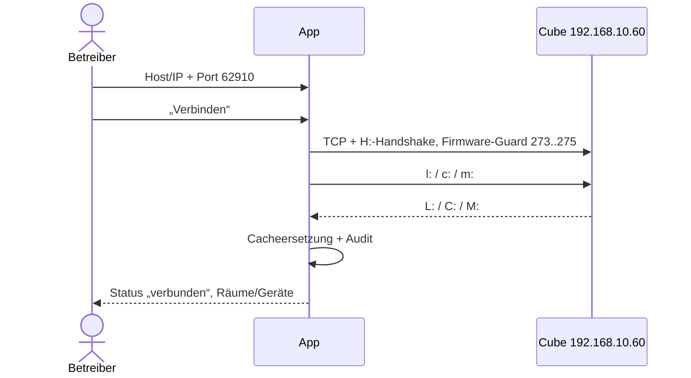
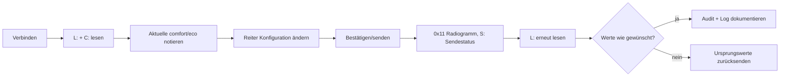

# Runbook – MAX! Cube Local App

> Stand 25.11.2026. Ausführbare Abläufe für Betreiber und Entwickler. Es gibt **keinen Server, keinen Container und kein Kubernetes**; „Deployment“ bedeutet: Programmordner und lokaler Datenordner auf einem Windows- oder Linux-PC. Alle Cube- bzw. Netzwerkänderungen erfolgen ausschließlich auf Benutzeraktion. Belege als `Datei:Zeile`.

## 0. Grundregeln

1. Der Cube ist **Source of Truth**; SQLite ist Cache, Einstellungsspeicher und Audit (`SqliteStateStore.cs:8-13`).
2. Vor Änderungen am Cube: Ist-Zustand lesen, Zielwert festlegen, Aktion bestätigen, danach read-back; bei unbeabsichtigter Änderung den gelesenen Ursprungswert zurücksenden.
3. Bei Unklarheit `INFERENZ`/`UNBEKANNT` kennzeichnen und nicht raten (`docs/INDEX.md:54-58`).
4. Keine Cloud-, Fernzugriffs-, Proxy-, HTTP-Update- oder Firmware-Schreibaktion (`docs/features.md:34-36`, `docs/gremium.md:11`).
5. Kein Broadcast beim Start; UDP 23272 nur über „Cube suchen“ (`docs/features.md:41`).

## 1. Normalbetrieb

### 1.1 Start

Windows:

```powershell
cd C:\Users\ebenh\OneDrive\Coding\app-maxcube
.\start.cmd
```

Linux:

```bash
cd /pfad/zu/app-maxcube
bash start.sh
```

Beide Skripte suchen ein .NET-10-SDK, bauen inkrementell und starten die Desktop-DLL (`start.cmd:8-43`, `start.sh:8-35`). Ohne SDK: veröffentlichtes self-contained Paket aus `publish/win-x64` oder `publish/linux-x64` starten (`ci.yml:39-69`).

**Erwartung:** Fenster mit neun Reitern; Titel/Status zeigen Version `0.8.1` (`Directory.Build.props:3-5`, `AppVersionProvider.cs:13-24`).

### 1.2 Stopp

1. Reiter „Einstellungen“ prüfen: Ist `closeToTray` aktiv? Dann Tray-Symbol → „Beenden“ nutzen (`App.axaml.cs:80-115`, `Settings.cs:48-53`).
2. Sonst Fenster schließen.
3. Shutdown wartet auf asynchrones Dispose: Reconnect stoppen, Log/DB schließen, `q:` senden, kurz auf EOF warten, Socket und Lock freigeben (`App.axaml.cs:124-143`, `CubeApplicationService.DisposeAsync`, `CubeGateway.cs`).

**FAKT (0.6.5):** Beide Wege – Fenster und Tray → „Beenden“ – lösen `ShutdownRequested` aus. Vor 0.6.5 rief der Tray-Eintrag `desktop.Shutdown()` auf; dieser forcierte Exit übersprang das Cleanup, sodass kein `q:` gesendet wurde und der Cube die einzige TCP-Session bis zu seinem Timeout hielt (`App.axaml.cs:91-95`).

**Notfall:** Prozess beenden. Das OS gibt Socket und Lockdatei frei; ein `q:` fehlt dann jedoch, und der Cube kann die Session bis zu seinem eigenen Timeout blockieren (`CubeGateway.cs:185-235`).

### 1.3 Verbindung herstellen



Wenn IP unbekannt: Reiter „Verbinden“ → **„Cube suchen“**. Erst dort werden drei UDP-Requests (19 Byte `eQ3Max*\0**********I`, 50 ms Abstand) an Broadcast `255.255.255.255` und Multicast `224.0.0.1`, TTL 5, Port 23272 gesendet (`CubeDiscoveryService.cs:15-28`, `UdpDiscoveryTransport.cs:16-60`). Treffer auswählen → „Übernehmen“ setzt Port 62910.

**FAKT:** Beim App-Start gibt es keinen Broadcast (`Program.cs:26-29`).

## 2. Wartung

### 2.1 Backup

```powershell
# Windows: App vorher beenden
Copy-Item -Recurse "$env:LOCALAPPDATA\MaxCube" "C:\Backup\MaxCube-2026-11-25"
```

```bash
# Linux: App vorher beenden
cp -a "${XDG_DATA_HOME:-$HOME/.local/share}/MaxCube" /backup/MaxCube-2026-11-25
```

Inhalt: `maxcube.db`, `logs/`, `reports/`, `maxcube.lock` (`AppPaths.cs:20-28`). Bei `MAXCUBE_DATA_DIR` entsprechenden Pfad verwenden (`AppPaths.cs:10-18`).

### 2.2 Restore

1. App beenden.
2. Gesicherte Dateien zurückkopieren.
3. `--selfcheck` ausführen (Erwartung Exit 0).
4. App starten und einmal verbinden; Räume/Geräte werden vom Cube überschrieben, Einstellungen/Audit bleiben aus der Sicherung (`SqliteStateStore.cs:236-255`).

### 2.3 Update / Rollback

1. Backup nach 2.1.
2. Neues Paket in einen **neuen** Ordner `publish/<rid>` entpacken; alten Ordner nicht überschreiben.
3. `--selfcheck` im neuen Ordner.
4. Alte App beenden, neue starten, kurz verbinden und eine lesende Ansicht prüfen.
5. Bei Fehler: neue App beenden, alten Ordner wieder verwenden; optional DB aus Backup zurückkopieren.

**Vorsicht:** Es gibt keine Schema-Rückwärtsmigration; `schema.version = 1` wird beim Start gesetzt (`SqliteStateStore.cs:97-115`).

### 2.4 Log- und Audit-Pflege

- Log-Aufbewahrung: Einstellungen-Reiter, `log.retentionDays`, Default 30, gültig 1..365 (`MainWindowViewModel.Settings.cs:22,27,88-95`, `FileAppLog.cs:45-75`).
- Audit: Einstellungen-Reiter, `audit.retentionDays`, Default 30, gültig 1..365; alte Zeilen werden beim Start gelöscht (`MainWindowViewModel.Settings.cs:23,27,95,165-174`, `SqliteStateStore.cs:186-202`). Vor einer manuellen Bereinigung backupen.
- Diagnosebericht: Reiter „Cube“ → „Diagnosebericht exportieren“; Datei liegt unter `reports/`, wird **nicht** versendet und nennt jetzt auch Verbindungs-, `Unreachable`- und Reconnect-Zeitpunkte (`CubeApplicationService.Admin.cs:922-959`, `MainWindowViewModel.Cube.cs:220-228`).

## 3. Geänderte Konfiguration senden (Komfort/Eco)

Dies ist der kritischste Prozess: `0x11` Komfort/Eco ist am 25.11.2026 hardwarevalidiert (`docs/HARDWARE-VERIFY.md`), die übrigen Felder und die fachliche `S:`-Bedeutung bleiben abgeleitet. Deshalb immer lesen → ändern → senden → **Funkübernahme abwarten** → read-back → ggf. zurücksetzen.



1. Reiter „Räume“: Raum mit gültigem Master-Thermostat wählen.
2. Reiter „Konfiguration“: Anzeige stammt aus gelesenem Cube-Zustand; nur diese Werte werden zurückgeschrieben (`MainWindowViewModel.Admin.cs:288`, `CubeApplicationService.Admin.cs:78-108`).
3. Komfort ECO ändern; Reihenfolge im Radiogramm: Comfort, Eco, Max, Min, Offset, FensterTemp, FensterDauer (`RoomCommands.cs:48-73`).
4. Senden auslösen; `S:`-Antwort ist nur Sendestatus (`discarded='1'` → Fehler, `CubeCommands.cs:238-257`). Fachliche Annahme ist `UNBEKANNT`.
5. **Mindestens 6 s warten**, bis das Thermostat die Funkübernahme bestätigt; ein sofortiges Read-back kann noch den alten Wert zeigen (`BEOBACHTUNG`, `docs/HARDWARE-VERIFY.md` §4.2). Dann „Zustand neu laden“ / erneut verbinden und Werte vergleichen.
6. Falls abweichend: Ursprungswerte erneut senden und das Ereignis im Audit/Log vermerken.

**Nie** tun: Werte senden, die nicht vorher vom Cube gelesen wurden; mehrere Räume gleichzeitig ohne Kontrolle; Firmware schreiben.

## 4. Strukturänderungen

Umbenennen, Löschen, Verschieben, Reihenfolge, Gruppierung und Linkpartner verändern die Cube-Metadaten.

- Vorher: „Zustand neu laden“, Seriennummern/Adressen notieren.
- Während: Bestätigungsdialog; `RequireConfirmed` verlangt `true` (`CubeApplicationService.Admin.cs:945-951`).
- Metadaten nur, wenn die Kodierung des **unveränderten** Zustands die empfangenen Bytes byte-genau reproduziert (`CubeGateway.Admin.cs:99-103`).
- Reihenfolge zwingend: Entwurf mutieren/validieren → Funktelegramme → Metadaten → reales Modell + `ApplyAndPublishAsync` (`Admin.cs:643-689`).
- Danach: erneut verbinden, Räume/Geräte und Wochenprofile stichprobenweise prüfen.

**INFERENZ:** Löschsperre für das einzige Heizkörperthermostat in einem Raum mit weiteren Geräten (`Admin.cs:510-531`); keine Garantie ohne Hardwaretest.

## 5. Netzwerkkonfiguration (UDP)

1. Nur mit verbundenem Cube und angehaktem `ConfirmNetwork` (`MainWindowViewModel.Cube.cs:64-68,155-166`).
2. Reiter „Cube“ → „Netzwerk lesen“; aktuelle Werte notieren.
3. Felder ändern; alle fünf Adressfelder müssen vier Oktette 0..255 haben (`CubeApplicationService.Admin.cs:792-824`).
4. Senden; `UdpNetworkConfigurator` liest vorher, übernimmt Bytes hinter dem DHCP-Flag und sendet Unicast an die IP des Cubes, Port 23272 (`UdpNetworkConfigurator.cs:31-41`, `CubeUdpCodec.cs:82-116`).
5. Danach Verbindung trennen/neu herstellen und Netzwerk erneut lesen.

**Risiko:** Falsche Netzwerkwerte können den Cube unerreichbar machen. Keine Firmware-Opcodes `B/U/W/R` (`CubeUdpCodec.cs:12`).

## 6. Hardwarevalidierung (gezielter Test)

Vor einem Hardwaretest: Protokoll schreiben, Uhrzeit, Cube-IP, Firmware und betroffenen Raum notieren.

1. **Discovery:** nur über „Cube suchen“ auslösen; lokaler UDP-Port muss 23272 sein; Broadcast/Multicast im Mitschnitt erwarten; Antwort muss Signatur `eQ3MaxAp` oder `eQ3MaxBl` haben (`CubeDiscoveryService.cs:30-65`, `UdpDiscoveryTransport.cs:23`, `docs/HARDWARE-VERIFY.md` §3).
2. **Lesender Abgleich:** `H:`, `L:`, `C:`, `M:` speichern; Rohwerte von Komfort/Eco notieren.
3. **Schreibtest:** genau ein Feld ändern, senden, `S:` protokollieren, erneut lesen.
4. **Rücksetzung:** Ursprungswert zurücksenden und erneut lesen.
5. **Doku:** Ergebnis als `FAKT`/`BEOBACHTUNG` mit Datum und Beleg (Mitschnitt/Datei:Zeile) in [HARDWARE-VERIFY.md](HARDWARE-VERIFY.md) und nach Freigabe im SecondBrain nachtragen; `INFERENZ` nur aufheben, wenn Hardware es belegt.

Die echte UDP-Antwort und `0x11` Komfort/Eco sind `FAKT` (25.11.2026, `docs/HARDWARE-VERIFY.md`); eine fachlich ausgewertete `S:`-Quittung bleibt `UNBEKANNT` (`CubeApplicationService.cs:439`).

## 7. Notfälle

| Notfall | Sofortmaßnahme | Danach |
|---|---|---|
| Cube antwortet nicht mehr | keine weiteren Schreibbefehle; IP/Ping/TCP 62910 prüfen | Netzwerkwerte lesen, falls möglich; Sicherung und Log sichern |
| Falsche Temperatur gesendet | Wert aus gelesenem Ursprung zurücksenden | Audit-Eintrag und Log dokumentieren |
| Struktur durcheinander | keine weiteren Metadaten-Schreibaktionen | Cache/Sicherung prüfen, Cube neu verbinden, Räume/Geräte read-back |
| Zweite Instanz blockiert | App ordnungsgemäß beenden | `maxcube.lock` und Port 62910 prüfen |
| DB defekt | App beenden | Backup zurückspielen; nächster Connect heilt Räume/Geräte |
| Update fehlgeschlagen | alte `publish/`-Version starten | `--selfcheck`, Logs, Version notieren |

## 8. Verknüpfte Dokumente

[README.md](../README.md) · [ARCHITECTURE.md](ARCHITECTURE.md) · [DEVELOPMENT.md](DEVELOPMENT.md) · [API.md](API.md) · [DATABASE.md](DATABASE.md) · [OPERATIONS.md](OPERATIONS.md) · [SECURITY.md](SECURITY.md) · [TROUBLESHOOTING.md](TROUBLESHOOTING.md) · [SECOND_BRAIN.md](SECOND_BRAIN.md)

## 9. Offene Fragen

- Wie verhält sich der Cube bei `S:`-Codes > 0 fachlich? `UNBEKANNT`.
- Ist die Netzwerkänderung nach Stromausfall dauerhaft? `UNBEKANNT`.
- Werden sechs Sprachen unter Wayland korrekt erkannt? `UNBEKANNT`.
