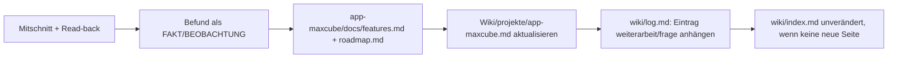

# SecondBrain-Anbindung – MAX! Cube Local App

> Stand 25.11.2026. Diese Datei ist **kein Wiki-Ingest**, sondern die Entwickler-/Betreiber-Sicht auf das persönliche Wissens-Wiki unter `C:\Users\ebenh\OneDrive\Coding\SecondBrain`. Sie erklärt, welche Erkenntnisse dort liegen, wie sie entstanden sind und wie Hardwarebefunde zurückfließen. Kennzeichnung und Belege wie in [INDEX.md](INDEX.md).

## 1. Rollenverteilung

| Ort | Rolle | Regel | Beleg |
|---|---|---|---|
| `SecondBrain/raw/` | unveränderliche Rohquellen (REA-Extrakte, Referenzen) | nie bearbeiten, nie löschen; neue Fassung = neue Datei | `SecondBrain/CLAUDE.md:15-16,19` |
| `SecondBrain/wiki/` | gepflegtes, verlinktes Wissens-Wiki | wird von der KI gepflegt, nicht veröffentlicht | `SecondBrain/CLAUDE.md:3,16,115` |
| `app-maxcube/docs/` | Reverse-Engineering- und Betriebsdoku des Projekts | analyzed based on `extracted/`, `decompiled/`, `evidence/`; **kein Code daraus kopieren** | `docs/INDEX.md:128`, `docs/DEVELOPMENT.md` §6 |
| `app-maxcube/src/`, `tests/` | umsetzbarer Code | darf nur aus Spezifikationen, nicht aus dekompiliertem Java entstehen | `docs/INDEX.md:4,128` |

**FAKT:** In diesem Arbeitsauftrag wurde `SecondBrain/raw/` nicht verändert und das Wiki nicht überschrieben. Die hier beschriebene Rückkopplung ist ein Ablauf, kein bereits ausgeführter Ingest.

## 2. Wiki-Landkarte (relevant für dieses Projekt)

| Wiki-Seite | Inhalt | Warum hier relevant |
|---|---|---|
| `wiki/index.md` | Katalog aller Seiten | Einstieg bei jeder Wiki-Frage (`SecondBrain/CLAUDE.md:23`) |
| `wiki/log.md` | chronologisches, nur anhängbares Log | jede Wiki-Änderung braucht Eintrag (`SecondBrain/CLAUDE.md:24,105`) |
| `wiki/projekte/app-maxcube.md` | Projektstand, Gremiumsrunden, Verifikation, offene Hardwarepunkte | zentrale Projektseite; historischer Stand 442/442 und INFERENZ-Grenzen stehen dort (`wiki/projekte/app-maxcube.md:28,48-52`) |
| `wiki/quellen/app-maxcube-java-rea-2026-11-24` | REA-Wissensbasis aus `raw/app-maxcube-rea/2026-11-24/` | Grundlage von `docs/INDEX.md`, `docs/architecture-rea.md` |
| `wiki/quellen/app-maxcube-protokoll-referenzen` | Bouni-Spec, Python-Orakel, Lizenzen | erklärt die Strategieentscheidung ohne AGPL (`docs/INDEX.md:28`) |
| `wiki/quellen/app-maxcube-ha-maxcube-erkenntnisse` | live bewährte Regeln aus Home Assistant | 13 Slots/Tag, 7+6-Telegramme, Modus-Kodierung (`docs/INDEX.md:37-38`) |
| `wiki/fragen/2026-11-24-app-maxcube-bester-weg` | Strategie und Fahrplan | entschieden: eigene C#-Protokollschicht, kein NuGet-Paket |
| `wiki/fragen/2026-11-24-maxcube-remote-proxy-opcodes` | Opcode-Familie `B:/G:/J:/P:/O:/V:/W:` und `g:` | geklärt als HTTP-Cloud-Proxy, bewusst ausgeschlossen (`wiki/projekte/app-maxcube.md:56`) |
| `wiki/konzepte/max-cube-protokoll` | geräteverifizierte Protokollkenntnisse | ergänzt die Wire-Doku in [API.md](API.md) |
| `wiki/anleitungen/maxcube-0x10-mitschnitt` | Mitschnittanleitung für Wochenprofile | direkter Vorläufer des Hardwaretests in [RUNBOOK.md](RUNBOOK.md) §6 |

**Hinweis:** Wikilinks im Wiki haben die Form `[[ordner/dateiname]]` ohne `.md` und dürfen **nicht** in Backticks stehen, sonst funktionieren Obsidian-Graph und Lint nicht (`SecondBrain/CLAUDE.md:62`). Diese Datei nutzt absichtlich Pfadangaben statt Wikilinks, weil sie außerhalb des Wikis liegt.

## 3. Was das Wiki bereits beantwortet

1. **Warum eigene Protokollschicht?** Kein brauchbares NuGet-Paket; `MAXSharp` ist AGPL v3 und eingefroren. Deshalb Bouni als Spec, Python `maxcube-api` als Verhaltensoracle, Java-REA als Quervergleich (`docs/INDEX.md:28`, `wiki/projekte/app-maxcube.md:73`).
2. **Warum keine Cloud-Funktionen?** Cloud seit 01.07.2023 abgeschaltet; Nutzerhinweis 25.11.2026 (`FAKT`, nicht extern verifiziert) ergänzt Store-Entfernung. Fernzugriff, Produktkonto, Proxy und App-Update bleiben verworfen (`README.md:7`, `wiki/projekte/app-maxcube.md:50`).
3. **Warum SQLite, obwohl das Original keine DB hatte?** Original speichert nur `~/.MAX/*.settings` via `java.util.Properties`; SQLite ist ein Neubau als Cache, Einstellungsspeicher und Audit. Der Cube bleibt Source of Truth (`wiki/projekte/app-maxcube.md:18`, `docs/DATABASE.md` §2).
4. **Welche Port-Regel gilt?** 62910 physisch, 54321 nur virtuell/lokal, 63121 war der dynamische Web-UI-Port des Originals (`docs/INDEX.md:35,39`).
5. **Wie belastbar sind die Tests?** 558/558 hardwarefreie Fälle unter Windows 10 und Debian 13 (WSL2, 27.11.2026); Aufteilung Domain 64 / Application 90 / Protocol 200 / Infrastructure 71 / UI 133 (`docs/DEVELOPMENT.md` §3, `CHANGELOG.md`). Die Stände 442/442 und 519/519 sind historisch.
6. **Was ist ungeklärt?** Echte UDP-Antwort, fachlich ausgewertete `S:`-Quittung, Golden-Capture, Hardwarewirkung der abgeleiteten Schreibformate und Linux-Oberfläche auf einem echten Desktop (`README.md:85-87`, `wiki/projekte/app-maxcube.md:52`).

## 4. Lessons Learned

| Lektion | Konsequenz im Code / in der Doku |
|---|---|
| Sonnet-Runden 1–4 fanden echte Fehler (DataContext, Endianness, `l:`-Offsets, UI-Thread, Rundung, CanExecute, Localzeit Temporary) | Alle Funde behoben und mit Regressionstests unterlegt; historische Stände 243/249/251/268/442/514/515/519 sind überholt, maßgeblich 558/558 (`wiki/projekte/app-maxcube.md:34-42,48`, `CHANGELOG.md`) |
| Gremium Runde 5 scheiterte an `Free usage limit reached` | Keine Modellstimmen für Runde 5; autark nach bindenden Beschlüssen der Runden 1–4 umgesetzt und so dokumentiert (`docs/gremium.md`, `wiki/projekte/app-maxcube.md:48`) |
| Naive `[Fact]`/`[Theory]`-Zählung lag wegen `[MemberData]` zu niedrig (historisch 422 statt 442) | Ein `[MemberData]` liefert 21 Zeilen; Doku weist auf die Korrektur hin (`docs/DEVELOPMENT.md` §3) |
| `MAX10038` weicht vom Muster `MAX\d{4}` ab | Nicht still korrigieren; Regex akzeptiert 4–5 Stellen (`ErrorCatalog.cs:54,97`, `docs/API.md` §4) |
| Original-`architecture.md` und neue Entwickler-Doku kollidierten auf case-insensitive NTFS | REA-Bestandsdoku als `docs/architecture-rea.md` erhalten (319 Zeilen, Deckung mit `raw/.../architecture.md`), neue Doku unter `docs/ARCHITECTURE.md`; [INDEX.md](INDEX.md) nachgezogen |
| Broadcast beim Start wäre ein Datenschutz-/Netzwerkvorstoß ohne Useraktion | UDP nur über „Cube suchen“; `--selfcheck` sendet nichts (`docs/features.md:41`, `Program.cs:26-29`) |

## 5. Rückkopplung nach Hardwareprüfung (192.168.10.60)

**FAKT (25.11.2026):** Die Prüfung gegen den echten Cube ist durchgeführt. Auto-Discovery war mit ephemeralem lokalen UDP-Port fehlerhaft und funktioniert nach Bindung an Port `23272` (`Treffer: 1`, `192.168.10.60`, Seriennummer `JEQ0355273`, Firmware `275`). Das Senden der Standardkonfiguration `0x11` mit Komfort 22,0 °C / Eco 17,0 °C war am Cube wirksam; der Zustand wurde danach auf 21,5 °C / 16,5 °C zurückgesetzt und nur-lesend bestätigt. Details und Mitschnitte: [HARDWARE-VERIFY.md](HARDWARE-VERIFY.md).

Wenn echte Hardwarebefunde vorliegen, ist die Reihenfolge:

- **FAKT:** Jede Wiki-Änderung steht im Log; das Log wird nie gekürzt (`SecondBrain/CLAUDE.md:24,105`).
- **FAKT:** `UNBEKANNT` darf nicht ohne Validierung als Implementierungsgrundlage dienen (`SecondBrain/CLAUDE.md:58`, `docs/INDEX.md:58`).
- Nur belegte Hardwareantworten dürfen eine `INFERENZ` aufheben; UDP-Antwort und `0x11` Komfort/Eco sind jetzt durch [HARDWARE-VERIFY.md](HARDWARE-VERIFY.md) belegt, nicht mehr nur vermutet (`docs/RUNBOOK.md` §§3,6).
- Keine Geheimnisse in Wiki oder Logs: keine Zugangsdaten, Tokens oder privaten Schlüssel; Seriennummern sind laut Nutzerlinie nicht schützenswert (`SecondBrain/CLAUDE.md:109-114`).

## 6. Was bewusst **nicht** ins Wiki kopiert wird

- Kein Code aus `decompiled/`; nur Spezifikation und Belege (`docs/INDEX.md:128`).
- Keine großen Byte-Dumps oder Mitschnitte ohne fachliche Auswertung; nur verdichtete Erkenntnisse mit Pfad/Beleg.
- Keine Vermutungen als Tatsachen; Widersprüche werden mit Datum und beiden Fassungen markiert (`SecondBrain/CLAUDE.md:70`).
- Keine Cloud-/Konto-/Proxy-Details, die nicht mehr relevant sind; die betroffenen Zeilen bleiben in `docs/features.md` als `verworfen`.

## 7. Offene Fragen

- Soll der Hardwarebefund eine neue Wiki-Seite `wiki/fragen/2026-11-25-maxcube-hardware-check.md` werden oder reicht ein Abschnitt in `wiki/projekte/app-maxcube.md`? **Entscheidung des Nutzers erforderlich.**
- Werden die historischen Gremium- und Sonnet-Protokolle nach Abschluss der Hardwarevalidierung als `status: veraltet` markiert? Derzeit bleiben sie als Verlauf erhalten (`SecondBrain/CLAUDE.md:71`).
- Wie werden Mitschnitte versioniert, ohne `raw/` zu verändern? Derzeit kein Golden-Capture im Repo (`docs/DEVELOPMENT.md` §8).
