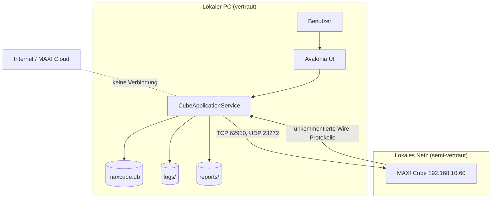

# Sicherheit – MAX! Cube Local App

> Stand 25.11.2026. Die App arbeitet ausschließlich lokal im vertrauten Netz. Es gibt keine Benutzerkonten, keine Cloud-Anmeldung und keine Secrets. Wo ein Schutz fehlt, ist er als solcher benannt – nicht als Funktion ausgegeben.

## 1. Vertrauensgrenzen

**FAKT:** Die Cloud ist seit 01.07.2023 abgeschaltet; laut Nutzerhinweis 25.11.2026 wurde die App aus Android-/iOS-Stores entfernt (`docs/features.md:34-36`). Deshalb gibt es keine Fernzugriffs-, Produktkonto- oder Proxy-Funktion, die Zugangsdaten speichern müsste.

## 2. Authentifizierung

| Ebene | Mechanismus | Bewertung |
|---|---|---|
| App-Login | **keiner** | `FAKT`: Es gibt keine Anmeldung; jeder mit lokalem Zugriff auf den PC kann die App starten. |
| Cube-TCP | **keiner** | Das MAX!-Protokoll kennt keine Authentifizierung; der Cube akzeptiert Kommandos auf TCP 62910 aus dem Netz. |
| UDP-Discovery | **keiner** | Jeder im Broadcast-/Multicast-Netz kann auf den Finder antworten. Treffer werden als `DiscoveredCube` angezeigt; die Seriennummer/IP stammt aus dem Datagramm (`CubeDiscoveryService.cs`). |
| Cloud/Portal | **entfällt** | bewusst verworfen |

**Konsequenz:** Die Sicherheit steckt in der **Netzsegmentierung** und in der **Benutzeraktion**, nicht in einem Login. Die App darf nicht in ein untrusted Netz mit fremden Geräten exponiert werden.

## 3. Autorisierung und Benutzeraktion

| Schutz | Umsetzung | Beleg |
|---|---|---|
| Instanzschutz | exklusive Lockdatei, eine TCP-Session zum Cube | `InstanceLock.cs:5-10`, `App.axaml.cs:31-41` |
| Destruktive Strukturaktionen | ausdrückliche Bestätigung pro Aktion; Metadaten erst nach byte-genauer Rundreise | `README.md` alt:34,77; `MainWindowViewModel.Admin.cs` |
| Netzwerkkonfiguration | nur mit `ConfirmNetwork`-Haken; danach wird Haken zurückgesetzt | `MainWindowViewModel.Cube.cs:160-165` |
| Firmware schreiben | **nicht implementiert/deaktiviert** | `docs/gremium.md:11`, `README.md` alt:76 |
| Firmware-Update-Check | **kein HTTP-Check** | `docs/features.md:77,86` |
| Broadcast beim Start | **keiner**; nur „Cube suchen“ | `docs/features.md:41`, `Program.cs:26-29` |
| Fehlerbericht | lokal, **kein Versand** | `CubeApplicationService.Admin.cs:915-947` |
| Sendingate | `OperationGate` mit 2 s Erwerb und `CancelActive()` | `OperationGate.cs:3-16` |

**INFERENZ:** Die Bestätigungsdialoge sind eine Bedienbarriere, keine kryptografische Autorisierung. Ein lokaler Prozess mit Zugriff auf denselben Datenordner kann die SQLite-Einstellungen dennoch ändern.

## 4. Security-Maßnahmen im Code

- **Kein Firmware-Opcode:** Der UDP-Firmware-Frame ist nicht belegt und wird nicht gesendet (`README.md` alt:76,83).
- **Response-Validierung:** `ResponseCommand<T>` akzeptiert nur das erwartete Prefix; `r:` wird als abgelehnt, unbekannte Prefixe als `UnknownCubeOpcodeException` behandelt (`CubeCommands.cs:21-64`). Damit kann eine fremde Antwort nicht fälschlich als Erfolg gewertet werden.
- **Firmware-Guard:** nur Firmware 273–275 (`FirmwareSupport.cs:101-107`, `CubeConnectionOptions.cs:4-6`).
- **Metadaten-Sicherheitsprüfung:** `m:`-Blöcke nur nach byte-genauer Rundreise; Blockgröße 1900, keine CR/LF im Block (`CubeCommands.cs:90-126`).
- **Längen-/Bereichsprüfungen:** z. B. 1..255 Adressen bei `t:`, 0..99 Index bei `m:`, 24 Byte Zeitzone bei `v:`, 66 Byte Tasterkonfiguration bei `w:` (`CubeCommands.cs:103-125,286-340`).
- **Radiogramm-Validierung:** Bitfelder werden gegen belegte Tabellen geprüft, z. B. Boost nur 0/5/10/15/20/25/30/60 min (`RoomCommands.cs:85-137`).
- **Airtime-Hinweis:** `RadioStatusParser` behandelt `discarded == '1'` als Kommunikationsfehler (`CubeCommands.cs:238-257`).
- **Keine automatischen Schreibzugriffe:** Sitzungsüberwachung und Reconnect lesen `L:`-Refreshes; Schreibbefehle bleiben Aktionen (`CubeApplicationService.cs`).

## 5. Umgang mit Secrets

| Fundort | Status |
|---|---|
| Quellcode / Konfiguration | **keine Passwörter, Tokens, API-Keys oder Produktkeys** belegt |
| SQLite `settings` | nur Version, Endpoint, Seriennummer, UI-Optionen – keine Zugangsdaten (`DATABASE.md` §6) |
| Logs / Reports | können Namen, Seriennummern, Temperaturen und Fehlertexte enthalten, aber keine Anmeldedaten |
| SecondBrain-Wiki | verbindlich keine Geheimnisse; nur Fundorte, nie Werte (`SecondBrain/CLAUDE.md:107-115`) |

**FAKT:** Die Fehlercodes `MAX1001`/`MAX1002` (AES-Schlüssel) und `MAX1046`/`MAX1047` (Autorisierung/Zugangsdaten) stammen aus dem Originalkatalog; die App implementiert diese Pfade nicht (`ErrorCatalog.cs:17-18,62-63`). `EncryptCommand`/`DecryptCommand` sind Protocol-Klassen, aber im lokalen App-Pfad nicht als Cloud-Login verdrahtet (`INFERENZ`; genaue Aufruferliste offen).

## 6. Datenschutzrelevante Aspekte

| Daten | gespeichert in | Zweck | Empfehlung |
|---|---|---|---|
| Cube-Seriennummer | `cubes.serial`, `settings.cube.serial`, Logs, Discovery-Anzeige | Identifikation/Cache | im SecondBrain nach Daniels Datenschutzlinie nicht schützenswert (`SecondBrain/CLAUDE.md:114`); trotzdem nicht unnötig teilen |
| Funkadressen | `cubes.rf_address`, `devices.address`, Radiogramme | Geräteadressierung | wie Geräte-ID behandeln |
| Raum-/Gerätenamen | `rooms.name`, `devices.name`, Logs | Bedienung | können personenbezogene Hinweise enthalten (z. B. „Schlafzimmer“) |
| Temperaturen/Zeitprofile | `rooms.*`, `week_profile` | Heizsteuerung | Rückschluss auf Anwesenheit möglich |
| Audit-Nachrichten | `audit_log` | Diagnose | Quell-Tag (`user`/`session`/`reconnect`/`system`), Aufbewahrung 1..365 Tage; bei Weitergabe prüfen |
| IP-Adresse/Endpoint | `settings.cube.endpoint` | Wiederverbindung | lokal im Datenordner |

**FAKT:** Es gibt keine Übermittlung dieser Daten an einen Herstellerdienst; der Diagnosebericht wird nur angezeigt/optional lokal gespeichert (`CubeApplicationService.Admin.cs:840-844`, `MainWindowViewModel.Cube.cs:168-181`).

## 7. Bedrohungsanalyse (STRIDE)

| Bedrohung | Szenario | Aktueller Schutz | Restrisiko / Empfehlung |
|---|---|---|---|
| **Spoofing** | fremdes Gerät antwortet auf UDP 23272 oder TCP 62910 | Response-Prefix-Prüfung, Firmware-Guard | `HOCH`: kein authentisiertes Protokoll; nur im vertrauten LAN betreiben |
| **Tampering** | manipulierter Cache soll Cube-Zustand überschreiben | Cube Source of Truth, Cache wird bei Connect ersetzt | `NIEDRIG` für Fachdaten; Einstellungen/Audit sind lokal editierbar |
| **Repudiation** | unklar, wer eine Änderung ausgelöst hat | Audit-Log pro fachlicher Aktion | `MITTEL`: Audit hat keine Benutzeridentität; nur Zeit+Nachricht |
| **Information Disclosure** | Logs/DB/Reports werden weitergegeben | keine Versendung, lokale Dateien | `MITTEL`: Datei-Rechte und Weitergabe prüfen |
| **Denial of Service** | zweite Instanz blockiert TCP-Session | `InstanceLock` zeigt „bereits gestartet“ (`App.axaml.cs:32-40`) | `MITTEL`: fremder Prozess kann Port 62910 blockieren; dann `UNBEKANNT` |
| **Elevation of Privilege** | Schreibkommandos ohne Wissen des Betreibers | Bestätigungen, Gate, deaktivierte Firmware | `MITTEL`: bestätigte Aktionen sind bewusst; keine Rollen/Trennung möglich |
| **Supply Chain** | NuGet/Avalonia/SQLite aktualisiert | Versionen gepinnt, CI auf Ubuntu/Windows | `NIEDRIG/MITTEL`: keine Signaturprüfung der Artefakte dokumentiert |

## 8. Sicherheitsprüfungen für Prüfer

1. `grep` im Quellcode nach `http`, `https`, `Jetty`, `DWR`, `password`, `token`, `secret` – erwartet: keine Zugangsdatenpfade; nur via `u:`/`e:`/`d:` historische Kommando-Klassen ohne App-Verdrahtung.
2. App starten: kein Broadcast (Paketmitschnitt), kein Port 80/8080/63121-Listener.
3. „Cube suchen“: nur hier UDP 23272 beobachten.
4. Konfigurationsseite: Bestätigungsdialog und Audit-Eintrag prüfen.
5. Firmware-Reiter: nur Anzeige, kein Schreibknopf.
6. Diagnosebericht exportieren: Datei öffnen, auf Zugangsdaten prüfen – erwartet: keine.

## 9. Verbesserungsvorschläge

1. Rechte des Datenordners explizit dokumentieren (nur Benutzerzugriff; keine Freigabe im Netz).
2. Optionalen Hardware-Testmodus mit nur-Lese-Kommandos anbieten (kein Schreiben).
3. Artefakte signieren und SHA-256 veröffentlichen.
4. Protoklassen `SetUrlCommand`, `SetIntervalCommand`, `EncryptCommand`, `DecryptCommand` aus dem öffentlichen Kommando-Pfad entfernen oder mit `[Obsolete("Cloud-only, nicht lokal verwendet")]` markieren, damit niemand sie versehentlich verdrahtet. `ResetGatewayCommand` bleibt bewusst verdrahtet: seit 0.6.4 nur über die Wartungsseite, mit Warnung, gesonderter Werksreset-Checkbox, Vorschau, zweiter Bestätigung und Audit-Eintrag (`CubeMaintenanceGateway`, `CubeApplicationService.FactoryResetCubeAsync`). Ein automatischer Aufruf existiert nicht.

## 10. Offene Fragen

- Besteht am Cube selbst ein Passwort-/Zugriffsschutz? `UNBEKANNT` (das Protokoll kennt keinen).
- Werden `u:`/`e:`/`d:`/`a:` von einer Firma außerhalb dieses Repos verwendet? `UNBEKANNT`.
- Wie sind Dateiberechtigungen im self-contained Paket und Datenordner in Produktion gesetzt? `UNBEKANNT`.
