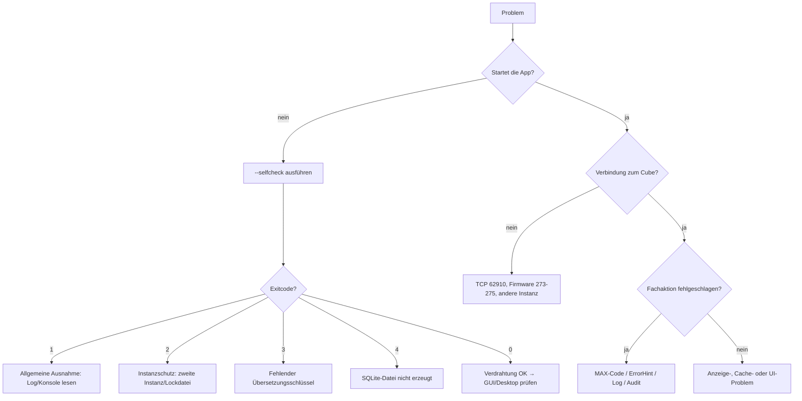

# Fehlerbehebung – MAX! Cube Local App

> Stand 25.11.2026. Reihenfolge: **Sichtbare Meldung → wahrscheinliche Ursache → kontrollierte Diagnose → Maßnahme**. Alle Maßnahmen, die den Cube, seine Struktur oder das Netzwerk verändern, setzen eine bewusste Benutzeraktion voraus. Belege als `Datei:Zeile`.

## 1. Diagnosepfad



**FAKT:** Der fensterlose Selbsttest baut Pfade, SQLite, Gateway, Dienst, ViewModel und Lokalisierung und kontaktiert **keinen** Cube (`Program.cs:26-92`). Er ist damit die erste, sichere Abnahme nach einem Update.

## 2. Selbsttest-Exitcodes

| Exitcode | Meldung | Bedeutung | Maßnahme | Beleg |
|---|---|---|---|---|
| 0 | `SELFCHECK OK: … | SQLite ok` | alles in Ordnung | weiter mit GUI/Cube | `Program.cs:89-92` |
| 1 | `SELFCHECK FEHLER: <Ausnahme>` | unerwartete Ausnahme beim Aufbau | vollständigen Text und `logs/maxcube-JJJJMMTT.log` prüfen | `:56-60` |
| 2 | `SELFCHECK FEHLER: Instanzschutz funktioniert nicht.` | Lockdatei konnte nicht exklusiv geöffnet werden | zweite Instanz beenden, `maxcube.lock` prüfen | `:36-43` |
| 3 | `SELFCHECK FEHLER: Text fehlt in <code>.` | Übersetzungsschlüssel fehlt | `Strings.Table` für alle Sprachen füllen | `:79-86`, `Localizer.cs:56-65` |
| 4 | `SELFCHECK OK … SQLite fehlt` | DB nicht angelegt | Datenordner/Rechte/`MAXCUBE_DATA_DIR` prüfen | `:89-92` |

Befehle:

```powershell
dotnet src/MaxCube.UI.Desktop/bin/Debug/net10.0/MaxCube.UI.Desktop.dll --selfcheck
```

```bash
publish/linux-x64/MaxCube.UI.Desktop --selfcheck
```

## 3. Start- und Oberflächenprobleme

| Symptom | Wahrscheinliche Ursache | Diagnose | Maßnahme |
|---|---|---|---|
| „Anderer Start bereits aktiv“ / `AlreadyRunningWindow` | Lockdatei `maxcube.lock` oder zweite Instanz | `InstanceLock` nutzt `FileShare.None`; zweiter Erwerb scheitert (`InstanceLock.cs:19-49`, `App.axaml.cs:31-41`) | andere Instanz ordnungsgemäß beenden; bei verwaistem Lock nach Prozessende Datei löschen |
| Fenster bleibt leer | `DataContext`/`CanExecuteChanged` fehlt (historische Funde K1/H-A) | Reiter und Buttons prüfen; ViewModel-Tests laufen lassen (`SecondBrain/wiki/projekte/app-maxcube.md:34-36`) | `DataContext` und `NotifyCanExecuteChanged()` nach Zustandswechsel prüfen |
| Sprachwechsel ändert alte Texte nicht | `PropertyChanged("Item[]")` fehlt | `Localizer.SetLanguage` prüfen (`Localizer.cs:43-54`) | Indexer-Binding `{Binding Loc[Schlüssel]}` verwenden |
| Text erscheint als `!Schlüssel!` | unbekannter Key | `--selfcheck` Exit 3 | Key in `Strings.Table` für alle sechs Sprachen ergänzen |
| Tray-Symbol fehlt (Linux) | Desktop keine Tray-Unterstützung | `App.axaml.cs:116-121` fängt Fehler und startet weiter | Fenster weiterverwenden oder `ui.closeToTray` deaktivieren; `UNBEKANNT` auf echten Desktops |
| „Schließen“ beendet nicht | `ui.closeToTray = 1` | Einstellungen-Reiter prüfen (`Settings.cs:48-53`, `App.axaml.cs:53-60`) | Haken entfernen oder Tray „Beenden“ nutzen |
| Linux startet ohne Oberfläche | kein X11/Wayland, `libSkiaSharp`/HarfBuzz fehlt | `start.sh:3-4`, `Program.cs:23-24` | Desktop-Session und self-contained Paketverzeichnis prüfen; `--selfcheck` trennt Verdrahtung von GUI |

**UNBEKANNT:** Tray und Fenster auf echtem X11-/Wayland-Desktop wurden nicht visuell geprüft (`README.md`, Grenzen-Tabelle; `ARCHITECTURE.md` R-03).

## 4. Verbindungsprobleme

| Symptom | Ursache | Beleg | Maßnahme |
|---|---|---|---|
| Connect timeout 30 s | Host/Port falsch, Cube aus, Firewall | `CubeConnectionOptions.cs:15-20`, `TcpCubeTransport.cs:23-60` | IP prüfen; Port **62910** für physischen Cube (54321 nur virtuell); andere Clients beenden |
| `NoIncomingHelloException` / `MalformedHelloException` | erste Zeile ist kein gültiges `H:` | `HelloParser.cs:13-47` | Cube neu starten; anderes Programm auf Port 62910 trennen; Mitschnitt prüfen |
| `IncompatibleFirmwareException` | Firmware außerhalb 273–275 | `FirmwareGuard.cs:12-20`, `ErrorCatalog.cs:101-107` | Firmware ist `UNBEKANNT`/nicht supportet; **kein** Firmware-Schreiben durchführen |
| `StateReceiveTimeout`/`CubeCommunicationFailedException` vor `L:` | `C:`/`M:` unvollständig oder zu langsam | `StateReceiver.cs:23-71` | Verbindung trennen und erneut connecten; Log/Mitschnitt prüfen |
| `CubeTransportException: Create a new transport to reconnect.` | fehlerhafter Transport wird wiederverwendet | `TcpCubeTransport.cs:25-28,184-189` | App trennen und neu verbinden; kein Code-Workaround |
| Status „stale“ / Reconnect | `l:`-Refresh dreimal fehlgeschlagen oder 6 h keine Aktivität | `CubeGateway.cs:278-334`, `CubeApplicationService.cs:111-185` | Cube/Ping prüfen; Reconnect läuft mit 1→2→4…30 s; ggf. manuell trennen/verbinden |
| `q:` fehlt beim Beenden | Gateway-Gate 250 ms nicht erreichbar | `CubeGateway.cs:185-235,441-459` | Prozessende akzeptieren; Cube-Session wird vom Socket-Close freigegeben |
| Suche findet keinen Cube | lokaler UDP-Port nicht 23272 (**FAKT**, Hardware 25.11.2026), Broadcast/Multicast blockiert oder falsches Subnetz | `UdpDiscoveryTransport.cs:23`, `docs/HARDWARE-VERIFY.md` §3 | IP manuell eintragen; Korrektur des Bindungsports prüfen; „Cube suchen“ erneut ausführen |
| Bootloader-Warnung „Firmware-Aktionen deaktiviert“ | Antwortsignatur `eQ3MaxBl` | `CubeDiscoveryService.cs:45-49`, `Strings.cs:249` | Normalfall; keine Firmware-Aktion starten |

**Wichtig:** Die App sendet **keinen** Broadcast beim Start. Wenn ein Mitschnitt einen Broadcast ohne Klick auf „Cube suchen“ zeigt, stammt er nicht aus dieser App (`Program.cs:26-29`).

## 5. Fachfehler und MAX-Codes

Die UI zeigt `ErrorMessage` und einen aus `ErrorCatalog.Describe` abgeleiteten `ErrorHint` (`MainWindowViewModel.cs:613-621`, `MainWindowViewModel.Admin.cs:65-78,225-241`). Die Beschreibungen sind Deutungen der Symbolnamen, **keine** Herstellermeldungen (`ErrorCatalog.cs:5-9`).

| Code / Meldung | Bedeutung nach Katalog | Typische Auslösung in der App | Maßnahme |
|---|---|---|---|
| `MAX1008` | Kommunikation mit dem Cube fehlgeschlagen | `r:`, `S:` mit `discarded`, EOF | Verbindung neu aufbauen; Radar-Auslastung prüfen |
| `MAX1009` | Cube im Anlernmodus | Kommando während `n:`/`N:` | Anlernmodus mit `x:` beenden oder abwarten; `CubeCommandQueue.cs:188-198` |
| `MAX1022` | ungültige/unbekannte Funkadresse | Wandthermostat/-Aktion auf falschem Gerät | Gerät in Geräte-Reiter prüfen |
| `MAX1029`/`MAX1030` | kein Name / Name zu lang | Umbenennen/Anlernen | 1..32 Zeichen verwenden |
| `MAX1032` | nicht verbunden | Schreiben bei Offline-Cache | erst verbinden; Cache ist schreibgeschützt (`CubeApplicationService.cs:528-534`) |
| `MAX1034`/`MAX1035` | Funkadressenformat | hexadezimale 24-Bit-Adresse prüfen | `RadioAddress.cs:10-11,26,40,45` |
| `MAX1040`/`MAX1041` | Seriennummer Länge/Muster | Discovery-/Header-Serial ungültig | `MAX1041`-Regex ist `UNBEKANNT` (`SerialNumber.cs:9-10`) |
| `MAX1050` | Validierung | Temperatur, Boost, Entkalkung, Netzwerkfelder | Werte laut Hilfe prüfen; z. B. Boost nur 0/5/10/15/20/25/30/60 min |
| `MAX10038` | Fernzugriffsdienst nicht verfügbar | **nicht lokal verdrahtet**, nur Katalogeintrag | nicht „korrigieren“; Regex akzeptiert 4–5 Stellen (`ErrorCatalog.cs:54,97`) |

Protokollausnahmen (`CubeCommunicationFailedException`, `UnknownCubeOpcodeException`, `CubeCommandRejectedException`, `IncompatibleFirmwareException`, `MalformedMetadataException`, `LineTooLongException`) tragen **keine** MAX-Codes (`CubeProtocolExceptions.cs:3-69`, `CubeCommandExceptions.cs:1-31`). Ihr Text erscheint trotzdem im Fehlerdialog und in `logs/`.

## 6. Schreibaktionen

| Symptom | Ursache | Maßnahme |
|---|---|---|
| Meldung „nur teilweise gesendet“ bei Wochenprofil | 8..13 Punkte brauchen zwei `0x10`-Telegramme; zweites fehlgeschlagen | `CubeApplicationService.cs:447-463` Audit lesen, erneut senden; fachliche Annahme `UNBEKANNT` |
| Konfiguration wird nicht übernommen | Nur vom Cube gelesene Werte dürfen zurück (`RoomConfigurationValues`) | „Zustand neu laden“, dann erneut senden; `CubeApplicationService.Admin.cs:78-108` |
| `0x12`/`0x20`–`0x23`/`m:`/`w:`/`v:`/UDP wirkungslos | Format ist `INFERENZ`, nicht hardwarevalidiert | Mitschnitt anlegen, Rohwerte vergleichen; nicht blind mehrfach senden (`ARCHITECTURE.md` R-01) |
| Strukturaktion abgelehnt | `confirmed == false` oder Metadaten-Rundreise nicht byte-identisch | Bestätigung erneut geben; `CubeGateway.Admin.cs:99-103`, `CubeApplicationService.Admin.cs:945-951` |
| Sendung „Command discarded“ | `S:`-Antwort mit `discarded='1'` | Funkauslastung/Airtime prüfen; später erneut versuchen (`CubeCommands.cs:250-254`) |
| Konfigurationsänderung im Cube erst bei der nächsten Sendung sichtbar | Funkübernahme durch Thermostat noch nicht abgeschlossen | 6 s warten, erneut lesen; kein Fehlschlag annehmen (`docs/HARDWARE-VERIFY.md` §4.2) |
| Gebündelte Temperatur verzögert | `ui.bundleTemperatures` sammelt 3 s | Einstellung deaktivieren oder `FlushPendingTemperaturesAsync` abwarten (`Admin.cs:272-343`, `ARCHITECTURE.md` R-04) |

**FAKT:** Nach erfolgreichem Cube-Befehl kann der lokale Cache-Schreibfehler nur eine Warnung erzeugen; der Cube-Erfolg bleibt erhalten (`CubeApplicationService.cs:544-564`). Umgekehrt darf ein Offline-Cache nie auf den Cube zurückfließen (`:265-280,528-534`).

## 7. Logs, Audit, Bericht

| Artefakt | Pfad | Inhalt / Grenze |
|---|---|---|
| Tageslog | `<Datenordner>/logs/maxcube-JJJJMMTT.log` | Zeitstempel, Level, Nachricht; `InvariantCulture`; IO-Fehler werden verschluckt (`FileAppLog.cs:6-9,25-43`) |
| Audit | `<Datenordner>/maxcube.db`, Tabelle `audit_log` | letzte 500 via `ReadAuditAsync`, UI zeigt 100; keine Rotation (`SqliteStateStore.cs:183-191`) |
| Diagnosebericht | `<Datenordner>/reports/maxcube-diagnose-*.txt` | OS/.NET, Cube, Räume, Funk, letzte 50 Audit-Zeilen; **lokal, kein Versand** (`CubeApplicationService.Admin.cs:840-876`) |
| Datenordner | `%LOCALAPPDATA%\MaxCube` / `$XDG_DATA_HOME/MaxCube` |Override `MAXCUBE_DATA_DIR` (`AppPaths.cs:10-28`) |

Logs können Gerätenamen, Seriennummern, Temperaturen und Fehlertexte enthalten; keine Zugangsdaten (`SECURITY.md` §5). Bei Weitergabe prüfen.

**FAKT:** Der Diagnosebericht ist der Ersatz für den „Fehlerbericht senden“ des Originals. Es gibt keinen HTTP-/Mail-Versand (`CubeApplicationService.Admin.cs:840-844`, `docs/features.md:83-87`).

## 8. Datenbankprobleme

| Symptom | Diagnose | Maßnahme |
|---|---|---|
| `SQLite fehlt` im Selbsttest | Pfad/Rechte/`MAXCUBE_DATA_DIR` | Datenordner prüfen; App beenden und erneut starten |
| Offline-Anzeige leer | kein `cube.serial` oder kein Snapshot | einmal verbinden; Danach Cache gefüllt (`CubeApplicationService.cs:282,265-303`) |
| Räume/Geräte veraltet | Cache wird nur bei Connect ersetzt | erneut verbinden oder „Zustand neu laden“ (`SqliteStateStore.cs:236-255`) |
| `week_profile`-Spalte fehlt | alte DB vor Migration | App startet additive Migration via `pragma_table_info` (`SqliteStateStore.cs:97-106`) |
| DB wächst durch Audit | unbegrenzte `audit_log`-Tabelle | App beenden, alte Zeilen löschen; Rotation ist Verbesserungsvorschlag (`DATABASE.md` §9) |

**Vorsicht:** Es gibt keine Rückwärtsmigration. Vor Downgrades die DB sichern (`SqliteStateStore.cs:108-115`, `OPERATIONS.md` §5).

## 9. Wenn nichts hilft

1. App vollständig beenden (Tray „Beenden“, nicht nur Fenster schließen, wenn `ui.closeToTray = 1`).
2. `--selfcheck` ausführen und Exitcode+Text notieren.
3. Letztes Tageslog, letzten Audit-Auszug und Diagnosebericht lokal sichten.
4. Version und OS notieren (`Directory.Build.props:3`, Fenstertitel/Status).
5. Bei Hardwareverdacht: Paketmitschnitt von TCP 62910 und – nur nach Klick „Cube suchen“ – UDP 23272 anlegen; keine fremden Schreibbefehle senden.
6. Problem mit Belegen dokumentieren; keine Vermutung als `FAKT` ausgeben (`docs/INDEX.md:54-58`).

## 10. Offene Fragen

- Echte UDP-Antwort und `0x11` Komfort/Eco sind `FAKT` (`docs/HARDWARE-VERIFY.md`); die fachlich ausgewertete `S:`-Quittung bleibt `UNBEKANNT`. Viele der hier genannten Schreibsymptome können erst nach Golden-Capture endgültig bewertet werden.
- `MAX10038` ist belegter Ausreißer; ob eine externe Komponente trotzdem feste vier Stellen erwartet, ist `UNBEKANNT`.
- Tray-/Fensterverhalten unter echtem Wayland ist `UNBEKANNT`.
