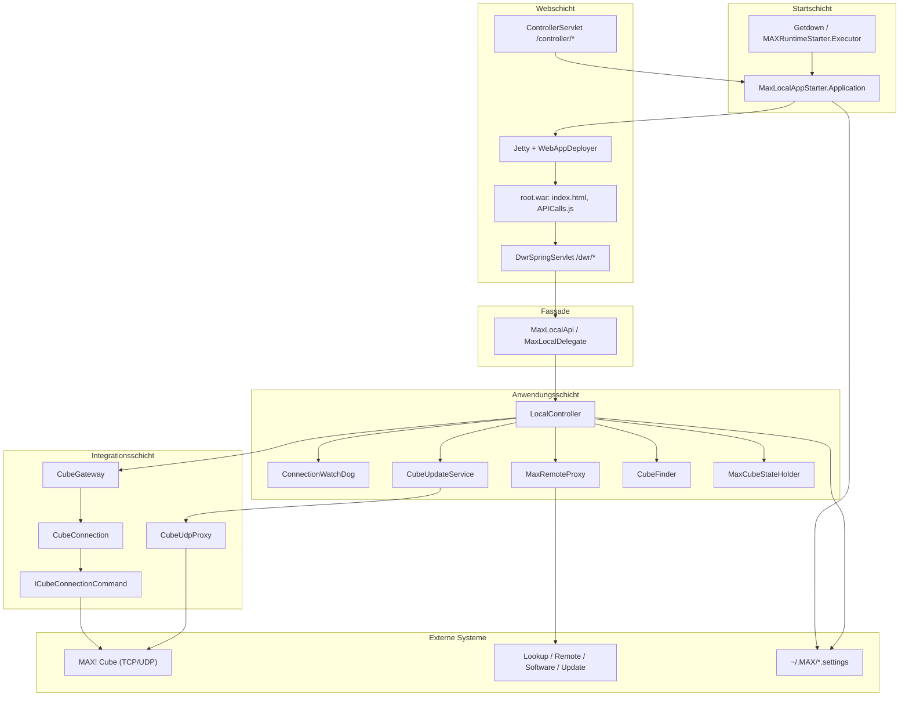

# Architektur der MAX Local Application 1.4.6

## 1. Zweck dieses Dokuments

Dieses Dokument beschreibt die technische Architektur der ausgelieferten MAX Local Application 1.4.6 als Grundlage für eine Neuimplementierung. Es ist keine Empfehlung für einen 1:1-Port, sondern eine Bestandsaufnahme mit klarer Trennung von Beobachtung, Inferenz und Unbekanntem. (Quelle: `decompiled/controller/resources/META-INF/maven/de.eq3.max/MaxControllerApplication/pom.xml:1-8`, Version 1.4.6; Quelle: `extracted/settings/Default.settings:1-9`)

Alle Aussagen sind mit `Quelldatei:Zeile` oder einer Evidence-ID belegt. Die verwendeten Evidenz-IDs werden in Abschnitt 2 aufgeführt. (Quelle: `evidence/maxlocalapp-evidence.json:1`, `evidence/controller-evidence.json:1`)

**Leseregeln:** `BEOBACHTUNG` = direkt im Artefakt sichtbar. `INFERENZ` = aus Beobachtungen abgeleitet, nicht direkt belegt. `UNBEKANNT` = mit den vorhandenen Quellen nicht entscheidbar. (Quelle: `extracted/rootwar/WEB-INF/web.xml:1-68`, `decompiled/controller/sources/de/eq3/max/al/local/LocalController.java:1-924`)

## 2. Evidenzgrundlage

| Artefakt | Evidence-ID | Rolle für dieses Dokument |
|---|---|---|
| `MaxLocalApp.jar` | `ev_0a83b0f4dfeaa8dc02b4b7e5168c4e25586ca4f78ee9bb199f263cf7971f0f67` | Desktop-Shell, Jetty-Start, Tray, Proxy (Quelle: Evidence-ID `ev_0a83b0f4dfeaa8dc02b4b7e5168c4e25586ca4f78ee9bb199f263cf7971f0f67`) |
| `MaxEssentialsBackend-1.4.6.jar` | `ev_cd71f066e83568d1ab3c71c8f78b5ea143ceb6dcf3b32ee7b5329970380de677` | Domain, DTO, State, Validierung, Dozer-Mapping (Quelle: Evidence-ID `ev_cd71f066e83568d1ab3c71c8f78b5ea143ceb6dcf3b32ee7b5329970380de677`) |
| `MaxLocalBackend-1.4.6.jar` | `ev_b01b22f5d2b54d783aa1cb8dbe567111e03a6fe5029e1641318be232168a43a7` | lokale Services, Gateway, Remote-Proxy, Update (Quelle: Evidence-ID `ev_b01b22f5d2b54d783aa1cb8dbe567111e03a6fe5029e1641318be232168a43a7`) |
| `MaxSettings.jar` | `ev_31f2c19749714a95e3e7fb36dfc7552969f422676dd7ea8282172d359855089f` | Default-Einstellungen und `firmware.enc` (Quelle: Evidence-ID `ev_31f2c19749714a95e3e7fb36dfc7552969f422676dd7ea8282172d359855089f`) |
| `root.war` | `ev_198593f77a5b718fcd92173c539c0b5f7d78752738b9e66ae993003f805d2e67` | Web-App, Servlets, JavaScript, DWR-Konfiguration (Quelle: Evidence-ID `ev_198593f77a5b718fcd92173c539c0b5f7d78752738b9e66ae993003f805d2e67`) |
| `MaxControllerApplication.jar` | `ev_42e4885a961f14d51aae2e5f880199599ca787a822b9dc66cd85ce2d46a9c91a` | dekompilierte Controller-/Backend-Klassen und Exit/Alive-Client (Quelle: Evidence-ID `ev_42e4885a961f14d51aae2e5f880199599ca787a822b9dc66cd85ce2d46a9c91a`) |
| Bootstrapper/Installationsspuren | `ev_81a48cb5c63ace439b913812ff1d104c79c9a1179387732f5682a5545799e809` | `getdown.txt`, `start.cmd`, `MAXRuntimeStarter.jar`, `Executor`, `Updater` (Quelle: Evidence-ID `ev_81a48cb5c63ace439b913812ff1d104c79c9a1179387732f5682a5545799e809`) |

**BEOBACHTUNG:** Die dekompilierten Quellen liegen in vier Teilbäumen vor: `maxlocalapp` (29 Java-Dateien), `essentials` (232), `localbackend` (109) und `controller` (110). (Quelle: `decompiled/`-Verzeichnisinventar, gezählt über `Get-ChildItem -Recurse -Filter *.java`; Evidence-IDs wie in Tabelle oben)

**BEOBACHTUNG:** Die Teilbäume `decompiled/controller/sources` und `decompiled/localbackend/sources` enthalten weitgehend dieselben `de.eq3.max.*`-Klassen; `controller` zusätzlich `de/eq3/max/MaxControllerApplication/App.java`. (Quelle: `decompiled/controller/sources/de/eq3/max/MaxControllerApplication/App.java:1-13`, `decompiled/localbackend/sources/de/eq3/max/al/local/LocalController.java:1-10`)

**INFERENZ:** Für die Architekturbeschreibung ist `controller` als kanonische Sicht auf die Backend-Klassen zu verwenden, weil dort der vollständige Klassenbaum inklusive Einstiegspunkt vorliegt. (Quelle: `decompiled/controller/sources/de/eq3/max/MaxControllerApplication/App.java:12-13`, `decompiled/controller/sources/de/eq3/max/al/local/LocalController.java:74-75`)

## 3. Systemüberblick

**BEOBACHTUNG:** Die Anwendung läuft als lokale Desktop-Anwendung mit eingebettetem Jetty-Server und einem im Browser dargestellten Web-Frontend. (Quelle: `decompiled/maxlocalapp/sources/de/eq3/max/MaxLocalAppStarter/Application.java:43-47`, `decompiled/maxlocalapp/sources/de/eq3/max/MaxLocalAppStarter/Application.java:190-220`, `extracted/rootwar/index.html:1-20`)

**BEOBACHTUNG:** Der Browser kommuniziert nicht direkt mit dem Cube, sondern über DWR-Aufrufe an die lokal ausgelieferte Web-App. (Quelle: `extracted/rootwar/js/lib/APICalls.js:905-919`, `extracted/rootwar/WEB-INF/web.xml:40-51`)

**BEOBACHTUNG:** Der Cube wird über eine TCP-Verbindung angesprochen; die Entdeckung erfolgt zusätzlich per UDP/Multicast auf Port 23272. (Quelle: `decompiled/controller/sources/de/eq3/max/il/local/CubeConnection.java:44-60`, `decompiled/controller/sources/de/eq3/max/al/local/finder/CubeFinder.java:21-28`)

**BEOBACHTUNG:** Externe HTTP-Dienste werden für Lookup, Remote-Proxy, Softwareversion und Firmwareaktualisierung verwendet. (Quelle: `extracted/settings/Default.settings:1`, `extracted/settings/Default.settings:7`, `extracted/settings/Default.settings:9`, `decompiled/controller/sources/de/eq3/max/al/local/remoteproxy/MaxRemoteProxy.java:271-298`)

### 3.1 Schichtenmodell (Mermaid)



**BELEG ZUM DIAGRAMM:** Startkette und Jetty-Start (Quelle: `evidence/javap-starter.txt:797-805`, `decompiled/maxlocalapp/sources/de/eq3/max/MaxLocalAppStarter/Application.java:190-220`), Web-Mappings (Quelle: `extracted/rootwar/WEB-INF/web.xml:9-62`), Fassade (Quelle: `extracted/localbackend/LocalApp-cl.xml:8-60`, `decompiled/controller/sources/de/eq3/max/al/local/MaxLocalApi.java:34-41`), Services (Quelle: `decompiled/controller/sources/de/eq3/max/al/local/LocalController.java:75-124`), Integration (Quelle: `decompiled/controller/sources/de/eq3/max/il/local/CubeGateway.java:41-58`, `decompiled/controller/sources/de/eq3/max/il/local/CubeConnection.java:24-37`), Dateiablage (Quelle: `decompiled/controller/sources/de/eq3/max/al/local/core/settings/SettingsProvider.java:69-75`).

### 3.2 Schichtenmodell (ASCII)

```text
+-------------------------------------------------------------------+
| Browser (index.html, APICalls.js, DWR-Engine)                     |
+---------------------------+---------------------------------------+
                            | HTTP / JSON-artige DWR-Payloads
+---------------------------v---------------------------------------+
| Jetty 6.1.26 + root.war                                          |
|   /dwr/*          -> DwrSpringServlet                            |
|   /controller/*   -> ControllerServlet (Exit / Alive)            |
|   /*.html         -> DispatcherServlet                           |
+---------------------------+---------------------------------------+
                            | Java-Aufrufe (IMaxLocal)
+---------------------------v---------------------------------------+
| MaxLocalApi + MaxLocalDelegate + Dozer-Mapper                     |
+---------------------------+---------------------------------------+
                            | ICommunicationService
+---------------------------v---------------------------------------+
| LocalController + MaxCubeStateHolder + WatchDog + RemoteProxy     |
|                + CubeUpdateService + CubeFinder                   |
+---------------------------+---------------------------------------+
                            | ICubeGateway
+---------------------------v---------------------------------------+
| CubeGateway -> CubeConnection -> ICubeConnectionCommand           |
| CubeUdpProxy (Bootloader/Firmware)                                |
+---------------------------+---------------------------------------+
                            | TCP 1.4.6-Port / UDP 23272
+---------------------------v---------------------------------------+
| MAX! Cube                                                        |
+-------------------------------------------------------------------+
```

**BELEG ZUM ASCII-MODELL:** Servlet-Mappings (Quelle: `extracted/rootwar/WEB-INF/web.xml:9-62`), HTTP/JS-Schicht (Quelle: `extracted/rootwar/js/lib/APICalls.js:905-919`), Fassade (Quelle: `decompiled/controller/sources/de/eq3/max/al/local/MaxLocalApi.java:34-41`), Service (Quelle: `decompiled/controller/sources/de/eq3/max/al/local/LocalController.java:75-124`), Gateway und Verbindung (Quelle: `decompiled/controller/sources/de/eq3/max/il/local/CubeGateway.java:41-58`, `decompiled/controller/sources/de/eq3/max/il/local/CubeConnection.java:44-60`), UDP-Port (Quelle: `decompiled/controller/sources/de/eq3/max/al/local/update/CubeUdpProxy.java:23-31`).

## 4. Start- und Lebenszyklus

**BEOBACHTUNG:** Der Bootstrapper `de.eq3.max.runtime.Executor` wird aus `startme*.cmd` gestartet und hat eine `main`-Methode, die `run()` aufruft. (Quelle: `C:\Program Files (x86)\Max Local Application\startme.cmd:1-3`, `evidence/javap-starter.txt:797-805`; Evidence-ID `ev_81a48cb5c63ace439b913812ff1d104c79c9a1179387732f5682a5545799e809`)

**BEOBACHTUNG:** `Executor.run()` prüft `version.txt` und `digest.txt`, schreibt eine `start.cmd` und startet anschließend `de.eq3.max.MaxLocalAppStarter.Application` mit `javaw -splash:max.png -cp ...`. (Quelle: `evidence/javap-starter.txt:244-302`, `evidence/javap-starter.txt:570-580`, `C:\ProgramData\MAX\start.cmd:1-5`; Evidence-ID `ev_81a48cb5c63ace439b913812ff1d104c79c9a1179387732f5682a5545799e809`)

**BEOBACHTUNG:** `MaxLocalAppStarter.Application` ist eine `Observable` und implementiert `FileChangeListener`. (Quelle: `decompiled/maxlocalapp/sources/de/eq3/max/MaxLocalAppStarter/Application.java:43`)

**BEOBACHTUNG:** `main()` setzt das Nimbus-Look-and-Feel, prüft mit `InstanceLock`, ob bereits eine Instanz läuft, und ruft `app.run()`. (Quelle: `decompiled/maxlocalapp/sources/de/eq3/max/MaxLocalAppStarter/Application.java:51-64`)

**BEOBACHTUNG:** `run()` registriert einen `FileMonitor` auf `~/.MAX/max.settings` mit 5000 ms Intervall, setzt die Locale, erzeugt einen `MaxThread` als Shutdown-Hook und initialisiert die Servereinstellungen. (Quelle: `decompiled/maxlocalapp/sources/de/eq3/max/MaxLocalAppStarter/Application.java:66-74`)

**BEOBACHTUNG:** `ApplicationRunningChecker.checkRunningApplication(...)` erkennt eine bereits laufende Anwendung und öffnet in diesem Fall die lokale URL im Browser. (Quelle: `decompiled/maxlocalapp/sources/de/eq3/max/MaxLocalAppStarter/Application.java:75-79`)

**BEOBACHTUNG:** Der Port wird über `SettingsProvider.getServerSettings()` gelesen; bei Bedarf wählt `PortFactory` einen freien Port und speichert ihn über `SettingsProvider.saveSettings(...)`. (Quelle: `decompiled/maxlocalapp/sources/de/eq3/max/MaxLocalAppStarter/Application.java:137-162`)

**BEOBACHTUNG:** Das Systemtray wird über `MaxSystemTrayHandler` als Observer an die Anwendung angeschlossen. (Quelle: `decompiled/maxlocalapp/sources/de/eq3/max/MaxLocalAppStarter/Application.java:176-180`)

**BEOBACHTUNG:** `startServer()` erzeugt `org.mortbay.jetty.Server`, einen `WebAppDeployer` für `<parent>/webapp`, setzt `setExtract(true)` und `setParentLoaderPriority(false)` und startet Server und Deployer. (Quelle: `decompiled/maxlocalapp/sources/de/eq3/max/MaxLocalAppStarter/Application.java:190-217`)

**BEOBACHTUNG:** Nach dem Serverstart wird `Desktop.getDesktop().browse(new URI(getLocalServerAddress()))` aufgerufen; `getLocalServerAddress()` liefert `http://localhost:<port>`. (Quelle: `decompiled/maxlocalapp/sources/de/eq3/max/MaxLocalAppStarter/Application.java:220`, `decompiled/maxlocalapp/sources/de/eq3/max/MaxLocalAppStarter/Application.java:275-276`)

**BEOBACHTUNG:** Proxy-Einstellungen werden als Systemproperties `http.proxySet`, `http.proxyHost` und `http.proxyPort` gesetzt. (Quelle: `decompiled/maxlocalapp/sources/de/eq3/max/MaxLocalAppStarter/Application.java:262-264`)

**BEOBACHTUNG:** Die HTTP-Schnittstelle `/controller/*` akzeptiert POST mit `Exit` oder `Alive`; `Exit` ruft `System.exit(0)` auf, `Alive` antwortet mit `Application running`. (Quelle: `decompiled/controller/sources/de/eq3/max/cl/local/controller/ControllerServlet.java:26-43`)

**BEOBACHTUNG:** `de.eq3.max.MaxControllerApplication.App` ist ein kleiner HTTP-Client, der `Exit` oder `Alive` an `http://localhost:<port>/controller` sendet; der Port stammt aus `SettingsProvider.getServerSettings().getPort()` mit Fallback 8080. (Quelle: `decompiled/controller/sources/de/eq3/max/MaxControllerApplication/App.java:20-61`)

**INFERENZ:** Es gibt zwei getrennte Einstiegspunkte: den langlebigen Desktop-Prozess (`Application`) und den kurzlebigen Kommandozeilen-Client (`App`) für Lebenszeichen- und Shutdown-Aufgaben. (Quelle: `decompiled/maxlocalapp/sources/de/eq3/max/MaxLocalAppStarter/Application.java:51-64`, `decompiled/controller/sources/de/eq3/max/MaxControllerApplication/App.java:20-61`)

## 5. Web- und Konfigurationsschicht

**BEOBACHTUNG:** `web.xml` deklariert den `ContextLoaderListener`, den `Log4jConfigListener`, den `DispatcherServlet` auf `/*.html`, den `DwrSpringServlet` auf `/dwr/*` und den `ControllerServlet` auf `/controller/*`. (Quelle: `extracted/rootwar/WEB-INF/web.xml:9-62`)

**BEOBACHTUNG:** Der DWR-Servlet ist mit `debug=true` konfiguriert. (Quelle: `extracted/rootwar/WEB-INF/web.xml:40-51`, `extracted/essentials/max-dwr.xml:75`)

**BEOBACHTUNG:** Die HTTP-Session hat einen Timeout von 5 Minuten. (Quelle: `extracted/rootwar/WEB-INF/web.xml:67`)

**BEOBACHTUNG:** `max-service.xml` lädt `classpath:max.properties,classpath:max.local.properties` als Property-Placeholder, aktiviert `context:component-scan` für `de.eq3.max` und importiert `essentials.spring.xml`, `max-dwr.xml`, `LocalApp-cl.xml` und `LocalApp-al.xml`. (Quelle: `extracted/rootwar/WEB-INF/max-service.xml:15-25`)

**BEOBACHTUNG:** `max-servlet.xml` enthält nur den leeren `<beans>`-Rahmen mit DWR-Namespace und keine weiteren Bean-Definitionen. (Quelle: `extracted/rootwar/WEB-INF/max-servlet.xml:1-7`)

**BEOBACHTUNG:** `essentials.spring.xml` erzeugt einen `org.dozer.DozerBeanMapper`, einen `ClientExceptionTranslator` mit `errorcodes.properties` und einen `ResetRadiogramBuilder`, der einen `TransmissionRadiogramBuilder` enthält. (Quelle: `extracted/essentials/essentials.spring.xml:12-27`)

**BEOBACHTUNG:** `LocalApp-al.xml` plant `connectionWatchDog.checkConnection` und `cubeGateway.idleCall` mit `fixed-delay="5000"` in einem Scheduler mit `pool-size="1"`. (Quelle: `extracted/localbackend/LocalApp-al.xml:10-15`)

**BEOBACHTUNG:** `LocalApp-cl.xml` definiert die Bean `MaxLocalApi` sowie einen `MaxLocalDelegate` als DWR-Delegate; im Kommentar wird der DWR-Fehler DWR-161 genannt. (Quelle: `extracted/localbackend/LocalApp-cl.xml:8-17`)

**BEOBACHTUNG:** Über `dwr:remote javascript="MaxLocalApi"` werden unter anderem `getMaxCubeState`, `setClientCommands`, `connect`, `disconnect`, `listAvailableMaxCubes`, `performFirmwareUpdate`, `checkFirmwareUpdateStatus`, `setRemoteCredentials` und `getLocale` freigegeben. (Quelle: `extracted/localbackend/LocalApp-cl.xml:16-60`)

**BEOBACHTUNG:** `max-dwr.xml` registriert DWR-Konvertierungen für DTOs wie `MaxCubeState`, `MaxHouse`, `MaxRoom`, `MaxDevice`, `MaxDeviceState`, `UpdateStatus`, `NetworkConfiguration` und für eine Vielzahl von `ClientCommand`-Subtypen. (Quelle: `extracted/essentials/max-dwr.xml:14-73`)

**BEOBACHTUNG:** Die JavaScript-Schicht ruft im lokalen Modus `MaxLocalApi.*` auf und im Nicht-Lokal-Modus `MaxRemoteApi.*`. (Quelle: `extracted/rootwar/js/lib/APICalls.js:51-52`, `extracted/rootwar/js/lib/APICalls.js:905-921`)

**BEOBACHTUNG:** `APICalls.prototype.timeout` beträgt 120000 ms. (Quelle: `extracted/rootwar/js/lib/APICalls.js:21-22`)

**BEOBACHTUNG:** Die DWR-Engine wird in `engine.js` durch eine Überschreibung von `dwr.engine._serializeAll` angepasst. (Quelle: `extracted/rootwar/js/lib/engine.js:1-15`)

**BEOBACHTUNG:** Der Keep-Alive wird im Browser mit `window.setTimeout` und `alivePingTime: 3000` ms zyklisch ausgelöst. (Quelle: `extracted/rootwar/js/com_structure/controllers/indexStructureController.js:31`, `extracted/rootwar/js/com_structure/controllers/indexStructureController.js:723-726`)

**INFERENZ:** Die Web-App ist zustandsarm; relevante Zustände liegen im Java-Prozess und werden bei Bedarf in Properties-Dateien gespeichert. (Quelle: `decompiled/controller/sources/de/eq3/max/al/local/core/settings/SettingsProvider.java:36-75`, `decompiled/controller/sources/de/eq3/max/al/local/core/cubestate/MaxCubeStateHolder.java:1-30`)

## 6. Persistenz und Datenbankfrage

**BEOBACHTUNG:** Es wurde keine Datenbank im ausgelieferten Artefakt gefunden: Eine Suche über alle dekompilierten `.java`-Dateien nach `jdbc`, `hsql`, `derby`, `sqlite`, `.db`, `DataSource`, `EntityManager`, `javax.persistence`, `PreparedStatement` und `getConnection(` lieferte 0 Treffer. (Quelle: `decompiled/**/*.java`, Suche mit `Select-String -Recurse`; Evidenz-IDs `ev_b01b22f5d2b54d783aa1cb8dbe567111e03a6fe5029e1641318be232168a43a7`, `ev_cd71f066e83568d1ab3c71c8f78b5ea143ceb6dcf3b32ee7b5329970380de677`, `ev_42e4885a961f14d51aae2e5f880199599ca787a822b9dc66cd85ce2d46a9c91a`)

**BEOBACHTUNG:** Die `getdown.txt` enthält zwar `lib/spring-jdbc-3.0.4.RELEASE.jar`, `lib/spring-orm-3.0.4.RELEASE.jar`, `lib/spring-tx-3.0.4.RELEASE.jar` und `lib/javax-persistence-2.0.1.jar`, aber die dekompilierten Klassen verwenden keine Datenbank-API. (Quelle: `C:\ProgramData\MAX\getdown.txt`; Evidence-ID `ev_81a48cb5c63ace439b913812ff1d104c79c9a1179387732f5682a5545799e809`, `decompiled/**/*.java` Suchergebnis 0 Treffer)

**BEOBACHTUNG:** Einstellungen werden als Java-`Properties` in Dateien unter `System.getProperty("user.home") + "/.MAX/"` geschrieben. (Quelle: `decompiled/controller/sources/de/eq3/max/al/local/core/settings/SettingsProvider.java:36-42`, `decompiled/controller/sources/de/eq3/max/al/local/core/settings/SettingsProvider.java:69-75`)

**BEOBACHTUNG:** `Settings` lädt Default-Werte aus der Ressource `Default.settings` im Classpath. (Quelle: `decompiled/controller/sources/de/eq3/max/al/local/core/settings/Settings.java:13-21`)

**BEOBACHTUNG:** `ApplicationSettings.getSettingsFileName()` liefert `max.settings`. (Quelle: `decompiled/controller/sources/de/eq3/max/al/local/core/settings/ApplicationSettings.java:147-148`)

**BEOBACHTUNG:** `Default.settings` enthält URLs und Schalter wie `LookupURL`, `NotificationProviderURL`, `UpdateURL`, `ShowInteractiveSplash` und `SwipeLogsOlderThanDays`. (Quelle: `extracted/settings/Default.settings:1-9`)

**BEOBACHTUNG:** Der Cube-Zustand wird im Speicher in `MaxCubeStateHolder` gehalten, nicht in einer Datenbank. (Quelle: `decompiled/essentials/sources/de/eq3/max/al/core/cubestate/MaxCubeStateHolder.java:1-30`)

**BEOBACHTUNG:** Metadaten werden nicht in einer lokalen Datenbank, sondern über `cubeGateway.sendMetaData(...)` zum Cube geschickt. (Quelle: `decompiled/controller/sources/de/eq3/max/al/local/LocalController.java:832-838`)

**INFERENZ:** Für eine Neuimplementierung genügt zunächst ein Datei-basierter Einstellungsspeicher plus In-Memory-State; eine relationale Datenbank ist aus den vorliegenden Artefakten nicht erforderlich. (Quelle: `decompiled/controller/sources/de/eq3/max/al/local/core/settings/SettingsProvider.java:36-75`, `decompiled/controller/sources/de/eq3/max/al/local/LocalController.java:832-838`)

**UNBEKANNT:** Ob ältere oder nicht ausgelieferte Versionen der Anwendung eine Datenbank nutzten, ist anhand der vorhandenen 1.4.6-Artefakte nicht entscheidbar. (Quelle: keine einschlägigen Treffer in `decompiled/**/*.java`; Evidence-IDs wie oben)

## 7. Zentrale Laufzeitpfade

### 7.1 Zustandsabfrage

**BEOBACHTUNG:** `MaxLocalApi.getMaxCubeState()` mappt den domänen-Zustand mit Dozer auf `MaxCubeState` und ruft anschließend `resetChangedState()`. (Quelle: `decompiled/controller/sources/de/eq3/max/al/local/MaxLocalApi.java:47-51`)

**BEOBACHTUNG:** `LocalController.getMaxCubeState()` führt `checkConnection()`, `cubeState()` und `cubeStateUpdateDeviceState()` aus. (Quelle: `decompiled/controller/sources/de/eq3/max/al/local/LocalController.java:128-133`)

**BEOBACHTUNG:** `cubeState()` liefert den Zustand aus dem Holder oder lädt ihn über `fetchMaxCubeState()` vom Cube. (Quelle: `decompiled/controller/sources/de/eq3/max/al/local/LocalController.java:848-870`)

**BEOBACHTUNG:** `fetchMaxCubeState()` verwendet `cubeGateway.fetchMaxCubeState().getRawState()` und `cubeStateFactory.processCubeState(...)`. (Quelle: `decompiled/controller/sources/de/eq3/max/al/local/LocalController.java:859-866`)

**BEOBACHTUNG:** `CubeGateway.fetchMaxCubeState()` erzeugt einen `FetchGatewayStateCubeCommand` und führt ihn über `execute(...)` aus. (Quelle: `decompiled/controller/sources/de/eq3/max/il/local/CubeGateway.java:122-126`)

### 7.2 Befehle

**BEOBACHTUNG:** `MaxLocalApi.setClientCommands(...)` mappt die DTO-Kommandos mit `mapCommands(...)` und delegiert an `ICommunicationService.setClientCommand(...)`. (Quelle: `decompiled/controller/sources/de/eq3/max/al/local/MaxLocalApi.java:99-101`, `decompiled/controller/sources/de/eq3/max/al/local/MaxLocalApi.java:153-159`)

**BEOBACHTUNG:** `LocalController.setClientCommand(...)` iteriert über die Kommandos und ruft `executeClientCommand(...)`. (Quelle: `decompiled/controller/sources/de/eq3/max/al/local/LocalController.java:484-492`)

**BEOBACHTUNG:** `executeClientCommand(...)` erzeugt über `radiogramBuilder.createDeviceRadiograms(...)` Geräte-Radiogramme und übergibt sie an `cubeGateway.commitDeviceRadiogram(...)`. (Quelle: `decompiled/controller/sources/de/eq3/max/al/local/LocalController.java:494-509`)

**BEOBACHTUNG:** BeiKommandos vom Typ `IPersistentMetaDataUpdate` wird nach `updateState()` ein `saveMetadata()` ausgelöst. (Quelle: `decompiled/controller/sources/de/eq3/max/al/local/LocalController.java:510-518`)

### 7.3 Verbindung und Zeitüberwachung

**BEOBACHTUNG:** `LocalController.connect(ip)` ruft `cubeGateway.connect(ip)` und setzt anschließend `remoteProxy.setInitialized(false)`. (Quelle: `decompiled/controller/sources/de/eq3/max/al/local/LocalController.java:534-550`)

**BEOBACHTUNG:** `CubeGateway.connect(ip)` erzeugt eine neue `CubeConnection`, sofern keine Verbindung besteht, und legt sie in eine `ArrayBlockingQueue` mit Kapazität 1. (Quelle: `decompiled/controller/sources/de/eq3/max/il/local/CubeGateway.java:110-119`, `decompiled/controller/sources/de/eq3/max/il/local/CubeGateway.java:52`)

**BEOBACHTUNG:** `CubeConnection` baut `new Socket(ip, config.getConnectionPort(ip))`, liest eine `H:`-Zeile und prüft die Firmware-Kompatibilität gegen `leastCompatible` und `latest`. (Quelle: `decompiled/controller/sources/de/eq3/max/il/local/CubeConnection.java:40-64`)

**BEOBACHTUNG:** `ConnectionWatchDog.checkConnection()` ruft nach Überschreiten von `max.idleTimeBeforeLocalAppDisconnect` den `timeoutHandler.onConnectionTimeout()` auf. (Quelle: `decompiled/controller/sources/de/eq3/max/al/local/ConnectionWatchDog.java:30-42`, `extracted/localbackend/LocalApp-al.xml:11`)

**BEOBACHTUNG:** `LocalController.onConnectionTimeout()` ruft `disconnect()`. (Quelle: `decompiled/controller/sources/de/eq3/max/al/local/LocalController.java:576-578`)

**BEOBACHTUNG:** `stillAlivePing()` setzt den Watchdog zurück und liefert den Airtime-Status des Gateways. (Quelle: `decompiled/controller/sources/de/eq3/max/al/local/LocalController.java:524-529`)

### 7.4 Geräteerkennung

**BEOBACHTUNG:** `LocalController.listAvailableMaxCubes()` liest zuerst `ApplicationSettings`, vergleicht die lokale IP und greift bei Bedarf auf zwischengespeicherte Cube-Daten zurück. (Quelle: `decompiled/controller/sources/de/eq3/max/al/local/LocalController.java:658-676`)

**BEOBACHTUNG:** Danach ruft sie `CubeFinder.listCubes(this.localConfiguration.getCubeScanTime())` und baut `CubeInfo`-Objekte aus Seriennummer, Firmware, IP und Bootloader-Flag. (Quelle: `decompiled/controller/sources/de/eq3/max/al/local/LocalController.java:677-681`)

**BEOBACHTUNG:** `CubeFinder` sendet `eQ3Max*\0**********I` per Broadcast und Multicast und parst Antworten mit der Signatur `^eQ3Max(Ap|Bl)`. (Quelle: `decompiled/controller/sources/de/eq3/max/al/local/finder/CubeFinder.java:21-28`, `decompiled/controller/sources/de/eq3/max/al/local/finder/CubeFinder.java:47-50`, `decompiled/controller/sources/de/eq3/max/al/local/finder/CubeFinder.java:84-94`)

**BEOBACHTUNG:** `CubeFinder` nutzt die Adressen `224.0.0.1` und `255.255.255.255` sowie Port 23272. (Quelle: `decompiled/controller/sources/de/eq3/max/al/local/finder/CubeFinder.java:22-24`)

### 7.5 Firmware-Update

**BEOBACHTUNG:** `LocalController.performFirmwareUpdate(serialNumber)` verlangt `assertNotConnected()` und delegiert an `cubeUpdateService.performUpdate(serialNumber)`. (Quelle: `decompiled/controller/sources/de/eq3/max/al/local/LocalController.java:686-689`)

**BEOBACHTUNG:** `assertNotConnected()` wirft `AlreadyConnectedToCubeException`, wenn eine Verbindung besteht. (Quelle: `decompiled/controller/sources/de/eq3/max/al/local/LocalController.java:842-846`)

**BEOBACHTUNG:** `CubeUpdateService.performUpdate(...)` setzt den Status auf `BeginUpdate` und startet einen Thread namens `CubeUpdateService`. (Quelle: `decompiled/controller/sources/de/eq3/max/al/local/update/CubeUpdateService.java:28-39`)

**BEOBACHTUNG:** `CubeUpdateService.run()` lädt `firmware.enc` aus dem Classpath und übergibt sie an `CubeUpdater.update(...)`. (Quelle: `decompiled/controller/sources/de/eq3/max/al/local/update/CubeUpdateService.java:48-54`)

**BEOBACHTUNG:** `CubeUpdater` arbeitet die Schritte `ParseFirmwareFile`, `EnterBootloader`, `InitUpdate`, `WriteFrame`, `Reboot` und `EndUpdate` ab und meldet sie über den Status-Handler. (Quelle: `decompiled/controller/sources/de/eq3/max/al/local/update/CubeUpdater.java:27-107`)

**BEOBACHTUNG:** `CubeUdpProxy` verwendet multicast `224.0.0.1`, Broadcast `255.255.255.255`, Port 23272, `TIMEOUT=2000` und `REBOOT_TIMEOUT=20000`. (Quelle: `decompiled/controller/sources/de/eq3/max/al/local/update/CubeUdpProxy.java:23-32`)

**BEOBACHTUNG:** `MaxSettings.jar` enthält eine Ressource `firmware.enc` mit 346352 Byte. (Quelle: `evidence/controller-evidence.json` Inventar-Eintrag `firmware.enc`; Evidence-ID `ev_31f2c19749714a95e3e7fb36dfc7552969f422676dd7ea8282172d359855089f`)

### 7.6 Remote-Proxy

**BEOBACHTUNG:** `MaxRemoteProxy.send(...)` baut eine `HttpURLConnection` zur `maxRemoteUrl`, schreibt Content und liest die Antwort. (Quelle: `decompiled/controller/sources/de/eq3/max/al/local/remoteproxy/MaxRemoteProxy.java:182-190`, `decompiled/controller/sources/de/eq3/max/al/local/remoteproxy/MaxRemoteProxy.java:196-233`)

**BEOBACHTUNG:** Die Ziel-URL wird über `UrlRetriever` mit `fallbackLookupUrl` ermittelt oder aus der Konfiguration übernommen. (Quelle: `decompiled/controller/sources/de/eq3/max/al/local/remoteproxy/MaxRemoteProxy.java:271-298`)

**BEOBACHTUNG:** Bei erfolgreichem Setzen der Remote-Zugangsdaten wird `cubeGateway.setInterval(getInterval(...))` aufgerufen. (Quelle: `decompiled/controller/sources/de/eq3/max/al/local/remoteproxy/MaxRemoteProxy.java:67-78`)

**BEOBACHTUNG:** `LocalController.setRemoteCredentials(...)` validiert die Eingaben, bevor es an den Proxy delegiert. (Quelle: `decompiled/controller/sources/de/eq3/max/al/local/LocalController.java:599-603`)

**BEOBACHTUNG:** `LocalController.setRemoteAccess(...)` und `getRemoteCredentials()` delegieren ebenfalls an `remoteProxy`. (Quelle: `decompiled/controller/sources/de/eq3/max/al/local/LocalController.java:891-895`, `decompiled/controller/sources/de/eq3/max/al/local/LocalController.java:636-642`)

## 8. Architekturimplikationen für eine Neuimplementierung

**INFERENZ:** Die Trennung in Web-Fassade, Anwendungs-Service, Gateway und Verbindung ist funktional sinnvoll und sollte als Grossstruktur erhalten bleiben. (Quelle: `extracted/localbackend/LocalApp-cl.xml:8-60`, `decompiled/controller/sources/de/eq3/max/al/local/LocalController.java:75-124`, `decompiled/controller/sources/de/eq3/max/il/local/CubeGateway.java:41-58`)

**INFERENZ:** Ein moderner Nachbau kann DWR durch ein explizites JSON-API ersetzen; die Methodenliste in `LocalApp-cl.xml` ist dabei die funktionale Mindestmenge. (Quelle: `extracted/localbackend/LocalApp-cl.xml:16-60`)

**INFERENZ:** Der eingebettete Jetty-Server kann durch einen modernen Embedded-Server ersetzt werden, solange lokale HTTP-Adressierung und Browser-Start erhalten bleiben. (Quelle: `decompiled/maxlocalapp/sources/de/eq3/max/MaxLocalAppStarter/Application.java:190-220`)

**INFERENZ:** Die Command-Queue pro Verbindung sollte beibehalten werden, weil sie die serielle Abfolge von Cube-Kommandos erzwingt. (Quelle: `decompiled/controller/sources/de/eq3/max/il/local/CubeConnection.java:36`, `decompiled/controller/sources/de/eq3/max/il/local/CubeConnection.java:139-155`, `decompiled/controller/sources/de/eq3/max/il/local/CubeConnection.java:185-197`)

**INFERENZ:** Der Datei-basierte Einstellungsspeicher und der In-Memory-State im Holder sind einfach nachbaubar; eine Datenbank würde ein neues Verhalten einführen. (Quelle: `decompiled/controller/sources/de/eq3/max/al/local/core/settings/SettingsProvider.java:36-75`, `decompiled/essentials/sources/de/eq3/max/al/core/cubestate/MaxCubeStateHolder.java:1-30`)

**INFERENZ:** Der Firmware-Update-Pfad ist vom normalen TCP-Pfad getrennt und benötigt eigene UDP- und Bootloader-Logik. (Quelle: `decompiled/controller/sources/de/eq3/max/al/local/LocalController.java:686-689`, `decompiled/controller/sources/de/eq3/max/al/local/update/CubeUpdater.java:27-41`, `decompiled/controller/sources/de/eq3/max/al/local/update/CubeUdpProxy.java:23-32`)

## 9. Offene Punkte

**BEOBACHTUNG:** Der Inhalt beider Property-Dateien liegt sehr wohl materialisiert vor – allerdings nicht im `root.war`, sondern in den Basis-JARs: `extracted/essentials/max.properties:1-13` (Default-Temperaturen 20.0/17.0/21.0/17.0 °C, Boost 15 min, Ventilwinkel 100, Entkalkung Tag 6/Stunde 12) und `extracted/settings/max.local.properties:1-27` (Grenzen 32/20/140, Timeouts, Firmware 273–275, Ports). Eine weitere Kopie liegt unter `extracted/controller/max.local.properties`. `max-service.xml:15` lädt beide über den Classpath. (Quelle: `extracted/rootwar/WEB-INF/max-service.xml:15`; `extracted/essentials/max.properties`; `extracted/settings/max.local.properties`)

**BEOBACHTUNG:** Die Port-Regel ist vollständig belegt: `LocalConfiguration.getConnectionPort(ip)` liefert `connectionVirtualCubePort` (konfiguriert 54321), wenn `ip` gleich `"127.0.0.1"` **oder** gleich `InetAddress.getLocalHost().getHostAddress()` ist; in allen anderen Fällen sowie bei `UnknownHostException` liefert sie `DEFAULT_CUBE_PORT = 62910`. (Quelle: `decompiled/localbackend/sources/de/eq3/max/al/local/core/LocalConfiguration.java:12-13,81-92`; `extracted/settings/max.local.properties:22`)

**UNBEKANNT:** Die vollständige Implementierung von `CubeGateway.run()` ist in JADX nicht dekompiliert und nur als Pseudocode erhalten. (Quelle: `decompiled/controller/sources/de/eq3/max/il/local/CubeGateway.java:67-107`)

**UNBEKANNT:** Die genaue Verschlüsselung der Firmware-Datei und das framing von `firmware.enc` sind nicht aus den vorliegenden Quellen rekonstruierbar. (Quelle: `decompiled/controller/sources/de/eq3/max/al/local/update/CubeUpdater.java:69-72`, `decompiled/controller/sources/de/eq3/max/al/local/update/CubeUdpProxy.java:156-160`)

**UNBEKANNT:** Es ist nicht belegt, ob `MaxRemoteProxy` zusätzlich HTTPS oder nur HTTP verwendet; belegt sind `HttpURLConnection` und die `http://...`-URLs. (Quelle: `decompiled/controller/sources/de/eq3/max/al/local/remoteproxy/MaxRemoteProxy.java:19`, `extracted/settings/Default.settings:1`)

**UNBEKANNT:** Der genaue Zeitpunkt und die Reihenfolge der Persistenz von `ServerSettings` gegenüber `ApplicationSettings` bei erstem Start ist nicht vollständig belegt. (Quelle: `decompiled/maxlocalapp/sources/de/eq3/max/MaxLocalAppStarter/Application.java:137-162`, `decompiled/controller/sources/de/eq3/max/al/local/LocalController.java:658-676`)

## 10. Kurzfassung

**BEOBACHTUNG:** Die MAX Local Application 1.4.6 ist eine lokal laufende Java-Anwendung mit eingebettetem Jetty, DWR-Fassade, zentralem `LocalController`, serieller Cube-Kommunikation über `CubeGateway`/`CubeConnection`, UDP-basiertem Firmware-Update und HTTP-Remote-Proxy. (Quelle: `decompiled/maxlocalapp/sources/de/eq3/max/MaxLocalAppStarter/Application.java:190-220`, `extracted/rootwar/WEB-INF/web.xml:9-62`, `decompiled/controller/sources/de/eq3/max/al/local/LocalController.java:75-124`, `decompiled/controller/sources/de/eq3/max/il/local/CubeConnection.java:40-60`, `decompiled/controller/sources/de/eq3/max/al/local/update/CubeUdpProxy.java:23-32`, `decompiled/controller/sources/de/eq3/max/al/local/remoteproxy/MaxRemoteProxy.java:182-190`)

**BEOBACHTUNG:** Eine Datenbank existiert in den ausgelieferten 1.4.6-Artefakten nicht; Persistenz erfolgt über Properties-Dateien unter `~/.MAX` und der Cube speichert Metadaten selbst. (Quelle: `decompiled/controller/sources/de/eq3/max/al/local/core/settings/SettingsProvider.java:69-75`, `decompiled/controller/sources/de/eq3/max/al/local/LocalController.java:832-838`, Suchergebnis 0 Treffer in `decompiled/**/*.java`)
