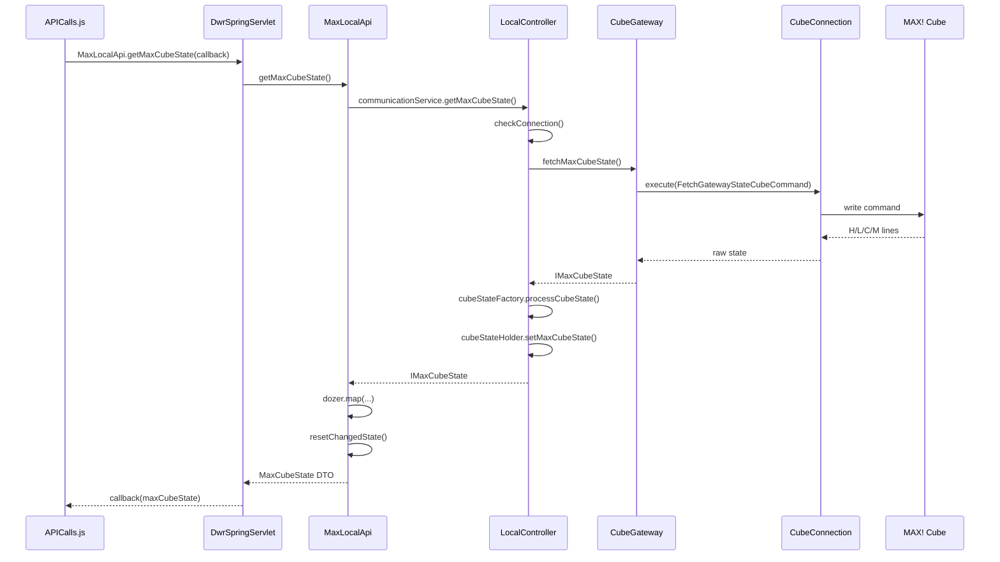

# Datenflüsse der MAX Local Application 1.4.6

## 1. Zweck und Lesart

Dieses Dokument beschreibt konkrete Datenflüsse der MAX Local Application 1.4.6 als Grundlage für eine Neuimplementierung. Es ist eine Bestandsaufnahme, keine Portierungsempfehlung. (Quelle: `decompiled/controller/sources/de/eq3/max/al/local/LocalController.java:75-124`, `extracted/rootwar/js/lib/APICalls.js:905-919`)

Jede Aussage ist als `BEOBACHTUNG`, `INFERENZ` oder `UNBEKANNT` markiert und mit `Quelldatei:Zeile` oder Evidence-ID belegt. (Quelle: `extracted/rootwar/WEB-INF/web.xml:9-62`, `decompiled/controller/sources/de/eq3/max/il/local/CubeConnection.java:139-197`)

## 2. Überblick über die Transportwege

| Weg | Transport | Beteiligte Klassen | Beleg |
|---|---|---|---|
| Browser → Java | HTTP/DWR unter `/dwr/*` | `APICalls.js` → `DwrSpringServlet` → `MaxLocalApi`/`MaxLocalDelegate` | (Quelle: `extracted/rootwar/js/lib/APICalls.js:905-919`, `extracted/rootwar/WEB-INF/web.xml:40-51`, `extracted/localbackend/LocalApp-cl.xml:8-17`) |
| Java → Cube | TCP mit zeilenbasiertem Protokoll | `LocalController` → `CubeGateway` → `CubeConnection` → `ICubeConnectionCommand` | (Quelle: `decompiled/controller/sources/de/eq3/max/al/local/LocalController.java:484-509`, `decompiled/controller/sources/de/eq3/max/il/local/CubeGateway.java:165-167`, `decompiled/controller/sources/de/eq3/max/il/local/CubeConnection.java:139-197`) |
| Cube → Java | `H:`, `L:`, `C:`, `M:`-Zeilen | `CubeConnection` → `IRawCubeState` → `MaxCubeStateFactory` → `MaxCubeStateHolder` | (Quelle: `decompiled/controller/sources/de/eq3/max/il/local/CubeConnection.java:54-57`, `decompiled/controller/sources/de/eq3/max/il/local/CubeConnection.java:157-183`, `decompiled/controller/sources/de/eq3/max/al/local/LocalController.java:859-866`) |
| Discovery | UDP Broadcast/Multicast 23272 | `CubeFinder` → `CubeConnectionInfo` | (Quelle: `decompiled/controller/sources/de/eq3/max/al/local/finder/CubeFinder.java:22-28`, `decompiled/controller/sources/de/eq3/max/al/local/finder/CubeFinder.java:47-50`) |
| Firmware-Update | UDP 23272 an Bootloader | `CubeUpdateService` → `CubeUpdater` → `CubeUdpProxy` | (Quelle: `decompiled/controller/sources/de/eq3/max/al/local/update/CubeUpdateService.java:48-54`, `decompiled/controller/sources/de/eq3/max/al/local/update/CubeUpdater.java:33-41`, `decompiled/controller/sources/de/eq3/max/al/local/update/CubeUdpProxy.java:23-32`) |
| Remote | HTTP `HttpURLConnection` | `LocalController` → `MaxRemoteProxy` → MAX-Remote | (Quelle: `decompiled/controller/sources/de/eq3/max/al/local/LocalController.java:599-603`, `decompiled/controller/sources/de/eq3/max/al/local/remoteproxy/MaxRemoteProxy.java:182-190`) |
| Persistenz | Properties-Dateien | `SettingsProvider` → `~/.MAX/*.settings` | (Quelle: `decompiled/controller/sources/de/eq3/max/al/local/core/settings/SettingsProvider.java:36-42`, `decompiled/controller/sources/de/eq3/max/al/local/core/settings/SettingsProvider.java:69-75`) |
| Steuerung | HTTP POST `/controller/*` | `App` → `ControllerServlet` → `System.exit(0)` | (Quelle: `decompiled/controller/sources/de/eq3/max/MaxControllerApplication/App.java:20-61`, `decompiled/controller/sources/de/eq3/max/cl/local/controller/ControllerServlet.java:26-43`) |

**INFERENZ:** Die wirkungsvolle Grenze liegt zwischen DWR-Fassade und `LocalController`; danach folgt eine streng serielle Cube-Kommunikation. (Quelle: `extracted/localbackend/LocalApp-cl.xml:8-17`, `decompiled/controller/sources/de/eq3/max/il/local/CubeConnection.java:36`, `decompiled/controller/sources/de/eq3/max/il/local/CubeConnection.java:185-197`)

### 2.1 Sequenzdiagramm: State-Abfrage

**BELEG ZUM DIAGRAMM:** JavaScript-Aufruf (Quelle: `extracted/rootwar/js/lib/APICalls.js:905-919`), DWR-Mapping (Quelle: `extracted/rootwar/WEB-INF/web.xml:40-51`, `extracted/localbackend/LocalApp-cl.xml:16-17`), Fassade (Quelle: `decompiled/controller/sources/de/eq3/max/al/local/MaxLocalApi.java:47-51`), Service (Quelle: `decompiled/controller/sources/de/eq3/max/al/local/LocalController.java:128-133`, `decompiled/controller/sources/de/eq3/max/al/local/LocalController.java:859-866`), Gateway (Quelle: `decompiled/controller/sources/de/eq3/max/il/local/CubeGateway.java:122-126`), Verbindung (Quelle: `decompiled/controller/sources/de/eq3/max/il/local/CubeConnection.java:157-197`), Cube-Protokoll (Quelle: `decompiled/controller/sources/de/eq3/max/il/local/CubeConnection.java:54-57`).

## 3. Fluss 1: Browser-Aufruf `getMaxCubeState` bis zum Cube und zurück

**BEOBACHTUNG:** Der Browser ruft im lokalen Modus `MaxLocalApi.getMaxCubeState({callback: ...})` über `APICalls.prototype.getMaxCubeState` auf. (Quelle: `extracted/rootwar/js/lib/APICalls.js:226`, `extracted/rootwar/js/lib/APICalls.js:905-919`)

**BEOBACHTUNG:** Der Aufruf landet bei `DwrSpringServlet`, der in `web.xml` auf `/dwr/*` gemappt ist. (Quelle: `extracted/rootwar/WEB-INF/web.xml:40-51`)

**BEOBACHTUNG:** `dwr:remote javascript="MaxLocalApi"` gibt `getMaxCubeState` frei; `MaxLocalDelegate` leitet den Aufruf an die Bean `MaxLocalApi` weiter. (Quelle: `extracted/localbackend/LocalApp-cl.xml:8-17`, `decompiled/controller/sources/de/eq3/max/al/local/MaxLocalDelegate.java:31-33`)

**BEOBACHTUNG:** `MaxLocalApi.getMaxCubeState()` ruft `communicationService.getMaxCubeState()` und mappt das Ergebnis mit `mapper.map(..., MaxCubeState.class)`. (Quelle: `decompiled/controller/sources/de/eq3/max/al/local/MaxLocalApi.java:47-49`)

**BEOBACHTUNG:** `LocalController.getMaxCubeState()` prüft zuerst die Verbindung über `checkConnection()`. (Quelle: `decompiled/controller/sources/de/eq3/max/al/local/LocalController.java:128-131`)

**BEOBACHTUNG:** `checkConnection()` setzt bei aktiver Verbindung den `ConnectionWatchDog` zurück und wirft sonst `NotConnectedToCubeException`. (Quelle: `decompiled/controller/sources/de/eq3/max/al/local/LocalController.java:589-595`)

**BEOBACHTUNG:** `cubeState()` liefert den Zustand aus `MaxCubeStateHolder`, falls vorhanden, sonst über `fetchMaxCubeState()`. (Quelle: `decompiled/controller/sources/de/eq3/max/al/local/LocalController.java:848-866`)

**BEOBACHTUNG:** `fetchMaxCubeState()` ruft `cubeGateway.fetchMaxCubeState().getRawState()` und verarbeitet das Ergebnis mit `cubeStateFactory.processCubeState(...)`. (Quelle: `decompiled/controller/sources/de/eq3/max/al/local/LocalController.java:859-866`)

**BEOBACHTUNG:** `CubeGateway.fetchMaxCubeState()` erzeugt `FetchGatewayStateCubeCommand` und ruft `execute(command)`. (Quelle: `decompiled/controller/sources/de/eq3/max/il/local/CubeGateway.java:122-126`)

**BEOBACHTUNG:** `CubeGateway.execute(...)` delegiert an `getCurrentConnection().execute(command)`. (Quelle: `decompiled/controller/sources/de/eq3/max/il/local/CubeGateway.java:304-306`)

**BEOBACHTUNG:** `CubeConnection.execute(...)` legt das Kommando in die `commandQueue` und wartet mit `command.waitForResult()` auf das Ergebnis. (Quelle: `decompiled/controller/sources/de/eq3/max/il/local/CubeConnection.java:139-149`)

**BEOBACHTUNG:** Der Gateway-Thread ruft periodisch `connection.process()` auf; darin werden zuerst Metadaten empfangen und danach Kommandos verarbeitet. (Quelle: `decompiled/controller/sources/de/eq3/max/il/local/CubeGateway.java:67-107`, `decompiled/controller/sources/de/eq3/max/il/local/CubeConnection.java:107-109`)

**BEOBACHTUNG:** `receiveDeviceAndMetaData()` liest Zeilen und behandelt `L:` als Geräteliste, `C:` als Gerätekonfiguration und `M:` als Metadatenblock. (Quelle: `decompiled/controller/sources/de/eq3/max/il/local/CubeConnection.java:157-183`)

**BEOBACHTUNG:** `talkToCube()` nimmt das nächste Kommando aus der Queue, setzt `lastAccessTimestamp`, führt es aus und ruft `command.notifyResult()`. (Quelle: `decompiled/controller/sources/de/eq3/max/il/local/CubeConnection.java:185-197`)

**BEOBACHTUNG:** Das Ergebnis wird über `command.waitForResult()` an `CubeConnection.execute(...)` und damit an `LocalController` zurückgegeben. (Quelle: `decompiled/controller/sources/de/eq3/max/il/local/CubeConnection.java:139-155`)

**BEOBACHTUNG:** `LocalController` speichert den verarbeiteten Zustand in `MaxCubeStateHolder` und ruft anschließend `cubeStateUpdateDeviceState()`. (Quelle: `decompiled/controller/sources/de/eq3/max/al/local/LocalController.java:859-866`, `decompiled/controller/sources/de/eq3/max/al/local/LocalController.java:128-133`)

**BEOBACHTUNG:** `MaxLocalApi` ruft nach dem Mapping `maxCubeState.resetChangedState()`, damit Änderungsflags nicht erneut gemeldet werden. (Quelle: `decompiled/controller/sources/de/eq3/max/al/local/MaxLocalApi.java:47-51`)

**BEOBACHTUNG:** DWR liefert das DTO an die `callback`-Funktion in `APICalls.js` zurück. (Quelle: `extracted/rootwar/js/lib/APICalls.js:906-919`)

**INFERENZ:** Der Zustand wird bei der ersten Abfrage geladen und danach aus dem Holder bedient; der Cube wird also nicht bei jedem Poll erneut gelesen. (Quelle: `decompiled/controller/sources/de/eq3/max/al/local/LocalController.java:848-866`)

**BEOBACHTUNG:** Die Reihenfolge ist belegt: `receiveDeviceAndMetaData()` liest Zeilen, bis eine `L:`-Zeile eintrifft; `C:`- und `M:`-Zeilen werden vorher in den `RawCubeState` einsortiert (`CubeConnection.java:157-183`). Der initiale State-Stream endet also mit `L:`. Die konkreten Payload-Werte der Beispiele in `docs/maxcube-protocol.md` Abschnitt 13 sind dagegen INFERENZ.

## 4. Fluss 2: JS → DWR → Controller → Service → Radiogram → TCP → Cube → zurück

**BEOBACHTUNG:** `APICalls.prototype.setClientCommands` ruft `MaxLocalApi.setClientCommands(commands, {...})` auf. (Quelle: `extracted/rootwar/js/lib/APICalls.js:2075-2081`)

**BEOBACHTUNG:** `LocalApp-cl.xml` gibt `setClientCommands` über DWR frei. (Quelle: `extracted/localbackend/LocalApp-cl.xml:33`)

**BEOBACHTUNG:** `MaxLocalApi.setClientCommands(...)` mappt die DTO-Kommandos mit `mapCommands(...)` in Domänen-Kommandos. (Quelle: `decompiled/controller/sources/de/eq3/max/al/local/MaxLocalApi.java:99-101`, `decompiled/controller/sources/de/eq3/max/al/local/MaxLocalApi.java:153-159`)

**BEOBACHTUNG:** `mapCommands(...)` erzeugt eine `ArrayList` und mapped jedes Element auf `de.eq3.max.al.core.command.ClientCommand`. (Quelle: `decompiled/controller/sources/de/eq3/max/al/local/MaxLocalApi.java:153-159`)

**BEOBACHTUNG:** `LocalController.setClientCommand(...)` ruft für jedes Kommando `executeClientCommand(...)` auf. (Quelle: `decompiled/controller/sources/de/eq3/max/al/local/LocalController.java:484-492`)

**BEOBACHTUNG:** Vor der Ausführung werden je nach Scope Geräte im Raum geweckt: bei `RoomConfiguration` und bei `SetDeviceDisplaySetPointActual`. (Quelle: `decompiled/controller/sources/de/eq3/max/al/local/LocalController.java:495-500`)

**BEOBACHTUNG:** `cubeState()` liefert den aktuellen Zustand aus dem Holder. (Quelle: `decompiled/controller/sources/de/eq3/max/al/local/LocalController.java:501`)

**BEOBACHTUNG:** `radiogramBuilder.createDeviceRadiograms(clientCommand, maxCubeState)` erzeugt die Radiogramme pro Gerät. (Quelle: `decompiled/controller/sources/de/eq3/max/al/local/LocalController.java:502-504`)

**BEOBACHTUNG:** Jedes Radiogramm wird über `cubeGateway.commitDeviceRadiogram(deviceRadiogram)` an das Gateway übergeben. (Quelle: `decompiled/controller/sources/de/eq3/max/al/local/LocalController.java:505-507`)

**BEOBACHTUNG:** `CubeGateway.commitDeviceRadiogram(...)` erzeugt ein `CommitDeviceRadiogramCommand` und führt es aus. (Quelle: `decompiled/controller/sources/de/eq3/max/il/local/CubeGateway.java:165-167`)

**BEOBACHTUNG:** Der Kommando-Context schreibt über den `BufferedWriter` des Sockets zum Cube; `CubeConnection` hält Reader und Writer. (Quelle: `decompiled/controller/sources/de/eq3/max/il/local/CubeConnection.java:26-28`, `decompiled/controller/sources/de/eq3/max/il/local/CubeConnection.java:49-50`)

**BEOBACHTUNG:** `clientCommand.setCubeState(maxCubeState)` verknüpft das Kommando mit dem Zustand, auf dem es ausgeführt wurde. (Quelle: `decompiled/controller/sources/de/eq3/max/al/local/LocalController.java:508`)

**BEOBACHTUNG:** `clientCommand.updateState()` aktualisiert den State-Halter; bei `IPersistentMetaDataUpdate` folgt `saveMetadata()`. (Quelle: `decompiled/controller/sources/de/eq3/max/al/local/LocalController.java:510-518`)

**BEOBACHTUNG:** `saveMetadata()` erzeugt Metadaten und sendet sie über `cubeGateway.sendMetaData(...)`. (Quelle: `decompiled/controller/sources/de/eq3/max/al/local/LocalController.java:832-838`)

**BEOBACHTUNG:** `CubeGateway.sendMetaData(...)` erzeugt ein `SendMetaDataCommand`. (Quelle: `decompiled/controller/sources/de/eq3/max/il/local/CubeGateway.java:148-151`)

**BEOBACHTUNG:** Das Ergebnis `MaxCubeAirtimeStatus` wird im `LocalController` gesammelt und als Rückgabewert verwendet. (Quelle: `decompiled/controller/sources/de/eq3/max/al/local/LocalController.java:504-509`)

**INFERENZ:** Ein Benutzerbefehl kann mehrere physische Radiogramme und zusätzlich einen Metadaten-Schreibvorgang auslösen. (Quelle: `decompiled/controller/sources/de/eq3/max/al/local/LocalController.java:502-518`)

## 5. Fluss 3: Cube-Erkennung und Verbindungsaufbau

**BEOBACHTUNG:** `APICalls.prototype.listAvailableMaxCubes` ruft `MaxLocalApi.listAvailableMaxCubes()` auf. (Quelle: `extracted/rootwar/js/lib/APICalls.js:1225-1237`)

**BEOBACHTUNG:** `LocalController.listAvailableMaxCubes()` lädt zuerst `ApplicationSettings` über `SettingsProvider.getApplicationSettings()`. (Quelle: `decompiled/controller/sources/de/eq3/max/al/local/LocalController.java:660-662`)

**BEOBACHTUNG:** Bei unveränderter lokaler IP und vorhandener gespeicherter Cube-IP wird ein zwischengespeichertes `CubeInfo` zurückgegeben. (Quelle: `decompiled/controller/sources/de/eq3/max/al/local/LocalController.java:663-669`)

**BEOBACHTUNG:** Andernfalls wird die aktuelle IP in `ApplicationSettings` geschrieben und über `SettingsProvider.saveSettings(appSettings, "")` persistiert. (Quelle: `decompiled/controller/sources/de/eq3/max/al/local/LocalController.java:670-673`)

**BEOBACHTUNG:** `CubeFinder.listCubes(this.localConfiguration.getCubeScanTime())` startet die UDP-Suche. (Quelle: `decompiled/controller/sources/de/eq3/max/al/local/LocalController.java:677`)

**BEOBACHTUNG:** `CubeFinder.sendHello()` sendet `eQ3Max*\0**********I` an `255.255.255.255` und `224.0.0.1`. (Quelle: `decompiled/controller/sources/de/eq3/max/al/local/finder/CubeFinder.java:47-50`, `decompiled/controller/sources/de/eq3/max/al/local/finder/CubeFinder.java:22-24`)

**BEOBACHTUNG:** `receiveCubeConnectioInfo()` parst Antworten und legt `CubeConnectionInfo` in ein `HashSet`. (Quelle: `decompiled/controller/sources/de/eq3/max/al/local/finder/CubeFinder.java:84-94`)

**BEOBACHTUNG:** `LocalController` baut aus jedem `CubeConnectionInfo` ein `CubeInfo` mit Seriennummer, Firmware, IP und Bootloader-Flag. (Quelle: `decompiled/controller/sources/de/eq3/max/al/local/LocalController.java:678-681`)

**BEOBACHTUNG:** `APICalls.prototype.connect(ip)` ruft `MaxLocalApi.connect(ip)` auf. (Quelle: `extracted/rootwar/js/lib/APICalls.js:1268-1273`)

**BEOBACHTUNG:** `LocalController.connect(ip)` ruft `cubeGateway.connect(ip)` und danach `remoteProxy.setInitialized(false)`. (Quelle: `decompiled/controller/sources/de/eq3/max/al/local/LocalController.java:548-550`)

**BEOBACHTUNG:** `CubeGateway.connect(ip)` erzeugt `new CubeConnection(ip, localConfiguration)` und legt sie in die `ArrayBlockingQueue` mit Kapazität 1. (Quelle: `decompiled/controller/sources/de/eq3/max/il/local/CubeGateway.java:110-119`, `decompiled/controller/sources/de/eq3/max/il/local/CubeGateway.java:52`)

**BEOBACHTUNG:** `CubeConnection` öffnet `new Socket(ip, config.getConnectionPort(ip))` und setzt Timeouts aus der Konfiguration. (Quelle: `decompiled/controller/sources/de/eq3/max/il/local/CubeConnection.java:44-60`)

**BEOBACHTUNG:** Der Konstruktor liest die `H:`-Zeile und prüft die Firmware-Kompatibilität. (Quelle: `decompiled/controller/sources/de/eq3/max/il/local/CubeConnection.java:54-64`)

**BEOBACHTUNG:** `LocalController` setzt über `setConnected(true)` den Watchdog aktiv. (Quelle: `decompiled/controller/sources/de/eq3/max/al/local/LocalController.java:583-586`)

**INFERENZ:** Discovery und Verbindungsaufbau sind zwei getrennte Phasen: erst UDP-Announcement, dann TCP-Handshake mit Firmware-Prüfung. (Quelle: `decompiled/controller/sources/de/eq3/max/al/local/finder/CubeFinder.java:47-50`, `decompiled/controller/sources/de/eq3/max/il/local/CubeConnection.java:44-64`)

## 6. Fluss 4: Keep-Alive, Idle-Call und Connection-Timeout

**BEOBACHTUNG:** Der Browser startet `mvc.c.IndexStructureController.stillAlivePing()` per `window.setTimeout` mit 3000 ms. (Quelle: `extracted/rootwar/js/com_structure/controllers/indexStructureController.js:31`, `extracted/rootwar/js/com_structure/controllers/indexStructureController.js:723-726`)

**BEOBACHTUNG:** `APICalls.prototype.stillAlivePing` ruft `MaxLocalApi.stillAlivePing`. (Quelle: `extracted/rootwar/js/lib/APICalls.js:1393-1400`)

**BEOBACHTUNG:** `LocalController.stillAlivePing()` ruft `connectionWatchDog.reset()` und liefert `cubeGateway.getActualAirtimeStatus()`. (Quelle: `decompiled/controller/sources/de/eq3/max/al/local/LocalController.java:524-529`)

**BEOBACHTUNG:** `MaxLocalApi.stillAlivePing()` mappt das Ergebnis auf `MaxCubeAirtimeStatus`. (Quelle: `decompiled/controller/sources/de/eq3/max/al/local/MaxLocalApi.java:104-109`)

**BEOBACHTUNG:** Parallel dazu ruft der `localScheduler` alle 5 Sekunden `connectionWatchDog.checkConnection()` und `cubeGateway.idleCall()` auf. (Quelle: `extracted/localbackend/LocalApp-al.xml:10-15`)

**BEOBACHTUNG:** `ConnectionWatchDog.checkConnection()` vergleicht `System.currentTimeMillis() - lastAccessTimestamp` mit `max.idleTimeBeforeLocalAppDisconnect`. (Quelle: `decompiled/controller/sources/de/eq3/max/al/local/ConnectionWatchDog.java:32-38`, `decompiled/controller/sources/de/eq3/max/al/local/ConnectionWatchDog.java:16-17`)

**BEOBACHTUNG:** Bei Überschreitung setzt der Watchdog `active = false` und ruft `timeoutHandler.onConnectionTimeout()`. (Quelle: `decompiled/controller/sources/de/eq3/max/al/local/ConnectionWatchDog.java:38-41`)

**BEOBACHTUNG:** `LocalController.onConnectionTimeout()` ruft `disconnect()`. (Quelle: `decompiled/controller/sources/de/eq3/max/al/local/LocalController.java:576-578`)

**BEOBACHTUNG:** `disconnect()` bricht vorher gegebenenfalls den Inclusions-Modus ab und ruft `cubeGateway.disconnect()`. (Quelle: `decompiled/controller/sources/de/eq3/max/al/local/LocalController.java:559-570`)

**BEOBACHTUNG:** `CubeGateway.idleCall()` sendet `encrypt("something")`, wenn der Cube länger als `getCubeIdleTimeout()` nicht angesprochen wurde. (Quelle: `decompiled/controller/sources/de/eq3/max/il/local/CubeGateway.java:291-301`)

**BEOBACHTUNG:** `encrypt(...)` nutzt `AESEncryptCubeCommand` und gibt den verschlüsselten Inhalt zurück. (Quelle: `decompiled/controller/sources/de/eq3/max/il/local/CubeGateway.java:173-176`)

**INFERENZ:** Es gibt zwei getrennte Lebendsignale: den Browser-Ping für den Watchdog und den Cube-Idle-Call für die TCP-Verbindung. (Quelle: `decompiled/controller/sources/de/eq3/max/al/local/LocalController.java:524-529`, `decompiled/controller/sources/de/eq3/max/il/local/CubeGateway.java:291-301`)

## 7. Fluss 5: Metadaten-Änderung und Persistenz

**BEOBACHTUNG:** `APICalls.prototype.changeRoomName` ruft `MaxLocalApi.changeRoomName(roomId, name, {...})`. (Quelle: `extracted/rootwar/js/lib/APICalls.js:1557`)

**BEOBACHTUNG:** `LocalController.changeRoomName(...)` ändert den Raum im Zustand und ruft `cubeGateway.sendMetaData(this.cubeStateFactory.createMetaData(cubeState()))`. (Quelle: `decompiled/controller/sources/de/eq3/max/al/local/LocalController.java:390-396`)

**BEOBACHTUNG:** `changeDeviceName(...)` folgt demselben Muster über `cubeGateway.sendMetaData(...)`. (Quelle: `decompiled/controller/sources/de/eq3/max/al/local/LocalController.java:408-425`)

**BEOBACHTUNG:** `addRoom(...)`, `removeRoom(...)`, `arrangeNewDevice(...)` und `rearrangeRoomOrder(...)` rufen ebenfalls `sendMetaData(...)` auf. (Quelle: `decompiled/controller/sources/de/eq3/max/al/local/LocalController.java:262-266`, `decompiled/controller/sources/de/eq3/max/al/local/LocalController.java:364-378`, `decompiled/controller/sources/de/eq3/max/al/local/LocalController.java:452-463`, `decompiled/controller/sources/de/eq3/max/al/local/LocalController.java:612-630`)

**BEOBACHTUNG:** Die zentrale Hilfsmethode `saveMetadata()` kapselt `createMetaData(cubeState())` und `cubeGateway.sendMetaData(...)`. (Quelle: `decompiled/controller/sources/de/eq3/max/al/local/LocalController.java:832-838`)

**BEOBACHTUNG:** `CubeConnection.receiveDeviceAndMetaData()` verarbeitet eingehende `M:`-Zeilen mit Index, Anzahl und Nutzdaten. (Quelle: `decompiled/controller/sources/de/eq3/max/il/local/CubeConnection.java:172-181`)

**BEOBACHTUNG:** `LocalController.listAvailableMaxCubes()` speichert die lokale IP über `SettingsProvider.saveSettings(appSettings, "")` in `~/.MAX/max.settings`. (Quelle: `decompiled/controller/sources/de/eq3/max/al/local/LocalController.java:670-673`, `decompiled/controller/sources/de/eq3/max/al/local/core/settings/ApplicationSettings.java:147-148`)

**BEOBACHTUNG:** `SettingsProvider.saveSettings(...)` schreibt mit `FileOutputStream` und `settings.store(...)`. (Quelle: `decompiled/controller/sources/de/eq3/max/al/local/core/settings/SettingsProvider.java:36-42`)

**BEOBACHTUNG:** `SettingsProvider.getSettingsFile(...)` setzt sich aus `user.home`, `.MAX` und dem Dateinamen zusammen. (Quelle: `decompiled/controller/sources/de/eq3/max/al/local/core/settings/SettingsProvider.java:69-75`)

**BEOBACHTUNG:** Es gibt keine Datenbank; eine Suche nach Datenbank-APIs in allen dekompilierten Java-Dateien lieferte 0 Treffer. (Quelle: `decompiled/**/*.java`, `Select-String`-Suche nach `jdbc|hsql|derby|sqlite|\.db\b|DataSource|EntityManager|javax.persistence|PreparedStatement|getConnection\(`; Evidenz-IDs `ev_b01b22f5d2b54d783aa1cb8dbe567111e03a6fe5029e1641318be232168a43a7`, `ev_cd71f066e83568d1ab3c71c8f78b5ea143ceb6dcf3b32ee7b5329970380de677`, `ev_42e4885a961f14d51aae2e5f880199599ca787a822b9dc66cd85ce2d46a9c91a`)

**INFERENZ:** Es gibt zwei Persistenzziele: Properties-Dateien auf dem PC und Metadaten auf dem Cube. (Quelle: `decompiled/controller/sources/de/eq3/max/al/local/core/settings/SettingsProvider.java:69-75`, `decompiled/controller/sources/de/eq3/max/al/local/LocalController.java:832-838`)

**BEOBACHTUNG:** Die Blockgröße ist doppelt belegt – als Konfigurationswert `max.metadataBlockSize=1900` (`extracted/settings/max.local.properties:8`) **und** im Code: `SendMetadataCubeCommand` hält sie als Feld (`Zeile 14,16-17`), berechnet die Paketanzahl mit `ceil(byteLength / metadataBlockSize)` (`Zeile 33`) und begrenzt die Schleife mit `b < metadataBlockSize && byteStream.available() != 0` (`Zeile 44`). (Quelle: `decompiled/localbackend/sources/de/eq3/max/il/local/commands/SendMetadataCubeCommand.java:14-17,33,44`; `decompiled/localbackend/sources/de/eq3/max/al/local/core/LocalConfiguration.java:30-31,149`)

## 8. Fluss 6: Firmware-Update über UDP-Bootloader

**BEOBACHTUNG:** `APICalls.prototype.performFirmwareUpdate` ruft `MaxLocalApi.performFirmwareUpdate(SN, {...})`. (Quelle: `extracted/rootwar/js/lib/APICalls.js:1157-1168`)

**BEOBACHTUNG:** `LocalController.performFirmwareUpdate(serialNumber)` verlangt `assertNotConnected()` und delegiert an `cubeUpdateService.performUpdate(serialNumber)`. (Quelle: `decompiled/controller/sources/de/eq3/max/al/local/LocalController.java:686-689`)

**BEOBACHTUNG:** `assertNotConnected()` wirft `AlreadyConnectedToCubeException`, wenn eine TCP-Verbindung besteht. (Quelle: `decompiled/controller/sources/de/eq3/max/al/local/LocalController.java:842-846`)

**BEOBACHTUNG:** `CubeUpdateService.performUpdate(...)` setzt `status = new UpdateStatus(UpdateStatusInfo.BeginUpdate)` und startet einen Thread `CubeUpdateService`. (Quelle: `decompiled/controller/sources/de/eq3/max/al/local/update/CubeUpdateService.java:29-37`)

**BEOBACHTUNG:** Der Thread lädt `firmware.enc` über `getClass().getClassLoader().getResourceAsStream(FIRMWARE_FILENAME)`. (Quelle: `decompiled/controller/sources/de/eq3/max/al/local/update/CubeUpdateService.java:16`, `decompiled/controller/sources/de/eq3/max/al/local/update/CubeUpdateService.java:50`)

**BEOBACHTUNG:** `CubeUpdater` wird erzeugt, bekommt den Status-Handler gesetzt und erhält `update(serialNumber, stream)`. (Quelle: `decompiled/controller/sources/de/eq3/max/al/local/update/CubeUpdateService.java:51-53`)

**BEOBACHTUNG:** `CubeUpdater.update(...)` erzeugt einen `CubeUdpProxy(serialNumber)` und zerlegt die Firmware in Frames. (Quelle: `decompiled/controller/sources/de/eq3/max/al/local/update/CubeUpdater.java:33-41`)

**BEOBACHTUNG:** `getFirmwareFrames(...)` meldet `ParseFirmwareFile` und liefert `firmwareFile.getFrames()`. (Quelle: `decompiled/controller/sources/de/eq3/max/al/local/update/CubeUpdater.java:69-72`)

**BEOBACHTUNG:** `enterBootloader(...)`, `initUpdate(...)` und `writeFrame(...)` melden die jeweiligen Statuswerte an den Handler. (Quelle: `decompiled/controller/sources/de/eq3/max/al/local/update/CubeUpdater.java:75-97`)

**BEOBACHTUNG:** `CubeUdpProxy(serialNumber)` nutzt `CubeFinder.listCubes(1800)`, um den Ziel-Cube zu finden. (Quelle: `decompiled/controller/sources/de/eq3/max/al/local/update/CubeUdpProxy.java:56-67`)

**BEOBACHTUNG:** `CubeUdpProxy` sendet über `MulticastSocket` an Port 23272 und wartet mit `TimeoutWatcher` auf Antworten. (Quelle: `decompiled/controller/sources/de/eq3/max/al/local/update/CubeUdpProxy.java:25-28`, `decompiled/controller/sources/de/eq3/max/al/local/update/CubeUdpProxy.java:211-224`)

**BEOBACHTUNG:** `waitForReboot()` wartet bis zu 20000 ms, bis der Cube wieder erreichbar ist. (Quelle: `decompiled/controller/sources/de/eq3/max/al/local/update/CubeUdpProxy.java:27`, `decompiled/controller/sources/de/eq3/max/al/local/update/CubeUdpProxy.java:131-135`)

**BEOBACHTUNG:** `LocalController.checkFirmwareUpdateStatus()` liefert den Status aus `cubeUpdateService.getStatus()` und wirft bei Fehlern `status.getError()`. (Quelle: `decompiled/controller/sources/de/eq3/max/al/local/LocalController.java:694-700`)

**BEOBACHTUNG:** `APICalls.prototype.checkFirmwareUpdateStatus` ruft `MaxLocalApi.checkFirmwareUpdateStatus`. (Quelle: `extracted/rootwar/js/lib/APICalls.js:1192-1203`)

**INFERENZ:** Der Update-Fluss ist asynchron: der HTTP-Aufruf liefert sofort einen Status zurück, den der Browser anschließend pollt. (Quelle: `decompiled/controller/sources/de/eq3/max/al/local/update/CubeUpdateService.java:29-37`, `decompiled/controller/sources/de/eq3/max/al/local/LocalController.java:694-700`)

**UNBEKANNT:** Das Format der `firmware.enc` und die Bedeutung einzelner Frames sind nicht dekompiliert. (Quelle: `decompiled/controller/sources/de/eq3/max/al/local/update/CubeUpdater.java:69-72`)

## 9. Fluss 7: Remote-Proxy und Produktaktivierung

**BEOBACHTUNG:** `LocalController.checkProductActivation()` delegiert an `remoteProxy.checkProductActivation()`. (Quelle: `decompiled/controller/sources/de/eq3/max/al/local/LocalController.java:216-219`)

**BEOBACHTUNG:** `LocalController.activateProduct(productKey)` delegiert an `remoteProxy.activateProduct(productKey)`. (Quelle: `decompiled/controller/sources/de/eq3/max/al/local/LocalController.java:227-230`)

**BEOBACHTUNG:** `MaxRemoteProxy.checkProductActivation()` erzeugt `CheckProductActivationRequest`, setzt den Cube-Zustand und ruft `send(request)`. (Quelle: `decompiled/controller/sources/de/eq3/max/al/local/remoteproxy/MaxRemoteProxy.java:123-133`)

**BEOBACHTUNG:** `MaxRemoteProxy.activateProduct(...)` erzeugt `ActivateProductRequest` mit dem Produktkey und ruft `send(request)`. (Quelle: `decompiled/controller/sources/de/eq3/max/al/local/remoteproxy/MaxRemoteProxy.java:156-166`)

**BEOBACHTUNG:** `send(...)` erzeugt über `createConnection(maxRemoteUrl)` eine `HttpURLConnection`, schreibt den Content und liest die Antwort. (Quelle: `decompiled/controller/sources/de/eq3/max/al/local/remoteproxy/MaxRemoteProxy.java:182-190`, `decompiled/controller/sources/de/eq3/max/al/local/remoteproxy/MaxRemoteProxy.java:196-233`)

**BEOBACHTUNG:** `maxRemoteUrl` wird in `init()` über `retrieveDeviceAppUrl()` gesetzt. (Quelle: `decompiled/controller/sources/de/eq3/max/al/local/remoteproxy/MaxRemoteProxy.java:271-274`)

**BEOBACHTUNG:** `retrieveDeviceAppUrl()` nutzt `UrlRetriever` mit `configuration.getFallbackLookupUrl()`, wenn der Lookup-Service aktiviert ist. (Quelle: `decompiled/controller/sources/de/eq3/max/al/local/remoteproxy/MaxRemoteProxy.java:282-291`)

**BEOBACHTUNG:** Bei Änderung der URL wird sie über `cubeGateway.setUrl(deviceAppUrl)` an den Cube übermittelt. (Quelle: `decompiled/controller/sources/de/eq3/max/al/local/remoteproxy/MaxRemoteProxy.java:287-289`)

**BEOBACHTUNG:** `LocalController.setRemoteCredentials(...)` validiert zuerst und delegiert dann an `remoteProxy.setRemoteCredentials(...)`. (Quelle: `decompiled/controller/sources/de/eq3/max/al/local/LocalController.java:599-603`)

**BEOBACHTUNG:** `MaxRemoteProxy.setRemoteCredentials(...)` setzt nach erfolgreichem Response das Gateway-Intervall über `cubeGateway.setInterval(getInterval(...))`. (Quelle: `decompiled/controller/sources/de/eq3/max/al/local/remoteproxy/MaxRemoteProxy.java:67-78`)

**BEOBACHTUNG:** `LocalController.setRemoteAccess(...)` und `getRemoteCredentials()` nutzen denselben Proxy. (Quelle: `decompiled/controller/sources/de/eq3/max/al/local/LocalController.java:891-895`, `decompiled/controller/sources/de/eq3/max/al/local/LocalController.java:636-642`)

**INFERENZ:** Der Remote-Proxy verändert nicht nur externen Zustand, sondern auch lokales Verhalten, indem er das Poll-Intervall des Cube-Gateways umstellt. (Quelle: `decompiled/controller/sources/de/eq3/max/al/local/remoteproxy/MaxRemoteProxy.java:67-78`, `decompiled/controller/sources/de/eq3/max/al/local/remoteproxy/MaxRemoteProxy.java:192-193`)

**BELEGT 24.11.2026 (Korrektur):** HTTP-Header (`Opt`, `MAX-Serial`) und Request-Format des Remote-Proxy sind vollständig dekompiliert: `H:`-Zeile + Kommando, Base64, `cubeGateway.encrypt()` als `e:`-Befehl, Base64 als HTTP-Body; Antwort über `d:` und Zeilenparser. (Quelle: `RemoteProxyRequest.java:27-56`, `RemoteProxyResponse.java:29-58`, `MaxRemoteProxy.java:182-190`; `docs/maxcube-protocol.md` Abschnitt 6.1)

## 10. Fluss 8: Start, Browser-Öffnung und Shutdown

**BEOBACHTUNG:** Getdown startet `de.eq3.max.MaxLocalAppStarter.Application` gemäß `class = ...` in `getdown.txt`. (Quelle: `C:\ProgramData\MAX\getdown.txt`; Evidence-ID `ev_81a48cb5c63ace439b913812ff1d104c79c9a1179387732f5682a5545799e809`)

**BEOBACHTUNG:** `Application.main()` prüft mit `InstanceLock`, ob bereits eine Instanz läuft. (Quelle: `decompiled/maxlocalapp/sources/de/eq3/max/MaxLocalAppStarter/Application.java:58-64`)

**BEOBACHTUNG:** `Application.run()` registriert den `FileMonitor` für `~/.MAX/max.settings` mit 5000 ms und initialisiert Servereinstellungen. (Quelle: `decompiled/maxlocalapp/sources/de/eq3/max/MaxLocalAppStarter/Application.java:66-74`)

**BEOBACHTUNG:** `initializeServerSettings()` liest `SettingsProvider.getServerSettings()` und wählt bei Bedarf einen freien Port. (Quelle: `decompiled/maxlocalapp/sources/de/eq3/max/MaxLocalAppStarter/Application.java:137-166`)

**BEOBACHTUNG:** `startServer()` legt den Jetty-Server an und deployt `webapp` über den `WebAppDeployer`. (Quelle: `decompiled/maxlocalapp/sources/de/eq3/max/MaxLocalAppStarter/Application.java:190-217`)

**BEOBACHTUNG:** Nach dem Start öffnet `Desktop.getDesktop().browse(...)` die Adresse `http://localhost:<port>`. (Quelle: `decompiled/maxlocalapp/sources/de/eq3/max/MaxLocalAppStarter/Application.java:220`, `decompiled/maxlocalapp/sources/de/eq3/max/MaxLocalAppStarter/Application.java:275-276`)

**BEOBACHTUNG:** `tools/alive.bat` und `tools/shutdown.bat` rufen `java -jar MaxControllerApplication.jar Alive` beziehungsweise `Exit` auf. (Quelle: `C:\ProgramData\MAX\tools\alive.bat:1-10`, `C:\ProgramData\MAX\tools\shutdown.bat:1-10`; Evidence-ID `ev_81a48cb5c63ace439b913812ff1d104c79c9a1179387732f5682a5545799e809`)

**BEOBACHTUNG:** `de.eq3.max.MaxControllerApplication.App` sendet den Text `Exit` oder `Alive` per POST an `http://localhost:<port>/controller`. (Quelle: `decompiled/controller/sources/de/eq3/max/MaxControllerApplication/App.java:20-61`)

**BEOBACHTUNG:** `ControllerServlet.doPost(...)` liest die erste Zeile und ruft bei `Exit` `System.exit(0)` auf. (Quelle: `decompiled/controller/sources/de/eq3/max/cl/local/controller/ControllerServlet.java:26-39`)

**BEOBACHTUNG:** Der Shutdown-Hook `MaxThread` wurde in `run()` registriert. (Quelle: `decompiled/maxlocalapp/sources/de/eq3/max/MaxLocalAppStarter/Application.java:70-72`)

**INFERENZ:** Der Shutdown-Kanal ist bewusst einfach gehalten und erlaubt es externen Skripten, den lokalen Server kontrolliert zu beenden. (Quelle: `C:\ProgramData\MAX\tools\shutdown.bat:1-10`, `decompiled/controller/sources/de/eq3/max/cl/local/controller/ControllerServlet.java:26-39`; Evidence-ID `ev_81a48cb5c63ace439b913812ff1d104c79c9a1179387732f5682a5545799e809`)

## 11. Fluss 9: Einstellungen und Datei-Monitoring

**BEOBACHTUNG:** `SettingsProvider.getApplicationSettings()` erzeugt ein `ApplicationSettings`-Objekt und lädt es über `loadSettings(...)`. (Quelle: `decompiled/controller/sources/de/eq3/max/al/local/core/settings/SettingsProvider.java:23-25`)

**BEOBACHTUNG:** `loadSettings(...)` prüft, ob die Datei existiert, und lädt sie per `FileInputStream`. (Quelle: `decompiled/controller/sources/de/eq3/max/al/local/core/settings/SettingsProvider.java:51-58`)

**BEOBACHTUNG:** `Settings.getDefaultValue(...)` lädt `Default.settings` aus dem Classpath und liefert den Wert zu einem Schlüssel. (Quelle: `decompiled/controller/sources/de/eq3/max/al/local/core/settings/Settings.java:13-21`)

**BEOBACHTUNG:** `ApplicationSettings.getSettingsFileName()` liefert `max.settings`. (Quelle: `decompiled/controller/sources/de/eq3/max/al/local/core/settings/ApplicationSettings.java:147-148`)

**BEOBACHTUNG:** `Application.fileChanged(...)` reagiert auf Änderungen an `~/.MAX/max.settings`, indem es die Locale neu setzt und das Tray-Menü neu zeichnet. (Quelle: `decompiled/maxlocalapp/sources/de/eq3/max/MaxLocalAppStarter/Application.java:66-67`, `decompiled/maxlocalapp/sources/de/eq3/max/MaxLocalAppStarter/Application.java:280-284`)

**BEOBACHTUNG:** `Default.settings` enthält die Standardwerte für Locale, URLs und UI-Schalter. (Quelle: `extracted/settings/Default.settings:1-9`)

**INFERENZ:** Einstellungen sind nicht transaktional und werden bei jedem Ladevorgang direkt aus der Datei rekonstruiert. (Quelle: `decompiled/controller/sources/de/eq3/max/al/local/core/settings/SettingsProvider.java:51-58`, `decompiled/controller/sources/de/eq3/max/al/local/core/settings/Settings.java:13-21`)

## 12. Zustandshalter und Persistenz im Überblick

| Zustand | Halter | Reichweite | Persistenz | Beleg |
|---|---|---|---|---|
| Cube-Zustand | `MaxCubeStateHolder.maxCubeState` | JVM/Web-Kontext | keine DB; Metadaten auf Cube | (Quelle: `decompiled/essentials/sources/de/eq3/max/al/core/cubestate/MaxCubeStateHolder.java:25-28`, `decompiled/controller/sources/de/eq3/max/al/local/LocalController.java:832-838`) |
| Neue Geräte | `MaxCubeStateHolder.newDevices` | JVM/Web-Kontext | keine | (Quelle: `decompiled/essentials/sources/de/eq3/max/al/core/cubestate/MaxCubeStateHolder.java:25-28`) |
| Airtime-Status | `MaxCubeStateHolder.actualAirtimeStatus`, `CubeGateway.actualAirtimeStatus` | JVM/Web-Kontext | keine | (Quelle: `decompiled/essentials/sources/de/eq3/max/al/core/cubestate/MaxCubeStateHolder.java:25-28`, `decompiled/controller/sources/de/eq3/max/il/local/CubeGateway.java:51`) |
| Watchdog-Zeitstempel | `ConnectionWatchDog.lastAccessTimestamp` | JVM/Web-Kontext | keine | (Quelle: `decompiled/controller/sources/de/eq3/max/al/local/ConnectionWatchDog.java:18-19`) |
| Verbindung | `CubeGateway.currentConnection`, `connections`-Queue | JVM/Web-Kontext | keine | (Quelle: `decompiled/controller/sources/de/eq3/max/il/local/CubeGateway.java:52-53`) |
| Update-Status | `CubeUpdateService.status`, `inProgress` | JVM/Web-Kontext | keine | (Quelle: `decompiled/controller/sources/de/eq3/max/al/local/update/CubeUpdateService.java:17-19`) |
| Einstellungen | `.MAX/*.settings` | Benutzerprofil | Properties-Datei | (Quelle: `decompiled/controller/sources/de/eq3/max/al/local/core/settings/SettingsProvider.java:69-75`) |
| Remote-Initialisierung | `MaxRemoteProxy.isInitialized` | JVM/Web-Kontext | keine | (Quelle: `decompiled/controller/sources/de/eq3/max/al/local/remoteproxy/MaxRemoteProxy.java:41`, `decompiled/controller/sources/de/eq3/max/al/local/LocalController.java:548-550`) |

**BEOBACHTUNG:** Es existiert keine Datenbank; dies wurde durch eine Suche über alle dekompilierten Java-Dateien nach Datenbank-APIs mit 0 Treffern geprüft. (Quelle: `decompiled/**/*.java`, `Select-String`-Suche nach `jdbc|hsql|derby|sqlite|\.db\b|DataSource|EntityManager|javax.persistence|PreparedStatement|getConnection\(`; Evidenz-IDs `ev_b01b22f5d2b54d783aa1cb8dbe567111e03a6fe5029e1641318be232168a43a7`, `ev_cd71f066e83568d1ab3c71c8f78b5ea143ceb6dcf3b32ee7b5329970380de677`, `ev_42e4885a961f14d51aae2e5f880199599ca787a822b9dc66cd85ce2d46a9c91a`)

## 13. Fehlerflüsse

**BEOBACHTUNG:** `checkConnection()` wirft `NotConnectedToCubeException`, wenn das Gateway keine Verbindung meldet. (Quelle: `decompiled/controller/sources/de/eq3/max/al/local/LocalController.java:589-595`)

**BEOBACHTUNG:** `CubeConnection.execute(...)` wirft die im Kommando gespeicherte `IOException` oder `RuntimeException` weiter. (Quelle: `decompiled/controller/sources/de/eq3/max/il/local/CubeConnection.java:141-151`)

**BEOBACHTUNG:** `CubeGateway.execute(...)` ruft bei `SocketException` oder `SocketTimeoutException` `dropConnection()` auf. (Quelle: `decompiled/controller/sources/de/eq3/max/il/local/CubeGateway.java:304-314`)

**BEOBACHTUNG:** `LocalController` übersetzt `IOException` in `CubeCommunicationFailedException`. (Quelle: `decompiled/controller/sources/de/eq3/max/al/local/LocalController.java:486-490`, `decompiled/controller/sources/de/eq3/max/al/local/LocalController.java:862-865`)

**BEOBACHTUNG:** `MaxRemoteProxy` übersetzt eine fehlende gültige URL in `RemoteServiceUnavailableException`. (Quelle: `decompiled/controller/sources/de/eq3/max/al/local/remoteproxy/MaxRemoteProxy.java:295-298`)

**BEOBACHTUNG:** `CubeUpdateService.checkFirmwareUpdateStatus()` wirft den im Status gespeicherten Fehler weiter. (Quelle: `decompiled/controller/sources/de/eq3/max/al/local/LocalController.java:694-700`)

**BEOBACHTUNG:** `ClientExceptionTranslator` wird mit `errorcodes.properties` konfiguriert und übersetzt Ausnahmen an der DWR-Grenze. (Quelle: `extracted/essentials/essentials.spring.xml:20-22`, `extracted/essentials/max-dwr.xml:16-17`)

**INFERENZ:** Fehler werden entlang der Schichten übersetzt: Socket-Fehler → Gateway-Drop → Service-Exception → Client-Exception. (Quelle: `decompiled/controller/sources/de/eq3/max/il/local/CubeGateway.java:304-314`, `decompiled/controller/sources/de/eq3/max/al/local/LocalController.java:486-490`, `extracted/essentials/essentials.spring.xml:20-22`)

## 14. Offene Punkte

**BEOBACHTUNG:** Die Wire-Reihenfolge der TCP-Kommandos ist vollständig in `docs/maxcube-protocol.md` Abschnitt 6 dokumentiert (28 Einträge mit exaktem Request-String, Antwort und Quellstelle je Kommando). Das gilt für die **App→Cube**-Richtung; die Cube-seitige Gegenimplementierung bleibt `UNBEKANNT` (kein PCAP, keine Firmware). (Quelle: `decompiled/localbackend/sources/de/eq3/max/il/local/commands/*.java`; `docs/maxcube-protocol.md` Abschnitt 6)

**UNBEKANNT:** Die genaue Implementierung von `CubeGateway.run()` ist nur als Pseudocode erhalten. (Quelle: `decompiled/controller/sources/de/eq3/max/il/local/CubeGateway.java:67-107`)

**BELEGT 24.11.2026 (Korrektur):** Das Format der Remote-Proxy-Requests ist vollständig dekompiliert (sieben Request-Klassen, `MaxRemoteProxy.java:67-175`); die Familie ist HTTP-Cloud-Protokoll, nicht Cube-TCP, und wird bewusst nicht übernommen. (Quelle: `docs/maxcube-protocol.md` Abschnitt 6.1)

**UNBEKANNT:** Die genaue Reihenfolge der Schritte beim Firmware-Update nach `Reboot` ist nicht belegt. (Quelle: `decompiled/controller/sources/de/eq3/max/al/local/update/CubeUpdater.java:100-107`)

## 15. Kurzfassung

**BEOBACHTUNG:** Die zentralen Flüsse sind State-Abfrage, Befehlsausführung, Discovery/Connect, Keep-Alive/Timeout, Metadaten-Persistenz, Firmware-Update, Remote-Proxy, Start/Shutdown und Einstellungsdateien. (Quelle: `decompiled/controller/sources/de/eq3/max/al/local/LocalController.java:128-133`, `decompiled/controller/sources/de/eq3/max/al/local/LocalController.java:484-518`, `decompiled/controller/sources/de/eq3/max/al/local/finder/CubeFinder.java:47-50`, `decompiled/controller/sources/de/eq3/max/al/local/ConnectionWatchDog.java:32-41`, `decompiled/controller/sources/de/eq3/max/al/local/update/CubeUpdater.java:27-107`, `decompiled/controller/sources/de/eq3/max/al/local/remoteproxy/MaxRemoteProxy.java:182-190`, `decompiled/maxlocalapp/sources/de/eq3/max/MaxLocalAppStarter/Application.java:66-79`)

**BEOBACHTUNG:** State-Halter liegen im Speicher, Persistenz erfolgt über `~/.MAX`-Properties und den Cube; eine Datenbank existiert nicht. (Quelle: `decompiled/essentials/sources/de/eq3/max/al/core/cubestate/MaxCubeStateHolder.java:25-28`, `decompiled/controller/sources/de/eq3/max/al/local/core/settings/SettingsProvider.java:69-75`, `decompiled/controller/sources/de/eq3/max/al/local/LocalController.java:832-838`, Suchergebnis 0 Treffer in `decompiled/**/*.java`)
