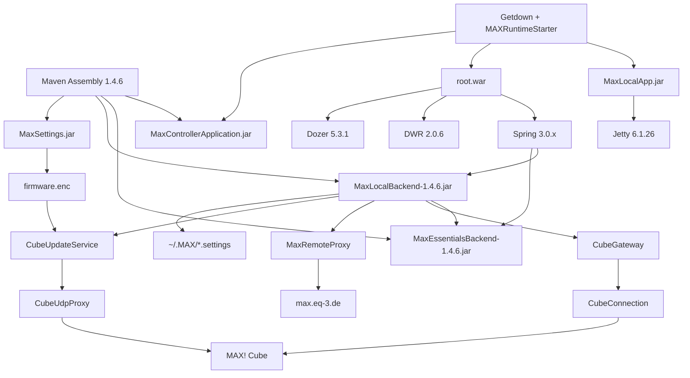

# Abhängigkeiten der MAX Local Application 1.4.6

## 1. Zweck und Lesart

Dieses Dokument beschreibt Build-, Laufzeit- und Schnittstellenabhängigkeiten der MAX Local Application 1.4.6. Es ist eine Bestandsaufnahme für eine Neuimplementierung, keine Empfehlung zur Übernahme der alten Techniken. (Quelle: `decompiled/controller/resources/META-INF/maven/de.eq3.max/MaxControllerApplication/pom.xml:1-8`, `C:\ProgramData\MAX\getdown.txt`; Evidence-ID `ev_81a48cb5c63ace439b913812ff1d104c79c9a1179387732f5682a5545799e809`)

Aussagen sind als `BEOBACHTUNG`, `INFERENZ` oder `UNBEKANNT` markiert und mit `Quelldatei:Zeile` oder Evidence-ID belegt. (Quelle: `extracted/rootwar/WEB-INF/max-service.xml:15-25`, `decompiled/controller/sources/de/eq3/max/al/local/LocalController.java:80-124`)

## 2. Build-Abhängigkeiten

**BEOBACHTUNG:** `MaxControllerApplication` ist ein Maven-Artefakt der Version 1.4.6 mit `groupId de.eq3.max` und `packaging jar`. (Quelle: `decompiled/controller/resources/META-INF/maven/de.eq3.max/MaxControllerApplication/pom.xml:1-8`)

**BEOBACHTUNG:** Das Artefakt nutzt `maven-assembly-plugin` 2.2 mit `jar-with-dependencies` und setzt `de.eq3.max.MaxControllerApplication.App` als `mainClass`. (Quelle: `decompiled/controller/resources/META-INF/maven/de.eq3.max/MaxControllerApplication/pom.xml` Assembly-Konfiguration, Zeilen 18-40)

**BEOBACHTUNG:** Das Eltern-POM `Max` hat ebenfalls die Version 1.4.6. (Quelle: `decompiled/controller/resources/META-INF/maven/de.eq3.max/MaxControllerApplication/pom.xml:9-15`)

**BEOBACHTUNG:** `MaxRuntimeStarter` liegt als eigenes Maven-Artefakt im `extracted/starter`-Pfad vor. (Quelle: `extracted/starter/META-INF/maven/de.eq3.max/MaxRuntimeStarter/pom.xml:1-20`; Evidence-ID `ev_81a48cb5c63ace439b913812ff1d104c79c9a1179387732f5682a5545799e809`)

**INFERENZ:** Die Build-Welt ist geprägt von Maven 2/3-Zeitraum und einem Assembly-Jar; ein moderner Nachbau sollte die Abhängigkeiten neu auflösen statt die alten Versionen zu übernehmen. (Quelle: `decompiled/controller/resources/META-INF/maven/de.eq3.max/MaxControllerApplication/pom.xml` Assembly-Konfiguration, `C:\ProgramData\MAX\getdown.txt`; Evidence-ID `ev_81a48cb5c63ace439b913812ff1d104c79c9a1179387732f5682a5545799e809`)

## 3. Laufzeitbibliotheken aus `getdown.txt`

**BEOBACHTUNG:** `getdown.txt` definiert `appbase = http://max.eq-3.de/max/` und `class = de.eq3.max.MaxLocalAppStarter.Application`. (Quelle: `C:\ProgramData\MAX\getdown.txt`; Evidence-ID `ev_81a48cb5c63ace439b913812ff1d104c79c9a1179387732f5682a5545799e809`)

**BEOBACHTUNG:** Die `code=`-Einträge enthalten die Laufzeitbibliotheken; die `resource=`-Einträge enthalten `tools/alive.bat`, `tools/shutdown.bat`, `tools/MaxControllerApplication.jar`, `webapp/root.war`, `webdefault.xml`, `getdown.jar` und `MaxLocalApp.jar`. (Quelle: `C:\ProgramData\MAX\getdown.txt`; Evidence-ID `ev_81a48cb5c63ace439b913812ff1d104c79c9a1179387732f5682a5545799e809`)

**BEOBACHTUNG:** `allow_offline = true` erlaubt den Offline-Betrieb des Getdown-Launchers. (Quelle: `C:\ProgramData\MAX\getdown.txt`; Evidence-ID `ev_81a48cb5c63ace439b913812ff1d104c79c9a1179387732f5682a5545799e809`)

### 3.1 Versionierte Kernbibliotheken

| Bibliothek | Version | Aufgabe im System | Beleg |
|---|---|---|---|
| `jetty` / `jetty-util` | 6.1.26 | Eingebetteter HTTP-Server | (Quelle: `C:\ProgramData\MAX\getdown.txt`, `decompiled/maxlocalapp/sources/de/eq3/max/MaxLocalAppStarter/Application.java:190-217`; Evidence-ID `ev_81a48cb5c63ace439b913812ff1d104c79c9a1179387732f5682a5545799e809`) |
| `spring-*` | 3.0.4.RELEASE / 3.0.5 (`webmvc`) | DI, XML-Config, Scheduling, MVC | (Quelle: `C:\ProgramData\MAX\getdown.txt`, `extracted/rootwar/WEB-INF/max-service.xml:15-25`; Evidence-ID `ev_81a48cb5c63ace439b913812ff1d104c79c9a1179387732f5682a5545799e809`) |
| `dwr` | 2.0.6 | Browser-zu-Java-RPC | (Quelle: `C:\ProgramData\MAX\getdown.txt`, `extracted/rootwar/WEB-INF/web.xml:40-51`; Evidence-ID `ev_81a48cb5c63ace439b913812ff1d104c79c9a1179387732f5682a5545799e809`) |
| `dozer` | 5.3.1 | DTO-Domänen-Mapping | (Quelle: `C:\ProgramData\MAX\getdown.txt`, `extracted/essentials/essentials.spring.xml:12-18`; Evidence-ID `ev_81a48cb5c63ace439b913812ff1d104c79c9a1179387732f5682a5545799e809`) |
| `log4j` | 1.2.16 | Logging | (Quelle: `C:\ProgramData\MAX\getdown.txt`, `extracted/rootwar/WEB-INF/web.xml:33-34`; Evidence-ID `ev_81a48cb5c63ace439b913812ff1d104c79c9a1179387732f5682a5545799e809`) |
| `aspectjrt` / `aspectjweaver` | 1.6.9 | AOP-Unterstützung | (Quelle: `C:\ProgramData\MAX\getdown.txt`, `extracted/rootwar/WEB-INF/max-service.xml:18`; Evidence-ID `ev_81a48cb5c63ace439b913812ff1d104c79c9a1179387732f5682a5545799e809`) |
| `hibernate-validator` | 4.0.2.GA | Eingabevalidierung | (Quelle: `C:\ProgramData\MAX\getdown.txt`, `decompiled/controller/sources/de/eq3/max/al/local/LocalController.java:599-603`; Evidence-ID `ev_81a48cb5c63ace439b913812ff1d104c79c9a1179387732f5682a5545799e809`) |
| `commons-io` | 2.1 | Dateioperationen, Log-Cleanup | (Quelle: `C:\ProgramData\MAX\getdown.txt`, `decompiled/maxlocalapp/sources/de/eq3/max/MaxLocalAppStarter/Application.java:290-292`; Evidence-ID `ev_81a48cb5c63ace439b913812ff1d104c79c9a1179387732f5682a5545799e809`) |
| `looks` | 2.2.2 | Swing-Look-and-Feel | (Quelle: `C:\ProgramData\MAX\getdown.txt`; Evidence-ID `ev_81a48cb5c63ace439b913812ff1d104c79c9a1179387732f5682a5545799e809`) |
| `selenium-java-client-driver` | 1.0.1 | Im Lieferumfang enthalten, Rolle ungeklärt | (Quelle: `C:\ProgramData\MAX\getdown.txt`; Evidence-ID `ev_81a48cb5c63ace439b913812ff1d104c79c9a1179387732f5682a5545799e809`) |

**BEOBACHTUNG:** Die eigenen Backend-Artefakte sind `MaxEssentialsBackend-1.4.6.jar`, `MaxLocalBackend-1.4.6.jar` und `MaxSettings.jar`. (Quelle: `C:\ProgramData\MAX\getdown.txt`; Evidence-ID `ev_81a48cb5c63ace439b913812ff1d104c79c9a1179387732f5682a5545799e809`)

**BEOBACHTUNG:** `servlet-api-2.5` liegt in zwei Varianten im Classpath. (Quelle: `C:\ProgramData\MAX\getdown.txt`; Evidence-ID `ev_81a48cb5c63ace439b913812ff1d104c79c9a1179387732f5682a5545799e809`)

**UNBEKANNT:** Die genaue Rolle von `selenium-java-client-driver-1.0.1.jar` im Produktionsbetrieb ist nicht belegt. (Quelle: `C:\ProgramData\MAX\getdown.txt`; Evidence-ID `ev_81a48cb5c63ace439b913812ff1d104c79c9a1179387732f5682a5545799e809`)

## 4. Spring-Kontextabhängigkeiten

**BEOBACHTUNG:** `max-service.xml` lädt `classpath:max.properties,classpath:max.local.properties` über `context:property-placeholder`. (Quelle: `extracted/rootwar/WEB-INF/max-service.xml:15`)

**BEOBACHTUNG:** `context:component-scan base-package="de.eq3.max"` aktiviert die automatische Erkennung allerannotierten Komponenten. (Quelle: `extracted/rootwar/WEB-INF/max-service.xml:16`)

**BEOBACHTUNG:** `context:annotation-config` aktiviert die Verarbeitung von Annotations-basiertem DI. (Quelle: `extracted/rootwar/WEB-INF/max-service.xml:17`)

**BEOBACHTUNG:** Der Kontext importiert `essentials.spring.xml`, `max-dwr.xml`, `LocalApp-cl.xml` und `LocalApp-al.xml`. (Quelle: `extracted/rootwar/WEB-INF/max-service.xml:22-25`)

**BEOBACHTUNG:** `aop:aspectj-autoproxy` ist im Kontext aktiviert. (Quelle: `extracted/rootwar/WEB-INF/max-service.xml:18`)

**BEOBACHTUNG:** `essentials.spring.xml` definiert den Dozer-Mapper, den Exception-Translator und den Radiogram-Builder. (Quelle: `extracted/essentials/essentials.spring.xml:12-27`)

**BEOBACHTUNG:** `LocalApp-al.xml` bindet `connectionWatchDog` und `cubeGateway` an den `localScheduler`. (Quelle: `extracted/localbackend/LocalApp-al.xml:10-15`)

**BEOBACHTUNG:** `LocalApp-cl.xml` erzeugt `MaxLocalApi` und den DWR-Delegate. (Quelle: `extracted/localbackend/LocalApp-cl.xml:8-17`)

**INFERENZ:** Der Spring-Kontext ist der zentrale Verdrahtungspunkt; eine Neuimplementierung kann diese Verdrahtung explizit im Code oder über ein modernes DI-Framework nachbilden. (Quelle: `extracted/rootwar/WEB-INF/max-service.xml:15-25`, `decompiled/controller/sources/de/eq3/max/al/local/LocalController.java:80-124`)

## 5. Komponentenabhängigkeiten im Detail

### 5.1 `LocalController`

| Abhängigkeit | Zweck | Beleg |
|---|---|---|
| `IMaxCubeStateHolder` | Zustand im Speicher | (Quelle: `decompiled/controller/sources/de/eq3/max/al/local/LocalController.java:80-82`) |
| `IRemoteCredentialsValidator`, `RoomValidator`, `DeviceValidator`, `UserSettingsValidator` | Validierung vor Mutation | (Quelle: `decompiled/controller/sources/de/eq3/max/al/local/LocalController.java:84-98`) |
| `IMaxRemoteProxy` | Remote-Dienste | (Quelle: `decompiled/controller/sources/de/eq3/max/al/local/LocalController.java:105-106`) |
| `ICubeUpdateService` | Firmware-Update | (Quelle: `decompiled/controller/sources/de/eq3/max/al/local/LocalController.java:109-110`) |
| `IMaxCubeStateFactory` | State-Parsing und Metadaten | (Quelle: `decompiled/controller/sources/de/eq3/max/al/local/LocalController.java:112-115`) |
| `ICubeGateway` | Cube-Zugriff | (Quelle: `decompiled/controller/sources/de/eq3/max/al/local/LocalController.java:117-118`) |
| `ConnectionWatchDog` | Inaktivitätsüberwachung | (Quelle: `decompiled/controller/sources/de/eq3/max/al/local/LocalController.java:121`) |
| `ILocalConfiguration` | Timeouts, Limits, Versionen | (Quelle: `decompiled/controller/sources/de/eq3/max/al/local/LocalController.java:124`) |

**BEOBACHTUNG:** `LocalController` implementiert `ICommunicationService` und `IConnectionTimeoutHandler`. (Quelle: `decompiled/controller/sources/de/eq3/max/al/local/LocalController.java:75`)

### 5.2 `CubeGateway`

| Abhängigkeit | Zweck | Beleg |
|---|---|---|
| `ILocalConfiguration` | Verbindungs- und Idle-Timeouts | (Quelle: `decompiled/controller/sources/de/eq3/max/il/local/CubeGateway.java:45-46`) |
| `IMaxCubeStateHolder` | Airtime-Status | (Quelle: `decompiled/controller/sources/de/eq3/max/il/local/CubeGateway.java:48-50`) |
| `ICubeConnection` | Aktive TCP-Verbindung | (Quelle: `decompiled/controller/sources/de/eq3/max/il/local/CubeGateway.java:52-53`) |
| Command-Klassen | Eine Klasse pro Cube-Operation | (Quelle: `decompiled/controller/sources/de/eq3/max/il/local/CubeGateway.java:122-287`) |

### 5.3 `MaxRemoteProxy`

| Abhängigkeit | Zweck | Beleg |
|---|---|---|
| `ICubeGateway` | `setInterval`, `setUrl` | (Quelle: `decompiled/controller/sources/de/eq3/max/al/local/remoteproxy/MaxRemoteProxy.java:35`, `decompiled/controller/sources/de/eq3/max/al/local/remoteproxy/MaxRemoteProxy.java:78`, `decompiled/controller/sources/de/eq3/max/al/local/remoteproxy/MaxRemoteProxy.java:289`) |
| `IMaxCubeStateHolder` | Seriennummer und Zustand in Requests | (Quelle: `decompiled/controller/sources/de/eq3/max/al/local/remoteproxy/MaxRemoteProxy.java:36`, `decompiled/controller/sources/de/eq3/max/al/local/remoteproxy/MaxRemoteProxy.java:71`) |
| `ILocalConfiguration` | Lookup-Fallback, Remote-URL, Software-URL | (Quelle: `decompiled/controller/sources/de/eq3/max/al/local/remoteproxy/MaxRemoteProxy.java:42`, `decompiled/controller/sources/de/eq3/max/al/local/remoteproxy/MaxRemoteProxy.java:48`) |
| `HttpURLConnection` | HTTP-Transport | (Quelle: `decompiled/controller/sources/de/eq3/max/al/local/remoteproxy/MaxRemoteProxy.java:19`, `decompiled/controller/sources/de/eq3/max/al/local/remoteproxy/MaxRemoteProxy.java:196-205`) |

## 6. Externe Endpunkte

| Zweck | URL/Adresse | Beleg |
|---|---|---|
| Lookup | `http://www.max-portal.eq-3.de/lookup` | (Quelle: `extracted/settings/Default.settings:1`) |
| Notification | `http://max.eq-3.de/messaging` | (Quelle: `extracted/settings/Default.settings:7`) |
| Update | `http://www.max.eq-3.de/maxupdate` | (Quelle: `extracted/settings/Default.settings:9`) |
| Remote-Cube | `http://max.eq-3.de/cube` | (Quelle: `extracted/controller/max.local.properties:10`) |
| Software | `http://max.eq-3.de/software` | (Quelle: `extracted/controller/max.local.properties:14`) |
| Getdown-Appbase | `http://max.eq-3.de/max/` | (Quelle: `C:\ProgramData\MAX\getdown.txt`; Evidence-ID `ev_81a48cb5c63ace439b913812ff1d104c79c9a1179387732f5682a5545799e809`) |
| Cube-Finder | `224.0.0.1`, `255.255.255.255`, Port 23272 | (Quelle: `decompiled/controller/sources/de/eq3/max/al/local/finder/CubeFinder.java:22-24`) |
| Cube-TCP | IP des Cube, Port aus `config.getConnectionPort(ip)` | (Quelle: `decompiled/controller/sources/de/eq3/max/il/local/CubeConnection.java:44-46`) |
| Lokale UI | `http://localhost:<ServerSettings.port>` | (Quelle: `decompiled/maxlocalapp/sources/de/eq3/max/MaxLocalAppStarter/Application.java:275-276`) |

**BEOBACHTUNG:** `MaxRemoteProxy` kann die Remote-URL über `UrlRetriever` mit dem Fallback-Lookup dynamisch ermitteln. (Quelle: `decompiled/controller/sources/de/eq3/max/al/local/remoteproxy/MaxRemoteProxy.java:282-291`)

**BEOBACHTUNG:** Bei Änderung der URL wird sie über `cubeGateway.setUrl(deviceAppUrl)` auch dem Cube mitgeteilt. (Quelle: `decompiled/controller/sources/de/eq3/max/al/local/remoteproxy/MaxRemoteProxy.java:287-289`)

**BEOBACHTUNG:** `Default.settings` enthält nur neun Einträge; die übrigen Konfigurationswerte liegen in `max.local.properties`. (Quelle: `extracted/settings/Default.settings:1-9`, `extracted/rootwar/WEB-INF/max-service.xml:15`)

**BEOBACHTUNG:** Beide Dateien sind materialisiert und enthalten **disjunkte** Schlüssel: `extracted/essentials/max.properties:1-13` hat 12 `max.heatingThermostat.default.*` / `max.shutterContact.default.*`-Schlüssel, `extracted/settings/max.local.properties:1-27` hat 20 Schlüssel für Limits, Timeouts, Versionen, URLs und Ports – Überschneidung: 0. Ein Konflikt beim Laden beider Property-Quellen (`max-service.xml:15`) ist damit ausgeschlossen. (Quelle: `extracted/essentials/max.properties`, `extracted/settings/max.local.properties`)

## 7. Konfigurationsparameter mit belegten Werten

| Parameter | Wert | Beleg |
|---|---|---|
| `max.maxSoftwareVersion` | 1.4.6 | (Quelle: `extracted/controller/max.local.properties:13`, `decompiled/controller/resources/META-INF/maven/de.eq3.max/MaxControllerApplication/pom.xml:5`) |
| `max.latestCubeFirmwareVersion` | 275 | (Quelle: `extracted/controller/max.local.properties:17`, `decompiled/controller/sources/de/eq3/max/al/local/LocalController.java:704-707`) |
| `max.leastCompatibleFirmwareVersion` | 273 | (Quelle: `extracted/controller/max.local.properties:18`, `decompiled/controller/sources/de/eq3/max/il/local/CubeConnection.java:57`) |
| `max.connection.virtualCubePort` | 54321 | (Quelle: `extracted/controller/max.local.properties:22`) |
| `max.connection.connectionTimeout` | 30000 | (Quelle: `extracted/controller/max.local.properties:23`, `decompiled/controller/sources/de/eq3/max/il/local/CubeConnection.java:48`) |
| `max.connection.socketTimeout` | 70000 | (Quelle: `extracted/controller/max.local.properties:24`, `decompiled/controller/sources/de/eq3/max/il/local/CubeConnection.java:60`) |
| `max.connection.commandQueueCapacity` | 100 | (Quelle: `extracted/controller/max.local.properties:21`, `decompiled/controller/sources/de/eq3/max/il/local/CubeConnection.java:51`) |
| `max.idleTimeBeforeLocalAppDisconnect` | 30000 | (Quelle: `extracted/controller/max.local.properties:4`, `decompiled/controller/sources/de/eq3/max/al/local/ConnectionWatchDog.java:16-17`) |
| `max.cubeIdleTimeToSend` | 900000 | (Quelle: `extracted/controller/max.local.properties:5`, `decompiled/controller/sources/de/eq3/max/il/local/CubeGateway.java:293-297`) |
| `max.metadataBlockSize` | 1900 | (Quelle: `extracted/controller/max.local.properties:8`) |
| `max.inclusionModeTimeoutSeconds` | 60 | (Quelle: `extracted/controller/max.local.properties:9`) |
| `max.cubeScanTime` | 1800 | (Quelle: `extracted/controller/max.local.properties:11`, `decompiled/controller/sources/de/eq3/max/al/local/LocalController.java:677`) |
| `max.maxNameLength` | 32 | (Quelle: `extracted/controller/max.local.properties:1`) |
| `max.maxRoomCount` | 20 | (Quelle: `extracted/controller/max.local.properties:2`) |
| `max.maxDeviceCount` | 140 | (Quelle: `extracted/controller/max.local.properties:3`) |

**INFERENZ:** Die Werte bilden ein zeit- und größenbasiertes Sicherheitsnetz: Timeouts verhindern hängende Verbindungen, Limits begrenzen Benutzereingaben. (Quelle: `decompiled/controller/sources/de/eq3/max/il/local/CubeConnection.java:48-60`, `decompiled/controller/sources/de/eq3/max/al/local/LocalController.java:599-603`)

## 8. DWR-Abhängigkeitsoberfläche

**BEOBACHTUNG:** `max-dwr.xml` konfiguriert einen DWR-Controller mit `debug="true"`. (Quelle: `extracted/essentials/max-dwr.xml:75`)

**BEOBACHTUNG:** DWR-Konvertierungen existieren für `MaxCubeState`, `MaxCubeAirtimeStatus`, `MaxCubeLastPing`, `MaxHouse`, `MaxRoom`, `MaxNewDevice`, `MaxDevice`, `MaxDeviceState`, `CubeInfo`, `RemoteCredentials`, `FirmwareInfo`, `SoftwareInformation`, `UpdateStatus`, `NetworkConfiguration`, `AdditionalInformation`, `ProductInformation` und `ProductActivation`. (Quelle: `extracted/essentials/max-dwr.xml:20-51`)

**BEOBACHTUNG:** Für Kommandos werden `ClientCommand` sowie zahlreiche Subtypen wie `SetRoomAutoMode`, `SetRoomPermanentMode`, `SetRoomTemporaryMode`, `SetRoomWeekTemperatureProfile` und `SetDeviceDisplaySetPointActual` konvertiert. (Quelle: `extracted/essentials/max-dwr.xml:53-67`)

**BEOBACHTUNG:** `LocalApp-cl.xml` gibt über 40 Methoden über `dwr:remote javascript="MaxLocalApi"` frei. (Quelle: `extracted/localbackend/LocalApp-cl.xml:16-60`)

**BEOBACHTUNG:** `MaxLocalDelegate` wird zwischen DWR und `MaxLocalApi` geschaltet, weil im Kontext DWR-161 erwähnt wird. (Quelle: `extracted/localbackend/LocalApp-cl.xml:6-17`)

**INFERENZ:** Die DWR-Methodenliste ist die komplette funktionale API der lokalen Anwendung; ein moderner Nachbau muss diese Oberfläche als HTTP-Endpunkte oder RPC-Methoden nachbilden. (Quelle: `extracted/localbackend/LocalApp-cl.xml:16-60`, `extracted/rootwar/js/lib/APICalls.js:905-919`)

## 9. Datenbankabhängigkeit – ausdrücklich geprüft

**BEOBACHTUNG:** Es wurde keine Datenbank gefunden: Die Suche über alle dekompilierten `.java`-Dateien nach `jdbc`, `hsql`, `derby`, `sqlite`, `.db`, `DataSource`, `EntityManager`, `javax.persistence`, `PreparedStatement` und `getConnection(` ergab 0 Treffer. (Quelle: `decompiled/**/*.java`, `Select-String -Recurse`; Evidenz-IDs `ev_b01b22f5d2b54d783aa1cb8dbe567111e03a6fe5029e1641318be232168a43a7`, `ev_cd71f066e83568d1ab3c71c8f78b5ea143ceb6dcf3b32ee7b5329970380de677`, `ev_42e4885a961f14d51aae2e5f880199599ca787a822b9dc66cd85ce2d46a9c91a`)

**BEOBACHTUNG:** Obwohl `getdown.txt` `spring-jdbc`, `spring-orm` und `spring-tx` enthält, werden diese Bibliotheken im dekompilierten Code nicht verwendet. (Quelle: `C:\ProgramData\MAX\getdown.txt`; Evidence-ID `ev_81a48cb5c63ace439b913812ff1d104c79c9a1179387732f5682a5545799e809`, `decompiled/**/*.java` Suchergebnis 0 Treffer)

**BEOBACHTUNG:** Die einzige belegte Persistenz sind Properties-Dateien unter `~/.MAX` und Metadaten auf dem Cube. (Quelle: `decompiled/controller/sources/de/eq3/max/al/local/core/settings/SettingsProvider.java:69-75`, `decompiled/controller/sources/de/eq3/max/al/local/LocalController.java:832-838`)

**INFERENZ:** Es besteht keine Abhängigkeit von einer Datenbank; ein Nachbau darf eine DB weglassen, ohne 1.4.6-Funktionalität zu verlieren. (Quelle: `decompiled/controller/sources/de/eq3/max/al/local/core/settings/SettingsProvider.java:69-75`, `decompiled/essentials/sources/de/eq3/max/al/core/cubestate/MaxCubeStateHolder.java:1-30`)

**UNBEKANNT:** Ob die Bibliotheken `spring-jdbc`, `spring-orm`, `spring-tx` und `javax-persistence` aus einer gemeinsamen Namespace-POM stammen, ist nicht belegt. (Quelle: `C:\ProgramData\MAX\getdown.txt`; Evidence-ID `ev_81a48cb5c63ace439b913812ff1d104c79c9a1179387732f5682a5545799e809`)

## 10. Abhängigkeitsgraph (Mermaid)

**BELEG ZUM GRAPHEN:** Maven-Artefakte (Quelle: `decompiled/controller/resources/META-INF/maven/de.eq3.max/MaxControllerApplication/pom.xml:1-15`), Getdown-Resources (Quelle: `C:\ProgramData\MAX\getdown.txt`; Evidence-ID `ev_81a48cb5c63ace439b913812ff1d104c79c9a1179387732f5682a5545799e809`), Jetty (Quelle: `decompiled/maxlocalapp/sources/de/eq3/max/MaxLocalAppStarter/Application.java:190-217`), Spring/DWR/Dozer (Quelle: `extracted/rootwar/WEB-INF/max-service.xml:15-25`, `extracted/essentials/essentials.spring.xml:12-18`), Gateway/Verbindung (Quelle: `decompiled/controller/sources/de/eq3/max/il/local/CubeGateway.java:41-58`, `decompiled/controller/sources/de/eq3/max/il/local/CubeConnection.java:40-60`), Persistenz (Quelle: `decompiled/controller/sources/de/eq3/max/al/local/core/settings/SettingsProvider.java:69-75`), Firmware (Quelle: `decompiled/controller/sources/de/eq3/max/al/local/update/CubeUpdateService.java:48-54`).

## 11. Offene Punkte

**UNBEKANNT:** Der vollständige Inhalt des Eltern-POM ist nicht im Artefakt vorhanden. (Quelle: `decompiled/controller/resources/META-INF/maven/de.eq3.max/MaxControllerApplication/pom.xml:9-15` verweist auf `../pom.xml`)

**UNBEKANNT:** Die genaue Transitivität der Spring- und DWR-Abhängigkeiten ist nicht aus einem Dependency-Tree belegbar. (Quelle: `C:\ProgramData\MAX\getdown.txt`; Evidence-ID `ev_81a48cb5c63ace439b913812ff1d104c79c9a1179387732f5682a5545799e809`)

**UNBEKANNT:** Es ist nicht belegt, ob die beiden `servlet-api-2.5`-Jars bewusst nebeneinander liegen oder ein Artefakt der Installation ist. (Quelle: `C:\ProgramData\MAX\getdown.txt`; Evidence-ID `ev_81a48cb5c63ace439b913812ff1d104c79c9a1179387732f5682a5545799e809`)

**BELEGT 24.11.2026 (Korrektur):** HTTP-Header (`Opt`, `MAX-Serial`) und Request-Format des Remote-Proxy sind vollständig dekompiliert (`RemoteProxyRequest.java:27-56`, `RemoteProxyResponse.java:29-58`, `MaxRemoteProxy.java:182-190`; `docs/maxcube-protocol.md` Abschnitt 6.1). Die Cloud-Familie bleibt bewusst unübernommen.

## 12. Kurzfassung

**BEOBACHTUNG:** Die Laufzeit hängt an Jetty 6.1.26, Spring 3.0.x, DWR 2.0.6, Dozer 5.3.1 und Log4j 1.2.16; die eigenen Artefakte tragen die Version 1.4.6. (Quelle: `C:\ProgramData\MAX\getdown.txt`, `decompiled/controller/resources/META-INF/maven/de.eq3.max/MaxControllerApplication/pom.xml:1-8`; Evidence-ID `ev_81a48cb5c63ace439b913812ff1d104c79c9a1179387732f5682a5545799e809`)

**BEOBACHTUNG:** Es existiert keine Datenbankabhängigkeit; Persistenz erfolgt über `~/.MAX`-Properties und den Cube, obwohl DB-nahe Bibliotheken im Classpath liegen. (Quelle: `decompiled/controller/sources/de/eq3/max/al/local/core/settings/SettingsProvider.java:69-75`, `decompiled/**/*.java` Suchergebnis 0 Treffer, `C:\ProgramData\MAX\getdown.txt`; Evidence-ID `ev_81a48cb5c63ace439b913812ff1d104c79c9a1179387732f5682a5545799e809`)
