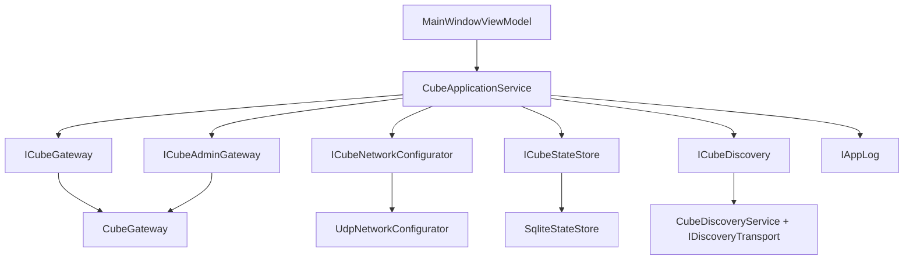
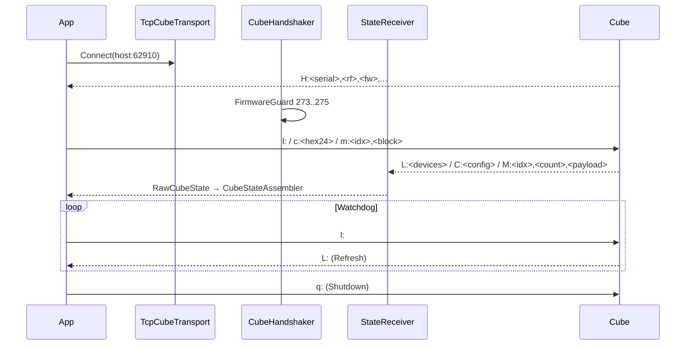

> English translation of docs/API.md. Machine-created; native-speaker review pending.

# API – MAX! Cube Local App

> As of 25.11.2026. This app has **no HTTP API**. The "API" consists of (1) local C# interfaces for the desktop application and (2) the cube wire protocol over TCP/UDP. Evidence as `file:line`; markers as in [INDEX.md](INDEX.md).

## 0. Important finding: no REST endpoints

**FACT:** There is no HTTP server, no REST/DWR/Jetty/browser interface, and no update endpoint in the C# app.

| Check | Result | Evidence |
|---|---|---|
| Project type | `Microsoft.NET.Sdk`, `OutputType=WinExe`; no `Microsoft.NET.Sdk.Web` | `src/MaxCube.UI.Desktop/MaxCube.UI.Desktop.csproj:1-13` |
| Entry point | `BuildAvaloniaApp().StartWithClassicDesktopLifetime(args)` or `--selfcheck` | `Program.cs:13-24` |
| Composition root | only clock, version, log, gateway, store, discovery, service, localizer, view model, window | `Composition.cs:18-47` |
| Full-text search `src/` | no hits for `WebApplication`, `MapGet`, `MapPost`, `IActionResult`, `ApiController`, `ControllerBase`, `HttpListener`, `TcpListener`, `Kestrel` | `OBSERVATION`, inventory 25.11.2026 |
| Only network primitives | `UdpClient` in discovery/network, `TcpClient` in transport | `UdpDiscoveryTransport.cs:23`, `UdpNetworkConfigurator.cs:52`, `TcpCubeTransport.cs:35` |
| Original HTTP surface | `/dwr/*`, `/controller/*`, `*.html`, port 63121 – **not adopted** | `docs/architecture-rea.md:145-179`, `docs/INDEX.md:99-103` |

Anyone looking for an HTTP endpoint is looking in the wrong place. For automation, only the local GUI or the cube itself is available; remote access is deliberately discarded (`docs/features.md:34-36`).

## 1. C# application API

### 1.1 Overview



`CubeGateway` implements **both** `ICubeGateway` and `ICubeAdminGateway`; DI gives both interfaces the same singleton so that only one socket, one queue, and one worker exist (`Composition.cs:27-30`, `CubeGateway.cs:21`).

### 1.2 `ICubeGateway` – core access

File: `src/MaxCube.Application/Abstractions/ICubeGateway.cs`.

| Element | Signature / value | Purpose and side effect | Evidence |
|---|---|---|---|
| Status enum | `Disconnected`, `Connecting`, `Connected`, `Faulted` | connection state of the physical cube | `:9-15` |
| Endpoint | `record CubeEndpoint(string Host, int Port)` | port **62910** physical, `54321` virtual only | `:17-18` |
| Property | `CubeConnectionState State` | maintained by the gateway | `:26` |
| Event | `StateChanged` | state change | `:28` |
| Event | `CubeRefreshed` | new device values from `l:` refresh, no metadata change | `:30-31` |
| Event | `SessionUnreachable` | session unreachable after repeated errors | `:33-34` |
| Method | `Task<Cube> ConnectAsync(CubeEndpoint, CancellationToken = default)` | TCP, `H:` handshake, firmware guard, `L:/C:/M:`, fresh aggregate; starts queue and watchdog | `:36-37`, `CubeGateway.cs:72-116` |
| Method | `Task SetRoomTemperatureAsync(int roomId, RadioAddress master, Temperature, CancellationToken)` | sends `0x40` permanent mode | `:39-40`, `CubeGateway.cs:118-120` |
| Method | `Task SetRoomControlModeAsync(int roomId, RadioAddress master, RoomControlMode, Temperature? setPoint, DateTimeOffset? until, CancellationToken)` | auto/permanent/temporary; parameters required per mode | `:42-48`, `CubeGateway.cs:130-144` |
| Method | `Task SetWeekDayProfileAsync(int roomId, RadioAddress master, DayProfile, CancellationToken)` | one or two `0x10` telegrams | `:50-52`, `CubeGateway.cs:149-171` |
| Method | `Task DisconnectAsync(CancellationToken)` | sends `q:` (time-limited), clears queue/watchdog | `:54`, `CubeGateway.cs:173-236` |

### 1.3 `ICubeAdminGateway` – configuration, learning, structure, time

File: `src/MaxCube.Application/Abstractions/ICubeAdminGateway.cs`.

| Method / type | Purpose | Evidence |
|---|---|---|
| `record FoundDevice(DeviceType, int NumericType, RadioAddress, string SerialNumber)` | device from `N:` response | `:8-13` |
| `record AirtimeStatus(int DutyCycle, int FreeMemorySlots)` | radio utilization from `S:` | `:15-16` |
| `record RoomConfigurationValues(Comfort, Eco, Maximum, Minimum, double Offset, WindowOpen, int WindowOpenMinutes)` | frame `0x11` | `:18-26` |
| `record ValveFunctionValues(BoostMinutes, BoostValveAngle, DecalcificationDay, DecalcificationHour, MaxValveRaw, ValveOffsetRaw)` | frame `0x12` (`INFERENCE`) | `:28-35` |
| Event `AirtimeChanged` | after every successfully sent radiogram | `:45-46` |
| `SetRoomConfigurationAsync(...)` | writes `0x11` | `:48-49` |
| `SetValveFunctionsAsync(...)` | writes `0x12` | `:51-52` |
| `SetDisplayModeAsync(RadioAddress, bool showActualTemperature, ...)` | `0x82`, wall thermostats only | `:54-55` |
| `Task<FoundDevice?> SearchNewDeviceAsync(TimeSpan window, ...)` | one learning window; `null` = no device | `:57-58` |
| `EndInclusionAsync(...)` | `x:` ends learning mode | `:60` |
| `SetGroupAddressAsync(...)` / `RemoveGroupAddressAsync(...)` | `0x22` / `0x23` (`INFERENCE`) | `:62-64` |
| `SetLinkPartnerAsync(..., bool add, ...)` | `0x20` add / `0x21` remove (`INFERENCE`) | `:66-68` |
| `DeleteDevicesAsync(IReadOnlyList<RadioAddress>, bool factoryReset, ...)` | `t:`, 1..255 addresses | `:70-71` |
| `WriteMetadataAsync(Cube, ...)` | `m:` blocks; only after byte-exact round trip of the unchanged state | `:73-77`, `CubeGateway.Admin.cs:99-103` |
| `Task<PushButtonConfiguration> ReadPushButtonAsync(RadioAddress, ...)` | `c:` + codec | `:79-80` |
| `SetPushButtonAsync(RadioAddress, PushButtonConfiguration, ...)` | `w:`, exactly 66 bytes | `:82-83` |
| `Task<TimeZoneConfiguration> ReadTimeZoneAsync(RadioAddress, ...)` | `c:` + codec | `:85-86` |
| `SetTimeZoneAsync(RadioAddress, TimeZoneConfiguration, DateTimeOffset? setTimeUtc, ...)` | `v:`; with time additionally cube time (`INFERENCE`: Unix seconds) | `:88-93`, `CubeApplicationService.Admin.cs:734-747` |
| `Task<string> QueryNtpServersAsync(...)` | `f:` → raw `F:` response; format `UNKNOWN` | `:95`, `MainWindowViewModel.Cube.cs:122` |
| `SetNtpServersAsync(IReadOnlyList<string>, ...)` | one or two servers, `f:` → `F:` | `:97` |

**Note:** `SetTimeZoneAsync` writes the time zone; `CubeApplicationService.SetCubeTimeAsync` reads it and sends it again with `_clock.Now.ToUniversalTime()` (`CubeApplicationService.Admin.cs:734-747`). The date/time part is `INFERENCE`.

### 1.4 `ICubeNetworkConfigurator` – UDP configuration

File: `ICubeAdminGateway.cs:100-108`.

| Method | Behavior | Evidence |
|---|---|---|
| `Task<CubeNetworkConfiguration> ReadAsync(string serialNumber, string ipAddress, ...)` | UDP unicast port 23272, opcode `c`, response `C`, 2 s × max. 5 attempts, response must come from the same IP | `:103-104`, `UdpNetworkConfigurator.cs:13-18,43-82` |
| `Task WriteAsync(string serialNumber, string ipAddress, CubeNetworkConfiguration, ...)` | reads first, takes over bytes after the DHCP flag, writes `C`; **no** firmware operation | `:106-108`, `UdpNetworkConfigurator.cs:31-41`, `CubeUdpCodec.cs:12` |

Writing is allowed only after confirmation (`CubeApplicationService.Admin.cs:776-790`, `MainWindowViewModel.Cube.cs:160-165`).

### 1.5 `ICubeStateStore`, `IClock`, `IAppLog`, `IAppVersionProvider`

Files: `src/MaxCube.Application/Abstractions/ICubeStateStore.cs`, `IAppLog.cs`, `IAppVersionProvider.cs`.

| Element | Signature / purpose | Evidence |
|---|---|---|
| `IClock.Now` | `DateTimeOffset.Now` = local time with offset (temporary end times!) | `ICubeStateStore.cs:5-19` |
| `Task<CubeSnapshot?> LoadAsync(string serialNumber, ...)` | read cache; `null` if never connected | `:25-27` |
| `Task SaveAsync(CubeSnapshot, ...)` | completely replace cache; cube remains source of truth | `:21-29` |
| `Task<string?> GetSettingAsync(string key, ...)` / `Task SetSettingAsync(...)` | settings; keys are not validated | `:31-33` |
| `Task AppendAuditAsync(string message, ...)` / `Task<IReadOnlyList<string>> ReadAuditAsync(...)` | audit; store returns 500, UI shows 100 | `:35-38`, `SqliteStateStore.cs:183-191` |
| `IAppLog.Write(level, message)` / `Cleanup(retentionDays)` | local daily file, no transmission | `IAppLog.cs:3-12`, `FileAppLog.cs:25-75` |
| `IAppVersionProvider.Version` | version from exactly one source | `IAppVersionProvider.cs:3-9`, `AppVersionProvider.cs:13-24` |

### 1.6 `CubeApplicationService` – technical use cases

File: `src/MaxCube.Application/Services/CubeApplicationService.cs`; admin part: `CubeApplicationService.Admin.cs`.

| Method | Behavior / precondition | Evidence |
|---|---|---|
| `ConnectAsync(CubeEndpoint, ...)` | stores `cube.serial`/`cube.endpoint`, persists snapshot, audit, sets `_current`/`_offline`; on cache error disconnect and rethrow | `:187-240` |
| `GetLastEndpointAsync(...)` | strictly parses `host:port`, port 1..65535 | `:242-263` |
| `LoadCachedAsync(...)` | readable offline; throws on `Connecting`/`Connected` | `:265-303` |
| `SetRoomTemperatureAsync(int, Temperature, ...)` | `RequireOnline`, 0.5° grid, permanent + cache/audit | `:305-332,521-526` |
| `SetRoomControlModeAsync(...)` | validation: permanent needs target value, temporary needs target value + end time > now, auto does not accept a target value | `:334-387` |
| `GetWeekDayProfile` / `HasWeekProfile` | send lock if day not read from cube | `:389-403` |
| `ApplyEcoAsync` / `ApplyComfortAsync` | sends the **evidenced** ECO/comfort target values | `:405-411` |
| `SetWeekDayProfileAsync(...)` | 1–2 telegrams; audit on success and on error with partial-send note; `S:` only send status | `:413-468` |
| `DisconnectAsync(...)` | stops reconnect, gate 250 ms, `q:` with 1 s upper bound, audit | `:470-519` |
| Admin mutations | `RunReadAsync`/`RunWriteAsync` enforce online, cube, gate, and audit; destructive actions need `confirmed` | `Admin.cs:349-951` |
| `BuildDiagnosticReportAsync(appVersion, ...)` | local text report, **no transmission** | `Admin.cs:840-876` |
| `ReloadAsync(...)` | disconnect + connect to last endpoint | `Admin.cs:878-887` |

**FACT:** The offline cache is read-only; all mutations call `RequireOnline()` (`:528-534`). Cache write errors after a successful cube command produce a warning but do not undo the cube success (`:544-564`).

### 1.7 Discovery API

| Element | Signature / purpose | Evidence |
|---|---|---|
| `ICubeDiscovery.DiscoverAsync(TimeSpan, CancellationToken)` | returns `IReadOnlyList<DiscoveredCube>` | `ICubeDiscovery.cs:3-7` |
| `IDiscoveryTransport.ProbeAsync(byte[] request, TimeSpan, CancellationToken)` | raw datagrams; tests supply sample bytes | `ICubeDiscovery.cs:10-17` |
| `CubeDiscoveryProtocol.UdpPort` | 23272 – **local binding port mandatory**, otherwise the UDP response is unreachable (`FACT`, hardware 25.11.2026) | `CubeDiscoveryService.cs:15`, `UdpDiscoveryTransport.cs:23`, `docs/HARDWARE-VERIFY.md` §3 |
| `MulticastTtl` / `ResendCount` / `ResendInterval` | 5 / 3 / 50 ms | `:16-18` |
| `MulticastGroup` / `BroadcastAddress` | `224.0.0.1` / `255.255.255.255` | `:19-20` |
| `BuildRequest()` | 19 bytes `eQ3Max*\0**********I` | `:22,27-28` |
| `TryParse(DiscoveryDatagram)` | signatures `eQ3MaxAp`/`eQ3MaxBl`; serial number bytes 8..17, firmware 24..25; bootloader loses against regular reply | `:30-65,68-105` |

Discovery is **always user-initiated**; no broadcast is sent at startup (`docs/features.md:41`, `Program.cs:26-29`).

### 1.8 `OperationGate` – synchronization

File: `src/MaxCube.Application/Abstractions/OperationGate.cs`.

```csharp
await using var lease = await gate.EnterAsync(callerToken);
await service.DoSomethingAsync(lease.Token);
// using/dispose gibt Semaphore und CTS frei
```

- `AcquireTimeout` 2 s, `ShutdownAcquireTimeout` 250 ms (`:13-16`).
- `CancelActive()` cancels the running operation (`:44-58`).
- Two separate instances in app and gateway (`:6-8`, `CubeApplicationService.cs:22`, `CubeGateway.cs:31`).

## 2. Cube wire protocol (TCP 62910)

### 2.1 Framework conditions

| Parameter | Value | Evidence |
|---|---|---|
| Port | 62910 physical; 54321 virtual cube only | `CubeConnectionOptions.cs:10-13` |
| Connect / Hello / Socket / State | 30 s / 30 s / 70 s / 70 s | `:15-44` |
| Firmware | 273–275 | `:31-35`, `FirmwareGuard.cs:12-20` |
| Maximum line length | 65536 | `:37-38` |
| Command timeout / queue | 30 s / 100 | `:49-56` |
| Watchdog / idle / keepalive / unreachable | 5 s / 30 s / 900 s / 6 h | `:58-72` |
| Framing | CRLF; `LineReader` also accepts LF, always writes CRLF | `LineReader.cs:46-58,113-125` |
| Hex | lowercase, fixed width; 24 bits = 6 digits | `CubeCommands.cs:7-19` |
| Base64 | radiograms and configuration blocks | `:15,225,309,338` |

**FACT:** After `Fault`, a **new** transport must be created; `TcpCubeTransport.ConnectAsync` rejects reuse (`TcpCubeTransport.cs:25-28,184-189`).

### 2.2 Connection and state flow



`StateReceiver` requires `H:` already consumed, accepts `C:`/`M:` before `L:`, ignores unknown prefixes like the manufacturer, and aborts on EOF/timeout before `L:` (`StateReceiver.cs:23-71`). `C:` needs exactly 2 arguments and a 24-bit hex address (`:73-88`); `M:` exactly 3 arguments, index/count hex, count 1..16, payload ≤ 8192 bytes (`:90-129`).

### 2.3 Response rules

`ResponseCommand<T>` (`CubeCommands.cs:21-64`):

| Response | Behavior |
|---|---|
| `null` (connection previously closed) | `CubeCommunicationFailedException` |
| `r:…` | `CubeCommandRejectedException` |
| other than expected prefix | `UnknownCubeOpcodeException` |
| expected prefix | `ParseBody(line[prefix.Length..])` |

`AcknowledgedCommand` expects `A:` and returns `true` (`:67-73`). Parse errors of a single command do **not** fault the queue; timeout/EOF/transport errors do (`CubeCommandQueue.cs:259-289`).

### 2.4 Complete command inventory (`CubeCommands.cs`)

| Class | Wire line | Response | Purpose / special feature | Evidence |
|---|---|---|---|---|
| `ListDevicesCommand` | `l:` | `L:` | device states (live refresh) | `:75-80` |
| `GetConfigurationCommand` | `c:<hex24>` | `C:` | read cube configuration | `:82-88` |
| `SendMetadataBlockCommand` | `m:<idx:D2>,<UTF-8>` | `A:` | one block; 1900 bytes; index 0..99; no CR/LF in block | `:90-127` |
| `StartInclusionCommand` | `n:<hex4 seconds>` | `N:` | learning mode; `Enter`; timeout `max(70 s, s+10 s)`; empty `N:` = `Exit` | `:129-167` |
| `CancelInclusionCommand` | `x:` | `N:` (multiple) | `AllowedDuringInclusion`, `UntilEmptyBody`, max. 64 | `:169-187` |
| `DisconnectCommand` | `q:` | none | `ExpectsResponse=false`; gateway timeout 700 ms | `:189-205`, `CubeGateway.cs:23-24` |
| `SetUrlCommand` | `u:<url>` | `A:` | set URL; **not wired locally** | `:207-210` |
| `SetIntervalCommand` | `i:<hex8>,00000000` | `A:` | interval ms | `:212-216` |
| `SendRadiogramCommand` | `s:<Base64>` | `S:` | radiogram; `discarded=='1'` = error | `:218-228,238-258` |
| `ResetDeviceCommand` | `r:01,<Base64 3 bytes>` | `S:` | reset device | `:230-236` |
| `EncryptCommand` | `e:<plaintext>` | `E:` | AES; **not wired locally** | `:260-266` |
| `DecryptCommand` | `d:<base64Cipher>` | `D:` | AES; **not wired locally** | `:268-274` |
| `ResetGatewayCommand` | `a:` | none | gateway reset; no ACK expected | `:276-284` |
| `DeleteDevicesCommand` | `t:<hex2 count>,<0\|1>,<Base64 addresses>` | `A:` | 1..255 addresses | `:286-304` |
| `SetPushButtonConfigurationCommand` | `w:<Base64>` | `A:` | exactly 66 bytes | `:306-321` |
| `SetTimezoneConfigurationCommand` | `v:<Base64 24 bytes>[,<hex seconds>]` | `A:` | time zone; optional cube time (`INFERENCE`) | `:323-341` |
| `SetNtpServerCommand` | `f:<server>[,<server2>]` | `F:` | 1–2 non-empty servers | `:343-362` |
| `QueryNtpServerCommand` | `f:` | `F:` | response format `UNKNOWN`, shown raw | `:364-369` |
| `WakeupCommand` | `z:<hex2 minutes>,A\|D\|G[,target]` | `A:` | A=all, D=device+hex24, G=group+hex2 | `:371-408` |

Sample wire lines from tests: `n:003c`, `r:01,HSo8`, `i:000003e8,00000000`, `z:1e,G,05` (`CubeCommandsTests.cs:10-33`).

### 2.5 Radiograms (`RoomCommands.cs`, all `s:<Base64>` → `S:`)

| Class | Frame | Content / evidence status | Evidence |
|---|---|---|---|
| `SetRoomAutoModeCommand` | `0x40` | mode 0, byte 10 bit 6 = 0 | `:9-16` |
| `SetRoomPermanentModeCommand` | `0x40` | mode 1 + target value byte 10, 0.5° | `:18-26` |
| `SetRoomTemporaryModeCommand` | `0x40` | mode 2 + temperature + end; bit positions deliberately Java-faithful; 30-min grid | `:28-46` |
| `SetRoomConfigurationCommand` | `0x11` | comfort, eco, max, min, offset, window temp, window duration; comfort/eco **FACT** on hardware 25.11.2026 (with radio delay), remaining fields only byte tests | `:48-73`, `docs/HARDWARE-VERIFY.md` §4 |
| `SetRoomValveFunctionsCommand` | `0x12` | boost, angle/5, descaling, maxValveRaw, valveOffsetRaw; **INFERENCE** | `:75-139` |
| `SetDisplayModeCommand` | `0x82` | 11 bytes; byte 10 `0x04`=actual, `0x00`=target; **live confirmed** | `:141-153` |
| `SetGroupAddressCommand` | `0x22` | byte 10 = group ID; **INFERENCE** | `:155-165` |
| `RemoveGroupAddressCommand` | `0x23` | 10 bytes; **INFERENCE** | `:167-172` |
| `LinkPartnerCommand` | `0x20`/`0x21` | partner address 3 bytes big-endian + numeric type; **INFERENCE** | `:174-193` |
| `SetRoomWeekTemperatureProfileCommand` | `0x10` | 7 or 6 switching points; 8..13 require two telegrams | `:195-215` |

`S:` response: `S:<dutyHex>,<discarded>,<freeHex>`; three arguments, `discarded='1'` throws `CubeCommunicationFailedException` (`CubeCommands.cs:238-257`). The **technical** acceptance of a radiogram by the cube is `UNKNOWN`; `S:` is only a send status (`CubeApplicationService.cs:439`). **OBSERVATION (hardware 25.11.2026):** After `0x11`, the cube showed the new comfort/eco value only after the next transmission; the technical meaning of the `S:` values remains `UNKNOWN` (`docs/HARDWARE-VERIFY.md` §4).

### 2.6 Learning mode and queue

- `CubeCommandQueue`: bounded channel capacity 100, `SingleReader`, `FullMode=Wait`, one worker (`CubeCommandQueue.cs:26-37,49-66`).
- During inclusion, only `x:`/`q:` are allowed; guard applies at acceptance **and** execution (`:188-198`, `:68-123`).
- `x:` reads up to 64 `N:` lines; if the empty `N:` is missing, a desync error occurs (`:204-237`, tests `:241-253`).
- Parse errors fault only the command; timeout faults the queue (`Fault` before `Fail`, `:259-289`).

### 2.7 Configuration and state codecs

| Codec | Task | Evidence |
|---|---|---|
| `CubeConfigurationCodec` | `C:` body → `CubeNetworkConfiguration`/time zone/button | `src/MaxCube.Protocol/State/CubeConfigurationCodec.cs` |
| `CubeUdpCodec` | UDP `c`/`C`; opcodes `B/U/W/R` deliberately not included | `CubeUdpCodec.cs:9-18,47-61,82-116` |
| `NewDeviceDecoder` | `N:` device → `FoundDevice` | `NewDeviceDecoder.cs` |
| `MetadataDecoder` / `MetadataEncoder` | `M:` blocks; version 1 without magic/master/DST, version 2 with magic 86 | `SecondBrain/wiki/projekte/app-maxcube.md:30` |
| `WeekProfileDecoder` / `WeekProfileSerializer` | 13 points/day, 7+6 telegrams | `docs/INDEX.md:37`, `WeekProfileSerializer.cs` |
| `CubeStateAssembler` | `H:/L:/C:/M:` → aggregate | `CubeStateAssembler.cs` |

## 3. UDP discovery (port 23272)

```mermaid
sequenceDiagram
  actor U as Benutzer
  participant VM as ViewModel
  participant S as CubeDiscoveryService
  participant T as UdpDiscoveryTransport
  participant C as Cube
  U->>VM: „Cube suchen“
  VM->>S: DiscoverAsync(1800 ms)
  S->>T: 3× 19-Byte-Request, 50 ms Abstand
  T->>C: Broadcast 255.255.255.255 + Multicast 224.0.0.1, TTL 5, Port 23272
  C-->>T: Datagramm (Signatur, Seriennummer, IP, Firmware)
  T-->>S: DiscoveryDatagram
  S-->>VM: Trefferliste; „Übernehmen“ → Host + Port 62910
```

- Request: `eQ3Max*\0**********I` (19 bytes) (`CubeDiscoveryService.cs:22,27-28`).
- Signatures: `eQ3MaxAp` (regular) and `eQ3MaxBl` (bootloader); bootloader loses against a regular reply with the same serial number (`:34-65,68-105`).
- Multicast join may fail in containers; broadcast remains usable (`UdpDiscoveryTransport.cs:26-36`).
- Discovery firmware is **decimal**, TCP header **hexadecimal**; discovery values are therefore not fed into the firmware guard (`CubeDiscoveryService.cs:8-12,10-11`).
- **FACT (hardware 25.11.2026, `192.168.10.60`):** response 26 bytes, `eQ3MaxAp` + 10 bytes serial number + `>I` + 2 bytes firmware (decimal) + 2 bytes unknown + `0x01 0x13`; the parser yielded `192.168.10.60`, `JEQ0355273`, firmware `275`. Capture in [HARDWARE-VERIFY.md](HARDWARE-VERIFY.md) §3.3. Bootloader response remains `UNKNOWN`.

## 4. Error contract

- Error catalog: `MAX0001`, `MAX1001`–`MAX1051` plus evidenced outlier `MAX10038` (`:54`); regex `MAX\d{4,5}` (`:97`).
- `DomainValidationException` formats the message as `"{Code}: {message}"` (`DomainValidationException.cs:3-16`).
- UI: `ErrorMessage = $"{errorPrefix}: {exception.Message}"`, `ErrorHint = ErrorCatalog.Describe(...)`; own `OperationCanceledException` → "Cancelled" (`MainWindowViewModel.cs:613-621`, `MainWindowViewModel.Admin.cs:70-74`).
- Protocol exceptions carry **no** MAX codes (`CubeProtocolExceptions.cs:3-69`); `Describe` applies only if a code appears in the text.
- The explanations in the catalog are interpretations of symbol names, **not** manufacturer messages (`ErrorCatalog.cs:5-9`).

## 5. Not implemented / discarded areas

| Area | Status | Reason |
|---|---|---|
| HTTP/REST, Jetty, DWR, browser UI | discarded | no server in C# project; original web layer not ported |
| Cloud, remote access, product account, proxy | discarded | cloud shut down; user notice 25.11.2026 (not externally verified) |
| App update/Getdown/HTTP check | discarded | no update dependency |
| Cube firmware write | disabled | no golden capture, risk of device damage |
| Opcodes `u:`, `e:`, `d:`, `a:` in app path | classes present, not wired | cloud/update related; no local action |
| UDP firmware opcodes `B/U/W/R` | not included | deliberately excluded (`CubeUdpCodec.cs:12`) |

## 6. Open questions

- Technical meaning of `S:` values > 0 and of the dead constant `g:` / `OUTGOING_MORE_DATA`: `UNKNOWN`.
- Format of the `F:` NTP response: `UNKNOWN`; shown raw.
- Real hardware behavior of `0x12`, `0x20`–`0x23`, `m:`, `w:`, `v:`, UDP network: `INFERENCE`; real UDP response and `0x11` comfort/eco `FACT` (25.11.2026, `docs/HARDWARE-VERIFY.md`), technically evaluated `S:` acknowledgement still `UNKNOWN`.
- Regex/pattern of the serial number: `UNKNOWN` (`SerialNumber.cs:9-10`, code `MAX1041` reserved only).
