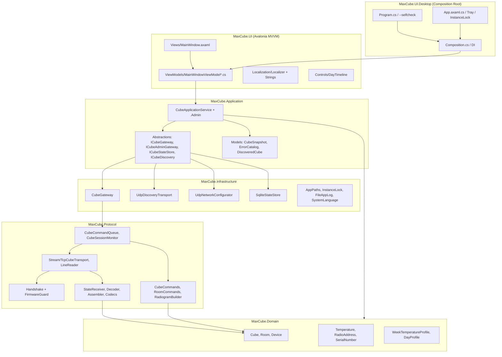
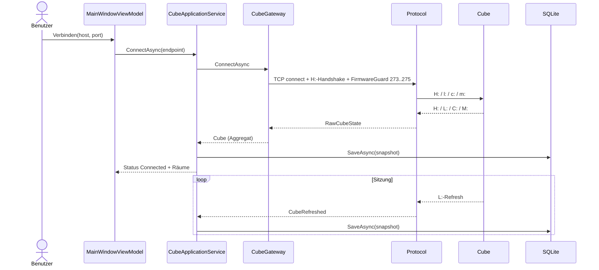
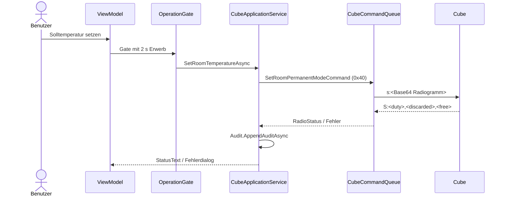

> English translation of docs/ARCHITECTURE.md. Machine-created; DE/EN reviewed by the user on 27.11.2026; FR/IT/NL/PL feedback expected via issues/PRs.

# Architecture – MAX! Cube Local App

> Role: Senior Solution Architect. As of: 27.11.2026. Version: 0.8.0.
> Markers: `FACT` = directly evidenced in the artifact, `OBSERVATION` = seen in a test run, `INFERENCE` = derived from code/docs, `UNKNOWN` = not evidenced. Evidence as `file:line`.

## 1. Executive Summary

### 1.1 Purpose

The app provides the locally usable functions of the former eQ-3 MAX! Local Application for the MAX! Cube on Windows and Linux. It is a reimplementation, not a fork and not a 1:1 port of the Java original (`docs/INDEX.md:3-4`).

### 1.2 Business benefit

MAX! hardware remains operable without manufacturer cloud and without a browser/Java shell. Heating comfort, heating periods, and device structure can be configured locally; operation is possible without internet, without a product account, and without an app update server. The user notice of 25.11.2026 confirms that the cloud app was removed from the Android/iOS stores; the local path is therefore the only one remaining (`docs/features.md:34-36`).

### 1.3 Main functions

Connection and discovery, room/device view, target temperature and modes, home control, weekly schedules, room and device configuration, learning and structure management, cube time/time zone/NTP/network, diagnostics, audit, six languages (`README.md:26-36` before the rewrite performed here; `docs/features.md:40-99`).

### 1.4 Target audience

- **Operator:** household/small installation with one physical MAX! Cube, Windows or Linux.
- **Developer:** .NET developer without Java knowledge who extends the protocol via the C# layer.
- **Administrator:** local maintenance, backup of the data folder, log/audit evaluation.

### 1.5 Technology stack

| Level | Technology | Evidence |
|---|---|---|
| Runtime | .NET 10, `net10.0`, `LangVersion latest`, `Nullable enable`, `InvariantGlobalization true` | `Directory.Build.props:3-13` |
| UI | Avalonia 11.3.23, Fluent Theme, CommunityToolkit.Mvvm 8.4.2 | `src/MaxCube.UI/MaxCube.UI.csproj:3-8`, `src/MaxCube.UI.Desktop/MaxCube.UI.Desktop.csproj:6-8` |
| Persistence | Microsoft.Data.Sqlite 10.0.0 + SQLitePCLRaw.lib.e_sqlite3 2.1.14 | `src/MaxCube.Infrastructure/MaxCube.Infrastructure.csproj:7-8` |
| Tests | xUnit 2.9.3, FluentAssertions 7.2.0, Microsoft.NET.Test.Sdk 17.14.1 | `tests/*/*.csproj:7-10` |
| CI | GitHub Actions, `ubuntu-latest` + `windows-latest`, self-contained publish | `.github/workflows/ci.yml:13-17,39-65` |
| Protocol | own C# layer, no external MAX! NuGet dependency | `docs/INDEX.md:28`, `src/MaxCube.Protocol/*.csproj:3` |

## 2. System context

```mermaid
C4Context
  title Systemkontext – MAX! Cube Local App
  Person(Betreiber, "Betreiber", "Steuert Heizung lokal am PC")
  System(App, "MAX! Cube Local App 0.8.0", "Avalonia-Desktop-App, Windows/Linux")
  System(Cube, "eQ-3 MAX! Cube", "Firmware 273–275, TCP 62910, UDP 23272")
  SystemDb(Cache, "maxcube.db", "SQLite-Cache, Einstellungen, Audit")
  SystemExt(Cloud, "MAX! Cloud", "seit 01.07.2023 abgeschaltet; App laut Nutzerhinweis aus Stores entfernt")
  Rel(Betreiber, App, "Bedient Räume, Profile, Struktur")
  Rel(App, Cube, "TCP-Kommandos, L/C/M/S-Telegramme; UDP nur benutzerinitiiert")
  Rel(App, Cache, "Offline-Anzeige, Einstellungen, Audit")
  Rel(Cloud, App, "keine Verbindung – bewusst verworfen")
```

**FACT:** There is no HTTP endpoint, no Jetty server, no browser autostart, and no update check (`docs/features.md:83-87`, `docs/maxcube-protocol.md` section 6.1). The app's "API" consists of C# interfaces and the cube wire protocol; see [API.md](API.md).

## 3. Overall architecture



### 3.1 Dependency rule

`Domain` has no dependencies. `Protocol` depends only on `Domain`. `Application` depends only on `Domain` and defines ports. `Infrastructure` implements these ports and additionally depends on `Protocol`. `UI` depends on `Application`/`Domain`. `UI.Desktop` wires everything together (`Composition.cs:18-47`; csproj references in `src/*/*.csproj`).

**FACT:** This direction prevents TCP/SQLite from leaking into the business logic or UI. The exception is deliberate: `CubeApplicationService` orchestrates write access and is therefore the only technical write location (`README.md` old:21; `src/MaxCube.Application/Services/CubeApplicationService.cs`).

## 4. Component overview

| Module | Responsibility | Key types | Evidence |
|---|---|---|---|
| `MaxCube.Domain` | business rules, value objects, aggregates, weekly schedules, limits | `Cube`, `Room`, `Device`, `Temperature`, `WeekTemperatureProfile`, `DomainLimits` | `src/MaxCube.Domain/Aggregates/DomainLimits.cs:4-13` |
| `MaxCube.Protocol` | wire format, transport, handshake, queue, radiograms, decoders | `TcpCubeTransport`, `CubeHandshaker`, `CubeCommandQueue`, `CubeCommands`, `RoomCommands`, `CubeStateAssembler` | `src/MaxCube.Protocol/Commands/*.cs`, `src/MaxCube.Protocol/State/*.cs` |
| `MaxCube.Application` | use cases, ports, snapshots, error catalog, discovery rules | `CubeApplicationService`, `ICubeGateway`, `ICubeAdminGateway`, `ICubeStateStore`, `ErrorCatalog` | `src/MaxCube.Application/Abstractions/*.cs` |
| `MaxCube.Infrastructure` | adapters: TCP, UDP, SQLite, platform | `CubeGateway`, `UdpDiscoveryTransport`, `UdpNetworkConfigurator`, `SqliteStateStore`, `AppPaths`, `FileAppLog` | `src/MaxCube.Infrastructure/**/*.cs` |
| `MaxCube.UI` | MVVM view, localization, day bar | `MainWindowViewModel*`, `DayProfileViewModel`, `Localizer`, `DayTimeline` | `src/MaxCube.UI/**/*.cs` |
| `MaxCube.UI.Desktop` | process, DI, tray, instance protection, self-test | `Program`, `App`, `Composition`, `InstanceLock` | `src/MaxCube.UI.Desktop/*.cs` |

### 4.1 Important classes and functions (selection)

- `CubeApplicationService.ConnectAsync(endpoint)` – connects, updates cache/audit, and subscribes to session events (`CubeApplicationService.cs:191`).
- `CubeApplicationService.SetRoomTemperatureAsync(...)` – technical write path for target temperature (`:305`).
- `CubeApplicationService.Admin.cs` – room configuration, boost, wall display, inclusion, assignment, structure, network, diagnostics (`:78-844`).
- `CubeGateway` – holds exactly one transport, writer, and queue; sends `q:` on shutdown (`CubeGateway.cs:17-26`).
- `ResponseCommand<T>.ParseResponse` – rejects `r:` as `CubeCommandRejectedException` and foreign prefixes as `UnknownCubeOpcodeException` (`CubeCommands.cs:21-64`).
- `SqliteStateStore.SaveAsync` – transactionally replaces rooms/devices of a serial; `LoadAsync` returns an offline snapshot (`SqliteStateStore.cs:207-379`).
- `Composition.Build` – singleton wiring for GUI and self-test (`Composition.cs:18-47`).
- `Program.SelfCheck` – headless acceptance without cube contact (`Program.cs:26-92`).

## 5. Data flows

### 5.1 Connecting and building state



### 5.2 Write command



### 5.3 Discovery (always user-initiated)

```mermaid
sequenceDiagram
  actor U as Benutzer
  participant VM as ViewModel
  participant S as CubeDiscoveryService
  participant T as UdpDiscoveryTransport
  participant C as Cube
  U->>VM: „Cube suchen“
  VM->>S: DiscoverAsync(duration)
  S->>T: 3× Request eQ3Max*…I, 50 ms Abstand
  T->>C: Broadcast 255.255.255.255 + Multicast 224.0.0.1, TTL 5, UDP 23272
  C-->>T: Datagramm mit Seriennummer/IP/Firmware
  T-->>S: DiscoveryDatagram
  S-->>VM: Trefferliste; „Übernehmen“ setzt Host + Port 62910
```

**FACT:** No broadcast is sent at app startup (`docs/features.md:41`, `CubeDiscoveryProtocol.cs:15-20`, `UdpDiscoveryTransport.cs:9-19`).

**FACT (hardware 25.11.2026):** The UDP client must be bound to port 23272; with an ephemeral port, no response arrived. After the fix, `192.168.10.60` returned a 26-byte response with serial number and firmware 275 (`UdpDiscoveryTransport.cs:23`, `docs/HARDWARE-VERIFY.md` §3). The earlier `UNKNOWN` classification is therefore lifted for this format.

### 5.4 Cache and source of truth

The cache is completely overwritten on every connect (`SqliteStateStore.cs:236-255`). A loaded offline state is read-only; write commands require a connection (`CubeApplicationService.cs:305-334`). SQLite can therefore never overwrite the cube state.

## 6. Dependencies

### 6.1 External packages

| Package | Version | Purpose |
|---|---|---|
| Avalonia / Avalonia.Desktop / Themes.Fluent | 11.3.23 | platform-native UI (Win32/X11) |
| CommunityToolkit.Mvvm | 8.4.2 | `ObservableObject`, `RelayCommand` |
| Microsoft.Extensions.DependencyInjection | 10.0.0 | composition root |
| Microsoft.Data.Sqlite | 10.0.0 | SQLite access |
| SQLitePCLRaw.lib.e_sqlite3 | 2.1.14 | native SQLite library |
| xUnit / FluentAssertions / Test SDK | 2.9.3 / 7.2.0 / 17.14.1 | hardware-free tests |
| Microsoft.Extensions.TimeProvider.Testing | 10.0.0 | deterministic time in protocol tests |

**FACT:** There is no cloud, Jetty, browser, Getdown, AGPL, or HTTP update dependency (`docs/INDEX.md:28`, `docs/features.md:83-87`).

### 6.2 Runtime dependencies

- TCP port 62910 must be reachable and not blocked by another instance.
- UDP port 23272 only for "Search for cube"; no listener in continuous operation.
- No DNS, certificate, secret store, or proxy required.
- Linux: X11/Wayland and `libSkiaSharp.so`/`libHarfBuzzSharp.so` from the package; `libe_sqlite3.so` from SQLitePCLRaw.

## 7. Architecture decisions

| No. | Decision | Rationale | Status/evidence |
|---|---|---|---|
| ADR-01 | Own C# protocol layer instead of NuGet library | No suitable C# package; `MAXSharp` AGPL and frozen | `docs/INDEX.md:28` |
| ADR-02 | Clean Architecture with ports/adapters | Protocol and SQLite must not contaminate business logic/UI | `Composition.cs:18-47` |
| ADR-03 | Cube source of truth, SQLite cache only | Original has no DB; stale cache data must not flow back | `SqliteStateStore.cs:8-13`, `docs/INDEX.md:113` |
| ADR-04 | No cloud/remote access/product account/proxy/update | Cloud shut down; store notice 25.11.2026; no credentials in the app | `docs/features.md:34-36` |
| ADR-05 | Firmware writing disabled | No golden capture, risk of device damage, no firmware file | `README.md` old:76, `docs/gremium.md:11` |
| ADR-06 | UDP only user-initiated | No broadcast at startup; network configuration only with confirmation | `docs/features.md:41`, `UdpNetworkConfigurator.cs:10-13` |
| ADR-07 | InvariantGlobalization + own language detection | Startup on slim Linux systems without libicu | `Directory.Build.props:12`, `SystemLanguage.cs:6-14` |
| ADR-08 | One gateway object for core + admin | One socket, one queue, one worker – prevents competing sessions | `Composition.cs:27-30` |
| ADR-09 | Two separate operation gates | A stuck gateway gate must not block the UI | `OperationGate.cs:3-16` |
| ADR-10 | Headless self-test in CI | Wiring, SQLite, paths, languages, and instance protection checkable without a desktop | `Program.cs:26-92`, `ci.yml:29-30` |
| ADR-11 | Metadata only after byte-exact round trip | `m:` semantics are `INFERENCE`; protection against structure loss | `README.md` old:34,77 |
| ADR-12 | Central app version + cache version | Display and diagnostics without distributed constants | `Directory.Build.props:3-5`, `SqliteStateStore.cs:108-115` |

## 8. Risks and technical debt

| ID | Risk/debt | Class | Impact | Evidence |
|---|---|---|---|---|
| R-01 | Write formats `0x12`, `0x20`–`0x23`, `m:`, `w:`, `v:`, UDP network only `INFERENCE` | **critical** | Wrong encoding could change meter values/structure; test room needed before production use | `README.md` old:77 |
| R-02 | No golden capture, no technically evaluated `S:` response | **critical** | Acknowledgements >0 and `A:` acceptance not evidenced; UDP response and `0x11` comfort/eco are hardware-evidenced (`docs/HARDWARE-VERIFY.md`) | `README.md` old:80,83 |
| R-03 | Tray behaviour on a real desktop not explicitly checked | medium | Tray problems possible; UI look confirmed by the user on 2026-11-27 | `HARDWARE-VERIFY.md` §28 |
| R-04 | Bundled temperatures (3 s) may lag behind individual commands | medium | Acceptance question, no data loss | `docs/features.md:93`, `MainWindowViewModel.Settings.cs:24` |
| R-05 | `ReadAuditAsync` loads 500, UI shows 100 entries; retention is configurable | low | Historical evaluation is still limited to 500 entries; DB growth is bounded | `SqliteStateStore.cs:166-219`, `MainWindowViewModel.Settings.cs:23,27,165-174` |
| R-06 | `Temperature` exact comparison instead of Java tolerance <0.1 °C | low | Different thresholds on floating-point rounding | `README.md` old:73 |
| R-07 | `DomainLimits` enforced in the aggregate, Java AL does not check | low | Stricter validation than original (deliberate) | `DomainLimits.cs:4-8` |
| R-08 | No hardware validation of 7+6 weekly schedules | high | Second `0x10` telegram remains `UNKNOWN` | `docs/roadmap.md:318-321` |
| R-09 | Round 5 without model votes (free limit) | organizational | No external cross-check voice for the last scope | `docs/gremium.md:90-97` |
| R-10 | `MAX10038` deviates from the pattern `MAX\d{4}` | low | Regex `MAX\d{4,5}` accounts for it; fixed-length consumers might miss it | `ErrorCatalog.cs:54,97` |

## 9. Improvement suggestions (open or partially open)

1. Hardware test with packet capture for all `INFERENCE` formats; then raise the evidence status in `docs/features.md` or correct the encoding.
2. Golden capture of a real cube including `S:` acknowledgement and UDP response; derive test fixtures from it.
3. Linux desktop visual check: the user confirmed on 26.11.2026 in principle "Linux Desktop funktiojniert auch" and on 27.11.2026 that the UI looks visually okay (`HARDWARE-VERIFY.md` §28). Tray and "close hides window" are not explicitly checked; the protocol-specific check remains open.
4. Resizing weekly schedule intervals by dragging their edges; moving a point is implemented.
5. Add error catalog entries with manufacturer wording instead of interpretations once evidenced.
6. Sign the self-contained packages in addition; `SHA256SUMS.txt` accompanies the release artefacts, a signature remains open (`release.yml:91-105,134`).

**Implemented in 0.7.0:** configurable audit retention (`audit.retentionDays`), source tags in
the audit log and reconnect timestamps in the diagnostic report.

**Implemented in 0.8.0:** free `Temporary` end time, per-tab room selection,
drag-and-drop moving of switch points, confirmed wake-up (`z:`) as a dedicated
user action and SHA-256 checksums in the release. The four changes are covered
by 553/553 tests on Windows and Debian/WSL2.

## 10. Open questions

- What is the technical meaning of `S:` codes > 0 and the dead constant `g:` / `OUTGOING_MORE_DATA`? (`UNKNOWN`)
- How does the cube interpret temporary end times during daylight saving/winter time? The app follows Java (local time), evidence missing.
- Is the real UDP firmware frame reproducible? The regular discovery response is evidenced (`docs/HARDWARE-VERIFY.md`); firmware writing remains out.
- Which `SerialNumber` pattern applies? (`UNKNOWN`)
- Are the six languages detected correctly on all Linux desktops when `LANG=C` is set? (`UNKNOWN`; the self-test only checks text keys.)
