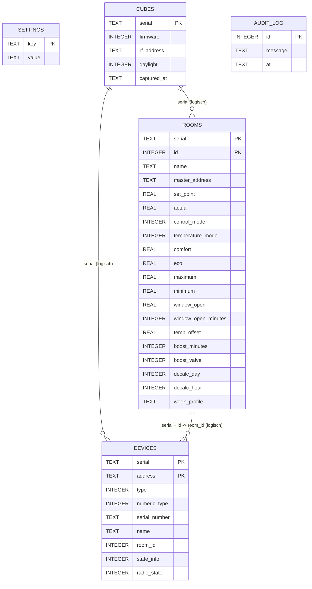
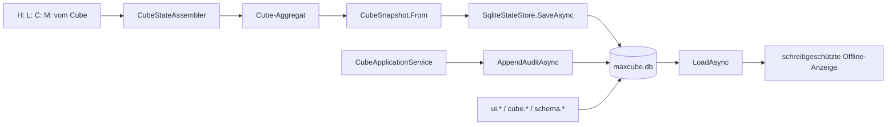

> English translation of docs/DATABASE.md. Machine-created; DE/EN reviewed by the user on 27.11.2026; FR/IT/NL/PL feedback expected via issues/PRs.

# Database – SQLite cache of the MAX! Cube Local App

> As of 25.11.2026. All statements are derived from `src/MaxCube.Infrastructure/Persistence/SqliteStateStore.cs` and its call sites. The original had **no database**; this store is a new development (`SqliteStateStore.cs:8-13`, `docs/INDEX.md:113`).

## 1. Purpose and principle

| Aspect | Finding | Evidence |
|---|---|---|
| Role | offline display, settings, audit – **not** source of truth | `SqliteStateStore.cs:8-13` |
| Source of truth | physical cube | `SqliteStateStore.cs:10-11` |
| Write lock | loaded offline state is read-only; write commands require a connection | `CubeApplicationService.cs:305-334` |
| Overwrite | On every connect, rooms/devices of a serial are completely replaced | `SqliteStateStore.cs:236-255` |
| File | `<data folder>/maxcube.db`, changeable with `MAXCUBE_DATA_DIR` | `AppPaths.cs:10,20-26` |
| Schema version | `PRAGMA user_version = 1`; additionally `settings.schema.version` and `settings.app.version` | `SqliteStateStore.cs:15-16,108-115` |

**FACT:** There are no FOREIGN KEY constraints, no explicit `CREATE INDEX` statements, and no foreign key checks. Relationships are established logically via `serial` or `rooms.id` (`SqliteStateStore.cs:43-94`).

## 2. ER diagram

## 3. Table description

### 3.1 `settings`

| Column | Type | Constraint | Purpose |
|---|---|---|---|
| `key` | TEXT | PRIMARY KEY | stable settings key |
| `value` | TEXT | NOT NULL | value as text; numbers/bools are parsed by the application |

**Upsert:** `INSERT ... ON CONFLICT(key) DO UPDATE SET value = excluded.value` (`SqliteStateStore.cs:118-127,146-163`).

### 3.2 `cubes`

| Column | Type | Constraint | Purpose |
|---|---|---|---|
| `serial` | TEXT | PRIMARY KEY | cube serial number |
| `firmware` | INTEGER | NOT NULL | firmware version from `H:` |
| `rf_address` | TEXT | NOT NULL | 24-bit address in hexadecimal |
| `daylight` | INTEGER | NOT NULL | daylight saving flag 0/1 |
| `captured_at` | TEXT | NOT NULL | snapshot timestamp, ISO-8601 (`"O"`) |

### 3.3 `rooms`

| Column | Type | Constraint | Purpose |
|---|---|---|---|
| `serial` | TEXT | PK (with `id`) | cube assignment |
| `id` | INTEGER | PK (with `serial`) | room ID |
| `name` | TEXT | NOT NULL | display name |
| `master_address` | TEXT | NOT NULL | master thermostat of the room |
| `set_point`, `actual` | REAL | NOT NULL | target/actual temperature |
| `control_mode`, `temperature_mode` | INTEGER | NOT NULL | enum-encoded |
| `comfort`, `eco`, `maximum`, `minimum` | REAL | NOT NULL | room temperature limits |
| `window_open`, `window_open_minutes` | REAL / INTEGER | NOT NULL | window-open configuration |
| `temp_offset` | REAL | NOT NULL | temperature offset |
| `boost_minutes`, `boost_valve` | INTEGER | NOT NULL | boost configuration |
| `decalc_day`, `decalc_hour` | INTEGER | NOT NULL | descaling |
| `week_profile` | TEXT | NULL | JSON of the weekly schedule or `NULL`; **additive migration** |

### 3.4 `devices`

| Column | Type | Constraint | Purpose |
|---|---|---|---|
| `serial` | TEXT | PK (with `address`) | cube assignment |
| `address` | TEXT | PK (with `serial`) | radio address in hexadecimal |
| `type`, `numeric_type` | INTEGER | NOT NULL | device type (enum / raw code) |
| `serial_number`, `name` | TEXT | NOT NULL | device identity/display |
| `room_id` | INTEGER | NOT NULL | logical room assignment |
| `state_info`, `radio_state` | INTEGER | NOT NULL | enum-encoded status values |

### 3.5 `audit_log`

| Column | Type | Constraint | Purpose |
|---|---|---|---|
| `id` | INTEGER | PRIMARY KEY AUTOINCREMENT | sortable order |
| `message` | TEXT | NOT NULL | human-readable event message |
| `at` | TEXT | NOT NULL | timestamp, ISO-8601 (`_clock.Now.ToString("O")`) |

## 4. Relationships, indexes, constraints

- **Relationships:** `cubes.serial` ↔ `rooms.serial`, `cubes.serial` ↔ `devices.serial`, `rooms.id` ↔ `devices.room_id`. All are **logical**, not enforced by `FOREIGN KEY` (`SqliteStateStore.cs:43-94`).
- **Indexes:** Only the implicit indexes of the PRIMARY KEYs. There is no explicit `CREATE INDEX` (`SqliteStateStore.cs:43-94`). With small data volumes (max. 20 rooms / 140 devices per `DomainLimits.cs:11-13`) this is sufficient.
- **Constraints:** `NOT NULL` on all columns except `rooms.week_profile`. `room_id` has **no** check against `rooms.id`; an orphaned device would still be included in the snapshot when loading (the assembler already discarded orphaned devices before saving).
- **Ordering:** `LoadAsync` returns rooms `ORDER BY id`, devices `ORDER BY address` (`SqliteStateStore.cs:316,349`). Audit `ORDER BY id DESC LIMIT 500`, then ascending again (`:191`).

## 5. Data flows

### 5.1 `SaveAsync` (transactional)

1. `SemaphoreSlim _gate` serializes all store accesses (`SqliteStateStore.cs:21,210`).
2. `BEGIN TRANSACTION`.
3. Upsert cube row (`:219-233`).
4. `DELETE FROM rooms WHERE serial = $serial` and reinsert all rooms (`:236-253`).
5. `DELETE FROM devices WHERE serial = $serial` and reinsert all devices (`:255-276`).
6. `COMMIT` (`:278`).

**Consequence:** A partial write error leaves the previous state intact; a connect completely overwrites the cache.

### 5.2 `LoadAsync`

1. Read cube row; `null` on failure (`:295-311`).
2. Load rooms and devices for the serial (`:313-364`).
3. Convert `week_profile` from JSON back to `DayProfile`/`WeekTemperatureProfile`; `NULL` becomes `null` (`:340-342`; `CubeSnapshot.cs`).
4. `CubeSnapshot` with `DateTimeOffset.Parse(captured)` (`:366-373`).

## 6. Stored settings keys

| Key | set by | read by | Value/meaning |
|---|---|---|---|
| `schema.version` | `SqliteStateStore.InitializeSchema` (`:114`) | diagnostics/display | `"1"` = `CurrentSchemaVersion` |
| `app.version` | `SqliteStateStore.InitializeSchema` (`:115`) | diagnostics/display | version from `IAppVersionProvider`, e.g. `0.8.3`; `"unbekannt"` as fallback (`:32-34`) |
| `cube.serial` | `CubeApplicationService.ConnectAsync` (`:306`) | `LoadCachedAsync` (`:370`) | serial number of the last connected cube |
| `cube.endpoint` | `CubeApplicationService.ConnectAsync` (`:307`) | `GetLastEndpointAsync` (`:347`) | `host:port`, e.g. `192.168.10.60:62910` |
| `ui.language` | `MainWindowViewModel.Settings.cs:21` | Localizer/view model | `de`, `en`, `fr`, `it`, `nl`, `pl` |
| `log.retentionDays` | `MainWindowViewModel.Settings.cs:22` | `FileAppLog` / settings | retention in days, default 30 (`:27`) |
| `audit.retentionDays` | `MainWindowViewModel.Settings.cs:23` | `CubeApplicationService.CleanupAuditAsync` (`:904`) | audit retention in days, default 30 (`:27`), valid 1..365 |
| `ui.bundleTemperatures` | `MainWindowViewModel.Settings.cs:24` | `CubeApplicationService.QueueRoomTemperature` | bundled sending 3 s, optional |
| `ui.closeToTray` | `MainWindowViewModel.Settings.cs:25` | `App.axaml.cs:55` | closing window only hides it |

Any additional keys can be written via `CubeApplicationService.ReadSettingAsync`/`WriteSettingAsync` (`CubeApplicationService.Admin.cs:908-914`); the store does not validate keys (`GetSettingAsync`/`SetSettingAsync` accept any string). **INFERENCE:** typos can therefore silently create new keys.

## 7. Migrations

| Version | Change | Idempotence | Evidence |
|---|---|---|---|
| 0 → 1 | tables `settings`, `cubes`, `rooms`, `devices`, `audit_log` | `CREATE TABLE IF NOT EXISTS` | `SqliteStateStore.cs:43-95` |
| 1 (additive) | `ALTER TABLE rooms ADD COLUMN week_profile TEXT NULL`, only if `pragma_table_info` does not know the column | yes, column check before `ALTER` | `SqliteStateStore.cs:97-106` |
| 1 (metadata) | `PRAGMA user_version = 1`, `schema.version`, `app.version` | yes, upsert | `SqliteStateStore.cs:108-115` |

**FACT:** There is no migratory downgrade and no check whether `user_version` is higher than `CurrentSchemaVersion`. A foreign, newer DB would be opened unchanged; unknown columns are ignored by the SELECT (`INFERENCE` from `LoadAsync`).

## 8. Backup, recovery, maintenance

- **Backup:** copy the data folder, at least `maxcube.db`; better `maxcube.db`, `logs/`, `reports/` together (consistent evidence). The DB is small; copying while running is usually possible with SQLite, but **recommended:** quit the app first so the lock and open transactions do not interfere (`AppPaths.cs:20-28`, `InstanceLock.cs:5-10`).
- **Recovery:** quit app → restore saved `maxcube.db` → start. The next connect will overwrite rooms/devices from the cube anyway; settings and audit remain from the backup.
- **Maintenance:** old `audit_log` rows are deleted at startup according to `audit.retentionDays` (default 30, valid 1..365; `MainWindowViewModel.Settings.cs:23,27,165-174`, `SqliteStateStore.cs:186-202`). The schema is unchanged; log rotation is handled separately by `FileAppLog` (`FileAppLog.cs:6-9`).

## 9. Open questions

- Should `room_id` be modeled as a real `FOREIGN KEY` with `ON DELETE CASCADE`? Currently only logical.
- How can a backup be consistently checked for migrations while the app is running? Currently no `PRAGMA integrity_check` in the app.
- Should audit retention also apply at runtime (not only at startup)? Currently `UNKNOWN`.
- Are `week_profile` JSONs versioned when the schema changes? Currently stored only as text.
