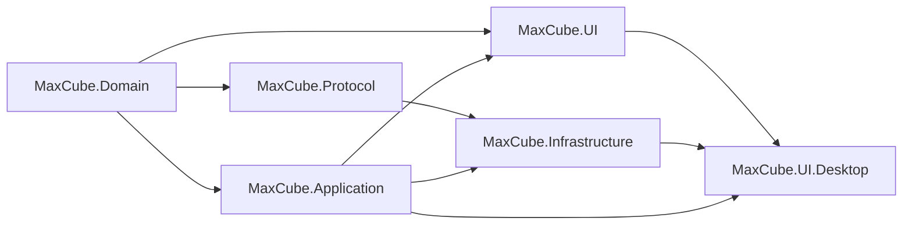
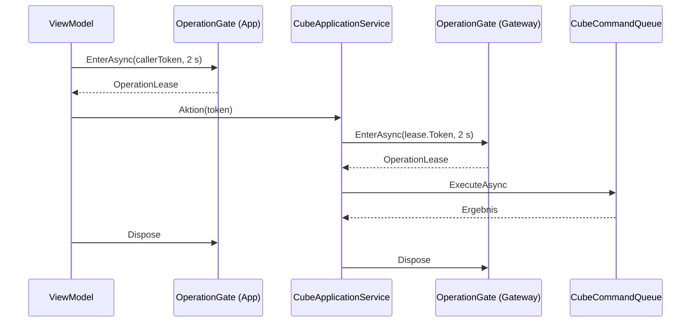

> English translation of docs/DEVELOPMENT.md. Machine-created; DE/EN reviewed by the user on 27.11.2026; FR/IT/NL/PL feedback expected via issues/PRs.

# Development – MAX! Cube Local App

> As of 27.11.2026. Version 0.8.2. This file describes the **as-built state of the repository**, not a desired architecture. Statements with `INFERENCE`/`UNKNOWN` are explicitly marked; evidence as `file:line`.

## 1. Quick start for developers

### 1.1 Prerequisites

| Prerequisite | Windows | Linux | Evidence |
|---|---|---|---|
| SDK | .NET 10 (`net10.0`) | .NET 10 | `Directory.Build.props:6`, `ci.yml:20-22` |
| Editor | any C# editor/IDE | any | `INFERENCE` – no editor configuration evidenced in the repo |
| Desktop | Win32 | X11 or Wayland | `start.sh:3-4`, `Program.cs:23-24` |
| Cube for hardware tests | optional | optional | All tests run hardware-free (`LoopbackFakeCube.cs:10-12`) |

`start.cmd` and `start.sh` look for an SDK, build incrementally, and start the debug DLL with passed arguments (`start.cmd:8-43`, `start.sh:8-35`). For pure code work, these are sufficient:

```powershell
dotnet restore MaxCube.slnx
dotnet build MaxCube.slnx --nologo
dotnet test MaxCube.slnx --nologo
dotnet src/MaxCube.UI.Desktop/bin/Debug/net10.0/MaxCube.UI.Desktop.dll --selfcheck
```

```bash
dotnet restore MaxCube.slnx
dotnet build MaxCube.slnx --nologo
dotnet test MaxCube.slnx --nologo
dotnet src/MaxCube.UI.Desktop/bin/Debug/net10.0/MaxCube.UI.Desktop.dll --selfcheck
```

The self-test is headless, builds paths/SQLite/gateway/service/view model/localization, and sends **no** broadcast (`Program.cs:26-92`). Exit codes: `0` OK, `1` exception, `2` instance protection, `3` missing text, `4` DB not created (`Program.cs:41-42,58-59,83-85,92`).

### 1.2 Solution and projects



`MaxCube.slnx` contains six source and five test projects (`MaxCube.slnx:2-16`).

| Project | Role | Key dependencies |
|---|---|---|
| `MaxCube.Domain` | aggregates, value objects, weekly schedules, error codes; **dependency-free** | – (`src/MaxCube.Domain/*.csproj`) |
| `MaxCube.Protocol` | wire format, framing, handshake, queue, radiograms, codecs | Domain only |
| `MaxCube.Application` | use cases, ports, snapshots, discovery, error catalog | Domain |
| `MaxCube.Infrastructure` | TCP/UDP/SQLite/platform adapters | Application + Protocol |
| `MaxCube.UI` | Avalonia MVVM, localization, day bar | Avalonia 11.3.23, CommunityToolkit.Mvvm 8.4.2 |
| `MaxCube.UI.Desktop` | process, DI, tray, instance protection, self-test | Avalonia.Desktop/Themes 11.3.23, DI 10.0.0 |

Central build properties: version `0.8.2`, `LangVersion latest`, `Nullable enable`, `ImplicitUsings enable`, `InvariantGlobalization true`, `Deterministic true` (`Directory.Build.props:3-13`). C# sources use LF line endings (`.gitattributes`, `.editorconfig`) so `dotnet format --verify-no-changes` matches on Windows and Debian.

## 2. Coding conventions

### 2.1 Language and error rules

- Comments/rationales are in German; identifiers are in English (`OBSERVATION`, e.g. `CubeGateway.cs`, `Localizer.cs`).
- All technical validation errors carry a MAX code via `DomainValidationException` (`DomainValidationException.cs:3-16`). The catalog is `MAX0001`, `MAX1001`–`MAX1051`, supplemented by the evidenced outlier `MAX10038` (`ErrorCatalog.cs:14-68,97`). **Do not correct** as long as the artifact contains it that way.
- Protocol/transport exceptions carry **no** MAX codes (`CubeProtocolExceptions.cs:3-69`, `CubeCommandExceptions.cs:1-31`). The UI shows `ErrorMessage` and a hint derived from `ErrorCatalog.Describe` (`MainWindowViewModel.cs:1208-1229`, `MainWindowViewModel.Admin.cs:149-169`).
- `INFERENCE` may be implemented, but only with marking in code/docs; `UNKNOWN` must not be passed through as a valid state (`docs/INDEX.md:54-58`, `docs/roadmap.md:61`).

### 2.2 Async, cancellation, gates



- `OperationGate.EnterAsync` uses 2 s by default, the shutdown path 250 ms (`OperationGate.cs:13-16,26-42`).
- `CancelActive()` aborts the active operation without itself waiting on the gate (`OperationGate.cs:44-58`).
- App and gateway have **separate** gates so a stuck gateway cannot block the UI (`OperationGate.cs:6-8`, `CubeApplicationService.cs:22`, `CubeGateway.cs:31`).
- Always release leases with `using`; `OperationLease.Dispose` is idempotent (`OperationGate.cs:75-99`).
- Async paths consistently use `ConfigureAwait(false)`, except where the UI dispatcher instance serves the UI thread (`IUiDispatcher.cs`, `AvaloniaUiDispatcher.cs`).

### 2.3 Time and clocks

`IClock.Now` returns `DateTimeOffset.Now`, i.e. **local time with offset**, not UTC; the reason is temporary end times encoded by the cube without a time zone (`ICubeStateStore.cs:5-19`). Tests inject `TimeProvider`/`FakeClock`; golden capture and hardware time are not currently in the test path.

### 2.4 Localization and help

- Six languages: `de`, `en`, `fr`, `it`, `nl`, `pl` (`Localizer.cs:15-23`).
- XAML binds via the indexer `{Binding Loc[Schlüssel]}`; `PropertyChanged("Item[]")` updates all texts without a restart (`Localizer.cs:9-11,51-54`).
- Unknown keys appear as `!Schlüssel!` – the self-test checks exactly this pattern (`Localizer.cs:56-61`, `Program.cs:79-86`).
- Language selection order: saved `ui.language`, then system language, then German (`Localizer.cs:70-84`, `MainWindowViewModel.Settings.cs:118-119`).
- Help topics: `Connect`, `Rooms`, `Week`, `Config`, `Devices`, `Cube` (`MainWindowViewModel.Settings.cs:27`), texts in `Strings.cs:265-276`.
- System language: `LC_ALL` → `LC_MESSAGES` → `LANGUAGE` → `LANG` → Windows API; `C`/`POSIX` = `null` (`SystemLanguage.cs:17-35,40-55,71-72`).

### 2.5 UI structure

`MainWindowViewModel` is a `partial class` **without Avalonia types**; all actions go through `CubeApplicationService` (`MainWindowViewModel.cs:29-33`). Partials: `.cs`, `.Admin.cs`, `.Structure.cs`, `.Cube.cs`, `.Settings.cs`.

**Nine tabs** in this order: `Rooms`, `Week`, `House`, `Configuration`, `Devices`, `Cube`, `Status`, `Help`, `Settings` (`MainWindowViewModel.Admin.cs:23-35`, XAML `MainWindow.axaml:49,112,168,193,305,370,441,451,464`). `SelectedIndex` is two-way bound (`MainWindow.axaml:46`).

There are **62 `[RelayCommand]` attributes** (static inventory 27.11.2026), including connection/discovery/temperature/week/house in `MainWindowViewModel.cs`, admin in `MainWindowViewModel.Admin.cs:77-408`, structure in `MainWindowViewModel.Structure.cs:86-249`, cube/time/network in `MainWindowViewModel.Cube.cs:74-172`, help in `MainWindowViewModel.Settings.cs:164`, day bar in `DayProfileViewModel.cs:32-41`. MVVM convention: `[ObservableProperty]` on private fields, `[RelayCommand]` on private methods; `partial void On…Changed` handles persistence and `CanExecute` invalidation (`MainWindowViewModel.cs:4-5`, `DayProfileViewModel.cs:25-41`, `Settings.cs:55-91`, `Cube.cs:68`).

Context help: six topics `Connect/Rooms/Week/Config/Devices/Cube`, jump to tab 7 (`Settings.cs:27,151-169`, `Strings.cs:265-276`, `MainWindow.axaml:40,198,310,375,451-457`).

Tray: runtime-generated icon without a binary asset (`TrayIconFactory.cs:9-17`), `TrayShow`/`TrayExit`, and language change (`App.axaml.cs:51,80-115`). If desktop tray support is missing, the app still starts (`App.axaml.cs:116-121`). "Close hides window" is **off** by default (`Settings.cs:48-53`, `App.axaml.cs:53-60`). Instance protection via exclusive lock file (`InstanceLock.cs:5-10,19-49`, `App.axaml.cs:31-41`, `AlreadyRunningWindow.cs:7-30`).

## 3. Tests

| Project | Focus | Evidence |
|---|---|---|
| `MaxCube.Domain.Tests` | value objects, aggregates, structure, enums | `tests/MaxCube.Domain.Tests/*Tests.cs` |
| `MaxCube.Application.Tests` | service, snapshots, discovery, admin | `tests/MaxCube.Application.Tests/*Tests.cs` |
| `MaxCube.Protocol.Tests` | framing, handshake, queue, commands, state, radiograms | `tests/MaxCube.Protocol.Tests/*Tests.cs` |
| `MaxCube.Infrastructure.Tests` | SQLite, gateway, UDP, platform, language | `tests/MaxCube.Infrastructure.Tests/*Tests.cs` |
| `MaxCube.UI.Tests` | view models, admin view model | `tests/MaxCube.UI.Tests/*Tests.cs` |

**OBSERVATION (27.11.2026):** 558/558 tests green on Windows 10 and Debian 13 (WSL2). **FACT (test run 27.11.2026):** Domain 64, Application 90, Protocol 200, Infrastructure 71, UI 133; the only `[MemberData]` source yields 21 rows (`CubeCommandsTests.cs:12-33`). The older statuses 442/442, 514/515 and 519/519 are historical and documented in `CHANGELOG.md`. Evidence: `tests/*/*.cs`, `CHANGELOG.md`. Hardware-free: the end-to-end test uses `LoopbackFakeCube`/`FakeGateway`/`FakeStore`, **no** golden capture (`LoopbackFakeCube.cs:10-12`). Wake-up deliberately has no automatic hardware write test; the action is only reachable after confirmation.

### 3.1 Test rules

1. No test may require a real cube, cloud, or broadcast. Discovery tests use `IDiscoveryTransport` with sample datagrams (`ICubeDiscovery.cs:10-17`, `CubeDiscoveryServiceTests.cs`).
2. Time-dependent tests use injected clock/`TimeProvider`, not `Task.Delay` with wall-clock time.
3. For every new wire format: codec test **and** byte expectation; origin marked as `FACT`/`INFERENCE` in the test comment.
4. For every new technical action: check audit entry and `Warning` path on cache errors (`CubeApplicationService.cs:648`, `:84`).
5. For every new UI action: check `CanExecuteChanged`/button state and language change (historical findings H-A/N9 in `SecondBrain/wiki/projekte/app-maxcube.md:36,40`).
6. Definition of Done: build `0 warnings/0 errors`, all tests green, `--selfcheck` OK, docs and markers updated.

## 4. Extension recipes

### 4.1 New cube command

1. Create a class in `src/MaxCube.Protocol/Commands/` deriving from `CubeCommand<T>`; set `WireLine`, `ResponsePrefix`, optionally `Timeout` (`CubeCommand.cs:8-33,56-87`).
2. Parse the response with `ResponseCommand<T>`: `r:` → `CubeCommandRejectedException`, foreign prefix → `UnknownCubeOpcodeException`, `null` → `CubeCommunicationFailedException` (`CubeCommands.cs:21-64`).
3. Add a byte test in `tests/MaxCube.Protocol.Tests/`; mark derived formats as `INFERENCE`.
4. Add the port to `ICubeAdminGateway`, the implementation in `CubeGateway.Admin.cs`, the technical action in `CubeApplicationService.Admin.cs`. All admin actions go through `RunReadAsync`/`RunWriteAsync` with gate and audit (`CubeApplicationService.Admin.cs:893-951`).
5. Add a UI action with confirmation if it changes structure, network, or devices (`RequireConfirmed`, `:945-951`).

**Warning:** Firmware opcodes `B/U/W/R` in the UDP codec and firmware writing remain excluded (`CubeUdpCodec.cs:12`, `docs/gremium.md:11`).

### 4.2 New setting

1. Add a constant in `MainWindowViewModel.Settings.cs`; define default and validation (model `log.retentionDays`: `:22,25,120-123`).
2. `InitializeAsync` loads the value via `ReadSettingAsync`; `PersistAsync` writes it via `WriteSettingAsync` (`:97-149`).
3. The store accepts arbitrary keys – typos create new keys (`SqliteStateStore.cs:130-164`). Therefore add it to `docs/DATABASE.md` §6.
4. If the setting affects connection or write order: adapt the self-test and view model tests.

### 4.3 New language

1. Add the code in `Localizer.Languages` (`Localizer.cs:15-23`).
2. Add a translation for **every** key in `Strings.Table`; empty texts fall back to German (`Localizer.cs:56-65`). A completeness test is located in `tests/MaxCube.UI.Tests/AdminViewModelTests.cs:34` (`Every_key_has_six_non_empty_texts_with_identical_placeholders`).
3. `SystemLanguage.Detect` needs no new case as long as the two-letter code matches (`SystemLanguage.cs:17-35`).
4. Run `--selfcheck` with the new code; it reports `SELFCHECK FEHLER: Text fehlt in <code>` if a key is missing (`Program.cs:79-86`).

### 4.4 New UI area

New tabs follow the pattern `MainWindowViewModel.<area>.cs` + `Strings` keys + context-specific help topic in `HelpKeys` (`MainWindowViewModel.Settings.cs:27`). View model actions run through `RunAsync` with an `OperationCanceledException` special case and error logging (`MainWindowViewModel.cs:1134`). No direct socket/SQLite access from the UI; only via `CubeApplicationService`.

## 5. Versioning and releases

Version comes **only** from `Directory.Build.props:3-5`; `AppVersionProvider` reads the assembly attribute (`AppVersionProvider.cs:13-24`). Window title and status show the version; the cache additionally stores `app.version` and `schema.version` (`SqliteStateStore.cs:31-37,108-115`).

For changes: increase the version automatically/autonomously per the user rule in SecondBrain (`SecondBrain/wiki/quellen/sitzung-2026-11-23-autobuild-bei-aenderungen`, `wiki/index.md:53`). Currently `0.8.2`; `schema.version` remains `1` as long as the schema stays compatible.

CI: push/PR on `main`/`master`/`develop` or manual; matrix `ubuntu-latest` + `windows-latest`; restore/build/test/self-test, then publish `linux-x64`/`win-x64` with self-test and artifact upload (`ci.yml:3-69`). The release workflow also creates `SHA256SUMS.txt` for both ZIPs (`release.yml:91-105,134`). Artefacts remain **unsigned**; a signature is still an improvement suggestion (`ARCHITECTURE.md` §9).

## 6. Handling of source material

- `extracted/`, `decompiled/`, `evidence/`, and `docs/*` (reverse engineering) are **analysis sources**; no code may be copied from them (`docs/INDEX.md:128`).
- `raw/` in SecondBrain is immutable; `wiki/` is maintained but not published (`SecondBrain/CLAUDE.md:15-16,115`).
- No cloud/Jetty/browser/AGPL dependency; no HTTP update check (`docs/INDEX.md:28`, `docs/features.md:83-87`).
- No commits/pushes in this work assignment; ask the user first if needed.

## 7. Common developer mistakes

| Symptom | Cause | Solution |
|---|---|---|
| "SELFCHECK FEHLER: Text fehlt in xx" | new key without translation | complete `Strings.Table` (`Localizer.cs:56-65`) |
| Buttons disabled after connect | `CanExecuteChanged` missing | `RelayCommand.NotifyCanExecuteChanged()` after state changes (historically H-A) |
| `q:` missing on exit | gateway gate not reachable within 250 ms | cleanup path uses `CancellationToken.None` + 700 ms/2 s upper bounds (`CubeGateway.cs:209-235,441-459`) |
| Offline value sent | `RequireOnline()` bypassed | all mutations via `CubeApplicationService` (`:528-534`) |
| `MAX10038` "corrected" as a typo | artifact deviates from the pattern | deliberately leave as is; regex accepts 4–5 digits (`ErrorCatalog.cs:54,97`) |
| Write format number wrong | temperature/byte grid | quantize to 0.5 °C (`CubeApplicationService.cs:310-312,521-526`), temporary 30-min grid (`RoomCommands.cs:28-46`) |

## 8. Open questions

- Should `ErrorCatalog` contain real manufacturer messages instead of symbol interpretations in the future? (`UNKNOWN`)
- How are hardware captures versioned as test fixtures? Currently no golden capture in the repo.
- Are six languages detected correctly on Wayland with `LANG=C`? The self-test only checks text keys.
- Should an `HttpListener`/REST test be added? **No** – there is deliberately no HTTP API (`API.md`).
