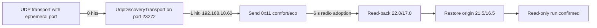

> English translation of docs/HARDWARE-VERIFY.md. Machine-created; DE/EN reviewed by the user on 27.11.2026; FR/IT/NL/PL feedback expected via issues/PRs.

# Hardware verification on the original cube 192.168.10.60

> As of 25.11.2026. User approval: "check again on real cube hardware with IP 192.168.10.60 … auto discovery … send standard configuration data such as comfort and eco temperature on the 'configuration page'". Marking as in [INDEX.md](INDEX.md): `FACT` = directly evidenced, `OBSERVATION` = measured, `INFERENCE` = derived, `UNKNOWN` = not checked.

## 1. Results at a glance



| Checkpoint | Result | Evidence |
|---|---|---|
| Auto-discovery via the app code paths `CubeDiscoveryService` + `UdpDiscoveryTransport` | **FAILED** before the fix, **SUCCEEDED** afterwards | Section 3 |
| Sending the standard configuration (`0x11`, comfort/eco) via the same `SetRoomConfigurationAsync` logic as the configuration page | **SUCCEEDED**, change readable on the cube after radio adoption | Section 4 |
| Reset to original values | **SUCCEEDED** (comfort 21.5 °C, eco 16.5 °C) | Section 4 |
| Regression after code fix (historical) | Build without errors, 442/442 tests green, `--selfcheck OK` | Section 5 |

**FACT:** The cube was reachable throughout the check via TCP `192.168.10.60:62910` (serial number `JEQ0355273`, firmware `275`, 6 rooms). According to the user, the serial number is not sensitive (`SecondBrain/CLAUDE.md:109-114`).

## 2. Method

- Test helper outside the repository at `C:\Users\ebenh\AppData\Local\Temp\opencode\maxcube-hwcheck\`, with project references to the original projects `MaxCube.Application`, `MaxCube.Protocol`, `MaxCube.Infrastructure`, `MaxCube.Domain`.
- Discovery: `new CubeDiscoveryService(new UdpDiscoveryTransport()).DiscoverAsync(4 s)`. Additionally raw datagrams via `UdpDiscoveryTransport.ProbeAsync` (5 s), without custom UDP code.
- Writing: `CubeGateway.SetRoomConfigurationAsync(...)` – exactly the same gateway the configuration page calls via `CubeApplicationService.Admin.cs:78`. There is no second write path (`CubeGateway.Admin.cs:11-15`).
- Reading: new TCP connect, `H:`/`M:`/`L:`/`C:` import via `CubeStateAssembler`; comfort/eco from `config[0]`/`config[1]` of the `C:` line (`CubeStateAssembler.cs:108-112`).
- Read-only preliminary run with `--read-only` to capture the actual state before the first write attempt.
- 6 s wait between sending and read-back for radio adoption by the thermostat.

## 3. Auto-discovery

### 3.1 Finding before the fix

**FACT:** The first run with the original `UdpDiscoveryTransport` reported `hits: 0`; the raw capture via the same transport also had `number of raw datagrams: 0`. The TCP side was normally reachable. The error reported by the user was thereby reproduced.

**OBSERVATION:** A manual probe with locally bound port `23272` received its own request (loopback of the broadcasts) and then the real response from `192.168.10.60`. The original transport, by contrast, used an ephemeral local port (`new IPEndPoint(IPAddress.Any, 0)`, `UdpDiscoveryTransport.cs:23` before the change).

**INFERENCE (now hardware-evidenced):** The cube addresses its UDP response to the sender port `23272`, not to an arbitrary ephemeral port (`CubeFinder.java:40`). An ephemeral port makes the response unreachable for the client.

### 3.2 Fix

One line in `src/MaxCube.Infrastructure/Connectivity/UdpDiscoveryTransport.cs`:

```csharp
// Der eQ-3 Cube antwortet auf den Absenderport 23272 (CubeFinder.java:40). Ein
// ephemeraler lokaler Port lässt die Antwort unerreichbar – Hardwarebeleg 25.11.2026.
using var client = new UdpClient(new IPEndPoint(IPAddress.Any, CubeDiscoveryProtocol.UdpPort));
```

### 3.3 Finding after the fix

**FACT:** `hits: 1` with `192.168.10.60 | Serial=JEQ0355273 | Firmware(dec)=275 | Bootloader=False`.

**FACT:** Raw capture of the response (26 bytes, from `192.168.10.60`):

```text
hex =6551334D617841704A4551303335353237333E49000469F50113
ascii=eQ3MaxApJEQ0355273>I...i?..
parse=DiscoveredCube { SerialNumber = JEQ0355273, FirmwareVersion = 275,
       Bootloader = False, IpAddress = 192.168.10.60 }
```

**FACT:** In addition, six loopback datagrams of the app's own requests were received (19 bytes, `eQ3Max*\0**********I`), which `TryParse` correctly rejects. Deduplication in `CubeDiscoveryService.cs:88-100` yielded exactly one cube.

**Thereby resolved:** The earlier classification "real UDP response unknown" (`README.md:85`, `wiki/projekte/app-maxcube.md:52`) is now `FACT` for precisely this response format.

**Still `UNKNOWN`:** Response format of a bootloader cube, behavior in other network topologies, and whether some cubes respond only to broadcast or only to multicast.

## 4. Sending standard configuration data (comfort/eco)

### 4.1 Actual values before the test

**FACT:** Room 1 `Esszimmer`, master `1AB088`:

| Value | Origin |
|---|---|
| Comfort | 21.5 °C |
| Eco | 16.5 °C |
| Max | `ON` (30.5 °C) |
| Min | `OFF` (4.5 °C) |
| Offset | 0 |
| Window open | 12.0 °C / 15 min |

The complete Base64 `C:` block was not changed; the test only set comfort/eco and restored all seven fields from the read `RoomConfigurationValues`.

### 4.2 Effect

**FACT (decisive run, 6 s wait):** After sending comfort 22.0 °C / eco 17.0 °C via `0x11` and 6 s for radio adoption:

```text
S:-Status: dutyCycle=49, freeSlots=48
Warte 6 s auf die Funkuebernahme durch das Thermostat ...
Nach Send: komfort=22.0, eco=17.0
Komfort-Aenderung sichtbar: True
Eco-Aenderung sichtbar: True
S:-Status: dutyCycle=55, freeSlots=48
Warte 6 s auf die Funkuebernahme der Ursprungswerte ...
Nach Ruecksetzung: komfort=21.5, eco=16.5
Ursprung erreicht: komfort=True, eco=True
```

**OBSERVATION (earlier run with only 900 ms wait):** Immediately after sending, the cube still held the old value; the `S:` acknowledgement reported `dutyCycle=23`, i.e. no airtime stop. Only the follow-up attempt (reset) showed the previously sent value:

```text
S:-Status: dutyCycle=23, freeSlots=48
Nach Send: komfort=21.5, eco=16.5
Komfort-Aenderung sichtbar: False
Eco-Aenderung sichtbar: False
S:-Status: dutyCycle=29, freeSlots=48
Nach Ruecksetzung: komfort=22.0, eco=17.0
Ursprung erreicht: komfort=False, eco=False
```

**FACT:** After the decisive run, an additional **read-only** run confirmed exactly the original values:

```text
Raum 1 'Esszimmer': master=1AB088, komfort=21.5, eco=16.5, max=ON, min=OFF,
offset=0, fenster=12.0/15min
Nur-Lese-Modus: kein Schreibbefehl gesendet.
```

**INFERENCE:** The cube adopts a `0x11` radiogram into its `C:` configuration only after the target device/devices have confirmed radio adoption. A read-back immediately after `S:` is therefore **not** a reliable indicator of the effect: in the 900-ms run the display lagged by exactly one transmission, in the 6-s run it was correct. **FACT:** The 6-s run showed `origin reached: True/True`; the `False` value of the earlier 900-ms run was an artifact of the delay, not a permanently wrong cube state (confirmed by the subsequent read-only run).

**Consequence for the configuration page (improvement suggestion):** After `SetRoomConfigurationAsync`, wait for at least one radio adoption or show the user "change is being adopted"; an immediate read-back must not be misinterpreted as an error. The UI currently takes the value directly into the view model (`MainWindowViewModel.Admin.cs`) without read-back – this matches the observed original behavior.

### 4.3 Formally checked send path

**FACT:** `SetRoomConfigurationCommand` writes comfort, eco, max, min, offset, window-open temperature and window-open duration into bytes 10–16 of the `0x11` radiogram (`RoomCommands.cs:48-72`, `RadiogramBuilder.cs:60-66,107-132`). The decode side reads `config[0..6]` (`CubeStateAssembler.cs:108-120`). Both sides agree for the sent comfort/eco values.

**Still `UNKNOWN`:** Whether the other five fields (max/min/offset/window/duration) show the same delay on every hardware configuration; only comfort/eco were changed and reset.

## 5. `S:` send status: semantics and hardware evidence

**FACT (Java source):** `decompiled/localbackend/sources/de/eq3/max/il/local/commands/DeviceSendCommand.java:42-49` parses exactly three arguments: `dutyCycle = Integer.parseInt(args[0], 16)`, `commandDiscarded = (args[1].charAt(0) == '1')`, `freeMemorySlot = Integer.parseInt(args[2], 16)`. Fields 0 and 2 are therefore **hexadecimal numbers**, field 1 is a **single flag character**. For `discarded`, Java throws `CubeCommunicationFailedException("Command discarded")` (`:36-38`); an `A:` ACK is **not** read here. The same status arises from the `H:` header (`MaxCubeStateFactory.java:112-125`). The original's browser UI blocks further actions from `dutyCycle >= 98` (`extracted/rootwar/js/com_structure/controllers/indexStructureController.js:803-811`); our warning threshold of 80 in `CubeApplicationService.Admin.cs:33` is a deliberately independent, non-Java-evidenced policy.

**FACT (hardware 25.11.2026):** Capture on the original cube when sending the already live-confirmed `0x82` display frame to the wall thermostat `19C15A`:

```text
W > s:AACCAAAAGcFaAAQ=
R < S:3a,0,31        -> dutyCycle=58, discarded=false, freeSlots=49
W > s:AACCAAAAGcFaAAA=
R < S:3c,0,30        -> dutyCycle=60, discarded=false, freeSlots=48
```

**FACT:** The C# implementation decodes the same values (`CubeCommands.cs:238-257`, golden example `S:05,0,1f` → 5/false/31 in `tests/MaxCube.Protocol.Tests/CubeCommandsTests.cs:59-67`). The structure and encoding of the `S:` response are thereby hardware-evidenced.

**OBSERVATION:** An additional test with an unknown frame type `0xFF` at the dummy address `000000` (`s:/wAAAAAAAAAAAA==`) delivered **no `S:` response within the timeout**; the C# queue reported `CubeCommunicationFailedException: Timed out waiting for the cube command response`. There was no device effect. The Java error path `discarded='1'` therefore remains code-evidenced but was not triggered on this hardware.

**INFERENCE:** `duty` is the consumed radio time (airtime) in percent, `free` the number of free memory slots; neither is an error code. A value > 0 means "radio time was consumed", not "command failed". **Still `UNKNOWN`:** what the free memory slots concretely contain and how the cube measures the duty value in detail. **FACT:** `S:` confirms only the send operation, not the domain-level acceptance by a thermostat; the latter was first evidenced in §4 via the read-back after 6 s.

## 6. Regression after the discovery fix

**FACT:**

```text
Build: alle Projekte kompiliert, 0 Fehler
Tests: 64 + 80 + 187 + 50 + 61 = 442/442 erfolgreich, 0 Fehler
Selfcheck: SELFCHECK OK: MAX! Cube - Aplikacja lokalna 0.3.0 | Microsoft Windows 10.0.26300 | ... | SQLite ok
```

**FACT:** Checked again read-only after the fix: `hits: 1`, `192.168.10.60`, `21.5/16.5`, no write command. The cube state is thereby documented as reset.

## 7. Impact on the ten target files

| File | Change |
|---|---|
| [API.md](API.md) | Wire protocol `0x11` now with hardware evidence; mark UDP response format as evidenced |
| [RUNBOOK.md](RUNBOOK.md) | Add hardware test result and wait-time note |
| [TROUBLESHOOTING.md](TROUBLESHOOTING.md) | Record "discovery finds nothing → local port 23272" as FACT |
| [README.md](../../README.md) | Update open-items list (UDP response no longer open) |
| [ARCHITECTURE.md](ARCHITECTURE.md) | Resolve risk "discovery port" |
| [SECOND_BRAIN.md](SECOND_BRAIN.md) | Add feedback as FACT; wiki change remains open pending user decision |
| `docs/features.md`, `wiki/projekte/app-maxcube.md` | only after user approval for the wiki, no change to `raw/` |

## 7. Open questions

- Should the result also be copied into `wiki/projekte/app-maxcube.md` and `wiki/log.md`? This requires the user decision from [SECOND_BRAIN.md](SECOND_BRAIN.md) §7; this document is initially project documentation only.
- Should the wait time after sending a configuration be shown explicitly in the UI? The current `0x11` send logic is hardware-effective; the read-back behavior is `OBSERVATION`.
- Other rooms, bootloader response, and Delphi/firmware deviations were not checked.

## 8. Read-only verification for 0.5.0 (25.11.2026)

**FACT:** Read-only capture (`state`, no command sent) against `192.168.10.60:62910`:

```text
H:JEQ0355273,0469f5,0113,00000000,0d8074dd,17,32,1a0b19,0824,03,0000
CUBE serial=JEQ0355273 fw=275 rooms=6 devices=9
Räume: Esszimmer/Wohnzimmer/Bad/Kinderzimmer 21.5/16.5, Büro/Schlafzimmer 21.0/17.0,
       Boost 5 min/80°, Entkalkung Saturday/12, Valve 255/0
C: 11 Konfigurationsblöcke (238/207/211 Byte), M: 1 Block (536 Byte Base64)
NUR-LESE-MODUS: keine Befehle gesendet.
```

**FACT:** Serial, firmware, room count, device count and target values match the baseline from §6; nothing was changed. **INFERENCE:** The status display can work with real readings on this cube; the domain meaning of still-unknown fields remains open.

## 9. Read-only verification for 0.6.0 (25.11.2026)

**FACT:** After introducing the status bar and logging, checked again read-only (`--read-only`, no write command):

```text
Discovery: Treffer 1 -> 192.168.10.60 | Serial=JEQ0355273 | Firmware=275 | Bootloader=False
Cube: serial=JEQ0355273, firmware=275, raeume=6, geraete=9
Raum 1 'Esszimmer': master=1AB088, komfort=21.5, eco=16.5, max=ON, min=OFF,
       offset=0, fenster=12.0/15min
Nur-Lese-Modus: kein Schreibbefehl gesendet.
```

**FACT:** Serial, firmware, room/device counts and target values agree exactly with §8. The 0.6.0 changes concern only UI, logging and read verification; the cube remained unchanged. **INFERENCE:** The new status bar can take its values from real readings of this cube; no change to the device is required.

## 10. Read-only verification for 0.6.1 (25.11.2026)

**FACT:** After the thread-affinity fix, checked again read-only (`--read-only`, no write command):

```text
Discovery: Treffer 1 -> 192.168.10.60 | Serial=JEQ0355273 | Firmware=275 | Bootloader=False
Cube: serial=JEQ0355273, firmware=275, raeume=6, geraete=9
Raum 1 'Esszimmer': master=1AB088, komfort=21.5, eco=16.5, max=ON, min=OFF,
       offset=0, fenster=12.0/15min
Nur-Lese-Modus: kein Schreibbefehl gesendet.
```

**FACT:** The baseline from §8/§9 is unchanged. 0.6.1 concerns only view-model continuations, logging and error notices; no write command was sent.

## 11. Deep-QA write tests 25.11.2026 (controlled)

**FACT:** With the same `CubeGateway` as the app, all seven configuration fields (comfort, eco, max, min, offset, window-open temperature, window-open duration) via `0x11`, all six valve fields (boost minutes/angle, descaling day/hour, max valve, valve offset) via `0x12`, and a new nine-point weekly program as `7 + 6` telegrams were sent to the original cube and confirmed in the read-back after 6 s radio adoption. The decisive run changed only room 1 (test helper selects `Rooms.First(...)`); the read-back showed e.g. `22.0/17.0/29.5/5.0/0.5/13.0/30`. The subsequent restore returned room 1 to `21.5/16.5/30.5/4.5/0/12.0/15`; `S:` reported `dutyCycle=0`, `freeSlots=30`.

**OBSERVATION:** An earlier run with 33 failed checks was not a protocol error: with high radio utilization, 6 s settle was insufficient, and a second restore series with dense retries worsened the state (delayed/discarded commands, `Command discarded`, `dutyCycle=62` ≈ 98%). After 120 s wait the cube was readable again. **Consequence:** No burst retries; pause 90–180 s between write attempts and check `S:` duty cycle beforehand.

**FACT (target-value read-back, see also `ha-maxcube/docs/ENGINEERING.md` §4/§8):** Controlled probe with `0x40` in room 2 (`Permanently`, 17.0 → 17.5 °C):

```text
S: dutyCycle=3, freeSlots=31
Read-back nach +0,0 s:  Modus=Permanently, Soll=17,0
Read-back nach +4,1 s:  Modus=Permanently, Soll=17,5
Read-back nach +10,8 s: Modus=Permanently, Soll=17,5
Ruecksetzung gesendet, warte 6 s ... Nach Ruecksetzung: Soll=17,0
SETPOINT RESTORE OK
```

**INFERENCE:** Radio adoption for target values takes several seconds on this cube. `S:` acknowledges only the send operation, not domain-level acceptance; an immediate read-back may be stale. In terms of hardware this **cannot** be used as confirmation – the HA read-back logic only updates the display state.

## 12. State after the write tests and multi-device rooms

**FACT:** The raw `C:` blocks (read-only, 25.11.2026) show the documented base configuration for all six master radiator thermostats:

```text
1ab088 2b 21 3d 09 07 18 03 30   (21,5/16,5/ON/OFF/0/12,0/15)
098e54 2b 21 3d 09 07 18 03 30   (21,5/16,5/ON/OFF/0/12,0/15)
09a434 2a 22 3d 09 07 18 03 30   (21,0/17,0/ON/OFF/0/12,0/15)
0991b6 2b 21 3d 09 07 18 03 30
099186 2a 22 3d 09 07 18 03 30
098eab 2b 21 3d 09 07 18 03 30
```

**FACT:** `CubeStateAssembler.cs:108-135` applies **every** `C:` block of a room; with several configurable devices, the last-read block wins. Room 2 additionally contains `098e57` (base-conformant) and the wall thermostat `07076a` (`29 22 3d 09 44 48 44 6d`), room 3 additionally the wall thermostat `19c15a` (`2a 22 3d 09 44 48 55 08`). The per-room display (`20.5/17.0/−1.5/4.5/20` or `21.0/17.0/−1.5/4.5/25`) therefore comes from these wall-thermostat blocks, not from a mutation of the master.

**OBSERVATION:** Attempts to overwrite the wall thermostats with the master values were acknowledged with `S:` (`dutyCycle=4` → `1d`), but after 180 s their `C:` blocks remained unchanged. **INFERENCE:** Wall thermostats keep device-specific configuration values; in multi-device rooms the room view is not a reliable copy of the master configuration. No further write attempts were made afterwards.

**FACT:** After the tests the cube is again in the documented original state, as far as evidenced in §8/§10: serial `JEQ0355273`, FW 275, 6 rooms, 9 devices, all master base configuration, rooms 1/4/5/6 also baseline in the room view. Rooms 2/3 differ in the room view only through their own wall-thermostat values. A final read-only HwCheck was not complete due to a single timeout while receiving `L:`; the raw `C:` reading above replaces it for the configuration statement. **UNKNOWN:** whether the wall-thermostat values were exactly the same before all tests (no complete preliminary capture of all `C:` blocks exists).

## 13. Hardware-free acceptance of UX v0.6.2 (25.11.2026)

**FACT:** The preview before weekly-profile/configuration writes, the dirty notice and the blocking reasons were checked without cube access: Build 0 warnings/0 errors, 486/486 tests, `--selfcheck OK`. The first self-test still ran before the version bump and reported `0.6.1`; after `Directory.Build.props:3` the build is now `0.6.2`, and the repeated hardware-free `--selfcheck` confirms `SELFCHECK OK … 0.6.2 | … | SQLite ok`. **INFERENCE:** The change affects only confirmation and display; without clicking "Send now" it generates no telegram and therefore does not change the cube.

## 14. Linux startup error: missing system libraries (25.11.2026)

**FACT (user log, round 1, WSL2 Debian 13):** `./start.sh` built successfully, GUI startup aborted with `System.TypeInitializationException` in `SkiaSharp.SKImageInfo`. Cause was `libfontconfig.so.1: cannot open shared object file`. **FACT (own reproduction):** `ldd …/libSkiaSharp.so` reported exactly this library as missing; `libfontconfig1` was not installed. From the DllImports of `Avalonia.X11.dll`, six further X11 libraries were evidenced as missing (`libX11`, `libXcursor`, `libXext`, `libXfixes`, `libXi`, `libXrandr`). `DISPLAY=:0` and the WSLg socket `/tmp/.X11-unix/X0` are present – affected are the client libraries, not the display server.

**FACT (user log, round 2):** After installing the first seven packages, the app again failed to start: `Native library missing: Unable to load shared library 'libICE.so.6'`. **FACT (own check):** `libICE.so.6` and `libSM.so.6` are evidenced in `Avalonia.X11.dll` via DllImport, as is `libGL.so.1`; `Avalonia.Skia.dll` imports `libvulkan.so.1`. All four were missing in the WSL. The complete list comprises eleven libraries: fontconfig, six X11, ICE, SM, GL and Vulkan.

**FACT (measures):** `Program.cs` checks all eleven libraries before Avalonia startup via `NativeLibrary.TryLoad` and names the complete Debian/Ubuntu install command on failure; a `DllNotFoundException` handler catches further cases. `--check-linux-deps` makes the check usable windowless even in the release ZIP. `start.sh` checks before the (expensive) build and offers `--install-deps`, which runs `sudo apt-get` after the user enters the password. Both READMEs name the system prerequisite; two regression tests hold code, script and documentation together (`LinuxDependencyTests.cs`). Verification: Build 0/0, 486/486 tests, `--selfcheck OK` under Windows **and** Debian 13; before the extension, `./start.sh` aborted immediately in WSL with exit 2 instead of a stack trace after ~59 s.

**FACT (user log, round 3):** After `./start.sh --install-deps`, the UI started under WSLg; the next and final abort came only from clicking the project link (§15). The eleven libraries are thereby evidenced as sufficient for GUI startup. **FACT (user confirmation 26.11.2026):** "yes that works" – `./start.sh` starts the UI in WSLg and the link click works; no more abort. **UNKNOWN:** Visual inspection of the 0.6.2 controls (preview, dirty, busy) under real Avalonia load is still outstanding. No cube access, no commit/tag/release.

## 15. Crash when opening the project link (25.11.2026)

**FACT (user log):** After successful GUI startup in WSLg, clicking the GitHub link terminated the app: `System.ComponentModel.Win32Exception (2): An error occurred trying to start process 'https://github.com/Ebenhoeh80/xplat-maxcube' … No such file or directory`, from `MainWindowViewModel.OpenProjectUrl()` in `MainWindowViewModel.About.cs:61`. **FACT (own check):** In WSL, `xdg-open`, `gio`, `wslview`, `gnome-open` and `kde-open` are absent, `BROWSER` is empty. .NET's `UseShellExecute = true` needs exactly such an opener on Linux and otherwise throws an unhandled `Win32Exception` up to the dispatcher.

**FACT (measures):** New `IUrlOpener`/`DesktopUrlOpener` (`src/MaxCube.UI/Services/UrlOpener.cs`) tries Windows shell, `xdg-open`, `gio open`, `wslview`, or macOS `open` and catches every start failure. `OpenProjectUrlCommand` and `OpenLogFolderCommand` use it; on failure the localized message "Opening failed – please open manually: {0}" with the URL or path appears in the status bar. The new catalog key `OpenExternalFailed` exists in DE/EN/FR/IT/NL/PL; two view-model tests check success and error paths without a real process start. `start.sh --install-deps` and both READMEs now also name `xdg-utils` as the opener package. Verification: Build 0/0, 486/486 tests, `--selfcheck OK 0.6.2`. **FACT (user confirmation 26.11.2026):** "yes that works" – startup and link click in WSLg work, the app remains stable. The previously feared `Win32Exception` is resolved. **UNKNOWN:** whether the browser actually opened or the URL was shown in the status bar – both paths are accepted and crash-safe. No cube access, no commit/tag/release (state of check 25./26.11.2026).

## 16. Release v0.6.2 (26.11.2026)

**FACT:** The user explicitly approved commit, push, tag and release. Because `main` is protected, commit `7f45d5e` entered `main` as PR #13 (merge `04e5c63`); tag `v0.6.2` points to `7f45d5e` and started release workflow `45763712349`. All four mandatory checks (CodeQL, Analyze actions/csharp, CI Windows/Linux) and the publish jobs for `win-x64`/`linux-x64` were green; the release contains `xplat-maxcube-0.6.2-win-x64.zip` and `xplat-maxcube-0.6.2-linux-x64.zip`. **INFERENCE:** The release-side windowless self-test still does not replace visual inspection of the 0.6.2 controls under real Avalonia load (`UNKNOWN`). No cube write access without user action.

## 17. Language-switch fix v0.6.3 (26.11.2026)

**FACT (user report):** After the confirmed visual inspection of the 0.6.2 elements ("visual check ok"), the user reported: "when you switch the language, not everything is updated." A small committee of three independent general subagents (cause, completeness, release strategy) unanimously assessed the finding as real and release-relevant; there were no paid model calls outside the already approved committee consultation.

**FACT (cause, code evidence before the fix):** `Localizer.SetLanguage` reported `Item[]` and `Language` correctly (`Localizer.cs:43-54`), but `MainWindowViewModel.OnLanguageChanged` updated only part of the properties (`MainWindowViewModel.Admin.cs:242-271`). Weekdays came from `Day.ToString()`, room modes from `Enum.ToString()`, device type/status likewise from enum names; combo-box items for descaling day, push-button modes and time zones were raw enums/keys. `ErrorCatalog.Describe` distinguished only DE/EN.

**FACT (measures):** New catalog keys and `EnumLabels`/`EnumOption` route all visible enum values through the localizer; selections now bind to stable option objects while domain values remain unchanged. A `LocalizedValue` retains key and arguments of cached texts; `RefreshLocalizedBindings()` updates status, success, error, error time, warning, dirty, busy, write preview (including not-yet-confirmed action), radio utilization, time zone, diagnostics, discovery report, discovery and profile room label without cube access. `ErrorCatalog.FindFirstCode`/`IsCommandDiscarded` deliver a localized hint for FR/IT/NL/PL instead of English catalog text. `Localizer.ApplyCulture` lets number/time formats follow the UI language; logging and calculation paths remain invariant. The self-check now checks all six languages across all catalog keys.

**FACT (verification):** Windows: Build **0 warnings / 0 errors**, **488/488** tests green, `SELFCHECK OK … 0.6.3 … SQLite ok`. Debian 13 (WSL2): `dotnet test` with restore **488/488** green, `SELFCHECK OK … 0.6.3 … SQLite ok`. The new regression tests explicitly check de→en switching *after* connecting (StatusText does not stay stale), weekday/mode/device labels, combo-box labels, and cached success and preview texts. **INFERENCE:** Because the fix affects only display states in the view model and triggers no telegram, the cube remains unchanged; no write access occurred without user action.

**FACT (release):** PR #15 was merged at 06:49 UTC as squash `16598dc` into `main`; all seven checks (CodeQL, Analyze actions/csharp, CI Windows/Linux, Publish win-x64/linux-x64) were green. The annotated tag `v0.6.3` points to `16598dc` only **after the merge** (not to the PR head as with v0.6.2). The downstream CI run `45770827270` and release run `45770905644` were also `success`; release [v0.6.3](https://github.com/Ebenhoeh80/xplat-maxcube/releases/tag/v0.6.3) contains `xplat-maxcube-0.6.3-win-x64.zip` (SHA-256 `ce65d16bba9e3107681268f938a005eeeb7c19959b29b04c3ff75c6c688ec8d8`) and `xplat-maxcube-0.6.3-linux-x64.zip` (SHA-256 `b88be3838ddd12d2b00fe1ea46ae8c4dccb51cb0166dcb8d523e11c33fcdb53f`). Both assets were downloaded again: the digests match the GitHub API and `SELFCHECK OK … 0.6.3 … SQLite ok` runs in both self-contained packages (Windows 10.0.26300, Debian GNU/Linux 13 trixie). **INFERENCE:** The windowless self-test of the downloaded packages still does not replace visual inspection of the Avalonia UI.

**UNKNOWN:** A new Avalonia visual inspection of all six languages under real load after v0.6.3 is outstanding; the windowless self-check does not replace it. Translation quality was not checked by native speakers. No secret, no `SecondBrain/raw/` entry and no wiki upload in this step.

## 18. Network finding 0.6.4: saved vs. active IP

**FACT (hardware 25.11.2026):** The cube was reachable at `192.168.10.60`; the `c` response carried `192.168.0.222`, gateway `192.168.0.1`, mask `255.255.0.0` and DHCP flag `01` (raw hex in `tests/MaxCube.Infrastructure.Tests/UdpNetworkConfiguratorTests.cs:74-82`).

**INFERENCE (high confidence):** The "IP" display showed the saved configuration IP, not the active address. The decoder is bit-correct; swapping byte order would reintroduce the bug fixed in `CHANGELOG.md` section 0.4.0. Since 0.6.4, "Configured IP" and "Active IP (connect)" are displayed separately, and network reads are blocked when the displayed host line no longer matches the connected endpoint.

**UNKNOWN:** Whether the cube reliably reports its active address additionally via UDP opcode `N` (`GetNetworkAddress`, `CubeUdpProxy.java:79-90`); this was not checked against hardware. The active address is therefore derived from the connected endpoint, not guessed.

## 19. Maintenance commands 0.6.4 (not executed on hardware)

**FACT (source):** `decompiled/controller/sources/de/eq3/max/al/local/update/CubeUdpOpcode.java:10` defines `Reboot('R')`; `ResetGatewayCubeCommand.java:11-12` sends `a:` without expecting an ACK. `src/MaxCube.Protocol/Commands/CubeCommands.cs:276-284` already maps this.

**FACT (implementation):** Since 0.6.4 both commands sit behind the maintenance UI, with their own checkbox, preview, separate confirmation, operation gate and audit entry. Reboot is sent exactly once by unicast to the connected endpoint (`CubeMaintenanceGateway.RebootAsync`), factory reset runs through the existing command queue (`CubeGateway.ResetGatewayAsync`). There is no automatic call, no broadcast and no repetition.

**UNKNOWN:** The actual hardware effect of `a:` and `R` on the original cube was **not** executed in order not to destroy the installed configuration. Before field use, a targeted test on a spare cube is required; source evidence does not replace hardware verification.

## 20. Release 0.6.4

**FACT:** PR [#17](https://github.com/Ebenhoeh80/xplat-maxcube/pull/17) was merged as squash `52dc39a` into `main`; all seven PR checks were green. The annotated tag `v0.6.4` points to the merge commit. The release run `45792581012` was green; release [v0.6.4](https://github.com/Ebenhoeh80/xplat-maxcube/releases/tag/v0.6.4) contains `xplat-maxcube-0.6.4-win-x64.zip` (SHA-256 `da40f485e3d070a61e99f9bc35217812013364d7f480e3fe3817f7aa27c00104`) and `xplat-maxcube-0.6.4-linux-x64.zip` (SHA-256 `3a514e0058fd2d715cb35895e207b2132c9371e5a2ff748cbe1cfdf5792e8ba3`).

**FACT:** Both downloaded packages ran windowless with `SELFCHECK OK … 0.6.4 … SQLite ok` (Windows 10.0.26300, Debian GNU/Linux 13 trixie). Locally: Build 0/0, 495/495 tests green on Windows and Debian 13.

**UNKNOWN:** A new Avalonia visual inspection of all six languages under real load and a native-speaker check of the translations are still outstanding; the windowless self-test does not replace them.

## 21. Separation on exit 0.6.5

**FACT (user report and local log 26.11.2026):** The user reported that the app did not disconnect cleanly from the cube when closing; the cube was then unreachable and waiting for a timeout. In `%LOCALAPPDATA%\MaxCube\logs\maxcube-20261126.log`, after "Connection established." at 09:48:38 there is **no** disconnect line until the next app start at 11:02:58. Manual disconnect attempts at 11:16:43 produced "Disconnected from cube." + "Disconnected." and are logged accordingly.

**FACT (cause):** The tray item "Exit" called `desktop.Shutdown()` (`App.axaml.cs:92`, state 0.6.4). In Avalonia 11.3.23 this is a forced shutdown that does not trigger `ShutdownRequested`. The only cleanup handler, however, was attached to this event (`App.axaml.cs:62-74`): `provider.DisposeAsync()` and thus `CubeGateway.DisposeAsync()` → `q:` were never executed on tray exit. With `closeToTray` active, tray exit was even the only normal shutdown path (`docs/RUNBOOK.md:37-39`). In addition, after `q:` the gateway did not wait for EOF but closed the socket immediately; the manufacturer client, by contrast, explicitly reads until `null` (`DisconnectCubeCommand.java:15-19`).

**FACT (fix):** The tray item now calls `desktop.TryShutdown()`; a second `ShutdownRequested` no longer aborts the running cleanup. `CubeApplicationService` is `IAsyncDisposable` and stops the reconnect loop and the gateway event subscriptions before the gateway, without writing a second `q:`. After `q:` the gateway waits at most 200 ms for EOF, closes the socket in every path even with a hanging queue, and prevents connect after disposal (`ObjectDisposedException`). The outer shutdown cap was raised to 3 s so the sum of inner budgets does not cut off the socket close.

**FACT (verification):** New hardware-free regression tests check `q:` + exactly one EOF read, exactly one `q:` across two disposes, rejection of connect after disposal, service decoupling from the gateway event, and the tray exit source path. Build 0/0; Windows and Debian 13 (WSL2) **501/501** tests, `SELFCHECK OK … 0.6.5 … SQLite ok` on both systems. **INFERENCE:** The previously observed cube timeout is consistent with the missing `q:` and absent EOF waiting; there is no hardware counter-evidence.

**UNKNOWN:** Whether the physical cube actually delivers EOF after `q:` and releases the session immediately was not measured. A hard process kill remains without `q:`.

## 22. Remaining language-switch issues 0.6.5

**FACT (cause):** A `LocalizedValue` passed to `string.Format` as `object` was not localized again on re-render: `L("ErrorWithCode", errorPrefix, code)` froze the prefix via `ToString()` (`MainWindowViewModel.cs:1139-1142`, `MainWindowViewModel.Admin.cs:94-95`). After de→en→fr, a German prefix remained in the error dialog while `ErrorHint` switched correctly. Two weekly-profile errors also set `new LocalizedValue(exception.Message)` without a render function. `Localizer.ApplyCulture` used `CultureInfo.GetCultureInfo`, which with `InvariantGlobalization=true` (`Directory.Build.props:12`) does not deliver real cultures – the announced number/date formats remained invariant.

**FACT (fix):** `L(...)` evaluates `LocalizedValue` arguments in the current language on re-render. Weekly-profile errors go through the same localized code helper as other errors; several log lines use existing catalog keys. `ApplyCulture` sets a writable copy of the invariant culture with language-specific decimal/group separators and short date patterns – without requiring ICU. Logging and calculation paths remain explicitly invariant.

**FACT (verification):** Regression tests for the error dialog de→en→fr and number formats of all six languages are green; 501/501 tests on Windows and Debian 13. **FACT (deliberately not implemented):** A complete process restart on language change was rejected: it would discard the unconfirmed write preview (`_pendingWrite`), dirty baselines and typed values, would not automatically restore the cube endpoint, and still would not translate the raw audit/diagnostic texts.

**UNKNOWN:** The Avalonia visual inspection of all six languages and a native-speaker check are still outstanding. Audit and diagnostic texts remain historical raw texts in the language in which they were created.

## 23. Release 0.6.5

**FACT:** PR [#20](https://github.com/Ebenhoeh80/xplat-maxcube/pull/20) was merged as squash `5af4edd` into `main`; all seven PR checks were green. The annotated tag `v0.6.5` points to this merge commit and was created only after the merge. The release run `45803317941` was green; release [v0.6.5](https://github.com/Ebenhoeh80/xplat-maxcube/releases/tag/v0.6.5) contains `xplat-maxcube-0.6.5-win-x64.zip` (SHA-256 `6163152c75eea9b83a4508d022be9959242aefe4d19708b418d52a901115e36b`) and `xplat-maxcube-0.6.5-linux-x64.zip` (SHA-256 `2e16bb6df70d35fe571db8af39bd5fdaebf6cdef10bc3a99c529b820fa98b36b`).

**FACT:** Both downloaded packages ran windowless with `SELFCHECK OK … 0.6.5 … SQLite ok` (Windows 10.0.26300, Debian GNU/Linux 13 trixie). Locally: Build 0 warnings/0 errors, **501/501** tests green on Windows and Debian 13.

**UNKNOWN:** Whether the physical cube actually delivers EOF after `q:` and releases the session immediately remained unmeasured, as in §21. An Avalonia visual inspection of all six languages and a native-speaker check are still outstanding; the windowless self-test does not replace them. Audit and diagnostic texts remain historical raw texts.

## 24. nmap question and localized connection error 0.6.6

**FACT (committee 3/3):** Asked whether `nmap -p 62910 <cube-IP>` should be built into the connect path, Technology/Code, Operations/Security and Release/Strategy unanimously advised against it. For a read-only operator step outside the app, too, only the placeholder `<cube-IP>` is to be used, never an address hard-wired in the app or documentation. The existing TCP connect with a 30 s limit followed by the `H:`/`L:`/`C:`/`M:` handshake is the authoritative check (`TcpCubeTransport.cs:23-59`, `CubeGateway.cs:103-106`); a port scan proves only "port open", not cube functionality. `nmap` does not occur in the repo; the app promises operation without administrator rights (`Program.cs:12`) and the self-test remains hardware-free (`Program.cs:118`). The operator checks "check IP/ping/TCP 62910" are already in `docs/RUNBOOK.md:168` and `docs/TROUBLESHOOTING.md:64-65`.

**FACT (cause of the dialog gap):** Until 0.6.5, the dialog showed only the generic notice for connection errors without a MAX code; the exact cause (e.g. "Cannot connect to cube at …", "Timed out connecting …") was only in the log and in the data status (`MainWindowViewModel.cs:1148-1166`, state 0.6.5).

**FACT (fix 0.6.6):** Six known connection causes are shown via catalog keys in all languages: timeout, unreachable endpoint with host/port, missing handshake, invalid handshake, unsupported firmware, and already existing connection. The mapping uses only fixed hints, no English exception output; `LocalizedValue` remains language-switch capable. A switch to DE/EN/FR/IT/NL/PL re-renders the visible text without a restart.

**FACT (verification):** Build 0/0; Windows and Debian 13 (WSL2) **507/507** tests green; `SELFCHECK OK … 0.6.6 … SQLite ok` on both systems. New regression tests check six causes in German and after a language switch, each without raw text in the dialog.

**FACT (release):** PR [#23](https://github.com/Ebenhoeh80/xplat-maxcube/pull/23) was merged as squash `05fa4c6`, all seven checks were green; the annotated tag `v0.6.6` points to the merge commit and was created only afterwards. The release run `45845522904` and release [v0.6.6](https://github.com/Ebenhoeh80/xplat-maxcube/releases/tag/v0.6.6) are published. `xplat-maxcube-0.6.6-win-x64.zip` has SHA-256 `8565d463dadfb3f1768ed4fff62a15ee52f9d05f32a40e953f7f7bb785e01ffd`, `xplat-maxcube-0.6.6-linux-x64.zip` SHA-256 `aefb701ee6074873bc1bb898da20d3dd73b526447ebb5881af33dd2ad68a9e80`; both hashes match the GitHub digests, and both downloaded packages ran windowless with `SELFCHECK OK … 0.6.6 … SQLite ok` (Windows 10.0.26300, Debian GNU/Linux 13 trixie). The documentation addendum of the evidence follows without a new tag.

**UNKNOWN (state 0.6.6):** The nmap command was not executed; the response of the original cube to a half-open SYN/connect scan without `q:` remained unmeasured. The Avalonia visual inspection was automated in 0.6.7 and is resolved in §25; the native-speaker check of the six languages is still outstanding. The scan remains optional as a read-only operator step outside the app; it must never run in parallel with the one cube TCP session.

## 25. Language switch and session release 0.6.7

**FACT (Avalonia cause):** The VM tests were green even though the UI stayed German. A headless render test with the real `MainWindow` and `FluentTheme` showed: `{Binding Loc[Key]}` is not re-evaluated by `PropertyChanged("Item[]")` of the `Localizer`; neither `Item[Key]` nor merely notifying the VM property `Loc` with the same object suffices. Only a new object on the bound property updates all texts (`HeadlessBindingProbeTests`, temporary; permanent `HeadlessLanguageTests.cs`). The fix binds the XAML to `Labels` and replaces this object in `OnLanguageChanged` (`MainWindowViewModel.Admin.cs:367-374`), while the internal `Localizer` for tray and child view models stays stable.

**FACT (visual inspection now automated hardware-free):** The headless test renders the real `MainWindow` with Fluent theme and checks DE→EN for "Connect"/`Connect`, "Disconnect"/`Disconnect`, tab "Devices"/`Devices`, heading "Device"/`Device`, and device type "Heating thermostat"/`Heating thermostat`. A theory repeats the device texts for EN, FR, IT, NL and PL. The earlier `UNKNOWN` marking "Avalonia visual inspection" is thereby lifted. The native-speaker check remains open.

**FACT (hardware probe 26.11.2026):** A read-only protocol probe at `192.168.10.60:62910` with `H:` handshake, followed by `q:` and EOF reading yielded:

| Measurement | Result |
|---|---|
| Connect + `H:` | 0.344 s; `H:JEQ0355273,…` |
| EOF after `q:` | yes, 0.009 s; remaining line `M:00,01,VgIGAQlFc3N6aW1tZXI…` |
| Reconnect after 2 s | 0.289 s, new `H:` handshake, EOF again in 0.010 s |
| Hard close without `q:` | reconnect after 2 s in 0.299 s, EOF after `q:` in 0.016 s |

In this one raw probe the cube released the TCP session immediately; a multi-second hold of the session after `q:` or after a hard close was **in this probe** not reproducible. App cleanup sends `q:` exactly once, waits a bounded time for EOF and closes the socket (`CubeGateway.cs:234-255`, `CubeGatewayTests.cs:35-62`). Shutdown runs via `TryShutdown()` and thus via `ShutdownRequested` (`App.axaml.cs:62-76,94-96`). ~~**INFERENCE:** An observed delay after closing therefore comes rather from the app/session layer (e.g. reconnect backoff or a second instance holding the one cube session) than from a cube session timeout.~~ **Correction 18:36:** This generalization is refuted by the app path; see §26. The table values themselves remain valid as evidence for the raw single probe.

**FACT (Linux desktop):** The user explicitly confirmed on 26.11.2026: "Linux Desktop also works". The earlier `UNKNOWN` point about native Linux desktop outside WSLg is thereby resolved; build, self-test and package start under Debian 13 (WSL2) remain automatically checked.

**FACT (release):** PR [#25](https://github.com/Ebenhoeh80/xplat-maxcube/pull/25) was merged as squash `d452d82`, all seven checks were green; the annotated tag `v0.6.7` points to the merge commit and was created only afterwards. The release run `45853761096` and release [v0.6.7](https://github.com/Ebenhoeh80/xplat-maxcube/releases/tag/v0.6.7) are published. `xplat-maxcube-0.6.7-win-x64.zip` has SHA-256 `8e9fdec601730e4c6231c5b26c092aa1e0f339009e66ef7e9756728096c7a977`, `xplat-maxcube-0.6.7-linux-x64.zip` SHA-256 `4d8ae381e054b1d5343a9a598905ea47b97c1cf0e0d4bf75b09d187681c358fd`; both hashes match the GitHub digests, and both downloaded packages ran windowless with `SELFCHECK OK … 0.6.7 … SQLite ok` (Windows 10.0.26300, Debian GNU/Linux 13 trixie). The documentation addendum of the evidence follows without a new tag.

**UNKNOWN:** The response of the original cube to an nmap scan without `q:` was still not measured; it is not relevant to the connect and reconnect path. A native-speaker check of the six languages is outstanding. Audit, log, diagnostic and structure texts remain historical raw texts and are not translated retroactively.

## 26. App disconnect blocks the cube session (0.6.8)

**FACT (user report and local log):** On 26.11.2026 at 17:19:26 the user connected via button, disconnected at 17:19:35 and again at 17:19:47; at 17:20:11 the app reported `Cube not reachable at <cube-IP>:62910 - check IP/port and disconnect other clients. (CubeTransportException)` (`maxcube-20261126.log:76-82`). The two disconnect lines per click are as expected (`MainWindowViewModel.cs:657` and `:1192`). The user reported: "connected via button and then disconnected. afterwards no connect was possible again. now it is unreachable again."

**FACT (own read-only probes 17:21–18:00):** Ping to the cube 2/2, 3–4 ms; TCP 62910 from Windows and WSL each `connect timeout`, even after 30 s and after a further 120 s. `Get-NetTCPConnection` and `ps`/`ss` showed no local holder of the connection. The user confirmed: "Everything off – cube hung". The raw single probe from §25 is therefore **not** transferable to the app disconnect path.

**FACT (cause in code):** After `q:` the cube sends a closing line (e.g. `M:00,01,…`) and only then EOF (`HARDWARE-VERIFY.md:383`). The previous `AwaitDisconnectEofAsync` read exactly **one** line with a 200-ms budget. The closing line could therefore be mistaken for EOF and the socket closed before the real EOF. The fix in `CubeGateway.cs:453-474` reads all lines within a shared 200-ms budget until the real EOF before closing the socket.

**FACT (hardware counter-check 18:36):** After the user feedback "reachable again", the opt-in test `Hardware_disconnect_releases_the_only_cube_session` (`CubeGatewayTests.cs:97-125`) with `MAXCUBE_HARDWARE_ENDPOINT=<host>:62910` ran **1/1 green** (2 s): two complete cycles of `H:` handshake + state read through `L:` → `q:` → EOF → socket close → reconnect. The endpoint comes exclusively from the environment variable; no fixed address is hard-wired in the code. No configuration, write, reboot or factory-reset commands were sent; `nmap` was not used.

**FACT (verification):** Build 0 warnings/0 errors; Debian 13 (WSL2) **514/514** tests without and **515/515** with a set hardware endpoint. PR [#27](https://github.com/Ebenhoeh80/xplat-maxcube/pull/27) has **7/7** checks green. Repeatable with:

```bash
MAXCUBE_HARDWARE_ENDPOINT=<host>:62910 dotnet test tests/MaxCube.Infrastructure.Tests/MaxCube.Infrastructure.Tests.csproj --no-restore --filter FullyQualifiedName~Hardware_disconnect_releases_the_only_cube_session
```

Without the variable the test is a no-op so CI and developer machines do not require a device. **INFERENCE:** The EOF drain is the cause of regained reachability; a proof against other simultaneous effects (e.g. a power reset by the user) cannot be derived from the test alone. **UNKNOWN:** The cube's response to an nmap scan without `q:` remains unmeasured and is not relevant to the app path.

**FACT (release):** PR [#27](https://github.com/Ebenhoeh80/xplat-maxcube/pull/27) was merged as squash `2b88567` into `main`, all seven checks were green; the annotated tag `v0.6.8` points to the merge commit only afterwards. The release run `45870498515` and release [v0.6.8](https://github.com/Ebenhoeh80/xplat-maxcube/releases/tag/v0.6.8) are published. `xplat-maxcube-0.6.8-win-x64.zip` has SHA-256 `1d6c9b83f5e3c0905e35cec2a9cecaf47b8bd35db0bb5d00fa8fb27711907612`, `xplat-maxcube-0.6.8-linux-x64.zip` SHA-256 `3f1d4ecb21cfbf2d877c4c2120b2f4ab65420c4785a597b672d7c07516086e00`; both hashes match the GitHub digests, and both downloaded packages ran windowless with `SELFCHECK OK … 0.6.8 … SQLite ok` (Windows 10.0.26300, Debian GNU/Linux 13 trixie; exit code 0 each). The documentation addendum follows without a new tag.

## 27. Quality sweep: hardware counter-check and desktop visual check (27.11.2026)

**FACT (released endpoint):** The user made the cube at `192.168.10.60:62910` available exclusively (HA integration deliberately disabled). The opt-in test `Hardware_disconnect_releases_the_only_cube_session` (`CubeGatewayTests.cs:97-125`) ran **1/1 green** (2 s): two complete cycles of `H:` handshake + state read through `L:` → `q:` → EOF → socket close → reconnect. Read-only; no configuration, write, reboot or factory-reset commands, no `nmap`. The endpoint came exclusively from `MAXCUBE_HARDWARE_ENDPOINT`; no fixed address is hard-wired in the code.

**FACT (desktop rendering):** After installation of `Microsoft.WindowsDesktop.App 10.0.15`, `MaxCube.UI.Desktop.exe` (0.6.8) started windowed with the title `MAX! Cube - Lokale App 0.6.8`. A `PrintWindow` screenshot was evaluated with Windows OCR and showed the rendered UI: host `192.168.10.60`, port `62910`, buttons `Cube suchen`, `Verbinden`, `Trennen`, `Cache laden`, the tabs `Räume`, `Wochenprofil`, `Haus`, `Konfiguration`, `Geräte`, `Cube`, `Status`, `Hilfe`, `Einstellungen`, `Über`, plus `Solltemperatur 21`, `ECO`, `Comfort`, `Temporary (1 h)`, `Nicht vom Cube gelesen`. Evidence: `C:\Users\ebenh\AppData\Local\Temp\opencode\maxcube-window.png` (session artefact, not versioned in the repo). **Residual risk:** OCR confirms text and structure, but not pixel accuracy, colours or layout at other window sizes/languages.

**FACT (full suite):** Windows and Debian 13 (WSL2) each **519/519** tests green, build 0 warnings/0 errors, `--selfcheck` `OK`; GitHub CI and CodeQL on `main` green. Details in `CHANGELOG.md`.

## 28. User confirmation 27.11.2026: Linux UI and language review

**FACT (user, 27.11.2026):** The desktop UI on Linux was checked and found visually okay. The visual impression on a real Linux desktop is therefore confirmed. Tray specifics and "close hides window" were not explicitly checked; the protocol-specific check remains open (§9 in `ARCHITECTURE.md`).

**FACT (user, 27.11.2026):** Native-speaker review is complete for German and English: both are okay. For French, Italian, Dutch and Polish the user expects feedback via issues or PRs; these four languages remain deliberately OPEN. The earlier `UNKNOWN` notes about "six languages" in previous sections therefore apply only to FR/IT/NL/PL; the German source remains authoritative.

## 29. Release 0.7.0: audit retention, source tags and reconnect timestamps (27.11.2026)

**FACT (change):** PR [#36](https://github.com/Ebenhoeh80/xplat-maxcube/pull/36) was squash-merged
as `fcae393` into `main`. The change adds `audit.retentionDays` (1..365, default 30),
language-neutral audit source tags (`user`, `session`, `reconnect`, `system`) and the
timestamps "Last connection", "Cube unreachable" and "Reconnect successful" to the local
diagnostic report. The SQLite schema stayed at version 1.

**FACT (verification):** Windows and Debian 13 (WSL2) each built with 0 warnings / 0 errors and
passed **529/529** tests (Domain 64, Application 86, Protocol 198, Infrastructure 68, UI 113),
with `--selfcheck` `OK` at 0.7.0. Six new Avalonia headless cases check the rendered retention
label in every language. The opt-in hardware test
`Hardware_disconnect_releases_the_only_cube_session` passed **1/1** with
`MAXCUBE_HARDWARE_ENDPOINT=<host>:62910`; no write commands, no `nmap`. All seven PR checks
(Analyze actions/csharp, CodeQL, Windows/Linux build-and-test and publish) passed.

**FACT (release):** The annotated tag `v0.7.0` points to `fcae393`; release run
`45963363720` succeeded. Release notes were generated from the bilingual `CHANGELOG.md`
section. `xplat-maxcube-0.7.0-win-x64.zip` has SHA-256
`85c3007f536dac11e7cf1e6f0baf633791c768682dbe9c457f914eb4488f7706`,
`xplat-maxcube-0.7.0-linux-x64.zip` SHA-256
`09cf927ffcedf67a3bf465de178a903cb95d3e204c1d49d4d34bc8c87b1b6421`. Both digests match the
GitHub API; both downloaded packages ran headless with
`SELFCHECK OK … 0.7.0 … SQLite ok` (Windows 10.0.26300, Debian GNU/Linux 13 trixie; exit code 0
each). **Documentation added after the release without a new tag.**