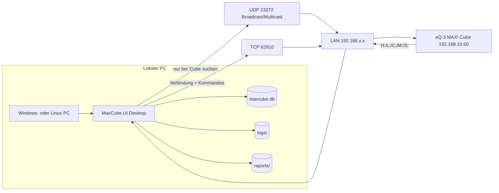

> English translation of docs/OPERATIONS.md. Machine-created; DE/EN reviewed by the user on 27.11.2026; FR/IT/NL/PL feedback expected via issues/PRs.

# Operations and infrastructure – MAX! Cube Local App

> As of 25.11.2026. The app is a **local desktop application**. Server, container, and Kubernetes concepts do not apply; where the brief asks about them, this is explicitly stated and replaced with the actual equivalent.

## 1. Infrastructure is "not present" – deliberately

| Category | Status | Replacement / evidence |
|---|---|---|
| Server | **not present** (no HTTP server, no Jetty) | `docs/features.md:83-87`, `src/MaxCube.UI.Desktop/Program.cs:9` |
| Container / Docker | **not present** (no Dockerfile seen in the inventory) | `OBSERVATION`; self-contained package directly on the host |
| Kubernetes / Helm | **not present** (no manifests seen) | `OBSERVATION`; no cluster needed |
| DNS | **not required** | cube addressed via IP/host:port; `CubeConnectionOptions.cs:10-13` |
| Certificates / TLS | **not present** | no HTTPS endpoints; local TCP/UDP protocol |
| Secrets management | **not present** | no credentials, no tokens, no product account (`docs/features.md:78-82`) |
| Proxy | **discarded** | only needed for cloud/update; cloud shut down (`docs/features.md:83`) |
| Cloud / remote access | **discarded** | user notice 25.11.2026, `FACT`, not externally verified (`docs/features.md:36`) |

**Open question:** Whether an internal distribution or MDM system exists outside this repository is `UNKNOWN`. This documentation describes only this repository.

## 2. Network topology



**FACT:** At startup there is no broadcast and no automatic cloud connection (`docs/features.md:41`, `Program.cs:26-29`). UDP network configuration (`c`/`C`) runs as unicast only after confirmation (`UdpNetworkConfigurator.cs:10-13`).

## 3. Deployment / installation

### 3.1 Variant A – source checkout + SDK (development)

Windows:

```powershell
cd C:\Users\ebenh\OneDrive\Coding\app-maxcube
.\start.cmd
```

Linux:

```bash
cd /pfad/zu/app-maxcube
bash start.sh
```

Both scripts build the solution incrementally and start `bin/Debug/net10.0/MaxCube.UI.Desktop.dll` (`start.cmd:34-43`, `start.sh:32-35`).

### 3.2 Variant B – published package (operations)

```bash
dotnet publish src/MaxCube.UI.Desktop/MaxCube.UI.Desktop.csproj -c Release -r linux-x64 --self-contained true -p:PublishSingleFile=false -o publish/linux-x64
chmod +x publish/linux-x64/MaxCube.UI.Desktop
publish/linux-x64/MaxCube.UI.Desktop --selfcheck
publish/linux-x64/MaxCube.UI.Desktop
```

On Windows use `-r win-x64` and `MaxCube.UI.Desktop.exe` accordingly. CI produces exactly these artifacts for `linux-x64` and `win-x64` and checks both with `--selfcheck` (`.github/workflows/ci.yml:39-65`).

**FACT:** `PublishSingleFile=false`; the package is a folder with DLLs and native libraries (`SkiaSharp`, `HarfBuzzSharp`, `libe_sqlite3`). No installer, no service, no registry dependency.

### 3.3 Data folder

| Platform | Default path | Override |
|---|---|---|
| Windows | `%LOCALAPPDATA%\MaxCube` | `MAXCUBE_DATA_DIR` |
| Linux | `$XDG_DATA_HOME/MaxCube` or `~/.local/share/MaxCube` | `MAXCUBE_DATA_DIR` |

Contains: `maxcube.db`, `logs/`, `reports/`, `maxcube.lock` (`AppPaths.cs:3-28`). The folder is created at startup (`App.axaml.cs:31`, `Program.cs:36`).

## 4. Start, stop, restart

| Action | Windows | Linux |
|---|---|---|
| Start | `.\start.cmd` or EXE from `publish/win-x64` | `bash start.sh` or binary from `publish/linux-x64` |
| Self-test | `dotnet ...\MaxCube.UI.Desktop.dll --selfcheck` | `.../MaxCube.UI.Desktop --selfcheck` |
| Stop | close window / tray → Exit | close window / tray → Exit |
| Restart | start again after stop; lock is released | identical |
| Forced | terminate process; `InstanceLock` released by OS | identical |

Shutdown is asynchronous: the tray is disposed, `ServiceProvider.DisposeAsync()` closes SQLite and sends `q:` via `CubeGateway`, then the lock is released (`App.axaml.cs:124-143`, `CubeGateway.cs:23-26`). A blocking `GetResult` in the UI thread is deliberately avoided (`App.axaml.cs:69-73`).

**FACT (0.6.5):** Both closing the window and tray → "Exit" go through `ShutdownRequested`: the tray entry calls `desktop.TryShutdown()` instead of the forced `desktop.Shutdown()` (`App.axaml.cs:91-95`). The service stops the reconnect loop before the gateway and unsubscribes from its gateway events; the gateway waits a bounded time for EOF after `q:` (as `DisconnectCubeCommand.java:15-19`) and closes the socket in every path (`CubeGateway.cs`). A hard process termination (Task Manager, crash) remains the only situation without `q:` – the cube then releases the session only after its own timeout.

## 5. Rollback

There is no installer and no backward database schema migration. Rollback means:

1. Quit the app completely (release lock/connection).
2. Restore the previous `publish/<rid>` directory or the previous DLLs.
3. Optionally restore the previous `maxcube.db` if settings/audit need to be restored. The next connect will then overwrite rooms/devices from the cube again.
4. Run `--selfcheck`.

**Caution:** `schema.version = 1` is always set at startup; an older app with an older schema would not understand the `week_profile` column. For downgrades, a tested copy of the DB is required (`SqliteStateStore.cs:97-115`).

## 6. Backup and recovery

| Data | Path | Backup time |
|---|---|---|
| Cache + settings + audit | `maxcube.db` | app stopped or quiet moment |
| Diagnostic logs | `logs/maxcube-JJJJMMTT.log` | daily / before update |
| Diagnostic reports | `reports/` | as needed |

**Recommendation:** Copy the entire data folder (`maxcube.db`, `logs/`, `reports/`), not just individual files. Recovery: stop app → restore backup → start + `--selfcheck`. The cube remains the source of truth; a connect automatically heals rooms/devices again (`SqliteStateStore.cs:236-255`).

## 7. Monitoring and alerting

| Mechanism | What it monitors | Limit |
|---|---|---|
| `--selfcheck` | paths, SQLite + native libs, instance protection, view model, six languages | no cube contact (`Program.cs:26-92`) |
| CI matrix | build, 554 tests, self-test, publish for Ubuntu/Windows | on push/PR/manual (`.github/workflows/ci.yml:3-7`) |
| `FileAppLog` | daily log file with retention | diagnostics, not a feature (`FileAppLog.cs:6-9`) |
| Audit log | technical events in SQLite with source tag | last 100 in UI, 500 via API, retention applied at startup (`SqliteStateStore.cs:166-219`) |
| `CubeSessionMonitor` | `L:` refresh/stale/reconnect at runtime | internal, no external notification |
| **Alerting** | **not present** | no mail/webhook dispatch; `UNKNOWN` whether anything is triggered externally |

**FACT:** The original's "Send error report" is replaced by a **local diagnostic report without transmission** (`CubeApplicationService.Admin.cs:922-959`, `MainWindowViewModel.Cube.cs:220-228`). No data is sent to eQ-3 or third parties.

## 8. Logging

- File: `logs/maxcube-JJJJMMTT.log` (local time), prefix `maxcube-`, suffix `.log` (`FileAppLog.cs:11-13,29-33`).
- Retention: configurable via the settings key `log.retentionDays`, default 30 (`MainWindowViewModel.Settings.cs:22,27`).
- Audit: `audit.retentionDays`, default 30, valid 1..365; old entries are deleted at startup (`MainWindowViewModel.Settings.cs:23,27,165-174`, `CubeApplicationService.Admin.cs:904-906`).
- Write errors in the log must never affect the app (`FileAppLog.cs:6-9`).
- Avalonia trace output: `LogToTrace()` (`Program.cs:23-24`).
- Log contents may include device names, serial numbers, and error texts; see [SECURITY.md](SECURITY.md).

## 9. Operational checks (summary)

```powershell
# Windows: after update/deployment
dotnet src/MaxCube.UI.Desktop/bin/Debug/net10.0/MaxCube.UI.Desktop.dll --selfcheck
dotnet test MaxCube.slnx --nologo
```

```bash
# Linux
publish/linux-x64/MaxCube.UI.Desktop --selfcheck
dotnet test MaxCube.slnx --nologo
```

Expected: `SELFCHECK OK: ... | SQLite ok`, exit code 0 (`Program.cs:89-92`). For exit codes 1/2/3/4 see [TROUBLESHOOTING.md](TROUBLESHOOTING.md).

## 10. Improvement suggestions

1. Sign release artefacts in addition; `SHA256SUMS.txt` is already generated and attached (`release.yml:91-105,134`), a signature remains open.
2. Extend `--selfcheck` with an optional hardware mode that **only** reads `l:`/`c:` and sends no write commands.
3. Provide the documented backup procedure as a script (`backup.cmd` / `backup.sh`).

**Implemented in 0.7.0:** audit retention and reconnect timestamps in the diagnostic report.

**Implemented in 0.8.0:** `SHA256SUMS.txt` in the release, per-tab room selection, free `Temporary` end time, drag-and-drop moving and confirmed wake-up.

## 11. Open questions

- Is there a distribution via MDM/WSUS/Intune in production? `UNKNOWN`.
- How are multiple cubes under one IP distinguished? The app stores one endpoint/serial; multi-cube operation is `UNKNOWN`.
- What retention applies to `reports/`? Currently no automatic rotation evidenced.
