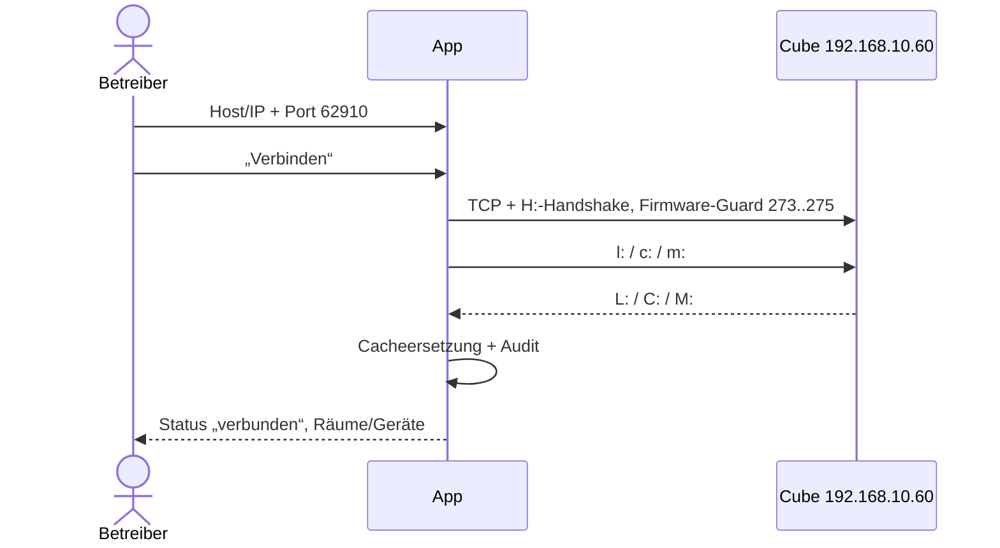
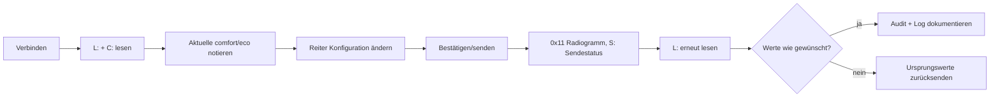

> English translation of docs/RUNBOOK.md. Machine-created; DE/EN reviewed by the user on 27.11.2026; FR/IT/NL/PL feedback expected via issues/PRs.

# Runbook – MAX! Cube Local App

> As of 25.11.2026. Executable procedures for operators and developers. There is **no server, no container, and no Kubernetes**; "deployment" means: program folder and local data folder on a Windows or Linux PC. All cube or network changes are made exclusively on user action. Evidence as `file:line`.

## 0. Ground rules

1. The cube is the **source of truth**; SQLite is cache, settings store, and audit (`SqliteStateStore.cs:8-13`).
2. Before changes to the cube: read current state, define target value, confirm action, then read back; if the change was unintended, resend the originally read value.
3. If unclear, mark `INFERENCE`/`UNKNOWN` and do not guess (`docs/INDEX.md:54-58`).
4. No cloud, remote access, proxy, HTTP update, or firmware write action (`docs/features.md:34-36`, `docs/gremium.md:11`).
5. No broadcast at startup; UDP 23272 only via "Search for cube" (`docs/features.md:41`).

## 1. Normal operation

### 1.1 Start

Windows:

```powershell
cd C:\Users\ebenh\OneDrive\Coding\app-maxcube
.\start.cmd
```

Linux:

```bash
cd /pfad/zu/app-maxcube
bash start.sh
```

Both scripts look for a .NET 10 SDK, build incrementally, and start the desktop DLL (`start.cmd:8-43`, `start.sh:8-35`). Without an SDK: start the published self-contained package from `publish/win-x64` or `publish/linux-x64` (`ci.yml:39-69`).

**Expected:** window with nine tabs; title/status show version `0.7.0` (`Directory.Build.props:3-5`, `AppVersionProvider.cs:13-24`).

### 1.2 Stop

1. Check the "Settings" tab: is `closeToTray` active? If so, use the tray icon → "Exit" (`App.axaml.cs:80-115`, `Settings.cs:48-53`).
2. Otherwise close the window.
3. Shutdown waits for asynchronous disposal: stop reconnect, close log/DB, send `q:`, briefly wait for EOF, release socket and lock (`App.axaml.cs:124-143`, `CubeApplicationService.DisposeAsync`, `CubeGateway.cs`).

**FACT (0.6.5):** Both paths – window and tray → "Exit" – trigger `ShutdownRequested`. Before 0.6.5, the tray entry called `desktop.Shutdown()`; this forced exit skipped cleanup, so no `q:` was sent and the cube held the only TCP session until its timeout (`App.axaml.cs:91-95`).

**Emergency:** terminate the process. The OS releases socket and lock file; however, no `q:` is sent, and the cube may block the session until its own timeout (`CubeGateway.cs:185-235`).

### 1.3 Establishing a connection



If the IP is unknown: "Connect" tab → **"Search for cube"**. Only there are three UDP requests (19 bytes `eQ3Max*\0**********I`, 50 ms apart) sent to broadcast `255.255.255.255` and multicast `224.0.0.1`, TTL 5, port 23272 (`CubeDiscoveryService.cs:15-28`, `UdpDiscoveryTransport.cs:16-60`). Select a hit → "Apply" sets port 62910.

**FACT:** There is no broadcast at app startup (`Program.cs:26-29`).

## 2. Maintenance

### 2.1 Backup

```powershell
# Windows: quit the app first
Copy-Item -Recurse "$env:LOCALAPPDATA\MaxCube" "C:\Backup\MaxCube-2026-11-25"
```

```bash
# Linux: quit the app first
cp -a "${XDG_DATA_HOME:-$HOME/.local/share}/MaxCube" /backup/MaxCube-2026-11-25
```

Contents: `maxcube.db`, `logs/`, `reports/`, `maxcube.lock` (`AppPaths.cs:20-28`). If `MAXCUBE_DATA_DIR` is set, use the corresponding path (`AppPaths.cs:10-18`).

### 2.2 Restore

1. Quit the app.
2. Copy the saved files back.
3. Run `--selfcheck` (expected exit 0).
4. Start the app and connect once; rooms/devices are overwritten from the cube, settings/audit remain from the backup (`SqliteStateStore.cs:236-255`).

### 2.3 Update / rollback

1. Backup according to 2.1.
2. Extract the new package into a **new** folder `publish/<rid>`; do not overwrite the old folder.
3. Run `--selfcheck` in the new folder.
4. Quit the old app, start the new one, connect briefly, and check a read-only view.
5. On error: quit the new app, use the old folder again; optionally restore the DB from the backup.

**Caution:** There is no backward schema migration; `schema.version = 1` is set at startup (`SqliteStateStore.cs:97-115`).

### 2.4 Log and audit care

- Log retention: Settings tab, `log.retentionDays`, default 30, valid 1..365 (`MainWindowViewModel.Settings.cs:22,27,88-95`, `FileAppLog.cs:45-75`).
- Audit: Settings tab, `audit.retentionDays`, default 30, valid 1..365; old rows are deleted at startup (`MainWindowViewModel.Settings.cs:23,27,95,165-174`, `SqliteStateStore.cs:186-202`). Back up before manual cleanup.
- Diagnostic report: "Cube" tab → "Export diagnostic report"; the file is stored under `reports/`, is **not** transmitted and now also lists connection, unreachable and reconnect timestamps (`CubeApplicationService.Admin.cs:922-959`, `MainWindowViewModel.Cube.cs:220-228`).

## 3. Sending changed configuration (comfort/eco)

This is the most critical process: `0x11` comfort/eco was hardware-validated on 25.11.2026 (`docs/HARDWARE-VERIFY.md`); the remaining fields and the technical meaning of `S:` remain derived. Therefore always read → change → send → **wait for radio adoption** → read back → reset if necessary.



1. "Rooms" tab: select a room with a valid master thermostat.
2. "Configuration" tab: the display comes from the read cube state; only these values are written back (`MainWindowViewModel.Admin.cs:288`, `CubeApplicationService.Admin.cs:78-108`).
3. Change comfort/eco; order in the radiogram: Comfort, Eco, Max, Min, Offset, WindowTemp, WindowDuration (`RoomCommands.cs:48-73`).
4. Trigger sending; the `S:` response is only a send status (`discarded='1'` → error, `CubeCommands.cs:238-257`). Technical acceptance is `UNKNOWN`.
5. **Wait at least 6 s** until the thermostat confirms radio adoption; an immediate read-back may still show the old value (`OBSERVATION`, `docs/HARDWARE-VERIFY.md` §4.2). Then use "Reload state" / reconnect and compare the values.
6. If they differ: resend the original values and note the event in audit/log.

**Never** do: send values that were not previously read from the cube; change several rooms at once without checking; write firmware.

## 4. Structural changes

Renaming, deleting, moving, ordering, grouping, and link partners change cube metadata.

- Before: "Reload state", note serial numbers/addresses.
- During: confirmation dialog; `RequireConfirmed` requires `true` (`CubeApplicationService.Admin.cs:945-951`).
- Metadata only if encoding the **unchanged** state reproduces the received bytes byte-for-byte (`CubeGateway.Admin.cs:99-103`).
- Mandatory order: mutate/validate draft → radio telegrams → metadata → real model + `ApplyAndPublishAsync` (`Admin.cs:643-689`).
- Afterwards: reconnect and spot-check rooms/devices and weekly schedules.

**INFERENCE:** deletion lock for the only radiator thermostat in a room with other devices (`Admin.cs:510-531`); no guarantee without a hardware test.

## 5. Network configuration (UDP)

1. Only with a connected cube and `ConfirmNetwork` checkbox checked (`MainWindowViewModel.Cube.cs:64-68,155-166`).
2. "Cube" tab → "Read network"; note current values.
3. Change fields; all five address fields must have four octets 0..255 (`CubeApplicationService.Admin.cs:792-824`).
4. Send; `UdpNetworkConfigurator` reads first, takes over the bytes after the DHCP flag, and sends unicast to the cube's IP, port 23272 (`UdpNetworkConfigurator.cs:31-41`, `CubeUdpCodec.cs:82-116`).
5. Afterwards disconnect/reconnect and read the network again.

**Risk:** Incorrect network values can make the cube unreachable. No firmware opcodes `B/U/W/R` (`CubeUdpCodec.cs:12`).

## 6. Hardware validation (targeted test)

Before a hardware test: write a protocol, note the time, cube IP, firmware, and affected room.

1. **Discovery:** trigger only via "Search for cube"; local UDP port must be 23272; expect broadcast/multicast in the capture; response must have signature `eQ3MaxAp` or `eQ3MaxBl` (`CubeDiscoveryService.cs:30-65`, `UdpDiscoveryTransport.cs:23`, `docs/HARDWARE-VERIFY.md` §3).
2. **Read-only comparison:** save `H:`, `L:`, `C:`, `M:`; note raw comfort/eco values.
3. **Write test:** change exactly one field, send, log `S:`, read again.
4. **Reset:** resend the original value and read again.
5. **Documentation:** record the result as `FACT`/`OBSERVATION` with date and evidence (capture/file:line) in [HARDWARE-VERIFY.md](HARDWARE-VERIFY.md) and, after approval, add it to SecondBrain; only lift an `INFERENCE` when hardware evidences it.

The real UDP response and `0x11` comfort/eco are `FACT` (25.11.2026, `docs/HARDWARE-VERIFY.md`); a technically evaluated `S:` acknowledgement remains `UNKNOWN` (`CubeApplicationService.cs:439`).

## 7. Emergencies

| Emergency | Immediate action | Afterwards |
|---|---|---|
| Cube stops responding | no further write commands; check IP/ping/TCP 62910 | read network values if possible; save backup and log |
| Wrong temperature sent | resend the value from the read original | document audit entry and log |
| Structure in disarray | no further metadata write actions | check cache/backup, reconnect cube, read back rooms/devices |
| Second instance blocking | quit app properly | check `maxcube.lock` and port 62910 |
| DB defective | quit app | restore backup; next connect heals rooms/devices |
| Update failed | start old `publish/` version | note `--selfcheck`, logs, version |

## 8. Linked documents

[README.md](../../README.md) · [ARCHITECTURE.md](ARCHITECTURE.md) · [DEVELOPMENT.md](DEVELOPMENT.md) · [API.md](API.md) · [DATABASE.md](DATABASE.md) · [OPERATIONS.md](OPERATIONS.md) · [SECURITY.md](SECURITY.md) · [TROUBLESHOOTING.md](TROUBLESHOOTING.md) · [SECOND_BRAIN.md](SECOND_BRAIN.md)

## 9. Open questions

- How does the cube behave technically for `S:` codes > 0? `UNKNOWN`.
- Is the network change permanent after a power outage? `UNKNOWN`.
- Are six languages detected correctly under Wayland? `UNKNOWN`.
