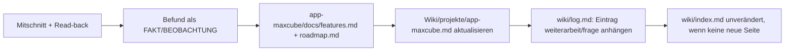

> English translation of docs/SECOND_BRAIN.md. Machine-created; DE/EN reviewed by the user on 27.11.2026; FR/IT/NL/PL feedback expected via issues/PRs.

# SecondBrain integration – MAX! Cube Local App

> As of 25.11.2026. This file is **not a wiki ingest**, but the developer/operator view of the personal knowledge wiki at `C:\Users\ebenh\OneDrive\Coding\SecondBrain`. It explains which findings are stored there, how they originated, and how hardware findings flow back. Markers and evidence as in [INDEX.md](INDEX.md).

## 1. Division of roles

| Location | Role | Rule | Evidence |
|---|---|---|---|
| `SecondBrain/raw/` | immutable raw sources (REA extracts, references) | never edit, never delete; new version = new file | `SecondBrain/CLAUDE.md:15-16,19` |
| `SecondBrain/wiki/` | maintained, linked knowledge wiki | maintained by the AI, not published | `SecondBrain/CLAUDE.md:3,16,115` |
| `app-maxcube/docs/` | reverse-engineering and operations documentation of the project | analyzed based on `extracted/`, `decompiled/`, `evidence/`; **do not copy code from it** | `docs/INDEX.md:128`, `docs/DEVELOPMENT.md` §6 |
| `app-maxcube/src/`, `tests/` | implementable code | may only be derived from specifications, not from decompiled Java | `docs/INDEX.md:4,128` |

**FACT:** In this work assignment, `SecondBrain/raw/` was not modified and the wiki was not overwritten. The feedback loop described here is a process, not an ingest already performed.

## 2. Wiki map (relevant to this project)

| Wiki page | Content | Why relevant here |
|---|---|---|
| `wiki/index.md` | catalog of all pages | entry point for any wiki question (`SecondBrain/CLAUDE.md:23`) |
| `wiki/log.md` | chronological, append-only log | every wiki change needs an entry (`SecondBrain/CLAUDE.md:24,105`) |
| `wiki/projekte/app-maxcube.md` | project status, council rounds, verification, open hardware items | central project page; historical status 442/442 and INFERENCE limits are there (`wiki/projekte/app-maxcube.md:28,48-52`) |
| `wiki/quellen/app-maxcube-java-rea-2026-11-24` | REA knowledge base from `raw/app-maxcube-rea/2026-11-24/` | basis of `docs/INDEX.md`, `docs/architecture-rea.md` |
| `wiki/quellen/app-maxcube-protokoll-referenzen` | Bouni spec, Python oracle, licenses | explains the strategy decision without AGPL (`docs/INDEX.md:28`) |
| `wiki/quellen/app-maxcube-ha-maxcube-erkenntnisse` | proven live rules from Home Assistant | 13 slots/day, 7+6 telegrams, mode encoding (`docs/INDEX.md:37-38`) |
| `wiki/fragen/2026-11-24-app-maxcube-bester-weg` | strategy and roadmap | decided: own C# protocol layer, no NuGet package |
| `wiki/fragen/2026-11-24-maxcube-remote-proxy-opcodes` | opcode family `B:/G:/J:/P:/O:/V:/W:` and `g:` | clarified as HTTP cloud proxy, deliberately excluded (`wiki/projekte/app-maxcube.md:56`) |
| `wiki/konzepte/max-cube-protokoll` | device-verified protocol knowledge | complements the wire documentation in [API.md](API.md) |
| `wiki/anleitungen/maxcube-0x10-mitschnitt` | capture guide for weekly schedules | direct precursor to the hardware test in [RUNBOOK.md](RUNBOOK.md) §6 |

**Note:** Wiki links in the wiki have the form `[[folder/filename]]` without `.md` and must **not** be enclosed in backticks, otherwise the Obsidian graph and lint will not work (`SecondBrain/CLAUDE.md:62`). This file deliberately uses path references instead of wiki links because it is located outside the wiki.

## 3. What the wiki already answers

1. **Why our own protocol layer?** No usable NuGet package; `MAXSharp` is AGPL v3 and frozen. Therefore Bouni as spec, Python `maxcube-api` as behavior oracle, Java REA as cross-check (`docs/INDEX.md:28`, `wiki/projekte/app-maxcube.md:73`).
2. **Why no cloud functions?** Cloud shut down since 01.07.2023; user notice 25.11.2026 (`FACT`, not externally verified) adds store removal. Remote access, product account, proxy, and app update remain discarded (`README.md:7`, `wiki/projekte/app-maxcube.md:50`).
3. **Why SQLite although the original had no DB?** The original only stores `~/.MAX/*.settings` via `java.util.Properties`; SQLite is a new development as cache, settings store, and audit. The cube remains the source of truth (`wiki/projekte/app-maxcube.md:18`, `docs/DATABASE.md` §2).
4. **Which port rule applies?** 62910 physical, 54321 virtual/local only, 63121 was the original's dynamic web UI port (`docs/INDEX.md:35,39`).
5. **How reliable are the tests?** 554/554 hardware-free cases on Windows 10 and Debian 13 (WSL2, 27.11.2026); breakdown Domain 64 / Application 90 / Protocol 200 / Infrastructure 69 / UI 131 (`docs/DEVELOPMENT.md` §3, `CHANGELOG.md`). The 442/442 and 519/519 statuses are historical.
6. **What is unresolved?** Real UDP response, technically evaluated `S:` acknowledgement, golden capture, hardware effect of the derived write formats, and Linux UI on a real desktop (`README.md:85-87`, `wiki/projekte/app-maxcube.md:52`).

## 4. Lessons learned

| Lesson | Consequence in code / documentation |
|---|---|
| Sonnet rounds 1–4 found real bugs (DataContext, endianness, `l:` offsets, UI thread, rounding, CanExecute, temporary local time) | All findings fixed and covered with regression tests; historical statuses 243/249/251/268/442/514/515/519 are obsolete, current is 554/554 (`wiki/projekte/app-maxcube.md:34-42,48`, `CHANGELOG.md`) |
| Council round 5 failed with `Free usage limit reached` | No model votes for round 5; implemented autonomously according to the binding decisions of rounds 1–4 and documented as such (`docs/gremium.md`, `wiki/projekte/app-maxcube.md:48`) |
| Naive `[Fact]`/`[Theory]` count was too low because of `[MemberData]` (historically 422 instead of 442) | One `[MemberData]` yields 21 rows; documentation points to the correction (`docs/DEVELOPMENT.md` §3) |
| `MAX10038` deviates from the pattern `MAX\d{4}` | Do not silently correct; regex accepts 4–5 digits (`ErrorCatalog.cs:54,97`, `docs/API.md` §4) |
| Original `architecture.md` and new developer documentation collided on case-insensitive NTFS | REA as-built documentation preserved as `docs/architecture-rea.md` (319 lines, coverage with `raw/.../architecture.md`), new documentation under `docs/ARCHITECTURE.md`; [INDEX.md](INDEX.md) updated |
| Broadcast at startup would be a privacy/network intrusion without user action | UDP only via "Search for cube"; `--selfcheck` sends nothing (`docs/features.md:41`, `Program.cs:26-29`) |

## 5. Feedback after hardware verification (192.168.10.60)

**FACT (25.11.2026):** The verification against the real cube has been performed. Auto-discovery was faulty with an ephemeral local UDP port and works after binding to port `23272` (`hits: 1`, `192.168.10.60`, serial number `JEQ0355273`, firmware `275`). Sending the default configuration `0x11` with comfort 22.0 °C / eco 17.0 °C was effective on the cube; the state was then reset to 21.5 °C / 16.5 °C and confirmed read-only. Details and captures: [HARDWARE-VERIFY.md](HARDWARE-VERIFY.md).

When real hardware findings are available, the order is:

- **FACT:** Every wiki change is recorded in the log; the log is never truncated (`SecondBrain/CLAUDE.md:24,105`).
- **FACT:** `UNKNOWN` must not serve as a basis for implementation without validation (`SecondBrain/CLAUDE.md:58`, `docs/INDEX.md:58`).
- Only evidenced hardware responses may lift an `INFERENCE`; the UDP response and `0x11` comfort/eco are now evidenced by [HARDWARE-VERIFY.md](HARDWARE-VERIFY.md), no longer merely suspected (`docs/RUNBOOK.md` §§3,6).
- No secrets in the wiki or logs: no credentials, tokens, or private keys; according to the user guideline, serial numbers are not considered sensitive (`SecondBrain/CLAUDE.md:109-114`).

## 6. What is deliberately **not** copied into the wiki

- No code from `decompiled/`; only specification and evidence (`docs/INDEX.md:128`).
- No large byte dumps or captures without technical evaluation; only condensed findings with path/evidence.
- No guesses as facts; contradictions are marked with date and both versions (`SecondBrain/CLAUDE.md:70`).
- No cloud/account/proxy details that are no longer relevant; the affected lines remain in `docs/features.md` as `discarded`.

## 7. Open questions

- Should the hardware finding become a new wiki page `wiki/fragen/2026-11-25-maxcube-hardware-check.md`, or is a section in `wiki/projekte/app-maxcube.md` sufficient? **User decision required.**
- Will the historical council and Sonnet logs be marked `status: outdated` after hardware validation is complete? For now they remain as history (`SecondBrain/CLAUDE.md:71`).
- How are captures versioned without modifying `raw/`? Currently no golden capture in the repo (`docs/DEVELOPMENT.md` §8).
