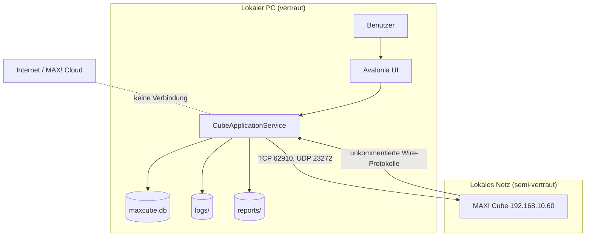

> English translation of docs/SECURITY.md. Machine-created; DE/EN reviewed by the user on 27.11.2026; FR/IT/NL/PL feedback expected via issues/PRs.

# Security – MAX! Cube Local App

> As of 25.11.2026. The app operates exclusively locally in a trusted network. There are no user accounts, no cloud login, and no secrets. Where protection is missing, it is named as such – not presented as a feature.

## 1. Trust boundaries

**FACT:** The cloud has been shut down since 01.07.2023; according to the user notice of 25.11.2026, the app was removed from the Android/iOS stores (`docs/features.md:34-36`). Therefore there is no remote access, product account, or proxy function that would need to store credentials.

## 2. Authentication

| Level | Mechanism | Assessment |
|---|---|---|
| App login | **none** | `FACT`: there is no login; anyone with local access to the PC can start the app. |
| Cube TCP | **none** | The MAX! protocol has no authentication; the cube accepts commands on TCP 62910 from the network. |
| UDP discovery | **none** | Anyone on the broadcast/multicast network can respond to the finder. Hits are displayed as `DiscoveredCube`; the serial number/IP comes from the datagram (`CubeDiscoveryService.cs`). |
| Cloud/portal | **not applicable** | deliberately discarded |

**Consequence:** Security lies in **network segmentation** and **user action**, not in a login. The app must not be exposed to an untrusted network with foreign devices.

## 3. Authorization and user action

| Protection | Implementation | Evidence |
|---|---|---|
| Instance protection | exclusive lock file, one TCP session to the cube | `InstanceLock.cs:5-10`, `App.axaml.cs:31-41` |
| Destructive structure actions | explicit confirmation per action; metadata only after byte-exact round trip | `README.md` old:34,77; `MainWindowViewModel.Admin.cs` |
| Network configuration | only with `ConfirmNetwork` checkbox; checkbox is reset afterwards | `MainWindowViewModel.Cube.cs:160-165` |
| Firmware write | **not implemented/disabled** | `docs/gremium.md:11`, `README.md` old:76 |
| Firmware update check | **no HTTP check** | `docs/features.md:77,86` |
| Broadcast at startup | **none**; only "Search for cube" | `docs/features.md:41`, `Program.cs:26-29` |
| Error report | local, **no transmission** | `CubeApplicationService.Admin.cs:915-947` |
| Send gate | `OperationGate` with 2 s acquisition and `CancelActive()` | `OperationGate.cs:3-16` |

**INFERENCE:** The confirmation dialogs are an operational barrier, not cryptographic authorization. A local process with access to the same data folder can still modify the SQLite settings.

## 4. Security measures in the code

- **No firmware opcode:** The UDP firmware frame is not evidenced and is not sent (`README.md` old:76,83).
- **Response validation:** `ResponseCommand<T>` accepts only the expected prefix; `r:` is treated as rejected, unknown prefixes as `UnknownCubeOpcodeException` (`CubeCommands.cs:21-64`). A foreign response cannot be mistaken for success.
- **Firmware guard:** only firmware 273–275 (`FirmwareSupport.cs:101-107`, `CubeConnectionOptions.cs:4-6`).
- **Metadata safety check:** `m:` blocks only after byte-exact round trip; block size 1900, no CR/LF inside the block (`CubeCommands.cs:90-126`).
- **Length/range checks:** e.g. 1..255 addresses for `t:`, 0..99 index for `m:`, 24 bytes time zone for `v:`, 66 bytes button configuration for `w:` (`CubeCommands.cs:103-125,286-340`).
- **Radiogram validation:** bit fields are checked against evidenced tables, e.g. boost only 0/5/10/15/20/25/30/60 min (`RoomCommands.cs:85-137`).
- **Airtime note:** `RadioStatusParser` treats `discarded == '1'` as a communication error (`CubeCommands.cs:238-257`).
- **No automatic write access:** session monitoring and reconnect read `L:` refreshes; write commands remain user actions (`CubeApplicationService.cs`).

## 5. Handling of secrets

| Location | Status |
|---|---|
| Source code / configuration | **no passwords, tokens, API keys, or product keys** evidenced |
| SQLite `settings` | only version, endpoint, serial number, UI options – no credentials (`DATABASE.md` §6) |
| Logs / reports | may contain names, serial numbers, temperatures, and error texts, but no login data |
| SecondBrain wiki | strictly no secrets; only locations, never values (`SecondBrain/CLAUDE.md:107-115`) |

**FACT:** The error codes `MAX1001`/`MAX1002` (AES key) and `MAX1046`/`MAX1047` (authorization/credentials) originate from the original catalog; the app does not implement these paths (`ErrorCatalog.cs:17-18,62-63`). `EncryptCommand`/`DecryptCommand` are protocol classes but are not wired as a cloud login in the local app path (`INFERENCE`; exact caller list open).

## 6. Privacy-relevant aspects

| Data | Stored in | Purpose | Recommendation |
|---|---|---|---|
| Cube serial number | `cubes.serial`, `settings.cube.serial`, logs, discovery display | identification/cache | according to Daniel's privacy guideline in SecondBrain not considered sensitive (`SecondBrain/CLAUDE.md:114`); still do not share unnecessarily |
| Radio addresses | `cubes.rf_address`, `devices.address`, radiograms | device addressing | treat as device IDs |
| Room/device names | `rooms.name`, `devices.name`, logs | operation | may contain personal hints (e.g. "bedroom") |
| Temperatures/time profiles | `rooms.*`, `week_profile` | heating control | may allow conclusions about presence |
| Audit messages | `audit_log` | diagnostics | stored without limit; check before sharing |
| IP address/endpoint | `settings.cube.endpoint` | reconnection | local in the data folder |

**FACT:** There is no transmission of this data to a manufacturer service; the diagnostic report is only displayed/optionally saved locally (`CubeApplicationService.Admin.cs:840-844`, `MainWindowViewModel.Cube.cs:168-181`).

## 7. Threat analysis (STRIDE)

| Threat | Scenario | Current protection | Residual risk / recommendation |
|---|---|---|---|
| **Spoofing** | foreign device responds on UDP 23272 or TCP 62910 | response prefix check, firmware guard | `HIGH`: no authenticated protocol; operate only in trusted LAN |
| **Tampering** | manipulated cache should overwrite cube state | cube source of truth, cache replaced on connect | `LOW` for technical data; settings/audit are locally editable |
| **Repudiation** | unclear who triggered a change | audit log per technical action | `MEDIUM`: audit has no user identity; only time + message |
| **Information Disclosure** | logs/DB/reports shared | no transmission, local files | `MEDIUM`: check file permissions and sharing |
| **Denial of Service** | second instance blocks TCP session | `InstanceLock` shows "already running" (`App.axaml.cs:32-40`) | `MEDIUM`: foreign process can block port 62910; then `UNKNOWN` |
| **Elevation of Privilege** | write commands without operator's knowledge | confirmations, gate, disabled firmware | `MEDIUM`: confirmed actions are deliberate; no roles/separation possible |
| **Supply Chain** | NuGet/Avalonia/SQLite updated | versions pinned, CI on Ubuntu/Windows | `LOW/MEDIUM`: no signature verification of artifacts documented |

## 8. Security checks for reviewers

1. `grep` the source for `http`, `https`, `Jetty`, `DWR`, `password`, `token`, `secret` – expected: no credential paths; only historical command classes via `u:`/`e:`/`d:` without app wiring.
2. Start app: no broadcast (packet capture), no listener on port 80/8080/63121.
3. "Search for cube": only here observe UDP 23272.
4. Configuration page: check confirmation dialog and audit entry.
5. Firmware tab: display only, no write button.
6. Export diagnostic report: open file, check for credentials – expected: none.

## 9. Improvement suggestions

1. Explicitly document data folder permissions (user access only; no network share).
2. Add source to audit messages ("user", "reconnect").
3. Offer an optional hardware test mode with read-only commands (no writes).
4. Sign artifacts and publish SHA-256.
5. Remove protocol classes `SetUrlCommand`, `SetIntervalCommand`, `EncryptCommand`, `DecryptCommand` from the public command path or mark them `[Obsolete("Cloud-only, nicht lokal verwendet")]` so nobody accidentally wires them up. `ResetGatewayCommand` remains deliberately wired: since 0.6.4 only via the maintenance page, with warning, separate factory-reset checkbox, preview, second confirmation, and audit entry (`CubeMaintenanceGateway`, `CubeApplicationService.FactoryResetCubeAsync`). No automatic call exists.

## 10. Open questions

- Is there password/access protection on the cube itself? `UNKNOWN` (the protocol has none).
- Are `u:`/`e:`/`d:`/`a:` used by a company outside this repo? `UNKNOWN`.
- How are file permissions set for the self-contained package and data folder in production? `UNKNOWN`.
