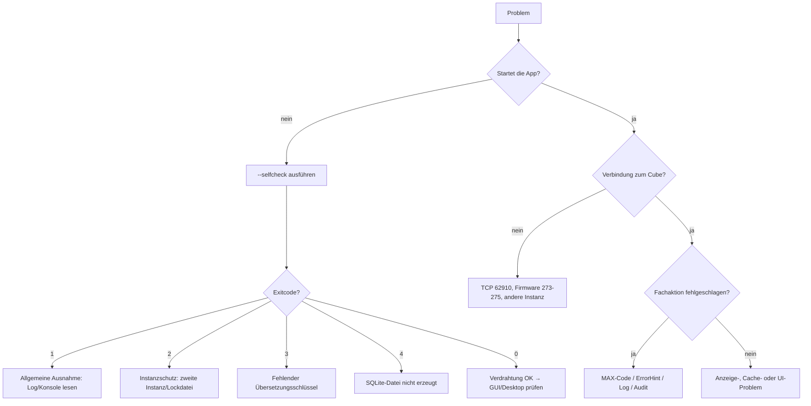

> English translation of docs/TROUBLESHOOTING.md. Machine-created; native-speaker review pending.

# Troubleshooting – MAX! Cube Local App

> As of 25.11.2026. Order: **visible message → likely cause → controlled diagnosis → action**. All actions that change the cube, its structure, or the network require a deliberate user action. Evidence as `file:line`.

## 1. Diagnostic path



**FACT:** The headless self-test builds paths, SQLite, gateway, service, view model, and localization and contacts **no** cube (`Program.cs:26-92`). It is therefore the first safe acceptance check after an update.

## 2. Self-test exit codes

| Exit code | Message | Meaning | Action | Evidence |
|---|---|---|---|---|
| 0 | `SELFCHECK OK: … | SQLite ok` | everything OK | continue with GUI/cube | `Program.cs:89-92` |
| 1 | `SELFCHECK FEHLER: <Ausnahme>` | unexpected exception during setup | check full text and `logs/maxcube-JJJJMMTT.log` | `:56-60` |
| 2 | `SELFCHECK FEHLER: Instanzschutz funktioniert nicht.` | lock file could not be opened exclusively | quit second instance, check `maxcube.lock` | `:36-43` |
| 3 | `SELFCHECK FEHLER: Text fehlt in <code>.` | translation key missing | fill `Strings.Table` for all languages | `:79-86`, `Localizer.cs:56-65` |
| 4 | `SELFCHECK OK … SQLite fehlt` | DB not created | check data folder/permissions/`MAXCUBE_DATA_DIR` | `:89-92` |

Commands:

```powershell
dotnet src/MaxCube.UI.Desktop/bin/Debug/net10.0/MaxCube.UI.Desktop.dll --selfcheck
```

```bash
publish/linux-x64/MaxCube.UI.Desktop --selfcheck
```

## 3. Startup and UI problems

| Symptom | Likely cause | Diagnosis | Action |
|---|---|---|---|
| "Another start already active" / `AlreadyRunningWindow` | lock file `maxcube.lock` or second instance | `InstanceLock` uses `FileShare.None`; second acquisition fails (`InstanceLock.cs:19-49`, `App.axaml.cs:31-41`) | quit other instance properly; after a crashed process with orphaned lock, delete the file |
| Window stays empty | `DataContext`/`CanExecuteChanged` missing (historical findings K1/H-A) | check tabs and buttons; run view model tests (`SecondBrain/wiki/projekte/app-maxcube.md:34-36`) | check `DataContext` and `NotifyCanExecuteChanged()` after state changes |
| Language change does not update old texts | `PropertyChanged("Item[]")` missing | check `Localizer.SetLanguage` (`Localizer.cs:43-54`) | use indexer binding `{Binding Loc[Schlüssel]}` |
| Text appears as `!Schlüssel!` | unknown key | `--selfcheck` exit 3 | add key to `Strings.Table` for all six languages |
| Tray icon missing (Linux) | desktop has no tray support | `App.axaml.cs:116-121` catches the error and continues | keep using the window or disable `ui.closeToTray`; `UNKNOWN` on real desktops |
| "Close" does not exit | `ui.closeToTray = 1` | check Settings tab (`Settings.cs:48-53`, `App.axaml.cs:53-60`) | remove checkbox or use tray "Exit" |
| Linux starts without UI | no X11/Wayland, `libSkiaSharp`/HarfBuzz missing | `start.sh:3-4`, `Program.cs:23-24` | check desktop session and self-contained package directory; `--selfcheck` separates wiring from GUI |

**UNKNOWN:** Tray and window on a real X11/Wayland desktop were not visually checked (`README.md`, limits table; `ARCHITECTURE.md` R-03).

## 4. Connection problems

| Symptom | Cause | Evidence | Action |
|---|---|---|---|
| Connect timeout 30 s | wrong host/port, cube off, firewall | `CubeConnectionOptions.cs:15-20`, `TcpCubeTransport.cs:23-60` | check IP; port **62910** for physical cube (54321 only virtual); quit other clients. Since 0.6.6 the cause is localized in the dialog, raw text only in the log. |
| `NoIncomingHelloException` / `MalformedHelloException` | first line is not a valid `H:` | `HelloParser.cs:13-47` | restart cube; disconnect other program on port 62910; check capture |
| `IncompatibleFirmwareException` | firmware outside 273–275 | `FirmwareGuard.cs:12-20`, `ErrorCatalog.cs:101-107` | firmware is `UNKNOWN`/unsupported; **no** firmware write |
| `StateReceiveTimeout`/`CubeCommunicationFailedException` before `L:` | `C:`/`M:` incomplete or too slow | `StateReceiver.cs:23-71` | disconnect and reconnect; check log/capture |
| `CubeTransportException: Create a new transport to reconnect.` | faulty transport reused | `TcpCubeTransport.cs:25-28,184-189` | disconnect and reconnect the app; no code workaround |
| Status "stale" / reconnect | `l:` refresh failed three times or no activity for 6 h | `CubeGateway.cs:278-334`, `CubeApplicationService.cs:111-185` | check cube/ping; reconnect runs at 1→2→4…30 s; disconnect/connect manually if needed |
| `q:` missing on exit / cube unreachable afterwards | Before 0.6.5: tray → "Exit" used forced shutdown; also gate timeout or process kill | `App.axaml.cs:91-95`, `CubeGateway.cs:185-235,448-466` | 0.6.5 uses `TryShutdown()`; on a hard process termination only wait for the cube timeout, no retry against the cube |
| Search finds no cube | local UDP port not 23272 (**FACT**, hardware 25.11.2026), broadcast/multicast blocked, or wrong subnet | `UdpDiscoveryTransport.cs:23`, `docs/HARDWARE-VERIFY.md` §3 | enter IP manually; check binding port correction; run "Search for cube" again |
| Bootloader warning "firmware actions disabled" | response signature `eQ3MaxBl` | `CubeDiscoveryService.cs:45-49`, `Strings.cs:249` | normal case; do not start a firmware action |

**Important:** The app sends **no** broadcast at startup. If a capture shows a broadcast without clicking "Search for cube", it does not come from this app (`Program.cs:26-29`).

## 5. Technical errors and MAX codes

The UI shows `ErrorMessage` and an `ErrorHint` derived from `ErrorCatalog.Describe` (`MainWindowViewModel.cs:1208-1229`, `MainWindowViewModel.Admin.cs:149-169`). The descriptions are interpretations of the symbol names, **not** manufacturer messages (`ErrorCatalog.cs:5-9`).

| Code / message | Meaning per catalog | Typical trigger in the app | Action |
|---|---|---|---|
| `MAX1008` | communication with cube failed | `r:`, `S:` with `discarded`, EOF | re-establish connection; check radio utilization |
| `MAX1009` | cube in learning mode | command during `n:`/`N:` | end learning mode with `x:` or wait; `CubeCommandQueue.cs:188-198` |
| `MAX1022` | invalid/unknown radio address | wall thermostat/action on wrong device | check device in Devices tab |
| `MAX1029`/`MAX1030` | no name / name too long | renaming/learning | use 1..32 characters |
| `MAX1032` | not connected | write on offline cache | connect first; cache is read-only (`CubeApplicationService.cs:528-534`) |
| `MAX1034`/`MAX1035` | radio address format | check hexadecimal 24-bit address | `RadioAddress.cs:10-11,26,40,45` |
| `MAX1040`/`MAX1041` | serial number length/pattern | invalid discovery/header serial | `MAX1041` regex is `UNKNOWN` (`SerialNumber.cs:9-10`) |
| `MAX1050` | validation | temperature, boost, descaling, network fields | check values as documented; e.g. boost only 0/5/10/15/20/25/30/60 min |
| `MAX10038` | remote access service unavailable | **not wired locally**, catalog entry only | do not "correct"; regex accepts 4–5 digits (`ErrorCatalog.cs:54,97`) |

Protocol exceptions (`CubeCommunicationFailedException`, `UnknownCubeOpcodeException`, `CubeCommandRejectedException`, `IncompatibleFirmwareException`, `MalformedMetadataException`, `LineTooLongException`) carry **no** MAX codes (`CubeProtocolExceptions.cs:3-69`, `CubeCommandExceptions.cs:1-31`). Their text still appears in the error dialog and in `logs/`.

## 6. Write actions

| Symptom | Cause | Action |
|---|---|---|
| "partially sent only" message for weekly schedule | 8..13 points require two `0x10` telegrams; second failed | read `CubeApplicationService.cs:447-463` audit, resend; technical acceptance `UNKNOWN` |
| Configuration not adopted | Only values read from the cube may be sent back (`RoomConfigurationValues`) | "Reload state", then resend; `CubeApplicationService.Admin.cs:78-108` |
| `0x12`/`0x20`–`0x23`/`m:`/`w:`/`v:`/UDP ineffective | Format is `INFERENCE`, not hardware-validated | create capture, compare raw values; do not send blindly multiple times (`ARCHITECTURE.md` R-01) |
| Structure action rejected | `confirmed == false` or metadata round trip not byte-identical | confirm again; `CubeGateway.Admin.cs:99-103`, `CubeApplicationService.Admin.cs:945-951` |
| Send "Command discarded" | `S:` response with `discarded='1'` | check radio load/airtime; retry later (`CubeCommands.cs:250-254`) |
| Configuration change visible in cube only at next transmission | radio adoption by thermostat not yet complete | wait 6 s, read again; do not assume failure (`docs/HARDWARE-VERIFY.md` §4.2) |
| Bundled temperature delayed | `ui.bundleTemperatures` collects for 3 s | disable setting or wait for `FlushPendingTemperaturesAsync` (`Admin.cs:272-343`, `ARCHITECTURE.md` R-04) |

**FACT:** After a successful cube command, a local cache write error can only produce a warning; the cube success remains intact (`CubeApplicationService.cs:648`). Conversely, an offline cache must never flow back to the cube (`:265-280,528-534`).

## 7. Logs, audit, report

| Artifact | Path | Content / limit |
|---|---|---|
| Daily log | `<data folder>/logs/maxcube-JJJJMMTT.log` | timestamp, level, message; `InvariantCulture`; IO errors swallowed (`FileAppLog.cs:6-9,25-43`) |
| Audit | `<data folder>/maxcube.db`, table `audit_log` | last 500 via `ReadAuditAsync`, UI shows 100; no rotation (`SqliteStateStore.cs:183-191`) |
| Diagnostic report | `<data folder>/reports/maxcube-diagnose-*.txt` | OS/.NET, cube, rooms, radio, last 50 audit rows; **local, no transmission** (`CubeApplicationService.Admin.cs:840-876`) |
| Data folder | `%LOCALAPPDATA%\MaxCube` / `$XDG_DATA_HOME/MaxCube` | override `MAXCUBE_DATA_DIR` (`AppPaths.cs:10-28`) |

Logs may contain device names, serial numbers, temperatures, and error texts; no credentials (`SECURITY.md` §5). Check before sharing.

**FACT:** The diagnostic report is the replacement for the original's "Send error report". There is no HTTP/mail transmission (`CubeApplicationService.Admin.cs:840-844`, `docs/features.md:83-87`).

## 8. Database problems

| Symptom | Diagnosis | Action |
|---|---|---|
| `SQLite fehlt` in self-test | path/permissions/`MAXCUBE_DATA_DIR` | check data folder; quit app and restart |
| Offline display empty | no `cube.serial` or no snapshot | connect once; cache then filled (`CubeApplicationService.cs:282,265-303`) |
| Rooms/devices outdated | cache replaced only on connect | reconnect or "Reload state" (`SqliteStateStore.cs:236-255`) |
| `week_profile` column missing | old DB before migration | app starts additive migration via `pragma_table_info` (`SqliteStateStore.cs:97-106`) |
| DB grows due to audit | unlimited `audit_log` table | quit app, delete old rows; rotation is an improvement suggestion (`DATABASE.md` §9) |

**Caution:** There is no backward migration. Back up the DB before downgrades (`SqliteStateStore.cs:108-115`, `OPERATIONS.md` §5).

## 9. If nothing helps

1. Quit the app completely (tray "Exit", not just closing the window if `ui.closeToTray = 1`).
2. Run `--selfcheck` and note exit code + text.
3. Review the latest daily log, latest audit excerpt, and diagnostic report locally.
4. Note version and OS (`Directory.Build.props:3`, window title/status).
5. If hardware is suspected, create a packet capture of TCP 62910 and – only after clicking "Search for cube" – UDP 23272; send no foreign write commands.
6. Document the problem with evidence; do not present a guess as `FACT` (`docs/INDEX.md:54-58`).

## 10. Open questions

- Real UDP response and `0x11` comfort/eco are `FACT` (`docs/HARDWARE-VERIFY.md`); the technically evaluated `S:` acknowledgement remains `UNKNOWN`. Many of the write symptoms listed here can only be assessed definitively after a golden capture.
- `MAX10038` is an evidenced outlier; whether an external component nevertheless expects exactly four digits is `UNKNOWN`.
- Tray/window behavior under a real Wayland desktop is `UNKNOWN`.
