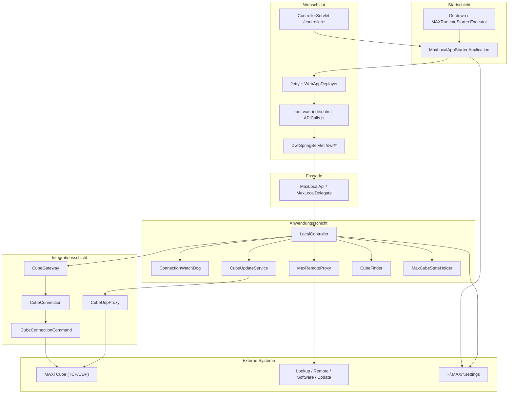

> English translation of docs/architecture-rea.md. Machine-created; DE/EN reviewed by the user on 27.11.2026; FR/IT/NL/PL feedback expected via issues/PRs.

# Architecture of MAX Local Application 1.4.6

## 1. Purpose of this document

This document describes the technical architecture of the shipped MAX Local Application 1.4.6 as a basis for a reimplementation. It is not a recommendation for a 1:1 port, but an inventory with a clear separation of observation, inference, and the unknown. (Source: `decompiled/controller/resources/META-INF/maven/de.eq3.max/MaxControllerApplication/pom.xml:1-8`, version 1.4.6; source: `extracted/settings/Default.settings:1-9`)

All statements are evidenced with `source file:line` or an evidence ID. The evidence IDs used are listed in section 2. (Source: `evidence/maxlocalapp-evidence.json:1`, `evidence/controller-evidence.json:1`)

**Reading rules:** `OBSERVATION` = directly visible in the artifact. `INFERENCE` = derived from observations, not directly evidenced. `UNKNOWN` = cannot be decided with the available sources. (Source: `extracted/rootwar/WEB-INF/web.xml:1-68`, `decompiled/controller/sources/de/eq3/max/al/local/LocalController.java:1-924`)

## 2. Evidence basis

| Artifact | Evidence ID | Role for this document |
|---|---|---|
| `MaxLocalApp.jar` | `ev_0a83b0f4dfeaa8dc02b4b7e5168c4e25586ca4f78ee9bb199f263cf7971f0f67` | Desktop shell, Jetty startup, tray, proxy (source: evidence ID `ev_0a83b0f4dfeaa8dc02b4b7e5168c4e25586ca4f78ee9bb199f263cf7971f0f67`) |
| `MaxEssentialsBackend-1.4.6.jar` | `ev_cd71f066e83568d1ab3c71c8f78b5ea143ceb6dcf3b32ee7b5329970380de677` | Domain, DTOs, state, validation, Dozer mapping (source: evidence ID `ev_cd71f066e83568d1ab3c71c8f78b5ea143ceb6dcf3b32ee7b5329970380de677`) |
| `MaxLocalBackend-1.4.6.jar` | `ev_b01b22f5d2b54d783aa1cb8dbe567111e03a6fe5029e1641318be232168a43a7` | Local services, gateway, remote proxy, update (source: evidence ID `ev_b01b22f5d2b54d783aa1cb8dbe567111e03a6fe5029e1641318be232168a43a7`) |
| `MaxSettings.jar` | `ev_31f2c19749714a95e3e7fb36dfc7552969f422676dd7ea8282172d359855089f` | Default settings and `firmware.enc` (source: evidence ID `ev_31f2c19749714a95e3e7fb36dfc7552969f422676dd7ea8282172d359855089f`) |
| `root.war` | `ev_198593f77a5b718fcd92173c539c0b5f7d78752738b9e66ae993003f805d2e67` | Web app, servlets, JavaScript, DWR configuration (source: evidence ID `ev_198593f77a5b718fcd92173c539c0b5f7d78752738b9e66ae993003f805d2e67`) |
| `MaxControllerApplication.jar` | `ev_42e4885a961f14d51aae2e5f880199599ca787a822b9dc66cd85ce2d46a9c91a` | Decompiled controller/backend classes and exit/alive client (source: evidence ID `ev_42e4885a961f14d51aae2e5f880199599ca787a822b9dc66cd85ce2d46a9c91a`) |
| Bootstrapper/installation traces | `ev_81a48cb5c63ace439b913812ff1d104c79c9a1179387732f5682a5545799e809` | `getdown.txt`, `start.cmd`, `MAXRuntimeStarter.jar`, `Executor`, `Updater` (source: evidence ID `ev_81a48cb5c63ace439b913812ff1d104c79c9a1179387732f5682a5545799e809`) |

**OBSERVATION:** The decompiled sources are present in four subtrees: `maxlocalapp` (29 Java files), `essentials` (232), `localbackend` (109), and `controller` (110). (Source: `decompiled/` directory inventory, counted with `Get-ChildItem -Recurse -Filter *.java`; evidence IDs as in the table above)

**OBSERVATION:** The subtrees `decompiled/controller/sources` and `decompiled/localbackend/sources` largely contain the same `de.eq3.max.*` classes; `controller` additionally contains `de/eq3/max/MaxControllerApplication/App.java`. (Source: `decompiled/controller/sources/de/eq3/max/MaxControllerApplication/App.java:1-13`, `decompiled/localbackend/sources/de/eq3/max/al/local/LocalController.java:1-10`)

**INFERENCE:** For the architecture description, `controller` should be used as the canonical view of the backend classes because it contains the complete class tree including the entry point. (Source: `decompiled/controller/sources/de/eq3/max/MaxControllerApplication/App.java:12-13`, `decompiled/controller/sources/de/eq3/max/al/local/LocalController.java:74-75`)

## 3. System overview

**OBSERVATION:** The application runs as a local desktop application with an embedded Jetty server and a web frontend displayed in the browser. (Source: `decompiled/maxlocalapp/sources/de/eq3/max/MaxLocalAppStarter/Application.java:43-47`, `decompiled/maxlocalapp/sources/de/eq3/max/MaxLocalAppStarter/Application.java:190-220`, `extracted/rootwar/index.html:1-20`)

**OBSERVATION:** The browser does not communicate directly with the cube, but via DWR calls to the locally shipped web app. (Source: `extracted/rootwar/js/lib/APICalls.js:905-919`, `extracted/rootwar/WEB-INF/web.xml:40-51`)

**OBSERVATION:** The cube is addressed over a TCP connection; discovery additionally uses UDP/multicast on port 23272. (Source: `decompiled/controller/sources/de/eq3/max/il/local/CubeConnection.java:44-60`, `decompiled/controller/sources/de/eq3/max/al/local/finder/CubeFinder.java:21-28`)

**OBSERVATION:** External HTTP services are used for lookup, remote proxy, software version, and firmware update. (Source: `extracted/settings/Default.settings:1`, `extracted/settings/Default.settings:7`, `extracted/settings/Default.settings:9`, `decompiled/controller/sources/de/eq3/max/al/local/remoteproxy/MaxRemoteProxy.java:271-298`)

### 3.1 Layer model (Mermaid)



**EVIDENCE FOR THE DIAGRAM:** Startup chain and Jetty startup (source: `evidence/javap-starter.txt:797-805`, `decompiled/maxlocalapp/sources/de/eq3/max/MaxLocalAppStarter/Application.java:190-220`), web mappings (source: `extracted/rootwar/WEB-INF/web.xml:9-62`), facade (source: `extracted/localbackend/LocalApp-cl.xml:8-60`, `decompiled/controller/sources/de/eq3/max/al/local/MaxLocalApi.java:34-41`), services (source: `decompiled/controller/sources/de/eq3/max/al/local/LocalController.java:75-124`), integration (source: `decompiled/controller/sources/de/eq3/max/il/local/CubeGateway.java:41-58`, `decompiled/controller/sources/de/eq3/max/il/local/CubeConnection.java:24-37`), file storage (source: `decompiled/controller/sources/de/eq3/max/al/local/core/settings/SettingsProvider.java:69-75`).

### 3.2 Layer model (ASCII)

```text
+-------------------------------------------------------------------+
| Browser (index.html, APICalls.js, DWR-Engine)                     |
+---------------------------+---------------------------------------+
                            | HTTP / JSON-artige DWR-Payloads
+---------------------------v---------------------------------------+
| Jetty 6.1.26 + root.war                                          |
|   /dwr/*          -> DwrSpringServlet                            |
|   /controller/*   -> ControllerServlet (Exit / Alive)            |
|   /*.html         -> DispatcherServlet                           |
+---------------------------+---------------------------------------+
                            | Java-Aufrufe (IMaxLocal)
+---------------------------v---------------------------------------+
| MaxLocalApi + MaxLocalDelegate + Dozer-Mapper                     |
+---------------------------+---------------------------------------+
                            | ICommunicationService
+---------------------------v---------------------------------------+
| LocalController + MaxCubeStateHolder + WatchDog + RemoteProxy     |
|                + CubeUpdateService + CubeFinder                   |
+---------------------------+---------------------------------------+
                            | ICubeGateway
+---------------------------v---------------------------------------+
| CubeGateway -> CubeConnection -> ICubeConnectionCommand           |
| CubeUdpProxy (Bootloader/Firmware)                                |
+---------------------------+---------------------------------------+
                            | TCP 1.4.6-Port / UDP 23272
+---------------------------v---------------------------------------+
| MAX! Cube                                                        |
+-------------------------------------------------------------------+
```

**EVIDENCE FOR THE ASCII MODEL:** Servlet mappings (source: `extracted/rootwar/WEB-INF/web.xml:9-62`), HTTP/JS layer (source: `extracted/rootwar/js/lib/APICalls.js:905-919`), facade (source: `decompiled/controller/sources/de/eq3/max/al/local/MaxLocalApi.java:34-41`), service (source: `decompiled/controller/sources/de/eq3/max/al/local/LocalController.java:75-124`), gateway and connection (source: `decompiled/controller/sources/de/eq3/max/il/local/CubeGateway.java:41-58`, `decompiled/controller/sources/de/eq3/max/il/local/CubeConnection.java:44-60`), UDP port (source: `decompiled/controller/sources/de/eq3/max/al/local/update/CubeUdpProxy.java:23-31`).

## 4. Startup and lifecycle

**OBSERVATION:** The bootstrapper `de.eq3.max.runtime.Executor` is started from `startme*.cmd` and has a `main` method that calls `run()`. (Source: `C:\Program Files (x86)\Max Local Application\startme.cmd:1-3`, `evidence/javap-starter.txt:797-805`; evidence ID `ev_81a48cb5c63ace439b913812ff1d104c79c9a1179387732f5682a5545799e809`)

**OBSERVATION:** `Executor.run()` checks `version.txt` and `digest.txt`, writes a `start.cmd`, and then starts `de.eq3.max.MaxLocalAppStarter.Application` with `javaw -splash:max.png -cp ...`. (Source: `evidence/javap-starter.txt:244-302`, `evidence/javap-starter.txt:570-580`, `C:\ProgramData\MAX\start.cmd:1-5`; evidence ID `ev_81a48cb5c63ace439b913812ff1d104c79c9a1179387732f5682a5545799e809`)

**OBSERVATION:** `MaxLocalAppStarter.Application` is an `Observable` and implements `FileChangeListener`. (Source: `decompiled/maxlocalapp/sources/de/eq3/max/MaxLocalAppStarter/Application.java:43`)

**OBSERVATION:** `main()` sets the Nimbus look and feel, uses `InstanceLock` to check whether an instance is already running, and calls `app.run()`. (Source: `decompiled/maxlocalapp/sources/de/eq3/max/MaxLocalAppStarter/Application.java:51-64`)

**OBSERVATION:** `run()` registers a `FileMonitor` on `~/.MAX/max.settings` with a 5000 ms interval, sets the locale, creates a `MaxThread` as a shutdown hook, and initializes the server settings. (Source: `decompiled/maxlocalapp/sources/de/eq3/max/MaxLocalAppStarter/Application.java:66-74`)

**OBSERVATION:** `ApplicationRunningChecker.checkRunningApplication(...)` detects an already running application and in that case opens the local URL in the browser. (Source: `decompiled/maxlocalapp/sources/de/eq3/max/MaxLocalAppStarter/Application.java:75-79`)

**OBSERVATION:** The port is read via `SettingsProvider.getServerSettings()`; if needed, `PortFactory` chooses a free port and saves it via `SettingsProvider.saveSettings(...)`. (Source: `decompiled/maxlocalapp/sources/de/eq3/max/MaxLocalAppStarter/Application.java:137-162`)

**OBSERVATION:** The system tray is attached to the application as an observer via `MaxSystemTrayHandler`. (Source: `decompiled/maxlocalapp/sources/de/eq3/max/MaxLocalAppStarter/Application.java:176-180`)

**OBSERVATION:** `startServer()` creates `org.mortbay.jetty.Server`, a `WebAppDeployer` for `<parent>/webapp`, sets `setExtract(true)` and `setParentLoaderPriority(false)`, and starts the server and deployer. (Source: `decompiled/maxlocalapp/sources/de/eq3/max/MaxLocalAppStarter/Application.java:190-217`)

**OBSERVATION:** After server startup, `Desktop.getDesktop().browse(new URI(getLocalServerAddress()))` is called; `getLocalServerAddress()` returns `http://localhost:<port>`. (Source: `decompiled/maxlocalapp/sources/de/eq3/max/MaxLocalAppStarter/Application.java:220`, `decompiled/maxlocalapp/sources/de/eq3/max/MaxLocalAppStarter/Application.java:275-276`)

**OBSERVATION:** Proxy settings are set as the system properties `http.proxySet`, `http.proxyHost`, and `http.proxyPort`. (Source: `decompiled/maxlocalapp/sources/de/eq3/max/MaxLocalAppStarter/Application.java:262-264`)

**OBSERVATION:** The HTTP interface `/controller/*` accepts POST with `Exit` or `Alive`; `Exit` calls `System.exit(0)`, `Alive` answers with `Application running`. (Source: `decompiled/controller/sources/de/eq3/max/cl/local/controller/ControllerServlet.java:26-43`)

**OBSERVATION:** `de.eq3.max.MaxControllerApplication.App` is a small HTTP client that sends `Exit` or `Alive` to `http://localhost:<port>/controller`; the port comes from `SettingsProvider.getServerSettings().getPort()` with fallback 8080. (Source: `decompiled/controller/sources/de/eq3/max/MaxControllerApplication/App.java:20-61`)

**INFERENCE:** There are two separate entry points: the long-running desktop process (`Application`) and the short-lived command-line client (`App`) for alive-check and shutdown tasks. (Source: `decompiled/maxlocalapp/sources/de/eq3/max/MaxLocalAppStarter/Application.java:51-64`, `decompiled/controller/sources/de/eq3/max/MaxControllerApplication/App.java:20-61`)

## 5. Web and configuration layer

**OBSERVATION:** `web.xml` declares the `ContextLoaderListener`, the `Log4jConfigListener`, the `DispatcherServlet` on `/*.html`, the `DwrSpringServlet` on `/dwr/*`, and the `ControllerServlet` on `/controller/*`. (Source: `extracted/rootwar/WEB-INF/web.xml:9-62`)

**OBSERVATION:** The DWR servlet is configured with `debug=true`. (Source: `extracted/rootwar/WEB-INF/web.xml:40-51`, `extracted/essentials/max-dwr.xml:75`)

**OBSERVATION:** The HTTP session has a timeout of 5 minutes. (Source: `extracted/rootwar/WEB-INF/web.xml:67`)

**OBSERVATION:** `max-service.xml` loads `classpath:max.properties,classpath:max.local.properties` as property placeholders, activates `context:component-scan` for `de.eq3.max`, and imports `essentials.spring.xml`, `max-dwr.xml`, `LocalApp-cl.xml`, and `LocalApp-al.xml`. (Source: `extracted/rootwar/WEB-INF/max-service.xml:15-25`)

**OBSERVATION:** `max-servlet.xml` contains only the empty `<beans>` frame with the DWR namespace and no further bean definitions. (Source: `extracted/rootwar/WEB-INF/max-servlet.xml:1-7`)

**OBSERVATION:** `essentials.spring.xml` creates an `org.dozer.DozerBeanMapper`, a `ClientExceptionTranslator` with `errorcodes.properties`, and a `ResetRadiogramBuilder` containing a `TransmissionRadiogramBuilder`. (Source: `extracted/essentials/essentials.spring.xml:12-27`)

**OBSERVATION:** `LocalApp-al.xml` schedules `connectionWatchDog.checkConnection` and `cubeGateway.idleCall` with `fixed-delay="5000"` in a scheduler with `pool-size="1"`. (Source: `extracted/localbackend/LocalApp-al.xml:10-15`)

**OBSERVATION:** `LocalApp-cl.xml` defines the `MaxLocalApi` bean and a `MaxLocalDelegate` as a DWR delegate; the comment mentions DWR error DWR-161. (Source: `extracted/localbackend/LocalApp-cl.xml:8-17`)

**OBSERVATION:** Via `dwr:remote javascript="MaxLocalApi"`, among others `getMaxCubeState`, `setClientCommands`, `connect`, `disconnect`, `listAvailableMaxCubes`, `performFirmwareUpdate`, `checkFirmwareUpdateStatus`, `setRemoteCredentials`, and `getLocale` are exposed. (Source: `extracted/localbackend/LocalApp-cl.xml:16-60`)

**OBSERVATION:** `max-dwr.xml` registers DWR conversions for DTOs such as `MaxCubeState`, `MaxHouse`, `MaxRoom`, `MaxDevice`, `MaxDeviceState`, `UpdateStatus`, `NetworkConfiguration`, and for a variety of `ClientCommand` subtypes. (Source: `extracted/essentials/max-dwr.xml:14-73`)

**OBSERVATION:** The JavaScript layer calls `MaxLocalApi.*` in local mode and `MaxRemoteApi.*` in non-local mode. (Source: `extracted/rootwar/js/lib/APICalls.js:51-52`, `extracted/rootwar/js/lib/APICalls.js:905-921`)

**OBSERVATION:** `APICalls.prototype.timeout` is 120000 ms. (Source: `extracted/rootwar/js/lib/APICalls.js:21-22`)

**OBSERVATION:** The DWR engine is customized in `engine.js` by overriding `dwr.engine._serializeAll`. (Source: `extracted/rootwar/js/lib/engine.js:1-15`)

**OBSERVATION:** Keep-alive is triggered cyclically in the browser with `window.setTimeout` and `alivePingTime: 3000` ms. (Source: `extracted/rootwar/js/com_structure/controllers/indexStructureController.js:31`, `extracted/rootwar/js/com_structure/controllers/indexStructureController.js:723-726`)

**INFERENCE:** The web app is largely stateless; relevant state resides in the Java process and is saved to properties files when needed. (Source: `decompiled/controller/sources/de/eq3/max/al/local/core/settings/SettingsProvider.java:36-75`, `decompiled/controller/sources/de/eq3/max/al/local/core/cubestate/MaxCubeStateHolder.java:1-30`)

## 6. Persistence and the database question

**OBSERVATION:** No database was found in the shipped artifact: a search across all decompiled `.java` files for `jdbc`, `hsql`, `derby`, `sqlite`, `.db`, `DataSource`, `EntityManager`, `javax.persistence`, `PreparedStatement`, and `getConnection(` returned 0 hits. (Source: `decompiled/**/*.java`, search with `Select-String -Recurse`; evidence IDs `ev_b01b22f5d2b54d783aa1cb8dbe567111e03a6fe5029e1641318be232168a43a7`, `ev_cd71f066e83568d1ab3c71c8f78b5ea143ceb6dcf3b32ee7b5329970380de677`, `ev_42e4885a961f14d51aae2e5f880199599ca787a822b9dc66cd85ce2d46a9c91a`)

**OBSERVATION:** `getdown.txt` does contain `lib/spring-jdbc-3.0.4.RELEASE.jar`, `lib/spring-orm-3.0.4.RELEASE.jar`, `lib/spring-tx-3.0.4.RELEASE.jar`, and `lib/javax-persistence-2.0.1.jar`, but the decompiled classes use no database API. (Source: `C:\ProgramData\MAX\getdown.txt`; evidence ID `ev_81a48cb5c63ace439b913812ff1d104c79c9a1179387732f5682a5545799e809`, `decompiled/**/*.java` search result 0 hits)

**OBSERVATION:** Settings are written as Java `Properties` to files under `System.getProperty("user.home") + "/.MAX/"`. (Source: `decompiled/controller/sources/de/eq3/max/al/local/core/settings/SettingsProvider.java:36-42`, `decompiled/controller/sources/de/eq3/max/al/local/core/settings/SettingsProvider.java:69-75`)

**OBSERVATION:** `Settings` loads default values from the classpath resource `Default.settings`. (Source: `decompiled/controller/sources/de/eq3/max/al/local/core/settings/Settings.java:13-21`)

**OBSERVATION:** `ApplicationSettings.getSettingsFileName()` returns `max.settings`. (Source: `decompiled/controller/sources/de/eq3/max/al/local/core/settings/ApplicationSettings.java:147-148`)

**OBSERVATION:** `Default.settings` contains URLs and switches such as `LookupURL`, `NotificationProviderURL`, `UpdateURL`, `ShowInteractiveSplash`, and `SwipeLogsOlderThanDays`. (Source: `extracted/settings/Default.settings:1-9`)

**OBSERVATION:** Cube state is held in memory in `MaxCubeStateHolder`, not in a database. (Source: `decompiled/essentials/sources/de/eq3/max/al/core/cubestate/MaxCubeStateHolder.java:1-30`)

**OBSERVATION:** Metadata is not stored in a local database but sent to the cube via `cubeGateway.sendMetaData(...)`. (Source: `decompiled/controller/sources/de/eq3/max/al/local/LocalController.java:832-838`)

**INFERENCE:** For a reimplementation, a file-based settings store plus in-memory state is sufficient initially; a relational database is not required by the available artifacts. (Source: `decompiled/controller/sources/de/eq3/max/al/local/core/settings/SettingsProvider.java:36-75`, `decompiled/controller/sources/de/eq3/max/al/local/LocalController.java:832-838`)

**UNKNOWN:** Whether older or non-shipped versions of the application used a database cannot be decided from the available 1.4.6 artifacts. (Source: no relevant hits in `decompiled/**/*.java`; evidence IDs as above)

## 7. Central runtime paths

### 7.1 State query

**OBSERVATION:** `MaxLocalApi.getMaxCubeState()` maps the domain state to `MaxCubeState` with Dozer and then calls `resetChangedState()`. (Source: `decompiled/controller/sources/de/eq3/max/al/local/MaxLocalApi.java:47-51`)

**OBSERVATION:** `LocalController.getMaxCubeState()` performs `checkConnection()`, `cubeState()`, and `cubeStateUpdateDeviceState()`. (Source: `decompiled/controller/sources/de/eq3/max/al/local/LocalController.java:128-133`)

**OBSERVATION:** `cubeState()` returns the state from the holder or loads it from the cube via `fetchMaxCubeState()`. (Source: `decompiled/controller/sources/de/eq3/max/al/local/LocalController.java:848-870`)

**OBSERVATION:** `fetchMaxCubeState()` uses `cubeGateway.fetchMaxCubeState().getRawState()` and `cubeStateFactory.processCubeState(...)`. (Source: `decompiled/controller/sources/de/eq3/max/al/local/LocalController.java:859-866`)

**OBSERVATION:** `CubeGateway.fetchMaxCubeState()` creates a `FetchGatewayStateCubeCommand` and executes it via `execute(...)`. (Source: `decompiled/controller/sources/de/eq3/max/il/local/CubeGateway.java:122-126`)

### 7.2 Commands

**OBSERVATION:** `MaxLocalApi.setClientCommands(...)` maps the DTO commands with `mapCommands(...)` and delegates to `ICommunicationService.setClientCommand(...)`. (Source: `decompiled/controller/sources/de/eq3/max/al/local/MaxLocalApi.java:99-101`, `decompiled/controller/sources/de/eq3/max/al/local/MaxLocalApi.java:153-159`)

**OBSERVATION:** `LocalController.setClientCommand(...)` iterates over the commands and calls `executeClientCommand(...)`. (Source: `decompiled/controller/sources/de/eq3/max/al/local/LocalController.java:484-492`)

**OBSERVATION:** `executeClientCommand(...)` creates device radiograms via `radiogramBuilder.createDeviceRadiograms(...)` and passes them to `cubeGateway.commitDeviceRadiogram(...)`. (Source: `decompiled/controller/sources/de/eq3/max/al/local/LocalController.java:494-509`)

**OBSERVATION:** For commands of type `IPersistentMetaDataUpdate`, `saveMetadata()` is triggered after `updateState()`. (Source: `decompiled/controller/sources/de/eq3/max/al/local/LocalController.java:510-518`)

### 7.3 Connection and time monitoring

**OBSERVATION:** `LocalController.connect(ip)` calls `cubeGateway.connect(ip)` and then sets `remoteProxy.setInitialized(false)`. (Source: `decompiled/controller/sources/de/eq3/max/al/local/LocalController.java:534-550`)

**OBSERVATION:** `CubeGateway.connect(ip)` creates a new `CubeConnection` if no connection exists and places it in an `ArrayBlockingQueue` with capacity 1. (Source: `decompiled/controller/sources/de/eq3/max/il/local/CubeGateway.java:110-119`, `decompiled/controller/sources/de/eq3/max/il/local/CubeGateway.java:52`)

**OBSERVATION:** `CubeConnection` builds `new Socket(ip, config.getConnectionPort(ip))`, reads an `H:` line, and checks firmware compatibility against `leastCompatible` and `latest`. (Source: `decompiled/controller/sources/de/eq3/max/il/local/CubeConnection.java:40-64`)

**OBSERVATION:** After `max.idleTimeBeforeLocalAppDisconnect` is exceeded, `ConnectionWatchDog.checkConnection()` calls `timeoutHandler.onConnectionTimeout()`. (Source: `decompiled/controller/sources/de/eq3/max/al/local/ConnectionWatchDog.java:30-42`, `extracted/localbackend/LocalApp-al.xml:11`)

**OBSERVATION:** `LocalController.onConnectionTimeout()` calls `disconnect()`. (Source: `decompiled/controller/sources/de/eq3/max/al/local/LocalController.java:576-578`)

**OBSERVATION:** `stillAlivePing()` resets the watchdog and returns the gateway's airtime status. (Source: `decompiled/controller/sources/de/eq3/max/al/local/LocalController.java:524-529`)

### 7.4 Device discovery

**OBSERVATION:** `LocalController.listAvailableMaxCubes()` first reads `ApplicationSettings`, compares the local IP, and falls back to cached cube data if needed. (Source: `decompiled/controller/sources/de/eq3/max/al/local/LocalController.java:658-676`)

**OBSERVATION:** It then calls `CubeFinder.listCubes(this.localConfiguration.getCubeScanTime())` and builds `CubeInfo` objects from serial number, firmware, IP, and bootloader flag. (Source: `decompiled/controller/sources/de/eq3/max/al/local/LocalController.java:677-681`)

**OBSERVATION:** `CubeFinder` sends `eQ3Max*\0**********I` via broadcast and multicast and parses responses with the signature `^eQ3Max(Ap|Bl)`. (Source: `decompiled/controller/sources/de/eq3/max/al/local/finder/CubeFinder.java:21-28`, `decompiled/controller/sources/de/eq3/max/al/local/finder/CubeFinder.java:47-50`, `decompiled/controller/sources/de/eq3/max/al/local/finder/CubeFinder.java:84-94`)

**OBSERVATION:** `CubeFinder` uses the addresses `224.0.0.1` and `255.255.255.255` as well as port 23272. (Source: `decompiled/controller/sources/de/eq3/max/al/local/finder/CubeFinder.java:22-24`)

### 7.5 Firmware update

**OBSERVATION:** `LocalController.performFirmwareUpdate(serialNumber)` requires `assertNotConnected()` and delegates to `cubeUpdateService.performUpdate(serialNumber)`. (Source: `decompiled/controller/sources/de/eq3/max/al/local/LocalController.java:686-689`)

**OBSERVATION:** `assertNotConnected()` throws `AlreadyConnectedToCubeException` if a connection exists. (Source: `decompiled/controller/sources/de/eq3/max/al/local/LocalController.java:842-846`)

**OBSERVATION:** `CubeUpdateService.performUpdate(...)` sets the status to `BeginUpdate` and starts a thread named `CubeUpdateService`. (Source: `decompiled/controller/sources/de/eq3/max/al/local/update/CubeUpdateService.java:28-39`)

**OBSERVATION:** `CubeUpdateService.run()` loads `firmware.enc` from the classpath and passes it to `CubeUpdater.update(...)`. (Source: `decompiled/controller/sources/de/eq3/max/al/local/update/CubeUpdateService.java:48-54`)

**OBSERVATION:** `CubeUpdater` processes the steps `ParseFirmwareFile`, `EnterBootloader`, `InitUpdate`, `WriteFrame`, `Reboot`, and `EndUpdate` and reports them via the status handler. (Source: `decompiled/controller/sources/de/eq3/max/al/local/update/CubeUpdater.java:27-107`)

**OBSERVATION:** `CubeUdpProxy` uses multicast `224.0.0.1`, broadcast `255.255.255.255`, port 23272, `TIMEOUT=2000`, and `REBOOT_TIMEOUT=20000`. (Source: `decompiled/controller/sources/de/eq3/max/al/local/update/CubeUdpProxy.java:23-32`)

**OBSERVATION:** `MaxSettings.jar` contains a resource `firmware.enc` with 346352 bytes. (Source: `evidence/controller-evidence.json` inventory entry `firmware.enc`; evidence ID `ev_31f2c19749714a95e3e7fb36dfc7552969f422676dd7ea8282172d359855089f`)

### 7.6 Remote proxy

**OBSERVATION:** `MaxRemoteProxy.send(...)` builds an `HttpURLConnection` to `maxRemoteUrl`, writes content, and reads the response. (Source: `decompiled/controller/sources/de/eq3/max/al/local/remoteproxy/MaxRemoteProxy.java:182-190`, `decompiled/controller/sources/de/eq3/max/al/local/remoteproxy/MaxRemoteProxy.java:196-233`)

**OBSERVATION:** The target URL is determined via `UrlRetriever` with `fallbackLookupUrl` or taken from the configuration. (Source: `decompiled/controller/sources/de/eq3/max/al/local/remoteproxy/MaxRemoteProxy.java:271-298`)

**OBSERVATION:** After remote credentials are successfully set, `cubeGateway.setInterval(getInterval(...))` is called. (Source: `decompiled/controller/sources/de/eq3/max/al/local/remoteproxy/MaxRemoteProxy.java:67-78`)

**OBSERVATION:** `LocalController.setRemoteCredentials(...)` validates the inputs before delegating to the proxy. (Source: `decompiled/controller/sources/de/eq3/max/al/local/LocalController.java:599-603`)

**OBSERVATION:** `LocalController.setRemoteAccess(...)` and `getRemoteCredentials()` also delegate to `remoteProxy`. (Source: `decompiled/controller/sources/de/eq3/max/al/local/LocalController.java:891-895`, `decompiled/controller/sources/de/eq3/max/al/local/LocalController.java:636-642`)

## 8. Architectural implications for a reimplementation

**INFERENCE:** The separation into web facade, application service, gateway, and connection makes functional sense and should be retained as the coarse structure. (Source: `extracted/localbackend/LocalApp-cl.xml:8-60`, `decompiled/controller/sources/de/eq3/max/al/local/LocalController.java:75-124`, `decompiled/controller/sources/de/eq3/max/il/local/CubeGateway.java:41-58`)

**INFERENCE:** A modern rebuild can replace DWR with an explicit JSON API; the method list in `LocalApp-cl.xml` is the functional minimum. (Source: `extracted/localbackend/LocalApp-cl.xml:16-60`)

**INFERENCE:** The embedded Jetty server can be replaced by a modern embedded server as long as local HTTP addressing and browser startup are preserved. (Source: `decompiled/maxlocalapp/sources/de/eq3/max/MaxLocalAppStarter/Application.java:190-220`)

**INFERENCE:** The command queue per connection should be retained because it enforces the serial sequence of cube commands. (Source: `decompiled/controller/sources/de/eq3/max/il/local/CubeConnection.java:36`, `decompiled/controller/sources/de/eq3/max/il/local/CubeConnection.java:139-155`, `decompiled/controller/sources/de/eq3/max/il/local/CubeConnection.java:185-197`)

**INFERENCE:** The file-based settings store and the in-memory state in the holder are easy to rebuild; a database would introduce new behavior. (Source: `decompiled/controller/sources/de/eq3/max/al/local/core/settings/SettingsProvider.java:36-75`, `decompiled/essentials/sources/de/eq3/max/al/core/cubestate/MaxCubeStateHolder.java:1-30`)

**INFERENCE:** The firmware update path is separate from the normal TCP path and needs its own UDP and bootloader logic. (Source: `decompiled/controller/sources/de/eq3/max/al/local/LocalController.java:686-689`, `decompiled/controller/sources/de/eq3/max/al/local/update/CubeUpdater.java:27-41`, `decompiled/controller/sources/de/eq3/max/al/local/update/CubeUdpProxy.java:23-32`)

## 9. Open points

**OBSERVATION:** The content of both property files is in fact materialized — just not in `root.war`, but in the base JARs: `extracted/essentials/max.properties:1-13` (default temperatures 20.0/17.0/21.0/17.0 °C, boost 15 min, valve angle 100, descaling day 6/hour 12) and `extracted/settings/max.local.properties:1-27` (limits 32/20/140, timeouts, firmware 273–275, ports). Another copy is under `extracted/controller/max.local.properties`. `max-service.xml:15` loads both via the classpath. (Source: `extracted/rootwar/WEB-INF/max-service.xml:15`; `extracted/essentials/max.properties`; `extracted/settings/max.local.properties`)

**OBSERVATION:** The port rule is fully evidenced: `LocalConfiguration.getConnectionPort(ip)` returns `connectionVirtualCubePort` (configured as 54321) when `ip` equals `"127.0.0.1"` **or** `InetAddress.getLocalHost().getHostAddress()`; in all other cases and on `UnknownHostException` it returns `DEFAULT_CUBE_PORT = 62910`. (Source: `decompiled/localbackend/sources/de/eq3/max/al/local/core/LocalConfiguration.java:12-13,81-92`; `extracted/settings/max.local.properties:22`)

**UNKNOWN:** The full implementation of `CubeGateway.run()` was not decompiled by JADX and survives only as pseudocode. (Source: `decompiled/controller/sources/de/eq3/max/il/local/CubeGateway.java:67-107`)

**UNKNOWN:** The exact encryption of the firmware file and the framing of `firmware.enc` cannot be reconstructed from the available sources. (Source: `decompiled/controller/sources/de/eq3/max/al/local/update/CubeUpdater.java:69-72`, `decompiled/controller/sources/de/eq3/max/al/local/update/CubeUdpProxy.java:156-160`)

**UNKNOWN:** It is not evidenced whether `MaxRemoteProxy` additionally uses HTTPS or only HTTP; evidenced are `HttpURLConnection` and the `http://...` URLs. (Source: `decompiled/controller/sources/de/eq3/max/al/local/remoteproxy/MaxRemoteProxy.java:19`, `extracted/settings/Default.settings:1`)

**UNKNOWN:** The exact time and order of persistence of `ServerSettings` relative to `ApplicationSettings` on first start is not fully evidenced. (Source: `decompiled/maxlocalapp/sources/de/eq3/max/MaxLocalAppStarter/Application.java:137-162`, `decompiled/controller/sources/de/eq3/max/al/local/LocalController.java:658-676`)

## 10. Summary

**OBSERVATION:** MAX Local Application 1.4.6 is a locally running Java application with embedded Jetty, DWR facade, central `LocalController`, serial cube communication via `CubeGateway`/`CubeConnection`, UDP-based firmware update, and HTTP remote proxy. (Source: `decompiled/maxlocalapp/sources/de/eq3/max/MaxLocalAppStarter/Application.java:190-220`, `extracted/rootwar/WEB-INF/web.xml:9-62`, `decompiled/controller/sources/de/eq3/max/al/local/LocalController.java:75-124`, `decompiled/controller/sources/de/eq3/max/il/local/CubeConnection.java:40-60`, `decompiled/controller/sources/de/eq3/max/al/local/update/CubeUdpProxy.java:23-32`, `decompiled/controller/sources/de/eq3/max/al/local/remoteproxy/MaxRemoteProxy.java:182-190`)

**OBSERVATION:** No database exists in the shipped 1.4.6 artifacts; persistence uses properties files under `~/.MAX`, and the cube stores metadata itself. (Source: `decompiled/controller/sources/de/eq3/max/al/local/core/settings/SettingsProvider.java:69-75`, `decompiled/controller/sources/de/eq3/max/al/local/LocalController.java:832-838`, search result 0 hits in `decompiled/**/*.java`)
