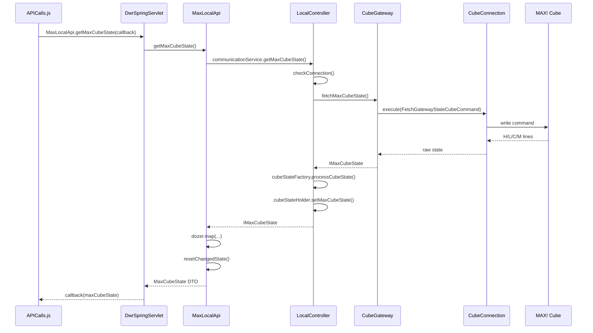

> English translation of docs/dataflow.md. Machine-created; DE/EN reviewed by the user on 27.11.2026; FR/IT/NL/PL feedback expected via issues/PRs.

# Data flows of MAX Local Application 1.4.6

## 1. Purpose and reading notes

This document describes concrete data flows of MAX Local Application 1.4.6 as a basis for a reimplementation. It is an inventory, not a porting recommendation. (Source: `decompiled/controller/sources/de/eq3/max/al/local/LocalController.java:75-124`, `extracted/rootwar/js/lib/APICalls.js:905-919`)

Every statement is marked as `OBSERVATION`, `INFERENCE`, or `UNKNOWN` and evidenced with `source file:line` or an evidence ID. (Source: `extracted/rootwar/WEB-INF/web.xml:9-62`, `decompiled/controller/sources/de/eq3/max/il/local/CubeConnection.java:139-197`)

## 2. Overview of transport paths

| Path | Transport | Classes involved | Evidence |
|---|---|---|---|
| Browser → Java | HTTP/DWR under `/dwr/*` | `APICalls.js` → `DwrSpringServlet` → `MaxLocalApi`/`MaxLocalDelegate` | (Source: `extracted/rootwar/js/lib/APICalls.js:905-919`, `extracted/rootwar/WEB-INF/web.xml:40-51`, `extracted/localbackend/LocalApp-cl.xml:8-17`) |
| Java → Cube | TCP with a line-based protocol | `LocalController` → `CubeGateway` → `CubeConnection` → `ICubeConnectionCommand` | (Source: `decompiled/controller/sources/de/eq3/max/al/local/LocalController.java:484-509`, `decompiled/controller/sources/de/eq3/max/il/local/CubeGateway.java:165-167`, `decompiled/controller/sources/de/eq3/max/il/local/CubeConnection.java:139-197`) |
| Cube → Java | `H:`, `L:`, `C:`, `M:` lines | `CubeConnection` → `IRawCubeState` → `MaxCubeStateFactory` → `MaxCubeStateHolder` | (Source: `decompiled/controller/sources/de/eq3/max/il/local/CubeConnection.java:54-57`, `decompiled/controller/sources/de/eq3/max/il/local/CubeConnection.java:157-183`, `decompiled/controller/sources/de/eq3/max/al/local/LocalController.java:859-866`) |
| Discovery | UDP broadcast/multicast 23272 | `CubeFinder` → `CubeConnectionInfo` | (Source: `decompiled/controller/sources/de/eq3/max/al/local/finder/CubeFinder.java:22-28`, `decompiled/controller/sources/de/eq3/max/al/local/finder/CubeFinder.java:47-50`) |
| Firmware update | UDP 23272 to bootloader | `CubeUpdateService` → `CubeUpdater` → `CubeUdpProxy` | (Source: `decompiled/controller/sources/de/eq3/max/al/local/update/CubeUpdateService.java:48-54`, `decompiled/controller/sources/de/eq3/max/al/local/update/CubeUpdater.java:33-41`, `decompiled/controller/sources/de/eq3/max/al/local/update/CubeUdpProxy.java:23-32`) |
| Remote | HTTP `HttpURLConnection` | `LocalController` → `MaxRemoteProxy` → MAX remote | (Source: `decompiled/controller/sources/de/eq3/max/al/local/LocalController.java:599-603`, `decompiled/controller/sources/de/eq3/max/al/local/remoteproxy/MaxRemoteProxy.java:182-190`) |
| Persistence | Properties files | `SettingsProvider` → `~/.MAX/*.settings` | (Source: `decompiled/controller/sources/de/eq3/max/al/local/core/settings/SettingsProvider.java:36-42`, `decompiled/controller/sources/de/eq3/max/al/local/core/settings/SettingsProvider.java:69-75`) |
| Control | HTTP POST `/controller/*` | `App` → `ControllerServlet` → `System.exit(0)` | (Source: `decompiled/controller/sources/de/eq3/max/MaxControllerApplication/App.java:20-61`, `decompiled/controller/sources/de/eq3/max/cl/local/controller/ControllerServlet.java:26-43`) |

**INFERENCE:** The effective boundary lies between the DWR facade and `LocalController`; after that follows strictly serial cube communication. (Source: `extracted/localbackend/LocalApp-cl.xml:8-17`, `decompiled/controller/sources/de/eq3/max/il/local/CubeConnection.java:36`, `decompiled/controller/sources/de/eq3/max/il/local/CubeConnection.java:185-197`)

### 2.1 Sequence diagram: state retrieval

**EVIDENCE FOR THE DIAGRAM:** JavaScript call (Source: `extracted/rootwar/js/lib/APICalls.js:905-919`), DWR mapping (Source: `extracted/rootwar/WEB-INF/web.xml:40-51`, `extracted/localbackend/LocalApp-cl.xml:16-17`), facade (Source: `decompiled/controller/sources/de/eq3/max/al/local/MaxLocalApi.java:47-51`), service (Source: `decompiled/controller/sources/de/eq3/max/al/local/LocalController.java:128-133`, `decompiled/controller/sources/de/eq3/max/al/local/LocalController.java:859-866`), gateway (Source: `decompiled/controller/sources/de/eq3/max/il/local/CubeGateway.java:122-126`), connection (Source: `decompiled/controller/sources/de/eq3/max/il/local/CubeConnection.java:157-197`), cube protocol (Source: `decompiled/controller/sources/de/eq3/max/il/local/CubeConnection.java:54-57`).

## 3. Flow 1: Browser call `getMaxCubeState` to the cube and back

**OBSERVATION:** In local mode the browser calls `MaxLocalApi.getMaxCubeState({callback: ...})` via `APICalls.prototype.getMaxCubeState`. (Source: `extracted/rootwar/js/lib/APICalls.js:226`, `extracted/rootwar/js/lib/APICalls.js:905-919`)

**OBSERVATION:** The call lands at `DwrSpringServlet`, which is mapped to `/dwr/*` in `web.xml`. (Source: `extracted/rootwar/WEB-INF/web.xml:40-51`)

**OBSERVATION:** `dwr:remote javascript="MaxLocalApi"` exposes `getMaxCubeState`; `MaxLocalDelegate` forwards the call to the `MaxLocalApi` bean. (Source: `extracted/localbackend/LocalApp-cl.xml:8-17`, `decompiled/controller/sources/de/eq3/max/al/local/MaxLocalDelegate.java:31-33`)

**OBSERVATION:** `MaxLocalApi.getMaxCubeState()` calls `communicationService.getMaxCubeState()` and maps the result with `mapper.map(..., MaxCubeState.class)`. (Source: `decompiled/controller/sources/de/eq3/max/al/local/MaxLocalApi.java:47-49`)

**OBSERVATION:** `LocalController.getMaxCubeState()` first checks the connection via `checkConnection()`. (Source: `decompiled/controller/sources/de/eq3/max/al/local/LocalController.java:128-131`)

**OBSERVATION:** `checkConnection()` resets the `ConnectionWatchDog` when a connection is active and otherwise throws `NotConnectedToCubeException`. (Source: `decompiled/controller/sources/de/eq3/max/al/local/LocalController.java:589-595`)

**OBSERVATION:** `cubeState()` returns the state from `MaxCubeStateHolder` if present, otherwise via `fetchMaxCubeState()`. (Source: `decompiled/controller/sources/de/eq3/max/al/local/LocalController.java:848-866`)

**OBSERVATION:** `fetchMaxCubeState()` calls `cubeGateway.fetchMaxCubeState().getRawState()` and processes the result with `cubeStateFactory.processCubeState(...)`. (Source: `decompiled/controller/sources/de/eq3/max/al/local/LocalController.java:859-866`)

**OBSERVATION:** `CubeGateway.fetchMaxCubeState()` creates `FetchGatewayStateCubeCommand` and calls `execute(command)`. (Source: `decompiled/controller/sources/de/eq3/max/il/local/CubeGateway.java:122-126`)

**OBSERVATION:** `CubeGateway.execute(...)` delegates to `getCurrentConnection().execute(command)`. (Source: `decompiled/controller/sources/de/eq3/max/il/local/CubeGateway.java:304-306`)

**OBSERVATION:** `CubeConnection.execute(...)` places the command in the `commandQueue` and waits for the result with `command.waitForResult()`. (Source: `decompiled/controller/sources/de/eq3/max/il/local/CubeConnection.java:139-149`)

**OBSERVATION:** The gateway thread periodically calls `connection.process()`; metadata is received first and commands are then processed. (Source: `decompiled/controller/sources/de/eq3/max/il/local/CubeGateway.java:67-107`, `decompiled/controller/sources/de/eq3/max/il/local/CubeConnection.java:107-109`)

**OBSERVATION:** `receiveDeviceAndMetaData()` reads lines and treats `L:` as the device list, `C:` as device configuration, and `M:` as the metadata block. (Source: `decompiled/controller/sources/de/eq3/max/il/local/CubeConnection.java:157-183`)

**OBSERVATION:** `talkToCube()` takes the next command from the queue, sets `lastAccessTimestamp`, executes it, and calls `command.notifyResult()`. (Source: `decompiled/controller/sources/de/eq3/max/il/local/CubeConnection.java:185-197`)

**OBSERVATION:** The result is returned via `command.waitForResult()` to `CubeConnection.execute(...)` and thus to `LocalController`. (Source: `decompiled/controller/sources/de/eq3/max/il/local/CubeConnection.java:139-155`)

**OBSERVATION:** `LocalController` stores the processed state in `MaxCubeStateHolder` and then calls `cubeStateUpdateDeviceState()`. (Source: `decompiled/controller/sources/de/eq3/max/al/local/LocalController.java:859-866`, `decompiled/controller/sources/de/eq3/max/al/local/LocalController.java:128-133`)

**OBSERVATION:** After mapping, `MaxLocalApi` calls `maxCubeState.resetChangedState()` so that change flags are not reported again. (Source: `decompiled/controller/sources/de/eq3/max/al/local/MaxLocalApi.java:47-51`)

**OBSERVATION:** DWR returns the DTO to the `callback` function in `APICalls.js`. (Source: `extracted/rootwar/js/lib/APICalls.js:906-919`)

**INFERENCE:** The state is loaded on the first query and then served from the holder; the cube is therefore not read again on every poll. (Source: `decompiled/controller/sources/de/eq3/max/al/local/LocalController.java:848-866`)

**OBSERVATION:** The order is evidenced: `receiveDeviceAndMetaData()` reads lines until an `L:` line arrives; `C:` and `M:` lines are sorted into `RawCubeState` beforehand (`CubeConnection.java:157-183`). The initial state stream therefore ends with `L:`. The concrete payload values of the examples in `docs/maxcube-protocol.md` section 13, by contrast, are INFERENCE.

## 4. Flow 2: JS → DWR → controller → service → radiogram → TCP → cube → back

**OBSERVATION:** `APICalls.prototype.setClientCommands` calls `MaxLocalApi.setClientCommands(commands, {...})`. (Source: `extracted/rootwar/js/lib/APICalls.js:2075-2081`)

**OBSERVATION:** `LocalApp-cl.xml` exposes `setClientCommands` via DWR. (Source: `extracted/localbackend/LocalApp-cl.xml:33`)

**OBSERVATION:** `MaxLocalApi.setClientCommands(...)` maps the DTO commands to domain commands with `mapCommands(...)`. (Source: `decompiled/controller/sources/de/eq3/max/al/local/MaxLocalApi.java:99-101`, `decompiled/controller/sources/de/eq3/max/al/local/MaxLocalApi.java:153-159`)

**OBSERVATION:** `mapCommands(...)` creates an `ArrayList` and maps each element to `de.eq3.max.al.core.command.ClientCommand`. (Source: `decompiled/controller/sources/de/eq3/max/al/local/MaxLocalApi.java:153-159`)

**OBSERVATION:** `LocalController.setClientCommand(...)` calls `executeClientCommand(...)` for each command. (Source: `decompiled/controller/sources/de/eq3/max/al/local/LocalController.java:484-492`)

**OBSERVATION:** Before execution, devices in the room are woken up depending on scope: for `RoomConfiguration` and for `SetDeviceDisplaySetPointActual`. (Source: `decompiled/controller/sources/de/eq3/max/al/local/LocalController.java:495-500`)

**OBSERVATION:** `cubeState()` delivers the current state from the holder. (Source: `decompiled/controller/sources/de/eq3/max/al/local/LocalController.java:501`)

**OBSERVATION:** `radiogramBuilder.createDeviceRadiograms(clientCommand, maxCubeState)` creates the radiograms per device. (Source: `decompiled/controller/sources/de/eq3/max/al/local/LocalController.java:502-504`)

**OBSERVATION:** Each radiogram is passed to the gateway via `cubeGateway.commitDeviceRadiogram(deviceRadiogram)`. (Source: `decompiled/controller/sources/de/eq3/max/al/local/LocalController.java:505-507`)

**OBSERVATION:** `CubeGateway.commitDeviceRadiogram(...)` creates a `CommitDeviceRadiogramCommand` and executes it. (Source: `decompiled/controller/sources/de/eq3/max/il/local/CubeGateway.java:165-167`)

**OBSERVATION:** The command context writes to the cube via the socket's `BufferedWriter`; `CubeConnection` holds reader and writer. (Source: `decompiled/controller/sources/de/eq3/max/il/local/CubeConnection.java:26-28`, `decompiled/controller/sources/de/eq3/max/il/local/CubeConnection.java:49-50`)

**OBSERVATION:** `clientCommand.setCubeState(maxCubeState)` links the command to the state on which it was executed. (Source: `decompiled/controller/sources/de/eq3/max/al/local/LocalController.java:508`)

**OBSERVATION:** `clientCommand.updateState()` updates the state holder; for `IPersistentMetaDataUpdate`, `saveMetadata()` follows. (Source: `decompiled/controller/sources/de/eq3/max/al/local/LocalController.java:510-518`)

**OBSERVATION:** `saveMetadata()` creates metadata and sends it via `cubeGateway.sendMetaData(...)`. (Source: `decompiled/controller/sources/de/eq3/max/al/local/LocalController.java:832-838`)

**OBSERVATION:** `CubeGateway.sendMetaData(...)` creates a `SendMetaDataCommand`. (Source: `decompiled/controller/sources/de/eq3/max/il/local/CubeGateway.java:148-151`)

**OBSERVATION:** The `MaxCubeAirtimeStatus` result is collected in `LocalController` and used as the return value. (Source: `decompiled/controller/sources/de/eq3/max/al/local/LocalController.java:504-509`)

**INFERENCE:** A single user command can trigger several physical radiograms and, in addition, a metadata write. (Source: `decompiled/controller/sources/de/eq3/max/al/local/LocalController.java:502-518`)

## 5. Flow 3: Cube discovery and connection setup

**OBSERVATION:** `APICalls.prototype.listAvailableMaxCubes` calls `MaxLocalApi.listAvailableMaxCubes()`. (Source: `extracted/rootwar/js/lib/APICalls.js:1225-1237`)

**OBSERVATION:** `LocalController.listAvailableMaxCubes()` first loads `ApplicationSettings` via `SettingsProvider.getApplicationSettings()`. (Source: `decompiled/controller/sources/de/eq3/max/al/local/LocalController.java:660-662`)

**OBSERVATION:** If the local IP is unchanged and a saved cube IP exists, a cached `CubeInfo` is returned. (Source: `decompiled/controller/sources/de/eq3/max/al/local/LocalController.java:663-669`)

**OBSERVATION:** Otherwise the current IP is written to `ApplicationSettings` and persisted via `SettingsProvider.saveSettings(appSettings, "")`. (Source: `decompiled/controller/sources/de/eq3/max/al/local/LocalController.java:670-673`)

**OBSERVATION:** `CubeFinder.listCubes(this.localConfiguration.getCubeScanTime())` starts the UDP search. (Source: `decompiled/controller/sources/de/eq3/max/al/local/LocalController.java:677`)

**OBSERVATION:** `CubeFinder.sendHello()` sends `eQ3Max*\0**********I` to `255.255.255.255` and `224.0.0.1`. (Source: `decompiled/controller/sources/de/eq3/max/al/local/finder/CubeFinder.java:47-50`, `decompiled/controller/sources/de/eq3/max/al/local/finder/CubeFinder.java:22-24`)

**OBSERVATION:** `receiveCubeConnectioInfo()` parses responses and places `CubeConnectionInfo` in a `HashSet`. (Source: `decompiled/controller/sources/de/eq3/max/al/local/finder/CubeFinder.java:84-94`)

**OBSERVATION:** `LocalController` builds a `CubeInfo` from each `CubeConnectionInfo` with serial number, firmware, IP, and bootloader flag. (Source: `decompiled/controller/sources/de/eq3/max/al/local/LocalController.java:678-681`)

**OBSERVATION:** `APICalls.prototype.connect(ip)` calls `MaxLocalApi.connect(ip)`. (Source: `extracted/rootwar/js/lib/APICalls.js:1268-1273`)

**OBSERVATION:** `LocalController.connect(ip)` calls `cubeGateway.connect(ip)` and then `remoteProxy.setInitialized(false)`. (Source: `decompiled/controller/sources/de/eq3/max/al/local/LocalController.java:548-550`)

**OBSERVATION:** `CubeGateway.connect(ip)` creates `new CubeConnection(ip, localConfiguration)` and places it in the `ArrayBlockingQueue` with capacity 1. (Source: `decompiled/controller/sources/de/eq3/max/il/local/CubeGateway.java:110-119`, `decompiled/controller/sources/de/eq3/max/il/local/CubeGateway.java:52`)

**OBSERVATION:** `CubeConnection` opens `new Socket(ip, config.getConnectionPort(ip))` and sets timeouts from the configuration. (Source: `decompiled/controller/sources/de/eq3/max/il/local/CubeConnection.java:44-60`)

**OBSERVATION:** The constructor reads the `H:` line and checks firmware compatibility. (Source: `decompiled/controller/sources/de/eq3/max/il/local/CubeConnection.java:54-64`)

**OBSERVATION:** `LocalController` activates the watchdog via `setConnected(true)`. (Source: `decompiled/controller/sources/de/eq3/max/al/local/LocalController.java:583-586`)

**INFERENCE:** Discovery and connection setup are two separate phases: first the UDP announcement, then the TCP handshake with firmware check. (Source: `decompiled/controller/sources/de/eq3/max/al/local/finder/CubeFinder.java:47-50`, `decompiled/controller/sources/de/eq3/max/il/local/CubeConnection.java:44-64`)

## 6. Flow 4: Keep-alive, idle call, and connection timeout

**OBSERVATION:** The browser starts `mvc.c.IndexStructureController.stillAlivePing()` via `window.setTimeout` with 3000 ms. (Source: `extracted/rootwar/js/com_structure/controllers/indexStructureController.js:31`, `extracted/rootwar/js/com_structure/controllers/indexStructureController.js:723-726`)

**OBSERVATION:** `APICalls.prototype.stillAlivePing` calls `MaxLocalApi.stillAlivePing`. (Source: `extracted/rootwar/js/lib/APICalls.js:1393-1400`)

**OBSERVATION:** `LocalController.stillAlivePing()` calls `connectionWatchDog.reset()` and delivers `cubeGateway.getActualAirtimeStatus()`. (Source: `decompiled/controller/sources/de/eq3/max/al/local/LocalController.java:524-529`)

**OBSERVATION:** `MaxLocalApi.stillAlivePing()` maps the result to `MaxCubeAirtimeStatus`. (Source: `decompiled/controller/sources/de/eq3/max/al/local/MaxLocalApi.java:104-109`)

**OBSERVATION:** In parallel, `localScheduler` calls `connectionWatchDog.checkConnection()` and `cubeGateway.idleCall()` every 5 seconds. (Source: `extracted/localbackend/LocalApp-al.xml:10-15`)

**OBSERVATION:** `ConnectionWatchDog.checkConnection()` compares `System.currentTimeMillis() - lastAccessTimestamp` with `max.idleTimeBeforeLocalAppDisconnect`. (Source: `decompiled/controller/sources/de/eq3/max/al/local/ConnectionWatchDog.java:32-38`, `decompiled/controller/sources/de/eq3/max/al/local/ConnectionWatchDog.java:16-17`)

**OBSERVATION:** If exceeded, the watchdog sets `active = false` and calls `timeoutHandler.onConnectionTimeout()`. (Source: `decompiled/controller/sources/de/eq3/max/al/local/ConnectionWatchDog.java:38-41`)

**OBSERVATION:** `LocalController.onConnectionTimeout()` calls `disconnect()`. (Source: `decompiled/controller/sources/de/eq3/max/al/local/LocalController.java:576-578`)

**OBSERVATION:** `disconnect()` first cancels inclusion mode if necessary and then calls `cubeGateway.disconnect()`. (Source: `decompiled/controller/sources/de/eq3/max/al/local/LocalController.java:559-570`)

**OBSERVATION:** `CubeGateway.idleCall()` sends `encrypt("something")` if the cube has not been addressed for longer than `getCubeIdleTimeout()`. (Source: `decompiled/controller/sources/de/eq3/max/il/local/CubeGateway.java:291-301`)

**OBSERVATION:** `encrypt(...)` uses `AESEncryptCubeCommand` and returns the encrypted content. (Source: `decompiled/controller/sources/de/eq3/max/il/local/CubeGateway.java:173-176`)

**INFERENCE:** There are two separate keep-alive signals: the browser ping for the watchdog and the cube idle call for the TCP connection. (Source: `decompiled/controller/sources/de/eq3/max/al/local/LocalController.java:524-529`, `decompiled/controller/sources/de/eq3/max/il/local/CubeGateway.java:291-301`)

## 7. Flow 5: Metadata change and persistence

**OBSERVATION:** `APICalls.prototype.changeRoomName` calls `MaxLocalApi.changeRoomName(roomId, name, {...})`. (Source: `extracted/rootwar/js/lib/APICalls.js:1557`)

**OBSERVATION:** `LocalController.changeRoomName(...)` changes the room in the state and calls `cubeGateway.sendMetaData(this.cubeStateFactory.createMetaData(cubeState()))`. (Source: `decompiled/controller/sources/de/eq3/max/al/local/LocalController.java:390-396`)

**OBSERVATION:** `changeDeviceName(...)` follows the same pattern via `cubeGateway.sendMetaData(...)`. (Source: `decompiled/controller/sources/de/eq3/max/al/local/LocalController.java:408-425`)

**OBSERVATION:** `addRoom(...)`, `removeRoom(...)`, `arrangeNewDevice(...)`, and `rearrangeRoomOrder(...)` also call `sendMetaData(...)`. (Source: `decompiled/controller/sources/de/eq3/max/al/local/LocalController.java:262-266`, `decompiled/controller/sources/de/eq3/max/al/local/LocalController.java:364-378`, `decompiled/controller/sources/de/eq3/max/al/local/LocalController.java:452-463`, `decompiled/controller/sources/de/eq3/max/al/local/LocalController.java:612-630`)

**OBSERVATION:** The central helper `saveMetadata()` encapsulates `createMetaData(cubeState())` and `cubeGateway.sendMetaData(...)`. (Source: `decompiled/controller/sources/de/eq3/max/al/local/LocalController.java:832-838`)

**OBSERVATION:** `CubeConnection.receiveDeviceAndMetaData()` processes incoming `M:` lines with index, count, and payload. (Source: `decompiled/controller/sources/de/eq3/max/il/local/CubeConnection.java:172-181`)

**OBSERVATION:** `LocalController.listAvailableMaxCubes()` saves the local IP via `SettingsProvider.saveSettings(appSettings, "")` to `~/.MAX/max.settings`. (Source: `decompiled/controller/sources/de/eq3/max/al/local/LocalController.java:670-673`, `decompiled/controller/sources/de/eq3/max/al/local/core/settings/ApplicationSettings.java:147-148`)

**OBSERVATION:** `SettingsProvider.saveSettings(...)` writes with `FileOutputStream` and `settings.store(...)`. (Source: `decompiled/controller/sources/de/eq3/max/al/local/core/settings/SettingsProvider.java:36-42`)

**OBSERVATION:** `SettingsProvider.getSettingsFile(...)` is composed of `user.home`, `.MAX`, and the file name. (Source: `decompiled/controller/sources/de/eq3/max/al/local/core/settings/SettingsProvider.java:69-75`)

**OBSERVATION:** There is no database; a search for database APIs across all decompiled Java files returned 0 hits. (Source: `decompiled/**/*.java`, `Select-String` search for `jdbc|hsql|derby|sqlite|\.db\b|DataSource|EntityManager|javax.persistence|PreparedStatement|getConnection\(`; evidence IDs `ev_b01b22f5d2b54d783aa1cb8dbe567111e03a6fe5029e1641318be232168a43a7`, `ev_cd71f066e83568d1ab3c71c8f78b5ea143ceb6dcf3b32ee7b5329970380de677`, `ev_42e4885a961f14d51aae2e5f880199599ca787a822b9dc66cd85ce2d46a9c91a`)

**INFERENCE:** There are two persistence targets: properties files on the PC and metadata on the cube. (Source: `decompiled/controller/sources/de/eq3/max/al/local/core/settings/SettingsProvider.java:69-75`, `decompiled/controller/sources/de/eq3/max/al/local/LocalController.java:832-838`)

**OBSERVATION:** The block size is evidenced twice – as configuration value `max.metadataBlockSize=1900` (`extracted/settings/max.local.properties:8`) **and** in the code: `SendMetadataCubeCommand` holds it as a field (`lines 14, 16-17`), computes the packet count with `ceil(byteLength / metadataBlockSize)` (`line 33`), and bounds the loop with `b < metadataBlockSize && byteStream.available() != 0` (`line 44`). (Source: `decompiled/localbackend/sources/de/eq3/max/il/local/commands/SendMetadataCubeCommand.java:14-17,33,44`; `decompiled/localbackend/sources/de/eq3/max/al/local/core/LocalConfiguration.java:30-31,149`)

## 8. Flow 6: Firmware update via UDP bootloader

**OBSERVATION:** `APICalls.prototype.performFirmwareUpdate` calls `MaxLocalApi.performFirmwareUpdate(SN, {...})`. (Source: `extracted/rootwar/js/lib/APICalls.js:1157-1168`)

**OBSERVATION:** `LocalController.performFirmwareUpdate(serialNumber)` requires `assertNotConnected()` and delegates to `cubeUpdateService.performUpdate(serialNumber)`. (Source: `decompiled/controller/sources/de/eq3/max/al/local/LocalController.java:686-689`)

**OBSERVATION:** `assertNotConnected()` throws `AlreadyConnectedToCubeException` if a TCP connection exists. (Source: `decompiled/controller/sources/de/eq3/max/al/local/LocalController.java:842-846`)

**OBSERVATION:** `CubeUpdateService.performUpdate(...)` sets `status = new UpdateStatus(UpdateStatusInfo.BeginUpdate)` and starts a `CubeUpdateService` thread. (Source: `decompiled/controller/sources/de/eq3/max/al/local/update/CubeUpdateService.java:29-37`)

**OBSERVATION:** The thread loads `firmware.enc` via `getClass().getClassLoader().getResourceAsStream(FIRMWARE_FILENAME)`. (Source: `decompiled/controller/sources/de/eq3/max/al/local/update/CubeUpdateService.java:16`, `decompiled/controller/sources/de/eq3/max/al/local/update/CubeUpdateService.java:50`)

**OBSERVATION:** `CubeUpdater` is created, receives the status handler, and is given `update(serialNumber, stream)`. (Source: `decompiled/controller/sources/de/eq3/max/al/local/update/CubeUpdateService.java:51-53`)

**OBSERVATION:** `CubeUpdater.update(...)` creates a `CubeUdpProxy(serialNumber)` and splits the firmware into frames. (Source: `decompiled/controller/sources/de/eq3/max/al/local/update/CubeUpdater.java:33-41`)

**OBSERVATION:** `getFirmwareFrames(...)` reports `ParseFirmwareFile` and delivers `firmwareFile.getFrames()`. (Source: `decompiled/controller/sources/de/eq3/max/al/local/update/CubeUpdater.java:69-72`)

**OBSERVATION:** `enterBootloader(...)`, `initUpdate(...)`, and `writeFrame(...)` report the respective status values to the handler. (Source: `decompiled/controller/sources/de/eq3/max/al/local/update/CubeUpdater.java:75-97`)

**OBSERVATION:** `CubeUdpProxy(serialNumber)` uses `CubeFinder.listCubes(1800)` to find the target cube. (Source: `decompiled/controller/sources/de/eq3/max/al/local/update/CubeUdpProxy.java:56-67`)

**OBSERVATION:** `CubeUdpProxy` sends via `MulticastSocket` to port 23272 and waits for responses with `TimeoutWatcher`. (Source: `decompiled/controller/sources/de/eq3/max/al/local/update/CubeUdpProxy.java:25-28`, `decompiled/controller/sources/de/eq3/max/al/local/update/CubeUdpProxy.java:211-224`)

**OBSERVATION:** `waitForReboot()` waits up to 20000 ms until the cube is reachable again. (Source: `decompiled/controller/sources/de/eq3/max/al/local/update/CubeUdpProxy.java:27`, `decompiled/controller/sources/de/eq3/max/al/local/update/CubeUdpProxy.java:131-135`)

**OBSERVATION:** `LocalController.checkFirmwareUpdateStatus()` delivers the status from `cubeUpdateService.getStatus()` and throws `status.getError()` on errors. (Source: `decompiled/controller/sources/de/eq3/max/al/local/LocalController.java:694-700`)

**OBSERVATION:** `APICalls.prototype.checkFirmwareUpdateStatus` calls `MaxLocalApi.checkFirmwareUpdateStatus`. (Source: `extracted/rootwar/js/lib/APICalls.js:1192-1203`)

**INFERENCE:** The update flow is asynchronous: the HTTP call returns a status immediately, which the browser then polls. (Source: `decompiled/controller/sources/de/eq3/max/al/local/update/CubeUpdateService.java:29-37`, `decompiled/controller/sources/de/eq3/max/al/local/LocalController.java:694-700`)

**UNKNOWN:** The format of `firmware.enc` and the meaning of individual frames were not decompiled. (Source: `decompiled/controller/sources/de/eq3/max/al/local/update/CubeUpdater.java:69-72`)

## 9. Flow 7: Remote proxy and product activation

**OBSERVATION:** `LocalController.checkProductActivation()` delegates to `remoteProxy.checkProductActivation()`. (Source: `decompiled/controller/sources/de/eq3/max/al/local/LocalController.java:216-219`)

**OBSERVATION:** `LocalController.activateProduct(productKey)` delegates to `remoteProxy.activateProduct(productKey)`. (Source: `decompiled/controller/sources/de/eq3/max/al/local/LocalController.java:227-230`)

**OBSERVATION:** `MaxRemoteProxy.checkProductActivation()` creates `CheckProductActivationRequest`, sets the cube state, and calls `send(request)`. (Source: `decompiled/controller/sources/de/eq3/max/al/local/remoteproxy/MaxRemoteProxy.java:123-133`)

**OBSERVATION:** `MaxRemoteProxy.activateProduct(...)` creates `ActivateProductRequest` with the product key and calls `send(request)`. (Source: `decompiled/controller/sources/de/eq3/max/al/local/remoteproxy/MaxRemoteProxy.java:156-166`)

**OBSERVATION:** `send(...)` creates an `HttpURLConnection` via `createConnection(maxRemoteUrl)`, writes the content, and reads the response. (Source: `decompiled/controller/sources/de/eq3/max/al/local/remoteproxy/MaxRemoteProxy.java:182-190`, `decompiled/controller/sources/de/eq3/max/al/local/remoteproxy/MaxRemoteProxy.java:196-233`)

**OBSERVATION:** `maxRemoteUrl` is set in `init()` via `retrieveDeviceAppUrl()`. (Source: `decompiled/controller/sources/de/eq3/max/al/local/remoteproxy/MaxRemoteProxy.java:271-274`)

**OBSERVATION:** `retrieveDeviceAppUrl()` uses `UrlRetriever` with `configuration.getFallbackLookupUrl()` when the lookup service is enabled. (Source: `decompiled/controller/sources/de/eq3/max/al/local/remoteproxy/MaxRemoteProxy.java:282-291`)

**OBSERVATION:** If the URL changes, it is passed to the cube via `cubeGateway.setUrl(deviceAppUrl)`. (Source: `decompiled/controller/sources/de/eq3/max/al/local/remoteproxy/MaxRemoteProxy.java:287-289`)

**OBSERVATION:** `LocalController.setRemoteCredentials(...)` validates first and then delegates to `remoteProxy.setRemoteCredentials(...)`. (Source: `decompiled/controller/sources/de/eq3/max/al/local/LocalController.java:599-603`)

**OBSERVATION:** `MaxRemoteProxy.setRemoteCredentials(...)` sets the gateway interval via `cubeGateway.setInterval(getInterval(...))` after a successful response. (Source: `decompiled/controller/sources/de/eq3/max/al/local/remoteproxy/MaxRemoteProxy.java:67-78`)

**OBSERVATION:** `LocalController.setRemoteAccess(...)` and `getRemoteCredentials()` use the same proxy. (Source: `decompiled/controller/sources/de/eq3/max/al/local/LocalController.java:891-895`, `decompiled/controller/sources/de/eq3/max/al/local/LocalController.java:636-642`)

**INFERENCE:** The remote proxy changes not only external state but also local behavior by switching the cube gateway's polling interval. (Source: `decompiled/controller/sources/de/eq3/max/al/local/remoteproxy/MaxRemoteProxy.java:67-78`, `decompiled/controller/sources/de/eq3/max/al/local/remoteproxy/MaxRemoteProxy.java:192-193`)

**EVIDENCED 24.11.2026 (correction):** The HTTP headers (`Opt`, `MAX-Serial`) and request format of the remote proxy are fully decompiled: `H:` line + command, Base64, `cubeGateway.encrypt()` as an `e:` command, Base64 as HTTP body; response via `d:` and line parser. (Source: `RemoteProxyRequest.java:27-56`, `RemoteProxyResponse.java:29-58`, `MaxRemoteProxy.java:182-190`; `docs/maxcube-protocol.md` section 6.1)

## 10. Flow 8: Start, browser opening, and shutdown

**OBSERVATION:** Getdown starts `de.eq3.max.MaxLocalAppStarter.Application` according to `class = ...` in `getdown.txt`. (Source: `C:\ProgramData\MAX\getdown.txt`; evidence ID `ev_81a48cb5c63ace439b913812ff1d104c79c9a1179387732f5682a5545799e809`)

**OBSERVATION:** `Application.main()` uses `InstanceLock` to check whether an instance is already running. (Source: `decompiled/maxlocalapp/sources/de/eq3/max/MaxLocalAppStarter/Application.java:58-64`)

**OBSERVATION:** `Application.run()` registers the `FileMonitor` for `~/.MAX/max.settings` with 5000 ms and initializes server settings. (Source: `decompiled/maxlocalapp/sources/de/eq3/max/MaxLocalAppStarter/Application.java:66-74`)

**OBSERVATION:** `initializeServerSettings()` reads `SettingsProvider.getServerSettings()` and selects a free port if needed. (Source: `decompiled/maxlocalapp/sources/de/eq3/max/MaxLocalAppStarter/Application.java:137-166`)

**OBSERVATION:** `startServer()` creates the Jetty server and deploys `webapp` via `WebAppDeployer`. (Source: `decompiled/maxlocalapp/sources/de/eq3/max/MaxLocalAppStarter/Application.java:190-217`)

**OBSERVATION:** After startup, `Desktop.getDesktop().browse(...)` opens the address `http://localhost:<port>`. (Source: `decompiled/maxlocalapp/sources/de/eq3/max/MaxLocalAppStarter/Application.java:220`, `decompiled/maxlocalapp/sources/de/eq3/max/MaxLocalAppStarter/Application.java:275-276`)

**OBSERVATION:** `tools/alive.bat` and `tools/shutdown.bat` call `java -jar MaxControllerApplication.jar Alive` or `Exit`, respectively. (Source: `C:\ProgramData\MAX\tools\alive.bat:1-10`, `C:\ProgramData\MAX\tools\shutdown.bat:1-10`; evidence ID `ev_81a48cb5c63ace439b913812ff1d104c79c9a1179387732f5682a5545799e809`)

**OBSERVATION:** `de.eq3.max.MaxControllerApplication.App` sends the text `Exit` or `Alive` by POST to `http://localhost:<port>/controller`. (Source: `decompiled/controller/sources/de/eq3/max/MaxControllerApplication/App.java:20-61`)

**OBSERVATION:** `ControllerServlet.doPost(...)` reads the first line and calls `System.exit(0)` for `Exit`. (Source: `decompiled/controller/sources/de/eq3/max/cl/local/controller/ControllerServlet.java:26-39`)

**OBSERVATION:** The shutdown hook `MaxThread` was registered in `run()`. (Source: `decompiled/maxlocalapp/sources/de/eq3/max/MaxLocalAppStarter/Application.java:70-72`)

**INFERENCE:** The shutdown channel is deliberately simple and allows external scripts to stop the local server in a controlled way. (Source: `C:\ProgramData\MAX\tools\shutdown.bat:1-10`, `decompiled/controller/sources/de/eq3/max/cl/local/controller/ControllerServlet.java:26-39`; evidence ID `ev_81a48cb5c63ace439b913812ff1d104c79c9a1179387732f5682a5545799e809`)

## 11. Flow 9: Settings and file monitoring

**OBSERVATION:** `SettingsProvider.getApplicationSettings()` creates an `ApplicationSettings` object and loads it via `loadSettings(...)`. (Source: `decompiled/controller/sources/de/eq3/max/al/local/core/settings/SettingsProvider.java:23-25`)

**OBSERVATION:** `loadSettings(...)` checks whether the file exists and loads it via `FileInputStream`. (Source: `decompiled/controller/sources/de/eq3/max/al/local/core/settings/SettingsProvider.java:51-58`)

**OBSERVATION:** `Settings.getDefaultValue(...)` loads `Default.settings` from the classpath and returns the value for a key. (Source: `decompiled/controller/sources/de/eq3/max/al/local/core/settings/Settings.java:13-21`)

**OBSERVATION:** `ApplicationSettings.getSettingsFileName()` returns `max.settings`. (Source: `decompiled/controller/sources/de/eq3/max/al/local/core/settings/ApplicationSettings.java:147-148`)

**OBSERVATION:** `Application.fileChanged(...)` reacts to changes in `~/.MAX/max.settings` by resetting the locale and redrawing the tray menu. (Source: `decompiled/maxlocalapp/sources/de/eq3/max/MaxLocalAppStarter/Application.java:66-67`, `decompiled/maxlocalapp/sources/de/eq3/max/MaxLocalAppStarter/Application.java:280-284`)

**OBSERVATION:** `Default.settings` contains the default values for locale, URLs, and UI switches. (Source: `extracted/settings/Default.settings:1-9`)

**INFERENCE:** Settings are not transactional and are reconstructed directly from the file on every load. (Source: `decompiled/controller/sources/de/eq3/max/al/local/core/settings/SettingsProvider.java:51-58`, `decompiled/controller/sources/de/eq3/max/al/local/core/settings/Settings.java:13-21`)

## 12. State holders and persistence at a glance

| State | Holder | Scope | Persistence | Evidence |
|---|---|---|---|---|
| Cube state | `MaxCubeStateHolder.maxCubeState` | JVM/web context | no DB; metadata on cube | (Source: `decompiled/essentials/sources/de/eq3/max/al/core/cubestate/MaxCubeStateHolder.java:25-28`, `decompiled/controller/sources/de/eq3/max/al/local/LocalController.java:832-838`) |
| New devices | `MaxCubeStateHolder.newDevices` | JVM/web context | none | (Source: `decompiled/essentials/sources/de/eq3/max/al/core/cubestate/MaxCubeStateHolder.java:25-28`) |
| Airtime status | `MaxCubeStateHolder.actualAirtimeStatus`, `CubeGateway.actualAirtimeStatus` | JVM/web context | none | (Source: `decompiled/essentials/sources/de/eq3/max/al/core/cubestate/MaxCubeStateHolder.java:25-28`, `decompiled/controller/sources/de/eq3/max/il/local/CubeGateway.java:51`) |
| Watchdog timestamp | `ConnectionWatchDog.lastAccessTimestamp` | JVM/web context | none | (Source: `decompiled/controller/sources/de/eq3/max/al/local/ConnectionWatchDog.java:18-19`) |
| Connection | `CubeGateway.currentConnection`, `connections` queue | JVM/web context | none | (Source: `decompiled/controller/sources/de/eq3/max/il/local/CubeGateway.java:52-53`) |
| Update status | `CubeUpdateService.status`, `inProgress` | JVM/web context | none | (Source: `decompiled/controller/sources/de/eq3/max/al/local/update/CubeUpdateService.java:17-19`) |
| Settings | `.MAX/*.settings` | user profile | properties file | (Source: `decompiled/controller/sources/de/eq3/max/al/local/core/settings/SettingsProvider.java:69-75`) |
| Remote initialization | `MaxRemoteProxy.isInitialized` | JVM/web context | none | (Source: `decompiled/controller/sources/de/eq3/max/al/local/remoteproxy/MaxRemoteProxy.java:41`, `decompiled/controller/sources/de/eq3/max/al/local/LocalController.java:548-550`) |

**OBSERVATION:** No database exists; this was checked by searching all decompiled Java files for database APIs, with 0 hits. (Source: `decompiled/**/*.java`, `Select-String` search for `jdbc|hsql|derby|sqlite|\.db\b|DataSource|EntityManager|javax.persistence|PreparedStatement|getConnection\(`; evidence IDs `ev_b01b22f5d2b54d783aa1cb8dbe567111e03a6fe5029e1641318be232168a43a7`, `ev_cd71f066e83568d1ab3c71c8f78b5ea143ceb6dcf3b32ee7b5329970380de677`, `ev_42e4885a961f14d51aae2e5f880199599ca787a822b9dc66cd85ce2d46a9c91a`)

## 13. Error flows

**OBSERVATION:** `checkConnection()` throws `NotConnectedToCubeException` if the gateway reports no connection. (Source: `decompiled/controller/sources/de/eq3/max/al/local/LocalController.java:589-595`)

**OBSERVATION:** `CubeConnection.execute(...)` propagates the `IOException` or `RuntimeException` stored in the command. (Source: `decompiled/controller/sources/de/eq3/max/il/local/CubeConnection.java:141-151`)

**OBSERVATION:** `CubeGateway.execute(...)` calls `dropConnection()` on `SocketException` or `SocketTimeoutException`. (Source: `decompiled/controller/sources/de/eq3/max/il/local/CubeGateway.java:304-314`)

**OBSERVATION:** `LocalController` translates `IOException` into `CubeCommunicationFailedException`. (Source: `decompiled/controller/sources/de/eq3/max/al/local/LocalController.java:486-490`, `decompiled/controller/sources/de/eq3/max/al/local/LocalController.java:862-865`)

**OBSERVATION:** `MaxRemoteProxy` translates a missing valid URL into `RemoteServiceUnavailableException`. (Source: `decompiled/controller/sources/de/eq3/max/al/local/remoteproxy/MaxRemoteProxy.java:295-298`)

**OBSERVATION:** `CubeUpdateService.checkFirmwareUpdateStatus()` propagates the error stored in the status. (Source: `decompiled/controller/sources/de/eq3/max/al/local/LocalController.java:694-700`)

**OBSERVATION:** `ClientExceptionTranslator` is configured with `errorcodes.properties` and translates exceptions at the DWR boundary. (Source: `extracted/essentials/essentials.spring.xml:20-22`, `extracted/essentials/max-dwr.xml:16-17`)

**INFERENCE:** Errors are translated along the layers: socket error → gateway drop → service exception → client exception. (Source: `decompiled/controller/sources/de/eq3/max/il/local/CubeGateway.java:304-314`, `decompiled/controller/sources/de/eq3/max/al/local/LocalController.java:486-490`, `extracted/essentials/essentials.spring.xml:20-22`)

## 14. Open points

**OBSERVATION:** The wire order of the TCP commands is fully documented in `docs/maxcube-protocol.md` section 6 (28 entries with exact request string, response, and source location per command). This applies to the **app→cube** direction; the cube-side counterpart remains `UNKNOWN` (no PCAP, no firmware). (Source: `decompiled/localbackend/sources/de/eq3/max/il/local/commands/*.java`; `docs/maxcube-protocol.md` section 6)

**UNKNOWN:** The exact implementation of `CubeGateway.run()` survives only as pseudocode. (Source: `decompiled/controller/sources/de/eq3/max/il/local/CubeGateway.java:67-107`)

**EVIDENCED 24.11.2026 (correction):** The format of remote proxy requests is fully decompiled (seven request classes, `MaxRemoteProxy.java:67-175`); the family is an HTTP cloud protocol, not cube TCP, and is deliberately not adopted. (Source: `docs/maxcube-protocol.md` section 6.1)

**UNKNOWN:** The exact sequence of steps in the firmware update after `Reboot` is not evidenced. (Source: `decompiled/controller/sources/de/eq3/max/al/local/update/CubeUpdater.java:100-107`)

## 15. Summary

**OBSERVATION:** The central flows are state retrieval, command execution, discovery/connect, keep-alive/timeout, metadata persistence, firmware update, remote proxy, start/shutdown, and settings files. (Source: `decompiled/controller/sources/de/eq3/max/al/local/LocalController.java:128-133`, `decompiled/controller/sources/de/eq3/max/al/local/LocalController.java:484-518`, `decompiled/controller/sources/de/eq3/max/al/local/finder/CubeFinder.java:47-50`, `decompiled/controller/sources/de/eq3/max/al/local/ConnectionWatchDog.java:32-41`, `decompiled/controller/sources/de/eq3/max/al/local/update/CubeUpdater.java:27-107`, `decompiled/controller/sources/de/eq3/max/al/local/remoteproxy/MaxRemoteProxy.java:182-190`, `decompiled/maxlocalapp/sources/de/eq3/max/MaxLocalAppStarter/Application.java:66-79`)

**OBSERVATION:** State holders reside in memory, persistence happens via `~/.MAX` properties and the cube; no database exists. (Source: `decompiled/essentials/sources/de/eq3/max/al/core/cubestate/MaxCubeStateHolder.java:25-28`, `decompiled/controller/sources/de/eq3/max/al/local/core/settings/SettingsProvider.java:69-75`, `decompiled/controller/sources/de/eq3/max/al/local/LocalController.java:832-838`, search result 0 hits in `decompiled/**/*.java`)
