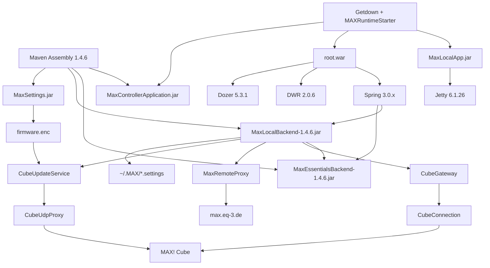

> English translation of docs/dependencies.md. Machine-created; native-speaker review pending.

# Dependencies of MAX Local Application 1.4.6

## 1. Purpose and reading notes

This document describes the build, runtime, and interface dependencies of MAX Local Application 1.4.6. It is an inventory for a reimplementation, not a recommendation to adopt the old technologies. (Source: `decompiled/controller/resources/META-INF/maven/de.eq3.max/MaxControllerApplication/pom.xml:1-8`, `C:\ProgramData\MAX\getdown.txt`; evidence ID `ev_81a48cb5c63ace439b913812ff1d104c79c9a1179387732f5682a5545799e809`)

Statements are marked as `OBSERVATION`, `INFERENCE`, or `UNKNOWN` and evidenced with `source file:line` or an evidence ID. (Source: `extracted/rootwar/WEB-INF/max-service.xml:15-25`, `decompiled/controller/sources/de/eq3/max/al/local/LocalController.java:80-124`)

## 2. Build dependencies

**OBSERVATION:** `MaxControllerApplication` is a Maven artifact of version 1.4.6 with `groupId de.eq3.max` and `packaging jar`. (Source: `decompiled/controller/resources/META-INF/maven/de.eq3.max/MaxControllerApplication/pom.xml:1-8`)

**OBSERVATION:** The artifact uses `maven-assembly-plugin` 2.2 with `jar-with-dependencies` and sets `de.eq3.max.MaxControllerApplication.App` as `mainClass`. (Source: `decompiled/controller/resources/META-INF/maven/de.eq3.max/MaxControllerApplication/pom.xml` assembly configuration, lines 18-40)

**OBSERVATION:** The parent POM `Max` is also version 1.4.6. (Source: `decompiled/controller/resources/META-INF/maven/de.eq3.max/MaxControllerApplication/pom.xml:9-15`)

**OBSERVATION:** `MaxRuntimeStarter` is present as its own Maven artifact in the `extracted/starter` path. (Source: `extracted/starter/META-INF/maven/de.eq3.max/MaxRuntimeStarter/pom.xml:1-20`; evidence ID `ev_81a48cb5c63ace439b913812ff1d104c79c9a1179387732f5682a5545799e809`)

**INFERENCE:** The build world is shaped by the Maven 2/3 era and an assembly JAR; a modern rebuild should resolve the dependencies anew instead of taking over the old versions. (Source: `decompiled/controller/resources/META-INF/maven/de.eq3.max/MaxControllerApplication/pom.xml` assembly configuration, `C:\ProgramData\MAX\getdown.txt`; evidence ID `ev_81a48cb5c63ace439b913812ff1d104c79c9a1179387732f5682a5545799e809`)

## 3. Runtime libraries from `getdown.txt`

**OBSERVATION:** `getdown.txt` defines `appbase = http://max.eq-3.de/max/` and `class = de.eq3.max.MaxLocalAppStarter.Application`. (Source: `C:\ProgramData\MAX\getdown.txt`; evidence ID `ev_81a48cb5c63ace439b913812ff1d104c79c9a1179387732f5682a5545799e809`)

**OBSERVATION:** The `code=` entries contain the runtime libraries; the `resource=` entries contain `tools/alive.bat`, `tools/shutdown.bat`, `tools/MaxControllerApplication.jar`, `webapp/root.war`, `webdefault.xml`, `getdown.jar`, and `MaxLocalApp.jar`. (Source: `C:\ProgramData\MAX\getdown.txt`; evidence ID `ev_81a48cb5c63ace439b913812ff1d104c79c9a1179387732f5682a5545799e809`)

**OBSERVATION:** `allow_offline = true` permits offline operation of the Getdown launcher. (Source: `C:\ProgramData\MAX\getdown.txt`; evidence ID `ev_81a48cb5c63ace439b913812ff1d104c79c9a1179387732f5682a5545799e809`)

### 3.1 Versioned core libraries

| Library | Version | Role in the system | Evidence |
|---|---|---|---|
| `jetty` / `jetty-util` | 6.1.26 | embedded HTTP server | (Source: `C:\ProgramData\MAX\getdown.txt`, `decompiled/maxlocalapp/sources/de/eq3/max/MaxLocalAppStarter/Application.java:190-217`; evidence ID `ev_81a48cb5c63ace439b913812ff1d104c79c9a1179387732f5682a5545799e809`) |
| `spring-*` | 3.0.4.RELEASE / 3.0.5 (`webmvc`) | DI, XML config, scheduling, MVC | (Source: `C:\ProgramData\MAX\getdown.txt`, `extracted/rootwar/WEB-INF/max-service.xml:15-25`; evidence ID `ev_81a48cb5c63ace439b913812ff1d104c79c9a1179387732f5682a5545799e809`) |
| `dwr` | 2.0.6 | browser-to-Java RPC | (Source: `C:\ProgramData\MAX\getdown.txt`, `extracted/rootwar/WEB-INF/web.xml:40-51`; evidence ID `ev_81a48cb5c63ace439b913812ff1d104c79c9a1179387732f5682a5545799e809`) |
| `dozer` | 5.3.1 | DTO/domain mapping | (Source: `C:\ProgramData\MAX\getdown.txt`, `extracted/essentials/essentials.spring.xml:12-18`; evidence ID `ev_81a48cb5c63ace439b913812ff1d104c79c9a1179387732f5682a5545799e809`) |
| `log4j` | 1.2.16 | logging | (Source: `C:\ProgramData\MAX\getdown.txt`, `extracted/rootwar/WEB-INF/web.xml:33-34`; evidence ID `ev_81a48cb5c63ace439b913812ff1d104c79c9a1179387732f5682a5545799e809`) |
| `aspectjrt` / `aspectjweaver` | 1.6.9 | AOP support | (Source: `C:\ProgramData\MAX\getdown.txt`, `extracted/rootwar/WEB-INF/max-service.xml:18`; evidence ID `ev_81a48cb5c63ace439b913812ff1d104c79c9a1179387732f5682a5545799e809`) |
| `hibernate-validator` | 4.0.2.GA | input validation | (Source: `C:\ProgramData\MAX\getdown.txt`, `decompiled/controller/sources/de/eq3/max/al/local/LocalController.java:599-603`; evidence ID `ev_81a48cb5c63ace439b913812ff1d104c79c9a1179387732f5682a5545799e809`) |
| `commons-io` | 2.1 | file operations, log cleanup | (Source: `C:\ProgramData\MAX\getdown.txt`, `decompiled/maxlocalapp/sources/de/eq3/max/MaxLocalAppStarter/Application.java:290-292`; evidence ID `ev_81a48cb5c63ace439b913812ff1d104c79c9a1179387732f5682a5545799e809`) |
| `looks` | 2.2.2 | Swing look and feel | (Source: `C:\ProgramData\MAX\getdown.txt`; evidence ID `ev_81a48cb5c63ace439b913812ff1d104c79c9a1179387732f5682a5545799e809`) |
| `selenium-java-client-driver` | 1.0.1 | shipped; role unclear | (Source: `C:\ProgramData\MAX\getdown.txt`; evidence ID `ev_81a48cb5c63ace439b913812ff1d104c79c9a1179387732f5682a5545799e809`) |

**OBSERVATION:** The in-house backend artifacts are `MaxEssentialsBackend-1.4.6.jar`, `MaxLocalBackend-1.4.6.jar`, and `MaxSettings.jar`. (Source: `C:\ProgramData\MAX\getdown.txt`; evidence ID `ev_81a48cb5c63ace439b913812ff1d104c79c9a1179387732f5682a5545799e809`)

**OBSERVATION:** `servlet-api-2.5` is present on the classpath in two variants. (Source: `C:\ProgramData\MAX\getdown.txt`; evidence ID `ev_81a48cb5c63ace439b913812ff1d104c79c9a1179387732f5682a5545799e809`)

**UNKNOWN:** The exact role of `selenium-java-client-driver-1.0.1.jar` in production operation is not evidenced. (Source: `C:\ProgramData\MAX\getdown.txt`; evidence ID `ev_81a48cb5c63ace439b913812ff1d104c79c9a1179387732f5682a5545799e809`)

## 4. Spring context dependencies

**OBSERVATION:** `max-service.xml` loads `classpath:max.properties,classpath:max.local.properties` via `context:property-placeholder`. (Source: `extracted/rootwar/WEB-INF/max-service.xml:15`)

**OBSERVATION:** `context:component-scan base-package="de.eq3.max"` enables automatic detection of all annotated components. (Source: `extracted/rootwar/WEB-INF/max-service.xml:16`)

**OBSERVATION:** `context:annotation-config` enables processing of annotation-based DI. (Source: `extracted/rootwar/WEB-INF/max-service.xml:17`)

**OBSERVATION:** The context imports `essentials.spring.xml`, `max-dwr.xml`, `LocalApp-cl.xml`, and `LocalApp-al.xml`. (Source: `extracted/rootwar/WEB-INF/max-service.xml:22-25`)

**OBSERVATION:** `aop:aspectj-autoproxy` is enabled in the context. (Source: `extracted/rootwar/WEB-INF/max-service.xml:18`)

**OBSERVATION:** `essentials.spring.xml` defines the Dozer mapper, the exception translator, and the radiogram builder. (Source: `extracted/essentials/essentials.spring.xml:12-27`)

**OBSERVATION:** `LocalApp-al.xml` binds `connectionWatchDog` and `cubeGateway` to `localScheduler`. (Source: `extracted/localbackend/LocalApp-al.xml:10-15`)

**OBSERVATION:** `LocalApp-cl.xml` creates `MaxLocalApi` and the DWR delegate. (Source: `extracted/localbackend/LocalApp-cl.xml:8-17`)

**INFERENCE:** The Spring context is the central wiring point; a reimplementation can reproduce this wiring explicitly in code or via a modern DI framework. (Source: `extracted/rootwar/WEB-INF/max-service.xml:15-25`, `decompiled/controller/sources/de/eq3/max/al/local/LocalController.java:80-124`)

## 5. Component dependencies in detail

### 5.1 `LocalController`

| Dependency | Purpose | Evidence |
|---|---|---|
| `IMaxCubeStateHolder` | in-memory state | (Source: `decompiled/controller/sources/de/eq3/max/al/local/LocalController.java:80-82`) |
| `IRemoteCredentialsValidator`, `RoomValidator`, `DeviceValidator`, `UserSettingsValidator` | validation before mutation | (Source: `decompiled/controller/sources/de/eq3/max/al/local/LocalController.java:84-98`) |
| `IMaxRemoteProxy` | remote services | (Source: `decompiled/controller/sources/de/eq3/max/al/local/LocalController.java:105-106`) |
| `ICubeUpdateService` | firmware update | (Source: `decompiled/controller/sources/de/eq3/max/al/local/LocalController.java:109-110`) |
| `IMaxCubeStateFactory` | state parsing and metadata | (Source: `decompiled/controller/sources/de/eq3/max/al/local/LocalController.java:112-115`) |
| `ICubeGateway` | cube access | (Source: `decompiled/controller/sources/de/eq3/max/al/local/LocalController.java:117-118`) |
| `ConnectionWatchDog` | inactivity monitoring | (Source: `decompiled/controller/sources/de/eq3/max/al/local/LocalController.java:121`) |
| `ILocalConfiguration` | timeouts, limits, versions | (Source: `decompiled/controller/sources/de/eq3/max/al/local/LocalController.java:124`) |

**OBSERVATION:** `LocalController` implements `ICommunicationService` and `IConnectionTimeoutHandler`. (Source: `decompiled/controller/sources/de/eq3/max/al/local/LocalController.java:75`)

### 5.2 `CubeGateway`

| Dependency | Purpose | Evidence |
|---|---|---|
| `ILocalConfiguration` | connection and idle timeouts | (Source: `decompiled/controller/sources/de/eq3/max/il/local/CubeGateway.java:45-46`) |
| `IMaxCubeStateHolder` | airtime status | (Source: `decompiled/controller/sources/de/eq3/max/il/local/CubeGateway.java:48-50`) |
| `ICubeConnection` | active TCP connection | (Source: `decompiled/controller/sources/de/eq3/max/il/local/CubeGateway.java:52-53`) |
| Command classes | one class per cube operation | (Source: `decompiled/controller/sources/de/eq3/max/il/local/CubeGateway.java:122-287`) |

### 5.3 `MaxRemoteProxy`

| Dependency | Purpose | Evidence |
|---|---|---|
| `ICubeGateway` | `setInterval`, `setUrl` | (Source: `decompiled/controller/sources/de/eq3/max/al/local/remoteproxy/MaxRemoteProxy.java:35`, `decompiled/controller/sources/de/eq3/max/al/local/remoteproxy/MaxRemoteProxy.java:78`, `decompiled/controller/sources/de/eq3/max/al/local/remoteproxy/MaxRemoteProxy.java:289`) |
| `IMaxCubeStateHolder` | serial number and state in requests | (Source: `decompiled/controller/sources/de/eq3/max/al/local/remoteproxy/MaxRemoteProxy.java:36`, `decompiled/controller/sources/de/eq3/max/al/local/remoteproxy/MaxRemoteProxy.java:71`) |
| `ILocalConfiguration` | lookup fallback, remote URL, software URL | (Source: `decompiled/controller/sources/de/eq3/max/al/local/remoteproxy/MaxRemoteProxy.java:42`, `decompiled/controller/sources/de/eq3/max/al/local/remoteproxy/MaxRemoteProxy.java:48`) |
| `HttpURLConnection` | HTTP transport | (Source: `decompiled/controller/sources/de/eq3/max/al/local/remoteproxy/MaxRemoteProxy.java:19`, `decompiled/controller/sources/de/eq3/max/al/local/remoteproxy/MaxRemoteProxy.java:196-205`) |

## 6. External endpoints

| Purpose | URL/address | Evidence |
|---|---|---|
| Lookup | `http://www.max-portal.eq-3.de/lookup` | (Source: `extracted/settings/Default.settings:1`) |
| Notification | `http://max.eq-3.de/messaging` | (Source: `extracted/settings/Default.settings:7`) |
| Update | `http://www.max.eq-3.de/maxupdate` | (Source: `extracted/settings/Default.settings:9`) |
| Remote cube | `http://max.eq-3.de/cube` | (Source: `extracted/controller/max.local.properties:10`) |
| Software | `http://max.eq-3.de/software` | (Source: `extracted/controller/max.local.properties:14`) |
| Getdown appbase | `http://max.eq-3.de/max/` | (Source: `C:\ProgramData\MAX\getdown.txt`; evidence ID `ev_81a48cb5c63ace439b913812ff1d104c79c9a1179387732f5682a5545799e809`) |
| Cube finder | `224.0.0.1`, `255.255.255.255`, port 23272 | (Source: `decompiled/controller/sources/de/eq3/max/al/local/finder/CubeFinder.java:22-24`) |
| Cube TCP | cube IP, port from `config.getConnectionPort(ip)` | (Source: `decompiled/controller/sources/de/eq3/max/il/local/CubeConnection.java:44-46`) |
| Local UI | `http://localhost:<ServerSettings.port>` | (Source: `decompiled/maxlocalapp/sources/de/eq3/max/MaxLocalAppStarter/Application.java:275-276`) |

**OBSERVATION:** `MaxRemoteProxy` can determine the remote URL dynamically via `UrlRetriever` with the fallback lookup. (Source: `decompiled/controller/sources/de/eq3/max/al/local/remoteproxy/MaxRemoteProxy.java:282-291`)

**OBSERVATION:** When the URL changes, it is also communicated to the cube via `cubeGateway.setUrl(deviceAppUrl)`. (Source: `decompiled/controller/sources/de/eq3/max/al/local/remoteproxy/MaxRemoteProxy.java:287-289`)

**OBSERVATION:** `Default.settings` contains only nine entries; the remaining configuration values are in `max.local.properties`. (Source: `extracted/settings/Default.settings:1-9`, `extracted/rootwar/WEB-INF/max-service.xml:15`)

**OBSERVATION:** Both files are materialized and contain **disjoint** keys: `extracted/essentials/max.properties:1-13` has 12 `max.heatingThermostat.default.*` / `max.shutterContact.default.*` keys, `extracted/settings/max.local.properties:1-27` has 20 keys for limits, timeouts, versions, URLs, and ports — overlap: 0. A conflict when loading both property sources (`max-service.xml:15`) is therefore ruled out. (Source: `extracted/essentials/max.properties`, `extracted/settings/max.local.properties`)

## 7. Configuration parameters with evidenced values

| Parameter | Value | Evidence |
|---|---|---|
| `max.maxSoftwareVersion` | 1.4.6 | (Source: `extracted/controller/max.local.properties:13`, `decompiled/controller/resources/META-INF/maven/de.eq3.max/MaxControllerApplication/pom.xml:5`) |
| `max.latestCubeFirmwareVersion` | 275 | (Source: `extracted/controller/max.local.properties:17`, `decompiled/controller/sources/de/eq3/max/al/local/LocalController.java:704-707`) |
| `max.leastCompatibleFirmwareVersion` | 273 | (Source: `extracted/controller/max.local.properties:18`, `decompiled/controller/sources/de/eq3/max/il/local/CubeConnection.java:57`) |
| `max.connection.virtualCubePort` | 54321 | (Source: `extracted/controller/max.local.properties:22`) |
| `max.connection.connectionTimeout` | 30000 | (Source: `extracted/controller/max.local.properties:23`, `decompiled/controller/sources/de/eq3/max/il/local/CubeConnection.java:48`) |
| `max.connection.socketTimeout` | 70000 | (Source: `extracted/controller/max.local.properties:24`, `decompiled/controller/sources/de/eq3/max/il/local/CubeConnection.java:60`) |
| `max.connection.commandQueueCapacity` | 100 | (Source: `extracted/controller/max.local.properties:21`, `decompiled/controller/sources/de/eq3/max/il/local/CubeConnection.java:51`) |
| `max.idleTimeBeforeLocalAppDisconnect` | 30000 | (Source: `extracted/controller/max.local.properties:4`, `decompiled/controller/sources/de/eq3/max/al/local/ConnectionWatchDog.java:16-17`) |
| `max.cubeIdleTimeToSend` | 900000 | (Source: `extracted/controller/max.local.properties:5`, `decompiled/controller/sources/de/eq3/max/il/local/CubeGateway.java:293-297`) |
| `max.metadataBlockSize` | 1900 | (Source: `extracted/controller/max.local.properties:8`) |
| `max.inclusionModeTimeoutSeconds` | 60 | (Source: `extracted/controller/max.local.properties:9`) |
| `max.cubeScanTime` | 1800 | (Source: `extracted/controller/max.local.properties:11`, `decompiled/controller/sources/de/eq3/max/al/local/LocalController.java:677`) |
| `max.maxNameLength` | 32 | (Source: `extracted/controller/max.local.properties:1`) |
| `max.maxRoomCount` | 20 | (Source: `extracted/controller/max.local.properties:2`) |
| `max.maxDeviceCount` | 140 | (Source: `extracted/controller/max.local.properties:3`) |

**INFERENCE:** The values form a time- and size-based safety net: timeouts prevent hanging connections, limits constrain user input. (Source: `decompiled/controller/sources/de/eq3/max/il/local/CubeConnection.java:48-60`, `decompiled/controller/sources/de/eq3/max/al/local/LocalController.java:599-603`)

## 8. DWR dependency surface

**OBSERVATION:** `max-dwr.xml` configures a DWR controller with `debug="true"`. (Source: `extracted/essentials/max-dwr.xml:75`)

**OBSERVATION:** DWR conversions exist for `MaxCubeState`, `MaxCubeAirtimeStatus`, `MaxCubeLastPing`, `MaxHouse`, `MaxRoom`, `MaxNewDevice`, `MaxDevice`, `MaxDeviceState`, `CubeInfo`, `RemoteCredentials`, `FirmwareInfo`, `SoftwareInformation`, `UpdateStatus`, `NetworkConfiguration`, `AdditionalInformation`, `ProductInformation`, and `ProductActivation`. (Source: `extracted/essentials/max-dwr.xml:20-51`)

**OBSERVATION:** For commands, `ClientCommand` and numerous subtypes such as `SetRoomAutoMode`, `SetRoomPermanentMode`, `SetRoomTemporaryMode`, `SetRoomWeekTemperatureProfile`, and `SetDeviceDisplaySetPointActual` are converted. (Source: `extracted/essentials/max-dwr.xml:53-67`)

**OBSERVATION:** `LocalApp-cl.xml` exposes more than 40 methods via `dwr:remote javascript="MaxLocalApi"`. (Source: `extracted/localbackend/LocalApp-cl.xml:16-60`)

**OBSERVATION:** `MaxLocalDelegate` is inserted between DWR and `MaxLocalApi` because DWR-161 is mentioned in the context. (Source: `extracted/localbackend/LocalApp-cl.xml:6-17`)

**INFERENCE:** The DWR method list is the complete functional API of the local application; a modern rebuild must reproduce this surface as HTTP endpoints or RPC methods. (Source: `extracted/localbackend/LocalApp-cl.xml:16-60`, `extracted/rootwar/js/lib/APICalls.js:905-919`)

## 9. Database dependency – explicitly checked

**OBSERVATION:** No database was found: a search across all decompiled `.java` files for `jdbc`, `hsql`, `derby`, `sqlite`, `.db`, `DataSource`, `EntityManager`, `javax.persistence`, `PreparedStatement`, and `getConnection(` returned 0 hits. (Source: `decompiled/**/*.java`, `Select-String -Recurse`; evidence IDs `ev_b01b22f5d2b54d783aa1cb8dbe567111e03a6fe5029e1641318be232168a43a7`, `ev_cd71f066e83568d1ab3c71c8f78b5ea143ceb6dcf3b32ee7b5329970380de677`, `ev_42e4885a961f14d51aae2e5f880199599ca787a822b9dc66cd85ce2d46a9c91a`)

**OBSERVATION:** Although `getdown.txt` contains `spring-jdbc`, `spring-orm`, and `spring-tx`, these libraries are not used in the decompiled code. (Source: `C:\ProgramData\MAX\getdown.txt`; evidence ID `ev_81a48cb5c63ace439b913812ff1d104c79c9a1179387732f5682a5545799e809`, `decompiled/**/*.java` search result 0 hits)

**OBSERVATION:** The only evidenced persistence is properties files under `~/.MAX` and metadata on the cube. (Source: `decompiled/controller/sources/de/eq3/max/al/local/core/settings/SettingsProvider.java:69-75`, `decompiled/controller/sources/de/eq3/max/al/local/LocalController.java:832-838`)

**INFERENCE:** There is no dependency on a database; a rebuild may omit a DB without losing 1.4.6 functionality. (Source: `decompiled/controller/sources/de/eq3/max/al/local/core/settings/SettingsProvider.java:69-75`, `decompiled/essentials/sources/de/eq3/max/al/core/cubestate/MaxCubeStateHolder.java:1-30`)

**UNKNOWN:** Whether the libraries `spring-jdbc`, `spring-orm`, `spring-tx`, and `javax-persistence` come from a common namespace POM is not evidenced. (Source: `C:\ProgramData\MAX\getdown.txt`; evidence ID `ev_81a48cb5c63ace439b913812ff1d104c79c9a1179387732f5682a5545799e809`)

## 10. Dependency graph (Mermaid)

**EVIDENCE FOR THE GRAPH:** Maven artifacts (source: `decompiled/controller/resources/META-INF/maven/de.eq3.max/MaxControllerApplication/pom.xml:1-15`), Getdown resources (source: `C:\ProgramData\MAX\getdown.txt`; evidence ID `ev_81a48cb5c63ace439b913812ff1d104c79c9a1179387732f5682a5545799e809`), Jetty (source: `decompiled/maxlocalapp/sources/de/eq3/max/MaxLocalAppStarter/Application.java:190-217`), Spring/DWR/Dozer (source: `extracted/rootwar/WEB-INF/max-service.xml:15-25`, `extracted/essentials/essentials.spring.xml:12-18`), gateway/connection (source: `decompiled/controller/sources/de/eq3/max/il/local/CubeGateway.java:41-58`, `decompiled/controller/sources/de/eq3/max/il/local/CubeConnection.java:40-60`), persistence (source: `decompiled/controller/sources/de/eq3/max/al/local/core/settings/SettingsProvider.java:69-75`), firmware (source: `decompiled/controller/sources/de/eq3/max/al/local/update/CubeUpdateService.java:48-54`).

## 11. Open points

**UNKNOWN:** The full content of the parent POM is not present in the artifact. (Source: `decompiled/controller/resources/META-INF/maven/de.eq3.max/MaxControllerApplication/pom.xml:9-15` points to `../pom.xml`)

**UNKNOWN:** The exact transitivity of the Spring and DWR dependencies cannot be evidenced from a dependency tree. (Source: `C:\ProgramData\MAX\getdown.txt`; evidence ID `ev_81a48cb5c63ace439b913812ff1d104c79c9a1179387732f5682a5545799e809`)

**UNKNOWN:** It is not evidenced whether the two `servlet-api-2.5` JARs are deliberately side by side or an artifact of the installation. (Source: `C:\ProgramData\MAX\getdown.txt`; evidence ID `ev_81a48cb5c63ace439b913812ff1d104c79c9a1179387732f5682a5545799e809`)

**EVIDENCED 24.11.2026 (correction):** The HTTP headers (`Opt`, `MAX-Serial`) and request format of the remote proxy are fully decompiled (`RemoteProxyRequest.java:27-56`, `RemoteProxyResponse.java:29-58`, `MaxRemoteProxy.java:182-190`; `docs/maxcube-protocol.md` section 6.1). The cloud family is deliberately not adopted.

## 12. Summary

**OBSERVATION:** The runtime depends on Jetty 6.1.26, Spring 3.0.x, DWR 2.0.6, Dozer 5.3.1, and Log4j 1.2.16; the in-house artifacts carry version 1.4.6. (Source: `C:\ProgramData\MAX\getdown.txt`, `decompiled/controller/resources/META-INF/maven/de.eq3.max/MaxControllerApplication/pom.xml:1-8`; evidence ID `ev_81a48cb5c63ace439b913812ff1d104c79c9a1179387732f5682a5545799e809`)

**OBSERVATION:** There is no database dependency; persistence uses `~/.MAX` properties and the cube, even though DB-adjacent libraries are on the classpath. (Source: `decompiled/controller/sources/de/eq3/max/al/local/core/settings/SettingsProvider.java:69-75`, `decompiled/**/*.java` search result 0 hits, `C:\ProgramData\MAX\getdown.txt`; evidence ID `ev_81a48cb5c63ace439b913812ff1d104c79c9a1179387732f5682a5545799e809`)
