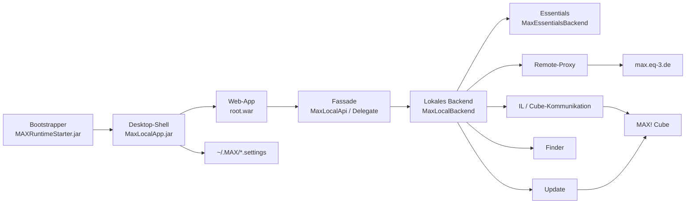

> English translation of docs/modules.md. Machine-created; DE/EN reviewed by the user on 27.11.2026; FR/IT/NL/PL feedback expected via issues/PRs.

# Modules and class roles of MAX Local Application 1.4.6

## 1. Purpose and reading notes

This document maps the modules and central classes of MAX Local Application 1.4.6 with their role, dependencies, and lifecycle. It serves as a basis for a rebuild, not as a porting recommendation. (Source: `decompiled/controller/resources/META-INF/maven/de.eq3.max/MaxControllerApplication/pom.xml:1-8`, `extracted/settings/Default.settings:1-9`)

Every statement is marked as `OBSERVATION`, `INFERENCE`, or `UNKNOWN` and evidenced with `source file:line` or an evidence ID. (Source: `decompiled/controller/sources/de/eq3/max/al/local/LocalController.java:75-124`, `evidence/javap-starter.txt:77-106`)

## 2. Module map

**EVIDENCE FOR THE MODULE MAP:** Bootstrapper (source: `evidence/javap-starter.txt:77-106`; evidence ID `ev_81a48cb5c63ace439b913812ff1d104c79c9a1179387732f5682a5545799e809`), desktop shell (source: `decompiled/maxlocalapp/sources/de/eq3/max/MaxLocalAppStarter/Application.java:42-47`), web app (source: `extracted/rootwar/WEB-INF/web.xml:1-68`), facade (source: `extracted/localbackend/LocalApp-cl.xml:8-17`), backend services (source: `decompiled/controller/sources/de/eq3/max/al/local/LocalController.java:75-124`), essentials (source: `extracted/essentials/essentials.spring.xml:12-27`), remote (source: `decompiled/controller/sources/de/eq3/max/al/local/remoteproxy/MaxRemoteProxy.java:31-41`), update (source: `decompiled/controller/sources/de/eq3/max/al/local/update/CubeUpdateService.java:13-19`), finder (source: `decompiled/controller/sources/de/eq3/max/al/local/finder/CubeFinder.java:20-35`), IL (source: `decompiled/controller/sources/de/eq3/max/il/local/CubeGateway.java:41-58`), settings (source: `decompiled/controller/sources/de/eq3/max/al/local/core/settings/SettingsProvider.java:69-75`).

### 2.1 Module inventory

| Module | Java files | Main task | Evidence |
|---|---:|---|---|
| `decompiled/maxlocalapp` | 29 | Desktop shell, Jetty, tray, proxy, splash | (Source: directory count of `decompiled/maxlocalapp/sources`; `decompiled/maxlocalapp/sources/de/eq3/max/MaxLocalAppStarter/Application.java:42-47`) |
| `decompiled/essentials` | 232 | Domain model, DTOs, state, validation, radiograms | (Source: directory count of `decompiled/essentials/sources`; `extracted/essentials/essentials.spring.xml:12-27`) |
| `decompiled/localbackend` | 109 | Local services, gateway, finder, remote, update | (Source: directory count of `decompiled/localbackend/sources`; `decompiled/localbackend/sources/de/eq3/max/al/local/LocalController.java:75-124`) |
| `decompiled/controller` | 110 | Complete backend view plus exit/alive client | (Source: directory count of `decompiled/controller/sources`; `decompiled/controller/sources/de/eq3/max/MaxControllerApplication/App.java:12-13`) |
| `extracted/rootwar` | 0 Java | HTML, JavaScript, DWR configuration, servlet mappings | (Source: `evidence/rootwar-entries.txt`; evidence ID `ev_198593f77a5b718fcd92173c539c0b5f7d78752738b9e66ae993003f805d2e67`) |
| `extracted/settings` | 0 Java | `Default.settings` with default values | (Source: `extracted/settings/Default.settings:1-9`; evidence ID `ev_31f2c19749714a95e3e7fb36dfc7552969f422676dd7ea8282172d359855089f`) |
| `extracted/starter` | 0 Java | `MAXRuntimeStarter.jar`, installer/updater | (Source: `evidence/javap-starter.txt:1-76`; evidence ID `ev_81a48cb5c63ace439b913812ff1d104c79c9a1179387732f5682a5545799e809`) |

**OBSERVATION:** `decompiled/controller/sources` and `decompiled/localbackend/sources` largely mirror the same classes; the counts of 109 and 110 are therefore not evidence of two functionally different backends. (Source: `decompiled/controller/sources/de/eq3/max/al/local/LocalController.java:74-75`, `decompiled/localbackend/sources/de/eq3/max/al/local/LocalController.java:74-75`, `decompiled/controller/sources/de/eq3/max/MaxControllerApplication/App.java:12-13`)

**INFERENCE:** The duplication is an artifact of extraction; for the module description, `controller` should be used as the reference. (Source: `decompiled/controller/sources/de/eq3/max/MaxControllerApplication/App.java:12-13`, `decompiled/localbackend/sources/de/eq3/max/al/local/LocalController.java:1-10`)

## 3. Module `maxlocalapp` – desktop shell

### 3.1 `de.eq3.max.MaxLocalAppStarter.Application`

| Property | Description | Evidence |
|---|---|---|
| Role | Starter of the desktop application, Jetty host, tray observer, file-change listener | (Source: `decompiled/maxlocalapp/sources/de/eq3/max/MaxLocalAppStarter/Application.java:42-47`) |
| Dependencies | `InstanceLock`, `SettingsProvider`, `PortFactory`, `ApplicationRunningChecker`, `MaxThread`, `MaxSystemTrayHandler`, `WebAppDeployer`, `Server`, `Desktop` | (Source: `decompiled/maxlocalapp/sources/de/eq3/max/MaxLocalAppStarter/Application.java:4-40`, `decompiled/maxlocalapp/sources/de/eq3/max/MaxLocalAppStarter/Application.java:58-67`, `decompiled/maxlocalapp/sources/de/eq3/max/MaxLocalAppStarter/Application.java:176-180`) |
| Lifecycle | `main()` → `InstanceLock` check → `run()` → `initializeServerSettings()` → `initializeSystemTray()` → `startServer()` → browser start; end via shutdown hook `MaxThread` and `Server.setStopAtShutdown(true)` | (Source: `decompiled/maxlocalapp/sources/de/eq3/max/MaxLocalAppStarter/Application.java:51-79`, `decompiled/maxlocalapp/sources/de/eq3/max/MaxLocalAppStarter/Application.java:216`) |

**OBSERVATION:** `Application` extends `Observable` and registers `MaxSystemTrayHandler` as an observer. (Source: `decompiled/maxlocalapp/sources/de/eq3/max/MaxLocalAppStarter/Application.java:43-44`, `decompiled/maxlocalapp/sources/de/eq3/max/MaxLocalAppStarter/Application.java:178-180`)

**OBSERVATION:** `notifyTrayAboutDownload(boolean)` informs observers about the download state. (Source: `decompiled/maxlocalapp/sources/de/eq3/max/MaxLocalAppStarter/Application.java:184-187`)

**OBSERVATION:** `fileChanged(...)` resets the locale and makes the tray menu redraw. (Source: `decompiled/maxlocalapp/sources/de/eq3/max/MaxLocalAppStarter/Application.java:280-284`)

**OBSERVATION:** `deleteOldLogFiles(...)` uses an `AgeFileFilter` and `FileUtils.deleteQuietly(...)`. (Source: `decompiled/maxlocalapp/sources/de/eq3/max/MaxLocalAppStarter/Application.java:288-292`)

**INFERENCE:** In a rebuild, the shell should be modeled as a separate, long-running process that manages the web server and browser link. (Source: `decompiled/maxlocalapp/sources/de/eq3/max/MaxLocalAppStarter/Application.java:51-79`, `decompiled/maxlocalapp/sources/de/eq3/max/MaxLocalAppStarter/Application.java:190-220`)

### 3.2 `de.eq3.max.cl.local.controller.ControllerServlet`

| Property | Description | Evidence |
|---|---|---|
| Role | Local control endpoint for `Exit` and `Alive` | (Source: `decompiled/controller/sources/de/eq3/max/cl/local/controller/ControllerServlet.java:13-16`) |
| Dependencies | `HttpServletRequest`, `HttpServletResponse`, JVM `System.exit(0)` | (Source: `decompiled/controller/sources/de/eq3/max/cl/local/controller/ControllerServlet.java:3-10`, `decompiled/controller/sources/de/eq3/max/cl/local/controller/ControllerServlet.java:26-43`) |
| Lifecycle | Servlet initialized via `init()`; `doGet()` returns 404; `doPost()` reads one line and reacts | (Source: `decompiled/controller/sources/de/eq3/max/cl/local/controller/ControllerServlet.java:18-26`) |

**OBSERVATION:** The servlet is mapped to `/controller/*` in `web.xml`. (Source: `extracted/rootwar/WEB-INF/web.xml:55-62`)

### 3.3 `de.eq3.max.MaxControllerApplication.App`

| Property | Description | Evidence |
|---|---|---|
| Role | Command-line client for `Exit`/`Alive` | (Source: `decompiled/controller/sources/de/eq3/max/MaxControllerApplication/App.java:12-20`) |
| Dependencies | `SettingsProvider`, `HttpURLConnection` | (Source: `decompiled/controller/sources/de/eq3/max/MaxControllerApplication/App.java:20-61`) |
| Lifecycle | Short-lived: read port, send POST, ignore/print response | (Source: `decompiled/controller/sources/de/eq3/max/MaxControllerApplication/App.java:20-61`) |

**OBSERVATION:** The port comes from `SettingsProvider.getServerSettings().getPort()` with fallback `8080`. (Source: `decompiled/controller/sources/de/eq3/max/MaxControllerApplication/App.java:20-26`)

## 4. Module `root.war` – web and facade layer

### 4.1 `MaxLocalApi`

| Property | Description | Evidence |
|---|---|---|
| Role | DWR facade, maps between `de.eq3.max.cl.dto.*` and domain classes | (Source: `decompiled/controller/sources/de/eq3/max/al/local/MaxLocalApi.java:34-41`) |
| Dependencies | `ICommunicationService` (`@Qualifier("localController")`), `org.dozer.Mapper` | (Source: `decompiled/controller/sources/de/eq3/max/al/local/MaxLocalApi.java:36-41`) |
| Lifecycle | Spring bean `MaxLocalApi`, wrapped by the DWR delegate `MaxLocalDelegate` | (Source: `extracted/localbackend/LocalApp-cl.xml:8-17`) |

**OBSERVATION:** `getMaxCubeState()` maps the domain state and calls `maxCubeState.resetChangedState()`. (Source: `decompiled/controller/sources/de/eq3/max/al/local/MaxLocalApi.java:47-51`)

**OBSERVATION:** `setClientCommands(...)` maps DTO commands to domain commands via `mapCommands(...)`. (Source: `decompiled/controller/sources/de/eq3/max/al/local/MaxLocalApi.java:99-101`, `decompiled/controller/sources/de/eq3/max/al/local/MaxLocalApi.java:153-159`)

**OBSERVATION:** `getAdditionalInformation()` maps IP addresses, firmware, and serial number into a DTO. (Source: `decompiled/controller/sources/de/eq3/max/al/local/MaxLocalApi.java:233-234`, `decompiled/controller/sources/de/eq3/max/al/local/LocalController.java:901-908`)

### 4.2 `MaxLocalDelegate`

| Property | Description | Evidence |
|---|---|---|
| Role | DWR-compatible wrapper around `IMaxLocal` because of DWR-161 | (Source: `extracted/localbackend/LocalApp-cl.xml:6-17`, `decompiled/controller/sources/de/eq3/max/al/local/MaxLocalDelegate.java:23-27`) |
| Dependencies | `IMaxLocal delegate` (final field, set via constructor) | (Source: `decompiled/controller/sources/de/eq3/max/al/local/MaxLocalDelegate.java:24-29`) |
| Lifecycle | Created by Spring with `ref bean="MaxLocalApi"`; forwards all methods | (Source: `extracted/localbackend/LocalApp-cl.xml:12-17`, `decompiled/controller/sources/de/eq3/max/al/local/MaxLocalDelegate.java:31-199`) |

**OBSERVATION:** The delegate implements the same methods as `MaxLocalApi`, including `getMaxCubeState`, `setClientCommands`, `performFirmwareUpdate`, `listAvailableMaxCubes`, and `getLocale`. (Source: `decompiled/controller/sources/de/eq3/max/al/local/MaxLocalDelegate.java:31-199`)

### 4.3 JavaScript modules

| Module | Role | Evidence |
|---|---|---|
| `js/lib/APICalls.js` | Wrapper for DWR calls, timeout 120000 ms, offline/offline-mode switch | (Source: `extracted/rootwar/js/lib/APICalls.js:15-34`, `extracted/rootwar/js/lib/APICalls.js:905-919`) |
| `js/lib/engine.js` | Overrides `dwr.engine._serializeAll` | (Source: `extracted/rootwar/js/lib/engine.js:1-15`) |
| `js/models/maxCubeModel.js` | Holds the `dwr` instance and `logLevel` in the model | (Source: `extracted/rootwar/js/models/maxCubeModel.js:12-30`) |
| `js/com_structure/controllers/indexStructureController.js` | Keep-alive with `alivePingTime: 3000` | (Source: `extracted/rootwar/js/com_structure/controllers/indexStructureController.js:31`, `extracted/rootwar/js/com_structure/controllers/indexStructureController.js:723-726`) |
| `index.html` | Entry page with CSS/JS imports | (Source: `extracted/rootwar/index.html:1-30`) |

**OBSERVATION:** `APICalls.prototype.isLocalApp()` delegates to `actionHelper.isLocalApp()`. (Source: `extracted/rootwar/js/lib/APICalls.js:2485-2487`)

**INFERENCE:** The JavaScript layer is tied to the DWR names; a rebuild must either emulate these names or change the callers. (Source: `extracted/rootwar/js/lib/APICalls.js:905-919`, `extracted/localbackend/LocalApp-cl.xml:16-60`)

## 5. Module `localbackend` – application layer

### 5.1 `de.eq3.max.al.local.LocalController`

| Property | Description | Evidence |
|---|---|---|
| Role | Central `ICommunicationService` and `IConnectionTimeoutHandler` | (Source: `decompiled/controller/sources/de/eq3/max/al/local/LocalController.java:74-75`) |
| Dependencies | `cubeStateHolder`, validators, `maxRemoteProxy`, `cubeUpdateService`, `cubeStateFactory`, `cubeGateway`, `connectionWatchDog`, `localConfiguration`, `radiogramBuilder` | (Source: `decompiled/controller/sources/de/eq3/max/al/local/LocalController.java:80-124`, `decompiled/controller/sources/de/eq3/max/al/local/LocalController.java:494-509`) |
| Lifecycle | Spring singleton `@Component("localController")`; lives for the duration of the web context | (Source: `decompiled/controller/sources/de/eq3/max/al/local/LocalController.java:74`, `extracted/rootwar/WEB-INF/max-service.xml:15-16`) |

**OBSERVATION:** `getMaxCubeState()` is the entry point for state retrieval and calls `checkConnection()`, `cubeState()`, and `cubeStateUpdateDeviceState()`. (Source: `decompiled/controller/sources/de/eq3/max/al/local/LocalController.java:128-133`)

**OBSERVATION:** `checkConnection()` throws `NotConnectedToCubeException` if no connection is active and otherwise resets the watchdog. (Source: `decompiled/controller/sources/de/eq3/max/al/local/LocalController.java:589-595`)

**OBSERVATION:** `setClientCommand(...)` delegates each command to `executeClientCommand(...)`. (Source: `decompiled/controller/sources/de/eq3/max/al/local/LocalController.java:484-492`)

**OBSERVATION:** `saveMetadata()` creates metadata via `cubeStateFactory.createMetaData(cubeState())` and sends it through the gateway. (Source: `decompiled/controller/sources/de/eq3/max/al/local/LocalController.java:832-838`)

**OBSERVATION:** `listAvailableMaxCubes()` combines cached `ApplicationSettings` with `CubeFinder.listCubes(...)`. (Source: `decompiled/controller/sources/de/eq3/max/al/local/LocalController.java:658-681`)

**OBSERVATION:** `connect(String ip)` sets `remoteProxy.setInitialized(false)` after connecting. (Source: `decompiled/controller/sources/de/eq3/max/al/local/LocalController.java:548-550`)

**OBSERVATION:** `stillAlivePing()` resets `connectionWatchDog` and returns `cubeGateway.getActualAirtimeStatus()`. (Source: `decompiled/controller/sources/de/eq3/max/al/local/LocalController.java:524-529`)

**OBSERVATION:** `disconnect()` first cancels inclusion mode if necessary. (Source: `decompiled/controller/sources/de/eq3/max/al/local/LocalController.java:559-570`)

### 5.2 `ConnectionWatchDog`

| Property | Description | Evidence |
|---|---|---|
| Role | Detects client inactivity and triggers timeout | (Source: `decompiled/controller/sources/de/eq3/max/al/local/ConnectionWatchDog.java:9-19`) |
| Dependencies | `IConnectionTimeoutHandler`, `@Value("${max.idleTimeBeforeLocalAppDisconnect}")` | (Source: `decompiled/controller/sources/de/eq3/max/al/local/ConnectionWatchDog.java:13-17`) |
| Lifecycle | Spring bean, called every 5 seconds by `localScheduler` | (Source: `extracted/localbackend/LocalApp-al.xml:10-15`) |

**OBSERVATION:** `setActive(boolean)` sets `lastAccessTimestamp` to the current time. (Source: `decompiled/controller/sources/de/eq3/max/al/local/ConnectionWatchDog.java:25-28`)

**OBSERVATION:** `checkConnection()` calls `timeoutHandler.onConnectionTimeout()` only when `active == true` and the timeout has been exceeded. (Source: `decompiled/controller/sources/de/eq3/max/al/local/ConnectionWatchDog.java:32-41`)

### 5.3 `CubeFinder`

| Property | Description | Evidence |
|---|---|---|
| Role | Finds cubes via UDP broadcast/multicast | (Source: `decompiled/controller/sources/de/eq3/max/al/local/finder/CubeFinder.java:20-35`) |
| Dependencies | `MulticastSocket`, `DatagramPacket`, `NetworkInterface`, `CubeConnectionInfo` | (Source: `decompiled/controller/sources/de/eq3/max/al/local/finder/CubeFinder.java:4-7`, `decompiled/controller/sources/de/eq3/max/al/local/finder/CubeFinder.java:84-94`) |
| Lifecycle | One object per search operation via `listCubes(...)`; socket used within the flow | (Source: `decompiled/controller/sources/de/eq3/max/al/local/finder/CubeFinder.java:37-43`, `decompiled/controller/sources/de/eq3/max/al/local/finder/CubeFinder.java:108-123`) |

**OBSERVATION:** The signature `^eQ3Max(Ap|Bl)` distinguishes normal mode from bootloader. (Source: `decompiled/controller/sources/de/eq3/max/al/local/finder/CubeFinder.java:21-25`)

**OBSERVATION:** `sendHello()` sends the same message to broadcast and multicast. (Source: `decompiled/controller/sources/de/eq3/max/al/local/finder/CubeFinder.java:47-50`)

**OBSERVATION:** `receiveCubeConnectioInfo()` creates `CubeConnectionInfo` from signature, serial number, firmware, and address. (Source: `decompiled/controller/sources/de/eq3/max/al/local/finder/CubeFinder.java:84-94`)

### 5.4 `MaxRemoteProxy`

| Property | Description | Evidence |
|---|---|---|
| Role | HTTP gateway to the MAX remote service and software-version query | (Source: `decompiled/controller/sources/de/eq3/max/al/local/remoteproxy/MaxRemoteProxy.java:31-41`) |
| Dependencies | `ICubeGateway`, `IMaxCubeStateHolder`, `ILocalConfiguration`, `HttpURLConnection`, `UrlRetriever` | (Source: `decompiled/controller/sources/de/eq3/max/al/local/remoteproxy/MaxRemoteProxy.java:35-42`, `decompiled/controller/sources/de/eq3/max/al/local/remoteproxy/MaxRemoteProxy.java:271-298`) |
| Lifecycle | Spring bean; `isInitialized` flag is reset on `connect` and refreshed via `init()` when needed | (Source: `decompiled/controller/sources/de/eq3/max/al/local/remoteproxy/MaxRemoteProxy.java:41`, `decompiled/controller/sources/de/eq3/max/al/local/remoteproxy/MaxRemoteProxy.java:271-274`, `decompiled/controller/sources/de/eq3/max/al/local/LocalController.java:548-550`) |

**OBSERVATION:** Connection and read timeouts are each 1500000 ms. (Source: `decompiled/controller/sources/de/eq3/max/al/local/remoteproxy/MaxRemoteProxy.java:33-34`)

**OBSERVATION:** `setRemoteCredentials(...)`, `getRemoteCredentials()`, `setRemoteAccess(...)`, `checkProductActivation()`, and `activateProduct(...)` each build request objects and call `send(request)`. (Source: `decompiled/controller/sources/de/eq3/max/al/local/remoteproxy/MaxRemoteProxy.java:67-78`, `decompiled/controller/sources/de/eq3/max/al/local/remoteproxy/MaxRemoteProxy.java:83-90`, `decompiled/controller/sources/de/eq3/max/al/local/remoteproxy/MaxRemoteProxy.java:123-133`, `decompiled/controller/sources/de/eq3/max/al/local/remoteproxy/MaxRemoteProxy.java:156-166`, `decompiled/controller/sources/de/eq3/max/al/local/remoteproxy/MaxRemoteProxy.java:303-313`)

**OBSERVATION:** `getCurrentSoftwareVersion()` uses `maxSoftwareUrl` and a `BufferedReader`. (Source: `decompiled/controller/sources/de/eq3/max/al/local/remoteproxy/MaxRemoteProxy.java:250-267`)

### 5.5 `CubeUpdateService`, `CubeUpdater`, `CubeUdpProxy`

| Class | Role | Dependencies | Lifecycle | Evidence |
|---|---|---|---|---|
| `CubeUpdateService` | Status management and thread start for firmware update | `firmware.enc`, `CubeUpdater`, `IUpdateStatusHandler` | Spring bean `cubeUpdateService`, own thread `CubeUpdateService` | (Source: `decompiled/controller/sources/de/eq3/max/al/local/update/CubeUpdateService.java:13-19`, `decompiled/controller/sources/de/eq3/max/al/local/update/CubeUpdateService.java:28-54`) |
| `CubeUpdater` | Control of update phases | `CubeUdpProxy`, `IFirmwareFile`, status handler | created anew per update | (Source: `decompiled/controller/sources/de/eq3/max/al/local/update/CubeUpdater.java:15-27`, `decompiled/controller/sources/de/eq3/max/al/local/update/CubeUpdater.java:33-41`) |
| `CubeUdpProxy` | UDP communication with the bootloader | `MulticastSocket`, `CubeUdpRequestFactory`, `CubeFinder` | created anew per update, `dispose()` closes resources | (Source: `decompiled/controller/sources/de/eq3/max/al/local/update/CubeUdpProxy.java:21-42`, `decompiled/controller/sources/de/eq3/max/al/local/update/CubeUdpProxy.java:56-67`, `decompiled/controller/sources/de/eq3/max/al/local/update/CubeUdpProxy.java:182`) |

**OBSERVATION:** `CubeUpdateService` prevents parallel updates via `inProgress` and throws `UpdateAlreadyInProgressException`. (Source: `decompiled/controller/sources/de/eq3/max/al/local/update/CubeUpdateService.java:18-19`, `decompiled/controller/sources/de/eq3/max/al/local/update/CubeUpdateService.java:27-39`)

**OBSERVATION:** `CubeUpdater.writeFrame(...)` reports `WriteFrameUpdateStatusArgs` and calls `proxy.writeFrame(index, frame)`. (Source: `decompiled/controller/sources/de/eq3/max/al/local/update/CubeUpdater.java:94-97`)

**OBSERVATION:** `CubeUdpProxy.performRequest(...)` sends to `this.ip` or broadcast and waits with `TimeoutWatcher`. (Source: `decompiled/controller/sources/de/eq3/max/al/local/update/CubeUdpProxy.java:199-224`)

**INFERENCE:** The update path is modularly separated from the normal connection path and should retain its own states and timeouts in a rebuild. (Source: `decompiled/controller/sources/de/eq3/max/al/local/LocalController.java:686-689`, `decompiled/controller/sources/de/eq3/max/al/local/update/CubeUdpProxy.java:23-32`)

## 6. Module `essentials` – domain and state

### 6.1 `MaxCubeStateHolder`

| Property | Description | Evidence |
|---|---|---|
| Role | Holds `IMaxCubeState`, new devices, airtime status, and timestamps in memory | (Source: `decompiled/essentials/sources/de/eq3/max/al/core/cubestate/MaxCubeStateHolder.java:1-30`) |
| Dependencies | `IRoomIdentificationManager`, `Configuration` | (Source: `decompiled/essentials/sources/de/eq3/max/al/core/cubestate/MaxCubeStateHolder.java:9-24`) |
| Lifecycle | Spring singleton `cubeStateHolder`, lives for the duration of the web context | (Source: `decompiled/essentials/sources/de/eq3/max/al/core/cubestate/MaxCubeStateHolder.java:12-13`) |

**OBSERVATION:** The holder contains `newDevices` as an `ArrayList` and `lastTimeGetNewDevicesWasCalled`. (Source: `decompiled/essentials/sources/de/eq3/max/al/core/cubestate/MaxCubeStateHolder.java:25-28`)

**OBSERVATION:** `LocalController` sets the timestamp via `cubeStateHolder.setLastTimeGetNewDevicesWasCalled()`. (Source: `decompiled/controller/sources/de/eq3/max/al/local/LocalController.java:238-244`)

### 6.2 `ClientExceptionTranslator`, `ResetRadiogramBuilder`, `Dozer`

**OBSERVATION:** `ClientExceptionTranslator` is constructed with `classpath:/errorcodes.properties` and `false`. (Source: `extracted/essentials/essentials.spring.xml:20-22`)

**OBSERVATION:** `ResetRadiogramBuilder` contains a `TransmissionRadiogramBuilder` as a property. (Source: `extracted/essentials/essentials.spring.xml:25-27`)

**OBSERVATION:** The `org.dozer.DozerBeanMapper` receives `dozer-mapping.xml` as its mapping file. (Source: `extracted/essentials/essentials.spring.xml:12-18`, `extracted/essentials/dozer-mapping.xml:1-20`)

**INFERENCE:** The Dozer layer decouples the DTO boundary from the domain; a rebuild can replace this with explicit mappers. (Source: `decompiled/controller/sources/de/eq3/max/al/local/MaxLocalApi.java:47-51`, `decompiled/controller/sources/de/eq3/max/al/local/MaxLocalApi.java:153-159`)

## 7. Module `il` – integration layer

### 7.1 `CubeGateway`

| Property | Description | Evidence |
|---|---|---|
| Role | Serializes access to the active cube connection | (Source: `decompiled/controller/sources/de/eq3/max/il/local/CubeGateway.java:41-53`) |
| Dependencies | `ILocalConfiguration`, `IMaxCubeStateHolder`, `ICubeConnection`, various command classes | (Source: `decompiled/controller/sources/de/eq3/max/il/local/CubeGateway.java:45-50`, `decompiled/controller/sources/de/eq3/max/il/local/CubeGateway.java:122-287`) |
| Lifecycle | Spring bean; starts a daemon thread `CubeGateway` in the constructor | (Source: `decompiled/controller/sources/de/eq3/max/il/local/CubeGateway.java:41-58`) |

**OBSERVATION:** The connection is held in `ArrayBlockingQueue<ICubeConnection>(1)`. (Source: `decompiled/controller/sources/de/eq3/max/il/local/CubeGateway.java:52`)

**OBSERVATION:** `execute(...)` catches `SocketException` and `SocketTimeoutException` and calls `dropConnection()`. (Source: `decompiled/controller/sources/de/eq3/max/il/local/CubeGateway.java:304-314`)

**OBSERVATION:** `idleCall()` sends `encrypt("something")` when the cube has not been addressed for longer than `getCubeIdleTimeout()`. (Source: `decompiled/controller/sources/de/eq3/max/il/local/CubeGateway.java:291-301`)

**OBSERVATION:** `encrypt(...)` and `decrypt(...)` are implemented via `AESEncryptCubeCommand` and `AESDecryptCubeCommand`. (Source: `decompiled/controller/sources/de/eq3/max/il/local/CubeGateway.java:173-184`)

**UNKNOWN:** `CubeGateway.run()` is preserved in JADX as an `UnsupportedOperationException` with pseudocode; the exact loop logic cannot be reconstructed directly. (Source: `decompiled/controller/sources/de/eq3/max/il/local/CubeGateway.java:67-107`)

### 7.2 `CubeConnection`

| Property | Description | Evidence |
|---|---|---|
| Role | Holds socket, reader/writer, command queue, and raw cube state | (Source: `decompiled/controller/sources/de/eq3/max/il/local/CubeConnection.java:24-37`) |
| Dependencies | `Socket`, `BufferedReader`, `BufferedWriter`, `BlockingQueue<ICubeConnectionCommand>`, `ILocalConfiguration`, `IRawCubeState` | (Source: `decompiled/controller/sources/de/eq3/max/il/local/CubeConnection.java:10-17`, `decompiled/controller/sources/de/eq3/max/il/local/CubeConnection.java:26-37`) |
| Lifecycle | Created by `CubeGateway.connect(ip)`, processed by the gateway thread, ended via `close()` | (Source: `decompiled/controller/sources/de/eq3/max/il/local/CubeGateway.java:110-119`, `decompiled/controller/sources/de/eq3/max/il/local/CubeGateway.java:67-107`, `decompiled/controller/sources/de/eq3/max/il/local/CubeConnection.java:123-125`) |

**OBSERVATION:** The constructor reads the `H:` line and parses serial number, radio address, and firmware version. (Source: `decompiled/controller/sources/de/eq3/max/il/local/CubeConnection.java:54-57`, `decompiled/controller/sources/de/eq3/max/il/local/CubeConnection.java:297-302`)

**OBSERVATION:** `receiveDeviceAndMetaData()` processes `L:`, `C:`, and `M:` into `IRawCubeState`. (Source: `decompiled/controller/sources/de/eq3/max/il/local/CubeConnection.java:157-183`)

**OBSERVATION:** `talkToCube()` waits blocking for commands and calls `command.notifyResult()` after execution. (Source: `decompiled/controller/sources/de/eq3/max/il/local/CubeConnection.java:185-197`)

**OBSERVATION:** In inclusion mode only `FetchNewDevicesCubeCommand`, `CancelInclusionModeCubeCommand`, and `DisconnectCubeCommand` are allowed. (Source: `decompiled/controller/sources/de/eq3/max/il/local/CubeConnection.java:264-275`)

### 7.3 Command classes (selection)

| Class | Role | Evidence |
|---|---|---|
| `FetchGatewayStateCubeCommand` | Fetches the cube's overall state | (Source: `decompiled/controller/sources/de/eq3/max/il/local/CubeGateway.java:122-126`) |
| `FetchNewDevicesCubeCommand` | Starts/reads inclusion mode | (Source: `decompiled/controller/sources/de/eq3/max/il/local/CubeGateway.java:129-132`) |
| `CancelInclusionModeCubeCommand` | Ends inclusion mode | (Source: `decompiled/controller/sources/de/eq3/max/il/local/CubeGateway.java:137-143`) |
| `SendMetaDataCommand` | Writes metadata to the cube | (Source: `decompiled/controller/sources/de/eq3/max/il/local/CubeGateway.java:148-151`) |
| `CommitDeviceRadiogramCommand` | Transmits device radiograms | (Source: `decompiled/controller/sources/de/eq3/max/il/local/CubeGateway.java:165-167`) |
| `AESEncryptCubeCommand` / `AESDecryptCubeCommand` | Encryption/decryption for keep-alive and remote data | (Source: `decompiled/controller/sources/de/eq3/max/il/local/CubeGateway.java:173-184`) |
| `DisconnectCubeCommand` | Ends the TCP connection | (Source: `decompiled/controller/sources/de/eq3/max/il/local/CubeGateway.java:187-189`) |

**INFERENCE:** Each command encapsulates exactly one cube operation and is serialized through the queue; this structure is reusable for a rebuild. (Source: `decompiled/controller/sources/de/eq3/max/il/local/CubeConnection.java:139-155`, `decompiled/controller/sources/de/eq3/max/il/local/CubeGateway.java:122-287`)

## 8. Module `settings` – configuration

### 8.1 `SettingsProvider` and `Settings`

| Class | Role | Dependencies | Lifecycle | Evidence |
|---|---|---|---|---|
| `SettingsProvider` | Loads and saves properties files | `FileInputStream`, `FileOutputStream`, `Settings` | static methods, no state | (Source: `decompiled/controller/sources/de/eq3/max/al/local/core/settings/SettingsProvider.java:10-75`) |
| `Settings` | Base class for properties with default values | `Default.settings` from classpath | abstract base class | (Source: `decompiled/controller/sources/de/eq3/max/al/local/core/settings/Settings.java:8-22`) |
| `ApplicationSettings` | `~/.MAX/max.settings` | `Settings` | reloaded on each access | (Source: `decompiled/controller/sources/de/eq3/max/al/local/core/settings/ApplicationSettings.java:147-148`, `decompiled/controller/sources/de/eq3/max/al/local/core/settings/SettingsProvider.java:23-25`) |
| `ServerSettings` | Port of the local application | `Settings` | reloaded on each access | (Source: `decompiled/controller/sources/de/eq3/max/al/local/core/settings/SettingsProvider.java:17-20`, `decompiled/maxlocalapp/sources/de/eq3/max/MaxLocalAppStarter/Application.java:137-162`) |
| `LookupSettings`, `ProxySettings` | Lookup and proxy configuration | `Settings` | reloaded on each access | (Source: `decompiled/controller/sources/de/eq3/max/al/local/core/settings/SettingsProvider.java:11-31`) |

**OBSERVATION:** `getSettingsFile(...)` builds the path from `user.home`, `.MAX`, and the respective settings class's file name. (Source: `decompiled/controller/sources/de/eq3/max/al/local/core/settings/SettingsProvider.java:69-75`)

**OBSERVATION:** `saveSettings(...)` writes with `settings.store(outputStream, comment)`. (Source: `decompiled/controller/sources/de/eq3/max/al/local/core/settings/SettingsProvider.java:36-42`)

**OBSERVATION:** `loadSettings(...)` loads an existing file; otherwise the default values from `Default.settings` remain active. (Source: `decompiled/controller/sources/de/eq3/max/al/local/core/settings/SettingsProvider.java:51-65`, `decompiled/controller/sources/de/eq3/max/al/local/core/settings/Settings.java:13-21`)

**OBSERVATION:** `Default.settings` defines nine keys, including `LookupURL`, `Locale`, `UpdateURL`, and `ShowInteractiveSplash`. (Source: `extracted/settings/Default.settings:1-9`)

## 9. Module `bootstrapper`

### 9.1 `de.eq3.max.runtime.Executor`

| Property | Description | Evidence |
|---|---|---|
| Role | Finds installation paths, checks version/digest, creates `start.cmd`, starts the application | (Source: `evidence/javap-starter.txt:77-135`, `evidence/javap-starter.txt:235-302`; evidence ID `ev_81a48cb5c63ace439b913812ff1d104c79c9a1179387732f5682a5545799e809`) |
| Dependencies | `IConstants`, `DigestReader`, `Updater`, registry queries, JNI folder helper | (Source: `evidence/javap-starter.txt:1-76`, `evidence/javap-starter.txt:683-797`; evidence ID `ev_81a48cb5c63ace439b913812ff1d104c79c9a1179387732f5682a5545799e809`) |
| Lifecycle | `main(String[])` creates `Executor` and calls `run()` | (Source: `evidence/javap-starter.txt:797-805`; evidence ID `ev_81a48cb5c63ace439b913812ff1d104c79c9a1179387732f5682a5545799e809`) |

### 9.2 `de.eq3.max.runtime.Updater`

| Property | Description | Evidence |
|---|---|---|
| Role | Checks and performs application updates | (Source: `evidence/javap-starter.txt:808-842`, `evidence/javap-starter.txt:1002-1008`; evidence ID `ev_81a48cb5c63ace439b913812ff1d104c79c9a1179387732f5682a5545799e809`) |
| Dependencies | `FileWriter` log, digest files, restore logic | (Source: `evidence/javap-starter.txt:809`, `evidence/javap-starter.txt:1407-1558`; evidence ID `ev_81a48cb5c63ace439b913812ff1d104c79c9a1179387732f5682a5545799e809`) |
| Lifecycle | Methods `isUpdateAvailable()`, `performUpdate(String)`, `restore(String)` | (Source: `evidence/javap-starter.txt:842`, `evidence/javap-starter.txt:1002`, `evidence/javap-starter.txt:1407`; evidence ID `ev_81a48cb5c63ace439b913812ff1d104c79c9a1179387732f5682a5545799e809`) |

**OBSERVATION:** `IConstants` defines `.MAX`, `.MAX_UPDATE`, `.MAX_BACKUP`, `digest.txt`, `version.txt`, and registry queries for shell folders. (Source: `evidence/javap-starter.txt:1-27`; evidence ID `ev_81a48cb5c63ace439b913812ff1d104c79c9a1179387732f5682a5545799e809`)

**OBSERVATION:** `getdown.txt` sets `class = de.eq3.max.MaxLocalAppStarter.Application`, `appbase = http://max.eq-3.de/max/`, and `webapp/root.war` as a resource. (Source: `C:\ProgramData\MAX\getdown.txt`; evidence ID `ev_81a48cb5c63ace439b913812ff1d104c79c9a1179387732f5682a5545799e809`)

**OBSERVATION:** `startme.cmd`, `startmejava.cmd`, and `startmeopen.cmd` start `de.eq3.max.runtime.Executor` with slightly different Java paths. (Source: `C:\Program Files (x86)\Max Local Application\startme.cmd:1-3`, `C:\Program Files (x86)\Max Local Application\startmejava.cmd:1-3`, `C:\Program Files (x86)\Max Local Application\startmeopen.cmd:1-3`; evidence ID `ev_81a48cb5c63ace439b913812ff1d104c79c9a1179387732f5682a5545799e809`)

## 10. Database status

**OBSERVATION:** No database exists in the analyzed modules; a search across all decompiled Java files for database APIs returned 0 hits. (Source: `decompiled/**/*.java`, `Select-String` search for `jdbc|hsql|derby|sqlite|\.db\b|DataSource|EntityManager|javax.persistence|PreparedStatement|getConnection\(`; evidence IDs `ev_b01b22f5d2b54d783aa1cb8dbe567111e03a6fe5029e1641318be232168a43a7`, `ev_cd71f066e83568d1ab3c71c8f78b5ea143ceb6dcf3b32ee7b5329970380de677`, `ev_42e4885a961f14d51aae2e5f880199599ca787a822b9dc66cd85ce2d46a9c91a`)

**OBSERVATION:** Persistence consists exclusively of `~/.MAX` properties and state on the cube. (Source: `decompiled/controller/sources/de/eq3/max/al/local/core/settings/SettingsProvider.java:69-75`, `decompiled/controller/sources/de/eq3/max/al/local/LocalController.java:832-838`)

**INFERENCE:** A rebuild does not need a database schema to cover 1.4.6 functionality. (Source: `decompiled/controller/sources/de/eq3/max/al/local/core/settings/SettingsProvider.java:69-75`, `decompiled/essentials/sources/de/eq3/max/al/core/cubestate/MaxCubeStateHolder.java:1-30`)

## 11. Open points

**UNKNOWN:** The concrete classes behind `MaxThread`, `MaxSystemTrayHandler`, `ProxySettingsWindow`, `PortFactory`, and `InteractiveSplash` were not analyzed in detail. (Source: `decompiled/maxlocalapp/sources/de/eq3/max/MaxLocalAppStarter/Application.java:4-40`, `decompiled/maxlocalapp/sources/de/eq3/max/MaxLocalAppStarter/Application.java:101-114`)

**OBSERVATION:** `getConnectionPort(ip)` is fully evidenced: returns `connectionVirtualCubePort` (54321) when `ip == "127.0.0.1"` or `ip == InetAddress.getLocalHost().getHostAddress()`, otherwise `DEFAULT_CUBE_PORT = 62910`; also 62910 on `UnknownHostException`. (Source: `decompiled/localbackend/sources/de/eq3/max/al/local/core/LocalConfiguration.java:12-13,81-92`; `extracted/settings/max.local.properties:22`)

**OBSERVATION:** The complete list is available: `decompiled/localbackend/sources/de/eq3/max/il/local/commands/` contains **19** command classes (`AdjustTimezoneConfigurationCommand`, `AESDecrypt/EncryptCubeCommand`, `CancelInclusionModeCubeCommand`, `DeleteDevicesCubeCommand`, `DeviceSendCommand`, `DisconnectCubeCommand`, `FetchGatewayStateCubeCommand`, `FetchNewDevicesCubeCommand`, `GetConfigurationCubeCommand`, `IntervalCubeCommand`, `ListDevicesCubeCommand`, `PushButtonConfigurationCubeCommand`, `QueryNTPServerCommand`, `ResetGatewayCubeCommand`, `SendMetadataCubeCommand`, `SetNTPServerCommand`, `SetUrlCommand`, `WakeupCommand`). The wire syntax of each class is documented in `docs/maxcube-protocol.md` section 6.

**UNKNOWN:** The exact meaning of all DWR conversions for `ClientCommand` subtypes was not investigated. (Source: `extracted/essentials/max-dwr.xml:53-67`)

## 12. Summary

**OBSERVATION:** The modules are clearly divided into bootstrapper, desktop shell, web facade, local backend, essentials/domain, IL communication, remote proxy, update, and settings. (Source: `evidence/javap-starter.txt:77-106`, `decompiled/maxlocalapp/sources/de/eq3/max/MaxLocalAppStarter/Application.java:42-47`, `extracted/localbackend/LocalApp-cl.xml:8-17`, `decompiled/controller/sources/de/eq3/max/al/local/LocalController.java:75-124`, `extracted/essentials/essentials.spring.xml:12-27`, `decompiled/controller/sources/de/eq3/max/il/local/CubeGateway.java:41-58`)

**OBSERVATION:** `LocalController` is the central service, `CubeGateway`/`CubeConnection` serialize cube communication, `MaxCubeStateHolder` holds state in memory, and `SettingsProvider` writes to `~/.MAX`. (Source: `decompiled/controller/sources/de/eq3/max/al/local/LocalController.java:75-124`, `decompiled/controller/sources/de/eq3/max/il/local/CubeGateway.java:52-58`, `decompiled/essentials/sources/de/eq3/max/al/core/cubestate/MaxCubeStateHolder.java:1-30`, `decompiled/controller/sources/de/eq3/max/al/local/core/settings/SettingsProvider.java:69-75`)
