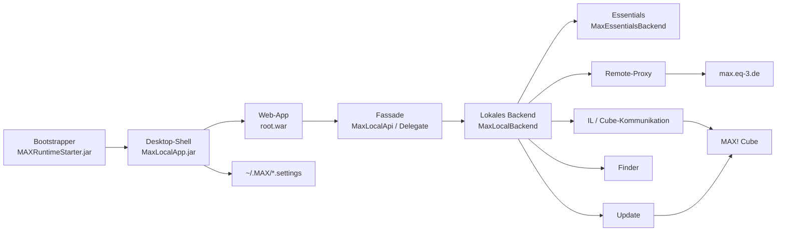

# Module und Klassenrollen der MAX Local Application 1.4.6

## 1. Zweck und Lesart

Dieses Dokument kartiert die Module und zentralen Klassen der MAX Local Application 1.4.6 mit Rolle, Abhängigkeiten und Lebenszyklus. Es dient als Nachbau-Grundlage, nicht als Portierungsempfehlung. (Quelle: `decompiled/controller/resources/META-INF/maven/de.eq3.max/MaxControllerApplication/pom.xml:1-8`, `extracted/settings/Default.settings:1-9`)

Jede Aussage ist als `BEOBACHTUNG`, `INFERENZ` oder `UNBEKANNT` markiert und mit `Quelldatei:Zeile` oder Evidence-ID belegt. (Quelle: `decompiled/controller/sources/de/eq3/max/al/local/LocalController.java:75-124`, `evidence/javap-starter.txt:77-106`)

## 2. Modulkarte

**BELEG ZUR MODULKARTE:** Bootstrapper (Quelle: `evidence/javap-starter.txt:77-106`; Evidence-ID `ev_81a48cb5c63ace439b913812ff1d104c79c9a1179387732f5682a5545799e809`), Desktop-Shell (Quelle: `decompiled/maxlocalapp/sources/de/eq3/max/MaxLocalAppStarter/Application.java:42-47`), Web-App (Quelle: `extracted/rootwar/WEB-INF/web.xml:1-68`), Fassade (Quelle: `extracted/localbackend/LocalApp-cl.xml:8-17`), Backend-Services (Quelle: `decompiled/controller/sources/de/eq3/max/al/local/LocalController.java:75-124`), Essentials (Quelle: `extracted/essentials/essentials.spring.xml:12-27`), Remote (Quelle: `decompiled/controller/sources/de/eq3/max/al/local/remoteproxy/MaxRemoteProxy.java:31-41`), Update (Quelle: `decompiled/controller/sources/de/eq3/max/al/local/update/CubeUpdateService.java:13-19`), Finder (Quelle: `decompiled/controller/sources/de/eq3/max/al/local/finder/CubeFinder.java:20-35`), IL (Quelle: `decompiled/controller/sources/de/eq3/max/il/local/CubeGateway.java:41-58`), Einstellungen (Quelle: `decompiled/controller/sources/de/eq3/max/al/local/core/settings/SettingsProvider.java:69-75`).

### 2.1 Modulinventar

| Modul | Java-Dateien | Hauptaufgabe | Beleg |
|---|---:|---|---|
| `decompiled/maxlocalapp` | 29 | Desktop-Shell, Jetty, Tray, Proxy, Splash | (Quelle: Verzeichniszählung `decompiled/maxlocalapp/sources`; `decompiled/maxlocalapp/sources/de/eq3/max/MaxLocalAppStarter/Application.java:42-47`) |
| `decompiled/essentials` | 232 | Domainmodell, DTOs, State, Validierung, Radiogramme | (Quelle: Verzeichniszählung `decompiled/essentials/sources`; `extracted/essentials/essentials.spring.xml:12-27`) |
| `decompiled/localbackend` | 109 | lokale Services, Gateway, Finder, Remote, Update | (Quelle: Verzeichniszählung `decompiled/localbackend/sources`; `decompiled/localbackend/sources/de/eq3/max/al/local/LocalController.java:75-124`) |
| `decompiled/controller` | 110 | vollständige Backend-Sicht plus Exit/Alive-Client | (Quelle: Verzeichniszählung `decompiled/controller/sources`; `decompiled/controller/sources/de/eq3/max/MaxControllerApplication/App.java:12-13`) |
| `extracted/rootwar` | 0 Java | HTML, JavaScript, DWR-Konfiguration, Servlet-Mappings | (Quelle: `evidence/rootwar-entries.txt`; Evidence-ID `ev_198593f77a5b718fcd92173c539c0b5f7d78752738b9e66ae993003f805d2e67`) |
| `extracted/settings` | 0 Java | `Default.settings` mit Standardwerten | (Quelle: `extracted/settings/Default.settings:1-9`; Evidence-ID `ev_31f2c19749714a95e3e7fb36dfc7552969f422676dd7ea8282172d359855089f`) |
| `extracted/starter` | 0 Java | `MAXRuntimeStarter.jar`, Installer/Updater | (Quelle: `evidence/javap-starter.txt:1-76`; Evidence-ID `ev_81a48cb5c63ace439b913812ff1d104c79c9a1179387732f5682a5545799e809`) |

**BEOBACHTUNG:** `decompiled/controller/sources` und `decompiled/localbackend/sources` spiegeln weitgehend dieselben Klassen; die Zählung 109 und 110 ist daher kein Hinweis auf zwei funktional verschiedene Backends. (Quelle: `decompiled/controller/sources/de/eq3/max/al/local/LocalController.java:74-75`, `decompiled/localbackend/sources/de/eq3/max/al/local/LocalController.java:74-75`, `decompiled/controller/sources/de/eq3/max/MaxControllerApplication/App.java:12-13`)

**INFERENZ:** Die Duplizierung ist ein Artefakt der Extraktion; für die Modulbeschreibung ist `controller` als Referenz zu verwenden. (Quelle: `decompiled/controller/sources/de/eq3/max/MaxControllerApplication/App.java:12-13`, `decompiled/localbackend/sources/de/eq3/max/al/local/LocalController.java:1-10`)

## 3. Modul `maxlocalapp` – Desktop-Shell

### 3.1 `de.eq3.max.MaxLocalAppStarter.Application`

| Eigenschaft | Beschreibung | Beleg |
|---|---|---|
| Rolle | Starter der Desktop-Anwendung, Jetty-Host, Tray-Observer, File-Change-Listener | (Quelle: `decompiled/maxlocalapp/sources/de/eq3/max/MaxLocalAppStarter/Application.java:42-47`) |
| Abhängigkeiten | `InstanceLock`, `SettingsProvider`, `PortFactory`, `ApplicationRunningChecker`, `MaxThread`, `MaxSystemTrayHandler`, `WebAppDeployer`, `Server`, `Desktop` | (Quelle: `decompiled/maxlocalapp/sources/de/eq3/max/MaxLocalAppStarter/Application.java:4-40`, `decompiled/maxlocalapp/sources/de/eq3/max/MaxLocalAppStarter/Application.java:58-67`, `decompiled/maxlocalapp/sources/de/eq3/max/MaxLocalAppStarter/Application.java:176-180`) |
| Lebenszyklus | `main()` → `InstanceLock`-Prüfung → `run()` → `initializeServerSettings()` → `initializeSystemTray()` → `startServer()` → Browser-Start; Ende über Shutdown-Hook `MaxThread` und `Server.setStopAtShutdown(true)` | (Quelle: `decompiled/maxlocalapp/sources/de/eq3/max/MaxLocalAppStarter/Application.java:51-79`, `decompiled/maxlocalapp/sources/de/eq3/max/MaxLocalAppStarter/Application.java:216`) |

**BEOBACHTUNG:** `Application` erweitert `Observable` und registriert `MaxSystemTrayHandler` als Observer. (Quelle: `decompiled/maxlocalapp/sources/de/eq3/max/MaxLocalAppStarter/Application.java:43-44`, `decompiled/maxlocalapp/sources/de/eq3/max/MaxLocalAppStarter/Application.java:178-180`)

**BEOBACHTUNG:** `notifyTrayAboutDownload(boolean)` informiert Observer über den Downloadzustand. (Quelle: `decompiled/maxlocalapp/sources/de/eq3/max/MaxLocalAppStarter/Application.java:184-187`)

**BEOBACHTUNG:** `fileChanged(...)` setzt die Locale neu und lässt das Tray-Menü neu zeichnen. (Quelle: `decompiled/maxlocalapp/sources/de/eq3/max/MaxLocalAppStarter/Application.java:280-284`)

**BEOBACHTUNG:** `deleteOldLogFiles(...)` nutzt einen `AgeFileFilter` und `FileUtils.deleteQuietly(...)`. (Quelle: `decompiled/maxlocalapp/sources/de/eq3/max/MaxLocalAppStarter/Application.java:288-292`)

**INFERENZ:** Die Shell sollte in einem Nachbau als separater, langlebiger Prozess modelliert werden, der Web-Server und Browser-Link verwaltet. (Quelle: `decompiled/maxlocalapp/sources/de/eq3/max/MaxLocalAppStarter/Application.java:51-79`, `decompiled/maxlocalapp/sources/de/eq3/max/MaxLocalAppStarter/Application.java:190-220`)

### 3.2 `de.eq3.max.cl.local.controller.ControllerServlet`

| Eigenschaft | Beschreibung | Beleg |
|---|---|---|
| Rolle | Lokaler Kontroll-Endpoint für `Exit` und `Alive` | (Quelle: `decompiled/controller/sources/de/eq3/max/cl/local/controller/ControllerServlet.java:13-16`) |
| Abhängigkeiten | `HttpServletRequest`, `HttpServletResponse`, JVM-`System.exit(0)` | (Quelle: `decompiled/controller/sources/de/eq3/max/cl/local/controller/ControllerServlet.java:3-10`, `decompiled/controller/sources/de/eq3/max/cl/local/controller/ControllerServlet.java:26-43`) |
| Lebenszyklus | Servlet initialisiert über `init()`; `doGet()` liefert 404; `doPost()` liest eine Zeile und reagiert | (Quelle: `decompiled/controller/sources/de/eq3/max/cl/local/controller/ControllerServlet.java:18-26`) |

**BEOBACHTUNG:** Der Servlet ist in `web.xml` auf `/controller/*` gemappt. (Quelle: `extracted/rootwar/WEB-INF/web.xml:55-62`)

### 3.3 `de.eq3.max.MaxControllerApplication.App`

| Eigenschaft | Beschreibung | Beleg |
|---|---|---|
| Rolle | Kommandozeilen-Client für `Exit`/`Alive` | (Quelle: `decompiled/controller/sources/de/eq3/max/MaxControllerApplication/App.java:12-20`) |
| Abhängigkeiten | `SettingsProvider`, `HttpURLConnection` | (Quelle: `decompiled/controller/sources/de/eq3/max/MaxControllerApplication/App.java:20-61`) |
| Lebenszyklus | Kurzlebig: Port lesen, POST senden, Antwort ignorieren/ausgeben | (Quelle: `decompiled/controller/sources/de/eq3/max/MaxControllerApplication/App.java:20-61`) |

**BEOBACHTUNG:** Der Port stammt aus `SettingsProvider.getServerSettings().getPort()` mit Fallback `8080`. (Quelle: `decompiled/controller/sources/de/eq3/max/MaxControllerApplication/App.java:20-26`)

## 4. Modul `root.war` – Web- und Fassadenschicht

### 4.1 `MaxLocalApi`

| Eigenschaft | Beschreibung | Beleg |
|---|---|---|
| Rolle | DWR-Fassade, mappt zwischen `de.eq3.max.cl.dto.*` und Domänenklassen | (Quelle: `decompiled/controller/sources/de/eq3/max/al/local/MaxLocalApi.java:34-41`) |
| Abhängigkeiten | `ICommunicationService` (`@Qualifier("localController")`), `org.dozer.Mapper` | (Quelle: `decompiled/controller/sources/de/eq3/max/al/local/MaxLocalApi.java:36-41`) |
| Lebenszyklus | Spring-Bean `MaxLocalApi`, vom DWR-Delegate `MaxLocalDelegate` umschlossen | (Quelle: `extracted/localbackend/LocalApp-cl.xml:8-17`) |

**BEOBACHTUNG:** `getMaxCubeState()` mappt den Domänenzustand und ruft `maxCubeState.resetChangedState()`. (Quelle: `decompiled/controller/sources/de/eq3/max/al/local/MaxLocalApi.java:47-51`)

**BEOBACHTUNG:** `setClientCommands(...)` mappt die DTO-Kommandos über `mapCommands(...)` in Domänen-Kommandos. (Quelle: `decompiled/controller/sources/de/eq3/max/al/local/MaxLocalApi.java:99-101`, `decompiled/controller/sources/de/eq3/max/al/local/MaxLocalApi.java:153-159`)

**BEOBACHTUNG:** `getAdditionalInformation()` mappt IP-Adressen, Firmware und Seriennummer in ein DTO. (Quelle: `decompiled/controller/sources/de/eq3/max/al/local/MaxLocalApi.java:233-234`, `decompiled/controller/sources/de/eq3/max/al/local/LocalController.java:901-908`)

### 4.2 `MaxLocalDelegate`

| Eigenschaft | Beschreibung | Beleg |
|---|---|---|
| Rolle | DWR-kompatibler Wrapper um `IMaxLocal` wegen DWR-161 | (Quelle: `extracted/localbackend/LocalApp-cl.xml:6-17`, `decompiled/controller/sources/de/eq3/max/al/local/MaxLocalDelegate.java:23-27`) |
| Abhängigkeiten | `IMaxLocal delegate` (Final Field, per Konstruktor gesetzt) | (Quelle: `decompiled/controller/sources/de/eq3/max/al/local/MaxLocalDelegate.java:24-29`) |
| Lebenszyklus | Von Spring mit `ref bean="MaxLocalApi"` erzeugt; leitet alle Methoden weiter | (Quelle: `extracted/localbackend/LocalApp-cl.xml:12-17`, `decompiled/controller/sources/de/eq3/max/al/local/MaxLocalDelegate.java:31-199`) |

**BEOBACHTUNG:** Der Delegate implementiert dieselben Methoden wie `MaxLocalApi`, unter anderem `getMaxCubeState`, `setClientCommands`, `performFirmwareUpdate`, `listAvailableMaxCubes` und `getLocale`. (Quelle: `decompiled/controller/sources/de/eq3/max/al/local/MaxLocalDelegate.java:31-199`)

### 4.3 JavaScript-Module

| Modul | Rolle | Beleg |
|---|---|---|
| `js/lib/APICalls.js` | Wrapper für DWR-Aufrufe, Timeout 120000 ms, Offline/OfflineMode-Schalter | (Quelle: `extracted/rootwar/js/lib/APICalls.js:15-34`, `extracted/rootwar/js/lib/APICalls.js:905-919`) |
| `js/lib/engine.js` | Überschreibt `dwr.engine._serializeAll` | (Quelle: `extracted/rootwar/js/lib/engine.js:1-15`) |
| `js/models/maxCubeModel.js` | Hält `dwr`-Instanz und `logLevel` im Modell | (Quelle: `extracted/rootwar/js/models/maxCubeModel.js:12-30`) |
| `js/com_structure/controllers/indexStructureController.js` | Keep-Alive mit `alivePingTime: 3000` | (Quelle: `extracted/rootwar/js/com_structure/controllers/indexStructureController.js:31`, `extracted/rootwar/js/com_structure/controllers/indexStructureController.js:723-726`) |
| `index.html` | Einstiegsseite mit CSS/JS-Imports | (Quelle: `extracted/rootwar/index.html:1-30`) |

**BEOBACHTUNG:** `APICalls.prototype.isLocalApp()` delegiert an `actionHelper.isLocalApp()`. (Quelle: `extracted/rootwar/js/lib/APICalls.js:2485-2487`)

**INFERENZ:** Die JavaScript-Schicht ist an die DWR-Namen gebunden; ein Nachbau muss entweder diese Namen emulieren oder die Aufrufer umstellen. (Quelle: `extracted/rootwar/js/lib/APICalls.js:905-919`, `extracted/localbackend/LocalApp-cl.xml:16-60`)

## 5. Modul `localbackend` – Anwendungsschicht

### 5.1 `de.eq3.max.al.local.LocalController`

| Eigenschaft | Beschreibung | Beleg |
|---|---|---|
| Rolle | Zentraler `ICommunicationService` und `IConnectionTimeoutHandler` | (Quelle: `decompiled/controller/sources/de/eq3/max/al/local/LocalController.java:74-75`) |
| Abhängigkeiten | `cubeStateHolder`, Validatoren, `maxRemoteProxy`, `cubeUpdateService`, `cubeStateFactory`, `cubeGateway`, `connectionWatchDog`, `localConfiguration`, `radiogramBuilder` | (Quelle: `decompiled/controller/sources/de/eq3/max/al/local/LocalController.java:80-124`, `decompiled/controller/sources/de/eq3/max/al/local/LocalController.java:494-509`) |
| Lebenszyklus | Spring-Singleton `@Component("localController")`; lebt für die Dauer des Web-Kontexts | (Quelle: `decompiled/controller/sources/de/eq3/max/al/local/LocalController.java:74`, `extracted/rootwar/WEB-INF/max-service.xml:15-16`) |

**BEOBACHTUNG:** `getMaxCubeState()` ist der Einstieg für die Zustandsabfrage und ruft `checkConnection()`, `cubeState()` und `cubeStateUpdateDeviceState()`. (Quelle: `decompiled/controller/sources/de/eq3/max/al/local/LocalController.java:128-133`)

**BEOBACHTUNG:** `checkConnection()` wirft `NotConnectedToCubeException`, wenn keine Verbindung aktiv ist, und setzt sonst den Watchdog zurück. (Quelle: `decompiled/controller/sources/de/eq3/max/al/local/LocalController.java:589-595`)

**BEOBACHTUNG:** `setClientCommand(...)` delegiert pro Kommando an `executeClientCommand(...)`. (Quelle: `decompiled/controller/sources/de/eq3/max/al/local/LocalController.java:484-492`)

**BEOBACHTUNG:** `saveMetadata()` erzeugt Metadaten über `cubeStateFactory.createMetaData(cubeState())` und sendet sie über das Gateway. (Quelle: `decompiled/controller/sources/de/eq3/max/al/local/LocalController.java:832-838`)

**BEOBACHTUNG:** `listAvailableMaxCubes()` kombiniert zwischengespeicherte `ApplicationSettings` mit `CubeFinder.listCubes(...)`. (Quelle: `decompiled/controller/sources/de/eq3/max/al/local/LocalController.java:658-681`)

**BEOBACHTUNG:** `connect(String ip)` setzt nach dem Verbinden `remoteProxy.setInitialized(false)`. (Quelle: `decompiled/controller/sources/de/eq3/max/al/local/LocalController.java:548-550`)

**BEOBACHTUNG:** `stillAlivePing()` setzt `connectionWatchDog.reset()` und liefert `cubeGateway.getActualAirtimeStatus()`. (Quelle: `decompiled/controller/sources/de/eq3/max/al/local/LocalController.java:524-529`)

**BEOBACHTUNG:** `disconnect()` bricht vorher gegebenenfalls den Inclusions-Modus ab. (Quelle: `decompiled/controller/sources/de/eq3/max/al/local/LocalController.java:559-570`)

### 5.2 `ConnectionWatchDog`

| Eigenschaft | Beschreibung | Beleg |
|---|---|---|
| Rolle | Erkennt Inaktivität des Clients und löst Timeout aus | (Quelle: `decompiled/controller/sources/de/eq3/max/al/local/ConnectionWatchDog.java:9-19`) |
| Abhängigkeiten | `IConnectionTimeoutHandler`, `@Value("${max.idleTimeBeforeLocalAppDisconnect}")` | (Quelle: `decompiled/controller/sources/de/eq3/max/al/local/ConnectionWatchDog.java:13-17`) |
| Lebenszyklus | Spring-Bean, alle 5 Sekunden durch `localScheduler` aufgerufen | (Quelle: `extracted/localbackend/LocalApp-al.xml:10-15`) |

**BEOBACHTUNG:** `setActive(boolean)` setzt `lastAccessTimestamp` auf die aktuelle Zeit. (Quelle: `decompiled/controller/sources/de/eq3/max/al/local/ConnectionWatchDog.java:25-28`)

**BEOBACHTUNG:** `checkConnection()` ruft `timeoutHandler.onConnectionTimeout()` nur bei `active == true` und überschrittenem Timeout. (Quelle: `decompiled/controller/sources/de/eq3/max/al/local/ConnectionWatchDog.java:32-41`)

### 5.3 `CubeFinder`

| Eigenschaft | Beschreibung | Beleg |
|---|---|---|
| Rolle | Findet Cubes per UDP-Broadcast/Multicast | (Quelle: `decompiled/controller/sources/de/eq3/max/al/local/finder/CubeFinder.java:20-35`) |
| Abhängigkeiten | `MulticastSocket`, `DatagramPacket`, `NetworkInterface`, `CubeConnectionInfo` | (Quelle: `decompiled/controller/sources/de/eq3/max/al/local/finder/CubeFinder.java:4-7`, `decompiled/controller/sources/de/eq3/max/al/local/finder/CubeFinder.java:84-94`) |
| Lebenszyklus | Objekt pro Suchvorgang via `listCubes(...)`; Socket wird im Ablauf verwendet | (Quelle: `decompiled/controller/sources/de/eq3/max/al/local/finder/CubeFinder.java:37-43`, `decompiled/controller/sources/de/eq3/max/al/local/finder/CubeFinder.java:108-123`) |

**BEOBACHTUNG:** Die Signatur `^eQ3Max(Ap|Bl)` unterscheidet normalen Modus und Bootloader. (Quelle: `decompiled/controller/sources/de/eq3/max/al/local/finder/CubeFinder.java:21-25`)

**BEOBACHTUNG:** `sendHello()` sendet dieselbe Nachricht an Broadcast und Multicast. (Quelle: `decompiled/controller/sources/de/eq3/max/al/local/finder/CubeFinder.java:47-50`)

**BEOBACHTUNG:** `receiveCubeConnectioInfo()` erzeugt `CubeConnectionInfo` aus Signatur, Seriennummer, Firmware und Adresse. (Quelle: `decompiled/controller/sources/de/eq3/max/al/local/finder/CubeFinder.java:84-94`)

### 5.4 `MaxRemoteProxy`

| Eigenschaft | Beschreibung | Beleg |
|---|---|---|
| Rolle | HTTP-Gateway zum MAX-Remote-Dienst und zur Softwareversionsabfrage | (Quelle: `decompiled/controller/sources/de/eq3/max/al/local/remoteproxy/MaxRemoteProxy.java:31-41`) |
| Abhängigkeiten | `ICubeGateway`, `IMaxCubeStateHolder`, `ILocalConfiguration`, `HttpURLConnection`, `UrlRetriever` | (Quelle: `decompiled/controller/sources/de/eq3/max/al/local/remoteproxy/MaxRemoteProxy.java:35-42`, `decompiled/controller/sources/de/eq3/max/al/local/remoteproxy/MaxRemoteProxy.java:271-298`) |
| Lebenszyklus | Spring-Bean; `isInitialized`-Flag wird bei `connect` zurückgesetzt und bei Bedarf via `init()` nachgezogen | (Quelle: `decompiled/controller/sources/de/eq3/max/al/local/remoteproxy/MaxRemoteProxy.java:41`, `decompiled/controller/sources/de/eq3/max/al/local/remoteproxy/MaxRemoteProxy.java:271-274`, `decompiled/controller/sources/de/eq3/max/al/local/LocalController.java:548-550`) |

**BEOBACHTUNG:** Connection- und Read-Timeout betragen jeweils 1500000 ms. (Quelle: `decompiled/controller/sources/de/eq3/max/al/local/remoteproxy/MaxRemoteProxy.java:33-34`)

**BEOBACHTUNG:** `setRemoteCredentials(...)`, `getRemoteCredentials()`, `setRemoteAccess(...)`, `checkProductActivation()` und `activateProduct(...)` bauen jeweils Request-Objekte und rufen `send(request)`. (Quelle: `decompiled/controller/sources/de/eq3/max/al/local/remoteproxy/MaxRemoteProxy.java:67-78`, `decompiled/controller/sources/de/eq3/max/al/local/remoteproxy/MaxRemoteProxy.java:83-90`, `decompiled/controller/sources/de/eq3/max/al/local/remoteproxy/MaxRemoteProxy.java:123-133`, `decompiled/controller/sources/de/eq3/max/al/local/remoteproxy/MaxRemoteProxy.java:156-166`, `decompiled/controller/sources/de/eq3/max/al/local/remoteproxy/MaxRemoteProxy.java:303-313`)

**BEOBACHTUNG:** `getCurrentSoftwareVersion()` nutzt `maxSoftwareUrl` und einen `BufferedReader`. (Quelle: `decompiled/controller/sources/de/eq3/max/al/local/remoteproxy/MaxRemoteProxy.java:250-267`)

### 5.5 `CubeUpdateService`, `CubeUpdater`, `CubeUdpProxy`

| Klasse | Rolle | Abhängigkeiten | Lebenszyklus | Beleg |
|---|---|---|---|---|
| `CubeUpdateService` | Statusverwaltung und Thread-Start für Firmware-Update | `firmware.enc`, `CubeUpdater`, `IUpdateStatusHandler` | Spring-Bean `cubeUpdateService`, eigener Thread `CubeUpdateService` | (Quelle: `decompiled/controller/sources/de/eq3/max/al/local/update/CubeUpdateService.java:13-19`, `decompiled/controller/sources/de/eq3/max/al/local/update/CubeUpdateService.java:28-54`) |
| `CubeUpdater` | Ablaufsteuerung der Update-Phasen | `CubeUdpProxy`, `IFirmwareFile`, Status-Handler | pro Update neu erzeugt | (Quelle: `decompiled/controller/sources/de/eq3/max/al/local/update/CubeUpdater.java:15-27`, `decompiled/controller/sources/de/eq3/max/al/local/update/CubeUpdater.java:33-41`) |
| `CubeUdpProxy` | UDP-Kommunikation mit dem Bootloader | `MulticastSocket`, `CubeUdpRequestFactory`, `CubeFinder` | pro Update neu erzeugt, `dispose()` schließt Ressourcen | (Quelle: `decompiled/controller/sources/de/eq3/max/al/local/update/CubeUdpProxy.java:21-42`, `decompiled/controller/sources/de/eq3/max/al/local/update/CubeUdpProxy.java:56-67`, `decompiled/controller/sources/de/eq3/max/al/local/update/CubeUdpProxy.java:182`) |

**BEOBACHTUNG:** `CubeUpdateService` verhindert parallele Updates über `inProgress` und wirft `UpdateAlreadyInProgressException`. (Quelle: `decompiled/controller/sources/de/eq3/max/al/local/update/CubeUpdateService.java:18-19`, `decompiled/controller/sources/de/eq3/max/al/local/update/CubeUpdateService.java:27-39`)

**BEOBACHTUNG:** `CubeUpdater.writeFrame(...)` meldet `WriteFrameUpdateStatusArgs` und ruft `proxy.writeFrame(index, frame)`. (Quelle: `decompiled/controller/sources/de/eq3/max/al/local/update/CubeUpdater.java:94-97`)

**BEOBACHTUNG:** `CubeUdpProxy.performRequest(...)` sendet an `this.ip` oder Broadcast und wartet mit `TimeoutWatcher`. (Quelle: `decompiled/controller/sources/de/eq3/max/al/local/update/CubeUdpProxy.java:199-224`)

**INFERENZ:** Der Update-Pfad ist modular vom normalen Verbindungs-Pfad getrennt und sollte in einem Nachbau eigene Zustände und Timeouts behalten. (Quelle: `decompiled/controller/sources/de/eq3/max/al/local/LocalController.java:686-689`, `decompiled/controller/sources/de/eq3/max/al/local/update/CubeUdpProxy.java:23-32`)

## 6. Modul `essentials` – Domain und State

### 6.1 `MaxCubeStateHolder`

| Eigenschaft | Beschreibung | Beleg |
|---|---|---|
| Rolle | Hält `IMaxCubeState`, neue Geräte, Airtime-Status und Zeitstempel im Speicher | (Quelle: `decompiled/essentials/sources/de/eq3/max/al/core/cubestate/MaxCubeStateHolder.java:1-30`) |
| Abhängigkeiten | `IRoomIdentificationManager`, `Configuration` | (Quelle: `decompiled/essentials/sources/de/eq3/max/al/core/cubestate/MaxCubeStateHolder.java:9-24`) |
| Lebenszyklus | Spring-Singleton `cubeStateHolder`, lebt für die Dauer des Web-Kontexts | (Quelle: `decompiled/essentials/sources/de/eq3/max/al/core/cubestate/MaxCubeStateHolder.java:12-13`) |

**BEOBACHTUNG:** Der Holder enthält `newDevices` als `ArrayList` und `lastTimeGetNewDevicesWasCalled`. (Quelle: `decompiled/essentials/sources/de/eq3/max/al/core/cubestate/MaxCubeStateHolder.java:25-28`)

**BEOBACHTUNG:** `LocalController` setzt den Zeitstempel über `cubeStateHolder.setLastTimeGetNewDevicesWasCalled()`. (Quelle: `decompiled/controller/sources/de/eq3/max/al/local/LocalController.java:238-244`)

### 6.2 `ClientExceptionTranslator`, `ResetRadiogramBuilder`, `Dozer`

**BEOBACHTUNG:** `ClientExceptionTranslator` wird mit `classpath:/errorcodes.properties` und `false` konstruiert. (Quelle: `extracted/essentials/essentials.spring.xml:20-22`)

**BEOBACHTUNG:** `ResetRadiogramBuilder` enthält einen `TransmissionRadiogramBuilder` als Property. (Quelle: `extracted/essentials/essentials.spring.xml:25-27`)

**BEOBACHTUNG:** Der `org.dozer.DozerBeanMapper` erhält `dozer-mapping.xml` als Mapping-Datei. (Quelle: `extracted/essentials/essentials.spring.xml:12-18`, `extracted/essentials/dozer-mapping.xml:1-20`)

**INFERENZ:** Die Dozer-Schicht entkoppelt die DTO-Grenze von der Domäne; ein Nachbau kann dies durch explizite Mapper ersetzen. (Quelle: `decompiled/controller/sources/de/eq3/max/al/local/MaxLocalApi.java:47-51`, `decompiled/controller/sources/de/eq3/max/al/local/MaxLocalApi.java:153-159`)

## 7. Modul `il` – Integrationsschicht

### 7.1 `CubeGateway`

| Eigenschaft | Beschreibung | Beleg |
|---|---|---|
| Rolle | Serialisiert Zugriff auf die aktive Cube-Verbindung | (Quelle: `decompiled/controller/sources/de/eq3/max/il/local/CubeGateway.java:41-53`) |
| Abhängigkeiten | `ILocalConfiguration`, `IMaxCubeStateHolder`, `ICubeConnection`, diverse Command-Klassen | (Quelle: `decompiled/controller/sources/de/eq3/max/il/local/CubeGateway.java:45-50`, `decompiled/controller/sources/de/eq3/max/il/local/CubeGateway.java:122-287`) |
| Lebenszyklus | Spring-Bean; startet im Konstruktor einen Daemon-Thread `CubeGateway` | (Quelle: `decompiled/controller/sources/de/eq3/max/il/local/CubeGateway.java:41-58`) |

**BEOBACHTUNG:** Die Verbindung wird in `ArrayBlockingQueue<ICubeConnection>(1)` gehalten. (Quelle: `decompiled/controller/sources/de/eq3/max/il/local/CubeGateway.java:52`)

**BEOBACHTUNG:** `execute(...)` fängt `SocketException` und `SocketTimeoutException` und ruft `dropConnection()`. (Quelle: `decompiled/controller/sources/de/eq3/max/il/local/CubeGateway.java:304-314`)

**BEOBACHTUNG:** `idleCall()` sendet `encrypt("something")`, wenn der Cube länger als `getCubeIdleTimeout()` nicht angesprochen wurde. (Quelle: `decompiled/controller/sources/de/eq3/max/il/local/CubeGateway.java:291-301`)

**BEOBACHTUNG:** `encrypt(...)` und `decrypt(...)` sind über `AESEncryptCubeCommand` beziehungsweise `AESDecryptCubeCommand` realisiert. (Quelle: `decompiled/controller/sources/de/eq3/max/il/local/CubeGateway.java:173-184`)

**UNBEKANNT:** `CubeGateway.run()` ist in JADX als `UnsupportedOperationException` mit Pseudocode erhalten; die genaue Schleifenlogik ist nicht direkt rekonstruierbar. (Quelle: `decompiled/controller/sources/de/eq3/max/il/local/CubeGateway.java:67-107`)

### 7.2 `CubeConnection`

| Eigenschaft | Beschreibung | Beleg |
|---|---|---|
| Rolle | Hält Socket, Reader/Writer, Command-Queue und rohen Cube-Zustand | (Quelle: `decompiled/controller/sources/de/eq3/max/il/local/CubeConnection.java:24-37`) |
| Abhängigkeiten | `Socket`, `BufferedReader`, `BufferedWriter`, `BlockingQueue<ICubeConnectionCommand>`, `ILocalConfiguration`, `IRawCubeState` | (Quelle: `decompiled/controller/sources/de/eq3/max/il/local/CubeConnection.java:10-17`, `decompiled/controller/sources/de/eq3/max/il/local/CubeConnection.java:26-37`) |
| Lebenszyklus | Wird von `CubeGateway.connect(ip)` erzeugt, vom Gateway-Thread verarbeitet und über `close()` beendet | (Quelle: `decompiled/controller/sources/de/eq3/max/il/local/CubeGateway.java:110-119`, `decompiled/controller/sources/de/eq3/max/il/local/CubeGateway.java:67-107`, `decompiled/controller/sources/de/eq3/max/il/local/CubeConnection.java:123-125`) |

**BEOBACHTUNG:** Der Konstruktor liest die `H:`-Zeile und parst Seriennummer, Radio-Adresse und Firmware-Version. (Quelle: `decompiled/controller/sources/de/eq3/max/il/local/CubeConnection.java:54-57`, `decompiled/controller/sources/de/eq3/max/il/local/CubeConnection.java:297-302`)

**BEOBACHTUNG:** `receiveDeviceAndMetaData()` verarbeitet `L:`, `C:` und `M:` in den `IRawCubeState`. (Quelle: `decompiled/controller/sources/de/eq3/max/il/local/CubeConnection.java:157-183`)

**BEOBACHTUNG:** `talkToCube()` wartet blockierend auf Kommandos und benachrichtigt nach der Ausführung `command.notifyResult()`. (Quelle: `decompiled/controller/sources/de/eq3/max/il/local/CubeConnection.java:185-197`)

**BEOBACHTUNG:** Im Inclusions-Modus sind nur `FetchNewDevicesCubeCommand`, `CancelInclusionModeCubeCommand` und `DisconnectCubeCommand` erlaubt. (Quelle: `decompiled/controller/sources/de/eq3/max/il/local/CubeConnection.java:264-275`)

### 7.3 Command-Klassen (Auswahl)

| Klasse | Rolle | Beleg |
|---|---|---|
| `FetchGatewayStateCubeCommand` | Holt den Gesamtzustand des Cube | (Quelle: `decompiled/controller/sources/de/eq3/max/il/local/CubeGateway.java:122-126`) |
| `FetchNewDevicesCubeCommand` | Startet/liest den Inclusions-Modus | (Quelle: `decompiled/controller/sources/de/eq3/max/il/local/CubeGateway.java:129-132`) |
| `CancelInclusionModeCubeCommand` | Beendet Inclusions-Modus | (Quelle: `decompiled/controller/sources/de/eq3/max/il/local/CubeGateway.java:137-143`) |
| `SendMetaDataCommand` | Schreibt Metadaten auf den Cube | (Quelle: `decompiled/controller/sources/de/eq3/max/il/local/CubeGateway.java:148-151`) |
| `CommitDeviceRadiogramCommand` | Überträgt Geräte-Radiogramme | (Quelle: `decompiled/controller/sources/de/eq3/max/il/local/CubeGateway.java:165-167`) |
| `AESEncryptCubeCommand` / `AESDecryptCubeCommand` | Ver-/Entschlüsselung für Keep-Alive und Remote-Daten | (Quelle: `decompiled/controller/sources/de/eq3/max/il/local/CubeGateway.java:173-184`) |
| `DisconnectCubeCommand` | Beendet die TCP-Verbindung | (Quelle: `decompiled/controller/sources/de/eq3/max/il/local/CubeGateway.java:187-189`) |

**INFERENZ:** Jedes Kommando kapselt genau eine Cube-Operation und wird über die Queue serialisiert; diese Struktur ist für einen Nachbau wiederverwendbar. (Quelle: `decompiled/controller/sources/de/eq3/max/il/local/CubeConnection.java:139-155`, `decompiled/controller/sources/de/eq3/max/il/local/CubeGateway.java:122-287`)

## 8. Modul `settings` – Konfiguration

### 8.1 `SettingsProvider` und `Settings`

| Klasse | Rolle | Abhängigkeiten | Lebenszyklus | Beleg |
|---|---|---|---|---|
| `SettingsProvider` | Lädt und speichert Properties-Dateien | `FileInputStream`, `FileOutputStream`, `Settings` | statische Methoden, kein Zustand | (Quelle: `decompiled/controller/sources/de/eq3/max/al/local/core/settings/SettingsProvider.java:10-75`) |
| `Settings` | Basisklasse für Properties mit Default-Werten | `Default.settings` aus Classpath | abstrakte Basisklasse | (Quelle: `decompiled/controller/sources/de/eq3/max/al/local/core/settings/Settings.java:8-22`) |
| `ApplicationSettings` | `~/.MAX/max.settings` | `Settings` | pro Zugriff neu geladen | (Quelle: `decompiled/controller/sources/de/eq3/max/al/local/core/settings/ApplicationSettings.java:147-148`, `decompiled/controller/sources/de/eq3/max/al/local/core/settings/SettingsProvider.java:23-25`) |
| `ServerSettings` | Port der lokalen Anwendung | `Settings` | pro Zugriff neu geladen | (Quelle: `decompiled/controller/sources/de/eq3/max/al/local/core/settings/SettingsProvider.java:17-20`, `decompiled/maxlocalapp/sources/de/eq3/max/MaxLocalAppStarter/Application.java:137-162`) |
| `LookupSettings`, `ProxySettings` | Lookup- und Proxy-Konfiguration | `Settings` | pro Zugriff neu geladen | (Quelle: `decompiled/controller/sources/de/eq3/max/al/local/core/settings/SettingsProvider.java:11-31`) |

**BEOBACHTUNG:** `getSettingsFile(...)` baut den Pfad aus `user.home`, `.MAX` und dem Dateinamen der jeweiligen Settings-Klasse. (Quelle: `decompiled/controller/sources/de/eq3/max/al/local/core/settings/SettingsProvider.java:69-75`)

**BEOBACHTUNG:** `saveSettings(...)` schreibt mit `settings.store(outputStream, comment)`. (Quelle: `decompiled/controller/sources/de/eq3/max/al/local/core/settings/SettingsProvider.java:36-42`)

**BEOBACHTUNG:** `loadSettings(...)` lädt eine vorhandene Datei, andernfalls bleiben die Default-Werte aus `Default.settings` aktiv. (Quelle: `decompiled/controller/sources/de/eq3/max/al/local/core/settings/SettingsProvider.java:51-65`, `decompiled/controller/sources/de/eq3/max/al/local/core/settings/Settings.java:13-21`)

**BEOBACHTUNG:** `Default.settings` definiert neun Schlüssel, darunter `LookupURL`, `Locale`, `UpdateURL` und `ShowInteractiveSplash`. (Quelle: `extracted/settings/Default.settings:1-9`)

## 9. Modul `bootstrapper`

### 9.1 `de.eq3.max.runtime.Executor`

| Eigenschaft | Beschreibung | Beleg |
|---|---|---|
| Rolle | Findet Installationspfade, prüft Version/Digest, erzeugt `start.cmd`, startet die Anwendung | (Quelle: `evidence/javap-starter.txt:77-135`, `evidence/javap-starter.txt:235-302`; Evidence-ID `ev_81a48cb5c63ace439b913812ff1d104c79c9a1179387732f5682a5545799e809`) |
| Abhängigkeiten | `IConstants`, `DigestReader`, `Updater`, Registry-Abfragen, JNI-Folder-Helper | (Quelle: `evidence/javap-starter.txt:1-76`, `evidence/javap-starter.txt:683-797`; Evidence-ID `ev_81a48cb5c63ace439b913812ff1d104c79c9a1179387732f5682a5545799e809`) |
| Lebenszyklus | `main(String[])` erzeugt `Executor` und ruft `run()` | (Quelle: `evidence/javap-starter.txt:797-805`; Evidence-ID `ev_81a48cb5c63ace439b913812ff1d104c79c9a1179387732f5682a5545799e809`) |

### 9.2 `de.eq3.max.runtime.Updater`

| Eigenschaft | Beschreibung | Beleg |
|---|---|---|
| Rolle | Prüft und führt Anwendungsupdates aus | (Quelle: `evidence/javap-starter.txt:808-842`, `evidence/javap-starter.txt:1002-1008`; Evidence-ID `ev_81a48cb5c63ace439b913812ff1d104c79c9a1179387732f5682a5545799e809`) |
| Abhängigkeiten | `FileWriter`-Log, Digest-Dateien, Restore-Logik | (Quelle: `evidence/javap-starter.txt:809`, `evidence/javap-starter.txt:1407-1558`; Evidence-ID `ev_81a48cb5c63ace439b913812ff1d104c79c9a1179387732f5682a5545799e809`) |
| Lebenszyklus | Methods `isUpdateAvailable()`, `performUpdate(String)`, `restore(String)` | (Quelle: `evidence/javap-starter.txt:842`, `evidence/javap-starter.txt:1002`, `evidence/javap-starter.txt:1407`; Evidence-ID `ev_81a48cb5c63ace439b913812ff1d104c79c9a1179387732f5682a5545799e809`) |

**BEOBACHTUNG:** `IConstants` definiert `.MAX`, `.MAX_UPDATE`, `.MAX_BACKUP`, `digest.txt`, `version.txt` und Registry-Abfragen für Shell-Folder. (Quelle: `evidence/javap-starter.txt:1-27`; Evidence-ID `ev_81a48cb5c63ace439b913812ff1d104c79c9a1179387732f5682a5545799e809`)

**BEOBACHTUNG:** `getdown.txt` legt `class = de.eq3.max.MaxLocalAppStarter.Application`, `appbase = http://max.eq-3.de/max/` und `webapp/root.war` als Resource fest. (Quelle: `C:\ProgramData\MAX\getdown.txt`; Evidence-ID `ev_81a48cb5c63ace439b913812ff1d104c79c9a1179387732f5682a5545799e809`)

**BEOBACHTUNG:** `startme.cmd`, `startmejava.cmd` und `startmeopen.cmd` starten `de.eq3.max.runtime.Executor` mit leicht unterschiedlichen Java-Pfaden. (Quelle: `C:\Program Files (x86)\Max Local Application\startme.cmd:1-3`, `C:\Program Files (x86)\Max Local Application\startmejava.cmd:1-3`, `C:\Program Files (x86)\Max Local Application\startmeopen.cmd:1-3`; Evidence-ID `ev_81a48cb5c63ace439b913812ff1d104c79c9a1179387732f5682a5545799e809`)

## 10. Datenbankstatus

**BEOBACHTUNG:** Es existiert keine Datenbank in den analysierten Modulen; die Suche über alle dekompilierten Java-Dateien nach Datenbank-APIs ergab 0 Treffer. (Quelle: `decompiled/**/*.java`, `Select-String`-Suche nach `jdbc|hsql|derby|sqlite|\.db\b|DataSource|EntityManager|javax.persistence|PreparedStatement|getConnection\(`; Evidenz-IDs `ev_b01b22f5d2b54d783aa1cb8dbe567111e03a6fe5029e1641318be232168a43a7`, `ev_cd71f066e83568d1ab3c71c8f78b5ea143ceb6dcf3b32ee7b5329970380de677`, `ev_42e4885a961f14d51aae2e5f880199599ca787a822b9dc66cd85ce2d46a9c91a`)

**BEOBACHTUNG:** Persistenz besteht ausschließlich aus `~/.MAX`-Properties und dem Zustand auf dem Cube. (Quelle: `decompiled/controller/sources/de/eq3/max/al/local/core/settings/SettingsProvider.java:69-75`, `decompiled/controller/sources/de/eq3/max/al/local/LocalController.java:832-838`)

**INFERENZ:** Ein Nachbau benötigt kein Datenbankschema, um die 1.4.6-Funktionalität abzudecken. (Quelle: `decompiled/controller/sources/de/eq3/max/al/local/core/settings/SettingsProvider.java:69-75`, `decompiled/essentials/sources/de/eq3/max/al/core/cubestate/MaxCubeStateHolder.java:1-30`)

## 11. Offene Punkte

**UNBEKANNT:** Die konkreten Klassen hinter `MaxThread`, `MaxSystemTrayHandler`, `ProxySettingsWindow`, `PortFactory` und `InteractiveSplash` sind nicht im Detail analysiert. (Quelle: `decompiled/maxlocalapp/sources/de/eq3/max/MaxLocalAppStarter/Application.java:4-40`, `decompiled/maxlocalapp/sources/de/eq3/max/MaxLocalAppStarter/Application.java:101-114`)

**BEOBACHTUNG:** `getConnectionPort(ip)` ist vollständig belegt: Rückgabe von `connectionVirtualCubePort` (54321) bei `ip == "127.0.0.1"` oder `ip == InetAddress.getLocalHost().getHostAddress()`, sonst `DEFAULT_CUBE_PORT = 62910`; bei `UnknownHostException` ebenfalls 62910. (Quelle: `decompiled/localbackend/sources/de/eq3/max/al/local/core/LocalConfiguration.java:12-13,81-92`; `extracted/settings/max.local.properties:22`)

**BEOBACHTUNG:** Die vollständige Liste liegt vor: `decompiled/localbackend/sources/de/eq3/max/il/local/commands/` enthält **19** Kommando-Klassen (`AdjustTimezoneConfigurationCommand`, `AESDecrypt/EncryptCubeCommand`, `CancelInclusionModeCubeCommand`, `DeleteDevicesCubeCommand`, `DeviceSendCommand`, `DisconnectCubeCommand`, `FetchGatewayStateCubeCommand`, `FetchNewDevicesCubeCommand`, `GetConfigurationCubeCommand`, `IntervalCubeCommand`, `ListDevicesCubeCommand`, `PushButtonConfigurationCubeCommand`, `QueryNTPServerCommand`, `ResetGatewayCubeCommand`, `SendMetadataCubeCommand`, `SetNTPServerCommand`, `SetUrlCommand`, `WakeupCommand`). Die Wire-Syntax jeder Klasse ist in `docs/maxcube-protocol.md` Abschnitt 6 dokumentiert.

**UNBEKANNT:** Die genaue Bedeutung aller DWR-Konvertierungen für `ClientCommand`-Subtypen ist nicht untersucht. (Quelle: `extracted/essentials/max-dwr.xml:53-67`)

## 12. Kurzfassung

**BEOBACHTUNG:** Die Module sind klar geteilt in Bootstrapper, Desktop-Shell, Web-Fassade, lokales Backend, Essentials/Domain, IL-Kommunikation, Remote-Proxy, Update und Einstellungen. (Quelle: `evidence/javap-starter.txt:77-106`, `decompiled/maxlocalapp/sources/de/eq3/max/MaxLocalAppStarter/Application.java:42-47`, `extracted/localbackend/LocalApp-cl.xml:8-17`, `decompiled/controller/sources/de/eq3/max/al/local/LocalController.java:75-124`, `extracted/essentials/essentials.spring.xml:12-27`, `decompiled/controller/sources/de/eq3/max/il/local/CubeGateway.java:41-58`)

**BEOBACHTUNG:** `LocalController` ist der zentrale Service, `CubeGateway`/`CubeConnection` serialisieren die Cube-Kommunikation, `MaxCubeStateHolder` hält den Zustand im Speicher und `SettingsProvider` schreibt nach `~/.MAX`. (Quelle: `decompiled/controller/sources/de/eq3/max/al/local/LocalController.java:75-124`, `decompiled/controller/sources/de/eq3/max/il/local/CubeGateway.java:52-58`, `decompiled/essentials/sources/de/eq3/max/al/core/cubestate/MaxCubeStateHolder.java:1-30`, `decompiled/controller/sources/de/eq3/max/al/local/core/settings/SettingsProvider.java:69-75`)
